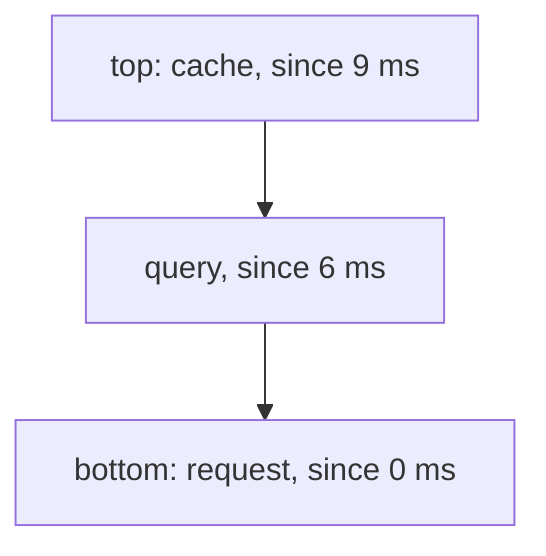
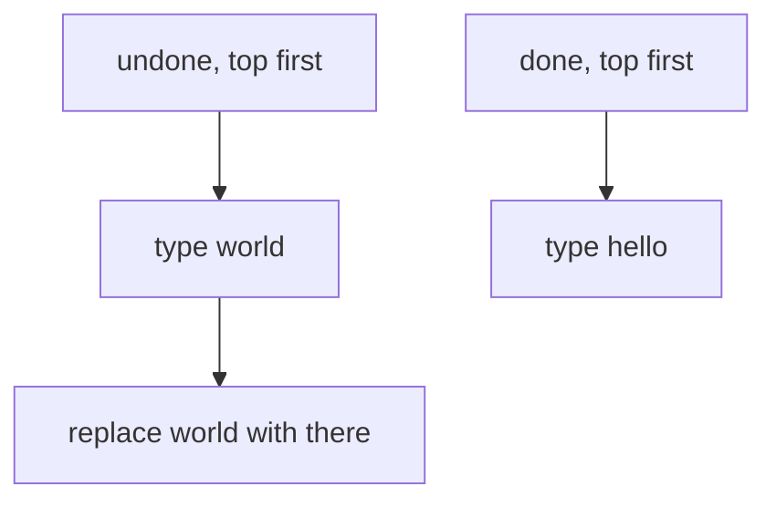

# Stacks

## The idea

A **stack** is a pile: you add to the top and take from the top, so the item you take is always the one you added last. That rule is called **last in, first out**, or LIFO. A stack has three operations, and each takes constant time:

- **push** puts an item on top,
- **pop** removes the top item and gives it back,
- **peek** (or **top**) reads the top item without removing it.

There is no way to reach the middle. That restriction is the point: when the problem only ever needs the most recent unfinished thing, a stack hands you exactly that thing, with no search.

Most languages build a stack on a growable array and make its end the top, because changing the end of an array moves nothing else: Python's `list` with `append` and `pop`, Go's slices with `append`, Rust's `Vec` and JavaScript's arrays with `push` and `pop`. Java's `ArrayDeque`, also a resizable array, pushes and pops at its front.

Three situations call for "the most recent unfinished thing", and this guide works through the first two:

1. **Matching pairs.** Things that open and close, and nest: a section of work that starts inside another one must end before it. The thing that closes is always the most recent one still open.
2. **Undo.** The edit to take back is the most recent one not yet taken back.
3. **Saved work.** A function that calls another one must wait for it, and the computer keeps the waiting functions on a stack, the call stack. The expert notes show how to keep that stack yourself.

Expressions such as `a - b * c` are a fourth: the [evaluating expressions](../evaluating-expressions/guide.md) guide builds them on stacks.

## A worked example

### Matching pairs: timing nested sections

A program that measures itself writes a trace: each section of work records when it starts and when it ends. Sections nest: a request runs an authentication step and a query, and the query looks in a cache.

```text
 0 ms  start request
 2 ms  start auth
 5 ms  end   auth
 6 ms  start query
 9 ms  start cache
10 ms  end   cache
14 ms  end   query
15 ms  end   request
```

To know how long each section took, every `end` must find its own `start`. A section that starts inside another one also ends inside it, so when an `end` arrives, the section it closes is the one that started most recently and has not ended yet. Keep the open sections on a stack: push on `start`, pop on `end`. The popped section is the one that ends, and the stack never has to be searched.

Here is the stack at 9 ms, just after `cache` started. Three sections are open, and the next `end` must be the end of `cache`, the top.



<!-- text-of-mermaid sha256:b251978f332da5a42ff17f2ebf735f3df95f8658473fac44db88fb7aa2add5ed -->
```text
┌───────────────────────────┐
│   top: cache, since 9 ms  │
└─────────────┬─────────────┘
              ▼
┌───────────────────────────┐
│     query, since 6 ms     │
└─────────────┬─────────────┘
              ▼
┌───────────────────────────┐
│bottom: request, since 0 ms│
└───────────────────────────┘
```

The program checks the trace as it goes. An `end` must name the section on top; an `end` with nothing open is an error; and when the trace is over, nothing may be left open.

```python examples/sections.py
"""Match every `end` of a timing trace with its `start`, using a stack of the sections still open.

A section that starts inside another one must also end inside it, so the section an `end` closes
is always the one that started most recently and is still open: the top of the stack.
"""

TRACE = [
    (0, "start", "request"),
    (2, "start", "auth"),
    (5, "end", "auth"),
    (6, "start", "query"),
    (9, "start", "cache"),
    (10, "end", "cache"),
    (14, "end", "query"),
    (15, "end", "request"),
]


def durations(trace: list[tuple[int, str, str]], show: bool = False) -> list[tuple[str, int, int]]:
    """Each section's name, how long it took and how many sections were open around it."""
    open_sections: list[tuple[str, int]] = []  # (name, start time); the innermost on top
    finished = []
    for time, kind, name in trace:
        if kind == "start":
            open_sections.append((name, time))
        else:
            if not open_sections:
                raise ValueError(f"end {name}, but no section is open")
            innermost, started = open_sections.pop()
            if innermost != name:
                raise ValueError(f"end {name}, but the innermost open section is {innermost}")
            finished.append((name, time - started, len(open_sections)))
        if show:
            names = [section for section, _ in open_sections]
            print(f"{time:>2} ms  {kind:<5} {name:<7}  open, bottom to top: {names}")
    if open_sections:
        raise ValueError(f"{open_sections[-1][0]} never ended")
    return finished


for name, took, around in durations(TRACE, show=True):
    print(f"{name:<7} took {took:>2} ms inside {around} other section(s)")

broken_traces = {
    "crossed": [(0, "start", "a"), (1, "start", "b"), (2, "end", "a"), (3, "end", "b")],
    "unclosed": [(0, "start", "a"), (1, "start", "b"), (2, "end", "b")],
    "stray end": [(0, "end", "a")],
}
for label, trace in broken_traces.items():
    try:
        durations(trace)
    except ValueError as error:
        print(f"{label}: {error}")
```

It prints:

```output examples/sections.py
 0 ms  start request  open, bottom to top: ['request']
 2 ms  start auth     open, bottom to top: ['request', 'auth']
 5 ms  end   auth     open, bottom to top: ['request']
 6 ms  start query    open, bottom to top: ['request', 'query']
 9 ms  start cache    open, bottom to top: ['request', 'query', 'cache']
10 ms  end   cache    open, bottom to top: ['request', 'query']
14 ms  end   query    open, bottom to top: ['request']
15 ms  end   request  open, bottom to top: []
auth    took  3 ms inside 1 other section(s)
cache   took  1 ms inside 2 other section(s)
query   took  8 ms inside 1 other section(s)
request took 15 ms inside 0 other section(s)
crossed: end a, but the innermost open section is b
unclosed: a never ended
stray end: end a, but no section is open
```

Follow the stack line by line. At 5 ms, `auth` ends, and the top is `auth`: it took 5 − 2 = 3 ms. At 10 ms the top is `cache`, and at 14 ms, after `cache` was popped, the top is `query` again. Each section ends inside as many other sections as remain on the stack after it is popped, which gives its depth for free.

The three broken traces show the three ways nesting fails. In the first, `a` ends while `b`, which started inside it, is still open: the sections cross instead of nesting. In the second, the trace ends with `a` still open. In the third, an `end` arrives with nothing open at all. Each check is one comparison with the top, or one look at whether the stack is empty.

### Undo and redo: two stacks

An editor that can undo keeps every edit it made, most recent last. Undo takes back the most recent edit that has not been taken back: that is a pop. To redo, keep a second stack of the edits you undid: undo pops from the first stack and pushes onto the second, and redo does the opposite.

The example stores each edit as `(position, removed, inserted)`: at `position`, the text `removed` was replaced by `inserted`. Swapping the last two gives the edit that takes it back, so one function applies both.

```python examples/undo_redo.py
"""Undo and redo in a small text editor, with one stack of edits done and one of edits undone.

An edit is (position, removed, inserted): at `position`, the text `removed` becomes `inserted`.
Swapping `removed` and `inserted` gives the edit that takes it back, so undo applies the inverse.
"""

Edit = tuple[int, str, str]


def apply(text: str, edit: Edit) -> str:
    position, removed, inserted = edit
    assert text[position : position + len(removed)] == removed
    return text[:position] + inserted + text[position + len(removed) :]


def inverse(edit: Edit) -> Edit:
    position, removed, inserted = edit
    return position, inserted, removed


class Editor:
    def __init__(self) -> None:
        self.text = ""
        self.done: list[Edit] = []  # the most recent edit on top
        self.undone: list[Edit] = []  # the most recently undone edit on top

    def edit(self, position: int, removed: str, inserted: str) -> None:
        change = (position, removed, inserted)
        self.text = apply(self.text, change)
        self.done.append(change)
        self.undone.clear()  # a new edit starts a new future: what was undone cannot come back

    def undo(self) -> None:
        if self.done:
            change = self.done.pop()
            self.text = apply(self.text, inverse(change))
            self.undone.append(change)

    def redo(self) -> None:
        if self.undone:
            change = self.undone.pop()
            self.text = apply(self.text, change)
            self.done.append(change)


editor = Editor()
steps = [
    ("type 'hello'", lambda: editor.edit(0, "", "hello")),
    ("type ' world'", lambda: editor.edit(5, "", " world")),
    ("replace 'world' with 'there'", lambda: editor.edit(6, "world", "there")),
    ("undo", editor.undo),
    ("undo", editor.undo),
    ("redo", editor.redo),
    ("type '!'", lambda: editor.edit(11, "", "!")),
    ("redo", editor.redo),
]
for label, step in steps:
    step()
    print(f"{label:<29} {editor.text!r:<15} done {len(editor.done)}, undone {len(editor.undone)}")
```

It prints:

```output examples/undo_redo.py
type 'hello'                  'hello'         done 1, undone 0
type ' world'                 'hello world'   done 2, undone 0
replace 'world' with 'there'  'hello there'   done 3, undone 0
undo                          'hello world'   done 2, undone 1
undo                          'hello'         done 1, undone 2
redo                          'hello world'   done 2, undone 1
type '!'                      'hello world!'  done 3, undone 0
redo                          'hello world!'  done 3, undone 0
```

After the two undos, the stacks look like this. The edit on top of `undone` is the one redo brings back first.



<!-- text-of-mermaid sha256:c3bab5a5e402c00cc8e3492b924fcabe335a20581e362dac1b8ab01acf5c0fbf -->
```text
┌────────────────────────┐    ┌───────────────┐
│   undone, top first    │    │done, top first│
└────────────┬───────────┘    └───────┬───────┘
             ▼                        ▼
┌────────────────────────┐    ┌───────────────┐
│       type world       │    │   type hello  │
└────────────┬───────────┘    └───────────────┘
             ▼
┌────────────────────────┐
│replace world with there│
└────────────────────────┘
```

The last two lines show the one rule that is easy to forget: a **new edit clears the redo stack**. After typing `!`, the undone edits would apply to a text that no longer exists, so redo has nothing to bring back.

## When to use it

- **Things open and close, and nest.** Sections, blocks, tags, brackets, transactions inside transactions: the one that closes is always the most recent still open.
- **"Take back the last one."** Undo, back buttons, and any history you walk backwards.
- **Work you must come back to.** Exploring a maze, a tree or a file system, where every branch you enter leaves the rest of its parent for later. A stack of what is left to do replaces recursion.
- **Reversing.** Push everything, then pop everything, and the order is reversed.

What to use instead: when the oldest item must come out first, as in a line of customers, you need a [queue](../queues-and-deques/guide.md). When you need the largest or the smallest item rather than the latest, you need a heap or a sorted structure. When you must look at items in the middle, a stack is the wrong tool.

## Common traps

- **Popping an empty stack.** It happens on input with more closes than opens, and each language reports it differently. Python's `list.pop()` raises `IndexError`; Java's `ArrayDeque.pop()` throws `NoSuchElementException` while its `peek()` returns `null`, and the legacy `Stack` throws `EmptyStackException`; Rust's `Vec::pop` returns `None`; JavaScript's `pop()` returns `undefined`; in Go, reading `s[len(s)-1]` of an empty slice is an index out of range, a run-time panic. Check for empty before you pop, wherever the input is not trusted.
- **Forgetting what is left at the end.** A trace that ends with open sections is broken even though every `end` matched. After the loop, look at the stack.
- **Using the wrong end of a list.** In Python, `insert(0, x)` and `pop(0)` work, but each one shifts every other element, so a stack built on the front of a list costs O(n) per operation. Use the end.
- **Mixing ends of a Java `Deque`.** `push` and `pop` work at the front of an `ArrayDeque`, while `add` and `offer` work at the back. Pushing with `push` and adding with `add` builds something that is neither a stack nor a queue.
- **Trusting the printed order.** The Java example in the expert notes shows that a `Stack` lists its elements from the bottom up, and an `ArrayDeque` used as a stack lists them from the top down.
- **Recursing too deep.** A recursive function keeps its unfinished calls on the call stack, which has a limit. Deeply nested input can exceed it; the expert notes show the fix.

## Complexity

| Operation | Time | Condition |
|-----------|------|-----------|
| push | O(1) amortized | On a growable array: one push in a while copies the array to a larger one |
| pop, peek, is-empty | O(1) | |
| Matching n events | O(n) | Each event is pushed once and popped at most once |
| Memory | O(d) for matching, O(n) in general | d is the deepest nesting: only open sections are on the stack |

Why push is amortized: a growable array that is full allocates a larger one and copies every element across. The Rust documentation of `Vec::push` states it as "amortized O(1)", the copy of O(capacity) being offset by the cheap pushes it allows; the [hash maps guide](../hash-maps-and-sets/guide.md) proves the same kind of bound for its table. Undo and redo cost O(1) per operation for the stacks, plus whatever it costs to apply the edit itself.

## Expert notes

### Recursion is a stack you do not see

Each function call pushes a frame holding its local variables and where to continue, and each return pops one. CPython limits how deep that stack may grow: `sys.getrecursionlimit()` returns "the maximum depth of the Python interpreter stack", and going deeper raises `RecursionError`, a subclass of `RuntimeError` since Python 3.5. The limit is 1000 in a fresh CPython 3.13, as the example prints. Any recursion can be rewritten as a loop over a stack of your own, which grows as far as memory allows:

```python examples/nesting_depth.py
"""Recursion keeps its unfinished work on the call stack; a loop can keep it on a stack of its own.

Both functions measure how deeply lists are nested. CPython limits how deep its interpreter stack
may grow (sys.getrecursionlimit()), so the recursive one fails on deep input and the loop does not.
"""

import sys


def depth_recursive(value: object) -> int:
    if not isinstance(value, list):
        return 0
    return 1 + max((depth_recursive(item) for item in value), default=0)


def depth_with_a_stack(value: object) -> int:
    deepest = 0
    pending = [(value, 0)]  # (a value still to look at, how many lists surround it)
    while pending:
        current, around = pending.pop()
        if isinstance(current, list):
            deepest = max(deepest, around + 1)
            pending.extend((item, around + 1) for item in current)
    return deepest


shallow = [1, [2, [3, 4]], [5]]
print("shallow:", depth_recursive(shallow), depth_with_a_stack(shallow))

deep: list = []
for _ in range(4_999):
    deep = [deep]
print("recursion limit:", sys.getrecursionlimit())
try:
    depth_recursive(deep)
except RecursionError:
    print("deep, recursive: RecursionError")
print("deep, with a stack:", depth_with_a_stack(deep))
```

It prints:

```output examples/nesting_depth.py
shallow: 3 3
recursion limit: 1000
deep, recursive: RecursionError
deep, with a stack: 5000
```

The loop pushes the work that the recursive version leaves in its frames: each value still to be looked at, with how many lists surround it. The two versions visit the items in different orders. That does not matter for a maximum, but it does when order counts: push the children in reverse to pop them in their own order.

### Stacks in Java, Go, Rust and JavaScript

- **Java: prefer `Deque` to `Stack`.** `Stack` dates from Java 1.0 and extends `Vector`, so every index stays open to change. Its documentation says that the `Deque` interface and its implementations, which provide "a more complete and consistent set of LIFO stack operations", should be used in preference, for example `Deque<Integer> stack = new ArrayDeque<Integer>()`. `ArrayDeque` is "likely to be faster than `Stack` when used as a stack", prohibits `null` elements, and iterates from head to tail, "the same order that elements would be ... popped". The example shows the differences.
- **Go has no stack type.** A slice is one: `s = append(s, x)` pushes, and `x, s = s[len(s)-1], s[:len(s)-1]` pops. Always store the result of `append`: when the slice is full, `append` allocates a new underlying array and returns a slice of that.
- **Rust's `Vec` documents itself as a stack.** Its documentation says "Use a `Vec<T>` as an efficient stack" and drains one with `while let Some(top) = stack.pop()`. `pop` returns `Option<T>`, `None` when the vector is empty, so the empty case cannot be ignored silently.
- **JavaScript arrays** are stacks with `push` and `pop`; `pop` on an empty array returns `undefined`, which is easy to mistake for a stored value.

```java examples/StackOrder.java
import java.util.ArrayDeque;
import java.util.ArrayList;
import java.util.Deque;
import java.util.EmptyStackException;
import java.util.List;
import java.util.NoSuchElementException;
import java.util.Stack;

// The legacy Stack class and an ArrayDeque used as a stack agree on push, pop and peek, but not on
// the order in which they list their elements, nor on what happens when they are empty.
public class StackOrder {
    public static void main(String[] args) {
        Stack<String> legacy = new Stack<>();
        Deque<String> deque = new ArrayDeque<>();
        for (String item : List.of("a", "b", "c")) {
            legacy.push(item);
            deque.push(item);
        }
        System.out.println("peek:  Stack " + legacy.peek() + ", ArrayDeque " + deque.peek());
        System.out.println("list:  Stack " + new ArrayList<>(legacy) + ", ArrayDeque " + new ArrayList<>(deque));
        legacy.add(0, "z");  // Stack extends Vector, so any index is open to change
        System.out.println("Stack after add(0, \"z\"): " + legacy);

        Deque<String> empty = new ArrayDeque<>();
        System.out.println("empty ArrayDeque, peek(): " + empty.peek());
        try {
            empty.pop();
        } catch (NoSuchElementException error) {
            System.out.println("empty ArrayDeque, pop(): NoSuchElementException");
        }
        try {
            new Stack<String>().pop();
        } catch (EmptyStackException error) {
            System.out.println("empty Stack, pop(): EmptyStackException");
        }
        try {
            deque.push(null);
        } catch (NullPointerException error) {
            System.out.println("ArrayDeque, push(null): NullPointerException");
        }
    }
}
```

It prints:

```output examples/StackOrder.java
peek:  Stack c, ArrayDeque c
list:  Stack [a, b, c], ArrayDeque [c, b, a]
Stack after add(0, "z"): [z, a, b, c]
empty ArrayDeque, peek(): null
empty ArrayDeque, pop(): NoSuchElementException
empty Stack, pop(): EmptyStackException
ArrayDeque, push(null): NullPointerException
```

### Undo in real editors

Two refinements are common. An edit history may merge a run of typed letters into one undo step, so that undo does not take back one letter at a time. And instead of a copy of the whole text per step, it keeps invertible edits, as the example does, so its memory grows with the edits rather than with the size of the document.

## Practice

- `cstudy start valid-parentheses`: three kinds of bracket, and whether they close in the right order.
- `cstudy start generate-parentheses`: the nesting rule from the other side: produce every balanced string of a given size instead of checking one.
- `cstudy start min-stack`: a stack that can also report its smallest element at any moment, in constant time.
- `cstudy start min-remove-to-balance`: repair instead of reject: delete as few parentheses as possible so that the rest is balanced.
- `cstudy start decode-string`: groups that repeat their content, nested inside each other.
- `cstudy start valid-parenthesis-string`: balanced parentheses again, now with wildcards that may stand for either parenthesis or for nothing.

## Further reading

- [Python tutorial: using lists as stacks](https://docs.python.org/3/tutorial/datastructures.html#using-lists-as-stacks): `append` and `pop`; and `list.pop`, which raises `IndexError` on an empty list.
- [Python `sys.getrecursionlimit`](https://docs.python.org/3/library/sys.html#sys.getrecursionlimit) and [`RecursionError`](https://docs.python.org/3/library/exceptions.html#RecursionError).
- [Java `Stack`](https://docs.oracle.com/en/java/javase/21/docs/api/java.base/java/util/Stack.html): extends `Vector`, and the advice to use `Deque` instead.
- [Java `Deque`](https://docs.oracle.com/en/java/javase/21/docs/api/java.base/java/util/Deque.html) and [`ArrayDeque`](https://docs.oracle.com/en/java/javase/21/docs/api/java.base/java/util/ArrayDeque.html): the stack methods, what an empty deque does, no `null` elements, and the iteration order.
- [Go built-in `append`](https://pkg.go.dev/builtin#append) and the [Go specification: index expressions](https://go.dev/ref/spec#Index_expressions), where an index out of range is a run-time panic.
- [Rust `Vec`](https://doc.rust-lang.org/std/vec/struct.Vec.html): "an efficient stack", amortized O(1) `push`, and `pop` returning `Option`.
- [MDN: `Array.prototype.pop`](https://developer.mozilla.org/en-US/docs/Web/JavaScript/Reference/Global_Objects/Array/pop): returns `undefined` on an empty array.
