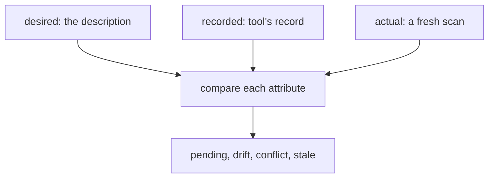

# State, drift and reconciliation

## The idea

The [plan guide](../plan-and-apply/guide.md) compared the desired state with "what exists". Where does a tool learn what exists? It could ask the provider about everything on every plan, but that has three problems. It is slow: one call per resource. It cannot tell which of the thousands of resources in an account belong to this description: delete a line, and the tool must know which real server that line stood for in order to delete it. And the provider knows a server as `i-100`, an identifier it chose, while the description calls it `server/web`: something has to remember that the two are the same thing.

So a tool keeps a **recorded state**, often called its state file: for each address it manages, the provider's **identifier** of the real resource, and the attributes the resource had when the tool last touched it. Now there are three versions of every resource, not two.

| Version | Where it comes from | Who changes it |
|---------|---------------------|----------------|
| **Desired** | The description | You, by editing it |
| **Recorded** | The tool's record | The tool, after each change it makes |
| **Actual** | A **scan**: reading the real resource from the provider | Anyone with access: the tool, a person in a console, a script, the provider itself |

**Drift** is a difference between the record and the actual state: something changed the resource without going through the tool. Someone resized a server during an incident, a script deleted a disk, a colleague created a bucket by hand. Drift is not the same as a pending change, a difference between the description and the record, which is simply what the next plan will do.



<!-- text-of-mermaid sha256:718f155f6ab7c8078697e278ff7a71db2afc2be3e6280e0971545246ffbeb77c -->
```text
┌───────────────────────────────┐    ┌───────────────────────┐    ┌────────────────────┐
│    desired: the description   │    │recorded: tool's record│    │actual: a fresh scan│
└───────────────┬───────────────┘    └───────────┬───────────┘    └──────────┬─────────┘
                ▼────────────────────────────────┴───────────────────────────┘
┌───────────────────────────────┐
│     compare each attribute    │
└───────────────┬───────────────┘
                ▼
┌───────────────────────────────┐
│pending, drift, conflict, stale│
└───────────────────────────────┘
```

The drawing is the comparison of the example below. With three values per attribute, the comparison can say not only that something differs, but who changed it.

- Description differs, record and world agree: a **pending** change, yours.
- Record and description agree, world differs: **drift**, made outside the tool.
- All three differ: a **conflict**, both changed the same attribute.
- Description and world agree, record differs: the world already looks the way you want, and only the record lags behind, a **stale record**.

Three more operations complete the picture. A **refresh** reads every managed resource and updates the record before planning. An **import** adopts a resource the tool never created: you give it an address, and the tool records the resource's identifier under that address, so that from then on the resource is managed. And a **reconciliation** decides what to do about drift: **revert** the resource to the description, **accept** the world's value into the description, or **alert** and leave the decision to a person.

## A worked example

Three resources are wanted and recorded; a scan finds two of them and one more. The record and the scan are matched by identifier, and each attribute is classified from its three values:

```python examples/three_way.py
"""Compare what you want, what the tool recorded, and what a scan of the real world found.

The record and the scan are matched by the id the provider gave each resource, never by name.
For each attribute, the three values tell apart a change you made in the description (pending),
a change made outside the tool (drift), both at once (conflict), and a world that already
agrees with what you want while the record lags behind (stale record).
"""

desired = {
    "server/web": {"size": "large", "zone": "eu-1", "monitoring": "on"},
    "server/api": {"size": "small", "zone": "eu-2"},
    "disk/data": {"size_gb": "100"},
}
recorded = {  # address -> (provider id, attributes when the tool last touched it)
    "server/web": ("i-100", {"size": "medium", "zone": "eu-1", "monitoring": "off"}),
    "server/api": ("i-200", {"size": "small", "zone": "eu-1"}),
    "disk/data": ("vol-7", {"size_gb": "100"}),
}
scanned = {  # provider id -> (type, attributes now)
    "i-100": ("server", {"size": "large", "zone": "eu-1", "monitoring": "debug"}),
    "i-200": ("server", {"size": "xlarge", "zone": "eu-1"}),
    "i-999": ("bucket", {"region": "eu"}),
}


def classify(want: str | None, record: str | None, world: str | None) -> str:
    if want == record == world:
        return "in sync"
    if world == record:
        return "pending"
    if want == record:
        return "drift"
    if want == world:
        return "stale record"
    return "conflict"


managed_ids = set()
for address in sorted(recorded):
    resource_id, record = recorded[address]
    managed_ids.add(resource_id)
    if resource_id not in scanned:
        print(f"{address} ({resource_id}): deleted outside the tool")
        continue
    world = scanned[resource_id][1]
    want = desired.get(address, {})
    for key in sorted(want.keys() | record.keys() | world.keys()):
        values = want.get(key), record.get(key), world.get(key)
        verdict = classify(*values)
        if verdict != "in sync":
            print(f"{address}.{key}: want={values[0]} record={values[1]} world={values[2]}"
                  f" -> {verdict}")
for resource_id in sorted(scanned.keys() - managed_ids):
    print(f"{resource_id} ({scanned[resource_id][0]}): unmanaged, no record names it")
```

It prints:

```output examples/three_way.py
disk/data (vol-7): deleted outside the tool
server/api.size: want=small record=small world=xlarge -> drift
server/api.zone: want=eu-2 record=eu-1 world=eu-1 -> pending
server/web.monitoring: want=on record=off world=debug -> conflict
server/web.size: want=large record=medium world=large -> stale record
i-999 (bucket): unmanaged, no record names it
```

- `disk/data` is recorded with the identifier `vol-7`, which the scan did not find: it was **deleted outside the tool**. The next plan would create a new one; whether that is right depends on why it was deleted.
- `server/api.size` is `small` in the description and the record, `xlarge` in the world: classic **drift**, probably a resize during an incident.
- `server/api.zone` is `eu-2` in the description only: a **pending** change you made, which the next plan will carry out.
- `server/web.monitoring` changed on both sides, to different values: a **conflict** that no rule can settle on its own.
- `server/web.size` is `large` in the description and the world, but `medium` in the record: someone made by hand the change you were about to make. Nothing needs to change in the world, only the record.
- `i-999` exists, but no record names it: an **unmanaged** resource. It might be a forgotten experiment, or something that should be imported.

## When to use it

- **Before planning**, so that the plan starts from what is true rather than from what was true last time.
- **On a schedule**, to notice hand-made changes soon after they happen, while the person who made them still remembers why.
- **After an incident**, to list what was changed by hand, and decide for each change whether to keep it (put it into the description) or undo it.
- **When adopting existing infrastructure**: import each resource under an address, describe it, and check that the plan is empty before trusting the tool with it.

## Common traps

- **Matching by name instead of identifier.** A server deleted and created again by hand can have the same name and be a different resource, with different data. Match the record to the world by the provider's identifier.
- **False alarms.** Some attributes change on their own: a timestamp, a tag that a billing job writes. Some look different while meaning the same: a list in another order, a value the provider fills in with a default. Reported as drift, they bury the real changes, and people stop reading. But every rule that hides a difference also hides the real drift on that attribute.
- **Reverting a deliberate change.** An automatic revert undoes the hand-made fix that kept a service alive during an incident. For sensitive resources, alert first and let a person choose.
- **Importing without describing.** An imported resource that the description does not mention is recorded and not desired, so the next plan deletes it. Describe it first, then check that the plan is empty.
- **Two people applying from the same record.** Both plan from the same record, both apply, and the record ends up reflecting only the last apply, while the world holds both changes. Lock the record while planning and applying, and refuse a plan whose record has changed since, as the [plan guide](../plan-and-apply/guide.md) does with its fingerprint.
- **A record that holds secrets.** The record keeps every attribute the tool saw, including passwords and keys the provider generated. Store it encrypted and give access to it as you would to the secrets themselves.

## Complexity

For `N` resources with up to `K` attributes each, with the record kept as a hash map from address to identifier and attributes, and the scan as a hash map from identifier to attributes:

| Step | Time | Space |
|------|------|-------|
| Match each record to the scan | O(N) average | O(N) for the set of managed identifiers |
| Compare three values per attribute | O(N · K) average | O(1) per attribute |
| List the unmanaged resources | O(N) average, O(N log N) sorted | O(N) |
| A scan | one provider call per resource, or per page of a listing | O(N · K) |

The scan dominates, as it is made of provider calls. The comparison itself is linear in the size of the three versions.

## Expert notes

- **What only the record knows.** The world can be scanned again and the description read again, but two things exist only in the record: which real resources this description manages, and which address each of them stands for. Lose the record, and the tool can no longer tell its server from someone else's, nor delete what it created. Back it up and keep its history.
- **Identity over time.** After a replacement, the same address stands for a new identifier. Keeping the old identifiers in the record's history is what lets you answer "which server was `server/web` last Tuesday?".
- **A three-way merge.** The record plays the part that a common ancestor plays when merging two branches of code: without it, two versions can only say that they differ; with it, the comparison can say which side changed.
- **Lists that are really sets.** RFC 8259 defines a JSON array as an ordered sequence of values. A provider may still treat a list, such as the ports a firewall opens, as a set and return it in any order. Nothing in the data says which kind of list it is, so the comparison has to be told, attribute by attribute.
- **Naming an attribute inside a resource.** A rule that ignores one attribute, or a report of where drift is, needs to name a location inside a nested resource. JSON Pointer, RFC 6901, does this: `/tags/team` is the member `team` of the member `tags`, `/ports/0` the first item of a list, and a `~` or a `/` inside a name is written `~0` or `~1`.

## Practice

- `cstudy start drift-detection`: records compared with a scan by identifier, reporting changed, deleted and unmanaged resources; ignore rules and comparisons that see the same meaning in another form; importing resources and planning against the record; then policies that revert, accept or alert.

## Further reading

- [RFC 8259, *The JavaScript Object Notation (JSON) Data Interchange Format*](https://www.rfc-editor.org/rfc/rfc8259): objects and ordered arrays.
- [RFC 6901, *JavaScript Object Notation (JSON) Pointer*](https://www.rfc-editor.org/rfc/rfc6901): naming a location inside a JSON document, and its two escapes.
