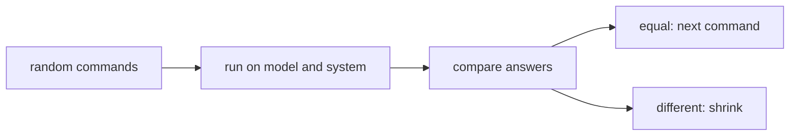

# Stateful and model-based testing

## The idea

The properties of the [previous guide](../property-based-testing/guide.md) check one call at a time, which suits functions: same input, same output. A cache, a key-value store or a connection pool is different. What `size()` should return depends on every put and delete that came before it. Such an object carries **state**, and its worst bugs hide in particular histories, for instance "remove a key, store it again, then count", which no single call reveals.

**Model-based testing** attacks such objects with random histories. A history is a list of **commands**, the operations a caller is allowed to perform, with their arguments. Beside the real object, the **system under test**, the test runs a **model**: a deliberately naive implementation of the same behaviour that is easy to trust, such as a plain dictionary standing in for a store. Each command goes to both, one at a time, and their replies are compared right away. The first disagreement makes the history a counterexample, and the counterexample is shrunk the same way as any generated input: drop commands, simplify arguments, and keep each simplification that still disagrees.



<!-- text-of-mermaid sha256:66f74c188278909d7c6547f01e24d3d38f750d7086c076d348f7a5caf721c3fe -->
```text
┌───────────────┐    ┌───────────────────────┐    ┌───────────────┐    ┌───────────────────┐
│random commands├───►│run on model and system├───►│compare answers├───►│equal: next command│
└───────────────┘    └───────────────────────┘    └───────┬───────┘    └───────────────────┘
                                                          │
                                                          │            ┌───────────────────┐
                                                          └───────────►│ different: shrink │
                                                                       └───────────────────┘
```

The drawing shows one sequence: every command goes to both sides, and the first disagreement ends the run.

Three more ideas complete the picture:

- **Preconditions.** Some commands are only valid in some states: a key can only be deleted if it is stored, and a file can only be read after it is opened. A command that breaks its precondition is not a bug in the system; it is an invalid test. The generator consults the model to offer only valid commands, and the shrinker throws away candidates that become invalid when a command before them is removed.
- **Postconditions without a full model.** Sometimes a model is too much work, and a rule per command is enough: after `put(k, v)`, `get(k)` returns `v`; after `delete(k)`, `size()` is one less. A full model gives all such rules at once.
- **An abstraction function.** The system's internal state rarely looks like the model's: a tree of nodes against a sorted list, an append-only log against a dictionary. An abstraction function maps the system's state to the model's, so the two can be compared directly, not only through their answers.

## A worked example

The store below counts its keys as they come and go. To avoid counting a key twice, it remembers every key it has stored. The bug: it never forgets a key it deleted, so putting that key back is not counted. No single call shows the bug, and no sequence shows it unless it deletes a key and puts the same key back. The model is a plain dictionary.

```python examples/model_based.py
"""A model-based test of a small key-value store, with random command sequences and shrinking.

The store counts its keys as they come and go. It has a bug that no single call shows: it
remembers every key it has ever stored, to avoid counting one twice, and forgets to forget a key
when it is deleted. A plain dictionary is the model. The test runs the same commands on both and
compares every answer.
"""

import random


class CountingStore:
    def __init__(self):
        self.values, self.seen, self.count = {}, set(), 0

    def put(self, key, value):
        if key not in self.seen:  # bug: "seen" should be "currently stored"
            self.seen.add(key)
            self.count += 1
        self.values[key] = value
        return "ok"

    def get(self, key):
        return self.values.get(key)

    def delete(self, key):
        del self.values[key]
        self.count -= 1
        return "ok"

    def size(self):
        return self.count


def below(rng: random.Random, n: int) -> int:
    return int(rng.random() * n)


def apply_to_model(model: dict, command: tuple):
    name, *args = command
    if name == "put":
        model[args[0]] = args[1]
        return "ok"
    if name == "get":
        return model.get(args[0])
    if name == "delete":
        del model[args[0]]
        return "ok"
    return len(model)


def valid(commands: list[tuple]) -> bool:
    """The precondition: delete only a key that is stored. Checked on the model."""
    model = {}
    for command in commands:
        if command[0] == "delete" and command[1] not in model:
            return False
        apply_to_model(model, command)
    return True


def generate(rng: random.Random) -> list[tuple]:
    model, commands = {}, []
    for _ in range(1 + below(rng, 12)):
        names = ["put", "get", "size"] + (["delete"] if model else [])
        name = names[below(rng, len(names))]
        key = "ab"[below(rng, 2)] if name != "delete" else sorted(model)[below(rng, len(model))]
        command = {"put": ("put", key, below(rng, 10)), "get": ("get", key),
                   "delete": ("delete", key), "size": ("size",)}[name]
        apply_to_model(model, command)
        commands.append(command)
    return commands


def fails(commands: list[tuple]) -> bool:
    model, store = {}, CountingStore()
    for name, *args in commands:
        if getattr(store, name)(*args) != apply_to_model(model, (name, *args)):
            return True
    return False


def candidates(commands: list[tuple]):
    for i in range(len(commands)):  # drop one command
        yield commands[:i] + commands[i + 1:]
    for i, command in enumerate(commands):  # make one stored value 0
        if command[0] == "put" and command[2] != 0:
            yield commands[:i] + [("put", command[1], 0)] + commands[i + 1:]


def shrink(commands: list[tuple]) -> list[tuple]:
    while True:
        simpler = next((c for c in candidates(commands) if valid(c) and fails(c)), None)
        if simpler is None:
            return commands
        commands = simpler


def show(commands: list[tuple]) -> str:
    return ", ".join(" ".join(map(str, command)) for command in commands)


rng = random.Random(11)
for run in range(1, 201):
    commands = generate(rng)
    if fails(commands):
        print(f"run {run} fails after {len(commands)} commands:\n  {show(commands)}")
        small = shrink(commands)
        print(f"shrunk to {len(small)} commands:\n  {show(small)}")
        model, store = {}, CountingStore()
        answers = [(getattr(store, c[0])(*c[1:]), apply_to_model(model, c)) for c in small]
        print(f"last answer: store says {answers[-1][0]}, model says {answers[-1][1]}")
        break
```

It prints:

```output examples/model_based.py
run 16 fails after 9 commands:
  put b 4, delete b, get a, size, put a 6, delete a, put a 2, size, size
shrunk to 4 commands:
  put a 0, delete a, put a 0, size
last answer: store says 0, model says 1
```

The sixteenth random sequence was the first to fail, after nine commands: somewhere in it, a key was deleted and stored again, and a later `size` disagreed. Shrinking removed every command that did not matter and set the stored values to 0, leaving four commands that read as a bug report: put `a`, delete `a`, put `a` again, ask the size. The store says 0; the dictionary says 1.

Several choices make the test work:

- **Two keys.** With only `a` and `b`, commands keep landing on the same key, which is where the interesting states are. With a thousand possible keys, twelve random commands would touch the same key twice in only about 6% of sequences, and the bug would hide.
- **The model decides what is valid.** `delete` is offered only when the model holds a key, and names a key the model holds. During shrinking, removing an earlier `put` can leave a `delete` with nothing to delete; `valid` rejects such candidates, so the shrunk sequence is a legal use of the store.
- **Commands are data.** Each command is a tuple, so a failing sequence prints as readable text, can be stored as a regression test, and can be inspected and edited by the shrinker. A sequence of closures would print as nothing useful.
- **Compare after every command.** The first difference is reported where it happens, not after twenty more commands have muddied the state.

## When to use it

- **Data structures and stores** with operations that interact: caches with eviction, maps with deletion, queues with capacity, indexes kept in sync with data.
- **Objects that follow a protocol**: a connection that must be opened before use, a file that is read after it is written, a session that expires.
- **A rewrite or an optimization**, where the old implementation is the model: run both on the same sequences and compare.
- **When example tests keep missing bugs** that users find through unusual orders of ordinary operations.
- **Not for** objects whose correct answer the model cannot compute more simply than the system does; then postconditions per command, or the techniques of the [previous guide](../property-based-testing/guide.md), fit better.

## Common traps

- **A model as complicated as the system.** If the model needs the same tricks as the system, it will have the same bugs. Keep it naive: a dictionary, a list, a counter, with no concern for speed.
- **Sharing code between model and system.** A helper used by both makes their mistakes agree. Write the model from the specification, not from the implementation.
- **A key space that is too large.** Random commands that never touch the same key twice test almost nothing. Draw keys from a small set.
- **Ignoring preconditions while shrinking.** A shrinker that removes a `put` and keeps a later `delete` of the same key reports a "failure" that no valid user could cause.
- **Comparing only at the end.** A final comparison misses errors that cancel out and hides where the first difference happened.
- **A nondeterministic system.** If the system draws random numbers, reads the clock or runs threads, the same sequence can give different answers. Make it [deterministic](../deterministic-tests/guide.md) first, or compare only what cannot vary.
- **Sequences that are too short.** Bugs that need a full cache, a wrapped buffer or a second round of operations need sequences long enough to get there. Let lengths vary, including long ones.

## Complexity

Each command costs one call on the system and one on the model, so a run of `R` sequences of up to `L` commands costs `O(R · L)` calls on each side, plus the comparisons.

The space of sequences is vast: with 25 distinct commands, as in the example (puts of two keys with ten values, gets and deletes of two keys, and size), there are 25⁴ = 390,625 sequences of length 4 and about 6 · 10¹⁶ of length 12, so random sampling, not enumeration, is the tool. Small key spaces and model-guided generation keep the sampled sequences in the interesting part of that space.

Shrinking a sequence by removing one command at a time tries at most `L` removals per step, each checked by replaying the candidate on a fresh model and system; with `L` steps at most for the removals, a shrink costs `O(L²)` replays, each of up to `L` commands.

## Expert notes

- **Models for imperative code.** Claessen and Hughes extended QuickCheck to imperative code in *Testing monadic code with QuickCheck* (ACM SIGPLAN Notices 37(12), 2002), and showed that its properties can express algebraic, model-based and pre- and postcondition specifications. Their running example is a queue whose model is a list of the stored elements, related to the implementation by an abstraction function.
- **Programs as data.** The same paper represents sequences of queue operations as a datatype, a small language of queue programs, rather than as functions. When a test fails, the quantified sequence is displayed as that syntax, which is useful, while a function would show nothing; and a program held as data can be analysed before it runs, for example to predict how many elements it adds. That is why commands are tuples in the example.
- **Generating reachable states.** Driving the system through random valid sequences, instead of constructing internal states directly, guarantees that every state tested is one a real user could reach. The paper uses the program language for exactly that.
- **Concurrency.** When several threads call the system at once, more than one answer can be right. Herlihy and Wing's *linearizability* (ACM Transactions on Programming Languages and Systems, 1990) defines correctness for such objects: each operation should appear to take effect instantaneously at some point between its invocation and its response, so its meaning can be given by sequential pre- and postconditions.
- **Shrinking stops at local minima.** Removing one command at a time cannot remove a pair that must go together, such as a `put` and a later `delete` of the same key, when removing the `delete` alone hides the failure and removing the `put` alone breaks the precondition; and lowering one value at a time cannot keep two values equal while making both smaller. The result is locally minimal, which can still be longer than the shortest failing sequence.
- **Keep the counterexample.** A shrunk sequence is the best regression test there is: short, readable and known to fail on the old code. Store it as an example test next to the property.

## Practice

- `cstudy start property-test-runner`: all four levels; level 4 tests a bounded queue with planted bugs against a model, with sequences of commands, a precondition and shrinking.

## Further reading

- [K. Claessen and J. Hughes, *Testing monadic code with QuickCheck*, ACM SIGPLAN Notices 37(12), 2002, pages 47 to 59](https://doi.org/10.1145/636517.636527): model-based and algebraic specifications of imperative code, and programs represented as data.
- [M. P. Herlihy and J. M. Wing, *Linearizability: a correctness condition for concurrent objects*, ACM Transactions on Programming Languages and Systems 12(3), 1990, pages 463 to 492](https://doi.org/10.1145/78969.78972): judging concurrent histories against a sequential specification.
- [K. Claessen and J. Hughes, *QuickCheck: a lightweight tool for random testing of Haskell programs*, ICFP 2000](https://doi.org/10.1145/351240.351266): the properties and generators this guide builds on.
