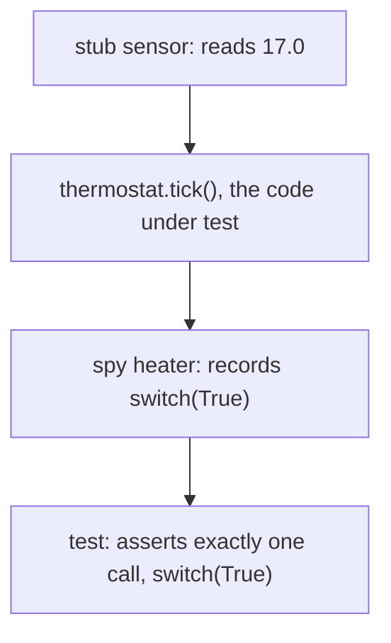

# Test doubles: stubs, spies, mocks and fakes

## The idea

Hardly any code works alone. A thermostat needs a temperature sensor and a heater; an order service needs a payment gateway; a nightly report needs today's date. Each of those collaborators can make a test miserable. A network call adds seconds and fails when the network does. A sensor reports whatever the room happens to be. A payment gateway moves real money. And sometimes the collaborator does not exist yet. A **test double** is an object that takes the collaborator's place for the duration of a test. It offers the same methods, so the code under test cannot tell the difference, but its behaviour is whatever the test arranged. The xUnit patterns vocabulary, which gave these objects their names, borrows the image of a film's stunt double, and calls the collaborator being replaced the **depended-on component**.

A dependency touches the code under test in two directions. What the code *receives* from it, such as a sensor reading, is an **indirect input**: the test cannot pass it as an argument, so it needs a way to control it. What the code *sends* to it, such as "switch the heater on", is an **indirect output**: it does not show up in the return value, so the test needs a way to observe it. The kinds of double differ in which of these they handle:

| Kind | What it does | Reach for it when |
|------|--------------|-------------------|
| **Dummy** | Fills a parameter that this test never uses | A constructor demands an alarm, and the path under test never rings it |
| **Stub** | Returns answers the test scripted | The test must decide what the sensor reports: 17 degrees, 30 degrees, an error |
| **Spy** | A stub that also records every call, for the test to inspect afterwards | The test must check, after the run, how the heater was switched and how often |
| **Mock** | Is told before the run which calls to expect, and fails on calls it did not expect and on expected calls that never came | Any call beyond the expected ones is itself a bug, and the expectations belong at the top of the test |
| **Fake** | A working implementation, simplified for tests | Several calls must see consistent state, as with a store that has to keep what was saved |



<!-- text-of-mermaid sha256:91dc0dc33059bcdd90b985ee4fbe69e6a775346d1e3eae40acb377a903c72070 -->
```text
┌────────────────────────────────────────────┐
│          stub sensor: reads 17.0           │
└──────────────────────┬─────────────────────┘
                       ▼
┌────────────────────────────────────────────┐
│   thermostat.tick(), the code under test   │
└──────────────────────┬─────────────────────┘
                       ▼
┌────────────────────────────────────────────┐
│      spy heater: records switch(True)      │
└──────────────────────┬─────────────────────┘
                       ▼
┌────────────────────────────────────────────┐
│test: asserts exactly one call, switch(True)│
└────────────────────────────────────────────┘
```

The drawing follows one test from top to bottom. The stub feeds the indirect input in, the code runs, the spy catches the indirect output, and the test asserts on what the spy caught.

Two styles of checking come out of this. **State verification** looks at results and state after the run: the return value, or what a fake store now holds. **Behaviour verification** looks at the calls the code made: what a spy recorded, or what a mock expected. A mock always verifies behaviour; a spy makes behaviour verification possible after the run; stubs, fakes and dummies usually serve state verification.

## A worked example

### Doubles by hand

A double needs no library: a small class with the same methods as the real dependency will do. The thermostat below reads its target from a settings store and a temperature from a sensor, switches a heater, and rings an alarm if the room is dangerously cold. Each test replaces the four dependencies:

```python examples/hand_rolled_doubles.py
"""A dummy, a stub, a spy and a fake, written by hand, in the tests of a thermostat.

The thermostat reads a temperature from a sensor, reads its target from a settings store and
switches a heater. It calls the alarm only when the room is dangerously cold. In a test, the real
sensor, store and heater are replaced by doubles that the test controls and inspects.
"""


class Thermostat:
    def __init__(self, sensor, heater, settings, alarm):
        self.sensor, self.heater, self.settings, self.alarm = sensor, heater, settings, alarm

    def tick(self) -> None:
        target = self.settings.get("target")
        reading = self.sensor.read()
        if reading < 5:
            self.alarm.ring(f"room at {reading} degrees")
        if reading < target - 0.5:
            self.heater.switch(True)
        elif reading > target + 0.5:
            self.heater.switch(False)


class StubSensor:
    """Gives the readings the test scripted, one per call."""

    def __init__(self, *readings: float):
        self.readings = list(readings)

    def read(self) -> float:
        return self.readings.pop(0)


class SpyHeater:
    """Does nothing, but records every call for the test to inspect afterwards."""

    def __init__(self):
        self.calls: list[bool] = []

    def switch(self, on: bool) -> None:
        self.calls.append(on)


class FakeSettings:
    """A working store, kept in a dictionary instead of a file on disk."""

    def __init__(self, **values):
        self.values = dict(values)

    def get(self, key):
        return self.values[key]

    def set(self, key, value) -> None:
        self.values[key] = value


DUMMY_ALARM = None  # never used on these paths; a call to it would fail loudly


def test_cold_room_turns_the_heater_on():
    heater = SpyHeater()
    Thermostat(StubSensor(17.0), heater, FakeSettings(target=20), DUMMY_ALARM).tick()
    assert heater.calls == [True], heater.calls


def test_room_in_range_leaves_the_heater_alone():
    heater = SpyHeater()
    Thermostat(StubSensor(20.3), heater, FakeSettings(target=20), DUMMY_ALARM).tick()
    assert heater.calls == [], heater.calls


def test_a_lower_target_turns_the_heater_off():
    heater, settings = SpyHeater(), FakeSettings(target=21)
    thermostat = Thermostat(StubSensor(19.0, 19.0), heater, settings, DUMMY_ALARM)
    thermostat.tick()
    settings.set("target", 18)
    thermostat.tick()
    assert heater.calls == [True, False], heater.calls


for test in (test_cold_room_turns_the_heater_on, test_room_in_range_leaves_the_heater_alone,
             test_a_lower_target_turns_the_heater_off):
    test()
    print(f"passed: {test.__name__}")

try:
    Thermostat(StubSensor(3.0), SpyHeater(), FakeSettings(target=20), DUMMY_ALARM).tick()
except AttributeError as error:
    print(f"a freezing room reaches the dummy: {error}")
```

It prints:

```output examples/hand_rolled_doubles.py
passed: test_cold_room_turns_the_heater_on
passed: test_room_in_range_leaves_the_heater_alone
passed: test_a_lower_target_turns_the_heater_off
a freezing room reaches the dummy: 'NoneType' object has no attribute 'ring'
```

Each double does one job. `StubSensor` steers the code down the path the test is about: cold room, warm room, room in range. `SpyHeater` records the calls so that the test can assert on them after the run. `FakeSettings` really stores values, so the third test can change the target between two ticks and see the thermostat follow, which a stub that always answered 21 could not show. The dummy alarm is `None`, which is honest: if a test ever reaches it, the test fails loudly instead of passing against a stand-in that nobody configured, as the last line shows.

Notice also what the tests do *not* check: how the thermostat computes, or in which order it reads its dependencies. They check what a caller cares about, whether the heater was switched and how.

### The same with `unittest.mock`

Python's `unittest.mock` builds doubles on the fly. A `Mock` answers every call, by default with another `Mock`, and records every call, so one object serves as a stub and a spy. Its flexibility is also its risk, and the module has three safety nets for it:

```python examples/with_unittest_mock.py
"""The same kinds of double with unittest.mock, its safety nets, and where to patch.

A Mock answers every call and records it, so it serves as a stub and a spy at once. A spec
limits it to the real object's attributes, autospeccing also checks the arguments, and patch()
replaces a name only in the module whose lookup it changes.
"""

import sys
import types
from unittest.mock import Mock, call, create_autospec, patch


class Heater:
    def switch(self, on: bool) -> None:
        raise RuntimeError("the real heater is not connected in tests")


def control(sensor, heater, target: float) -> None:
    reading = sensor.read()
    if reading < target - 0.5:
        heater.switch(True)
    elif reading > target + 0.5:
        heater.switch(False)


# A stub and a spy in one: side_effect scripts the answers, call_args_list records the calls.
sensor = Mock()
sensor.read.side_effect = [17.0, 22.0]
heater = Mock(spec=Heater)
control(sensor, heater, 20)
control(sensor, heater, 20)
print("calls recorded:", heater.switch.call_args_list == [call(True), call(False)])
heater.switch.assert_called_with(False)
print("last call was switch(False)")

# Without a spec, a renamed or misspelled method still "works", and a test can pass for nothing.
print("unspecced mock accepts turn_on():", Mock().turn_on() is not None)
try:
    heater.turn_on()
except AttributeError as error:
    print("spec refuses it:", type(error).__name__)

# Names that look like a misspelled assertion are refused too.
try:
    heater.switch.assret_called_once()
except AttributeError as error:
    print("typo caught:", type(error).__name__)

# Autospeccing also checks the arguments against the real signature.
strict_heater = create_autospec(Heater, instance=True)
try:
    strict_heater.switch(True, "fast")
except TypeError as error:
    print("autospec refuses the call:", type(error).__name__)

# Where to patch: in the module that looks the name up, not the one that defines it.
weather = types.ModuleType("weather")
exec("def read_celsius():\n    raise RuntimeError('no network in tests')\n", weather.__dict__)
sys.modules["weather"] = weather
dashboard = types.ModuleType("dashboard")
exec("from weather import read_celsius\n\n"
     "def headline():\n    return f'{read_celsius():.0f} degrees'\n", dashboard.__dict__)
sys.modules["dashboard"] = dashboard

with patch("weather.read_celsius", return_value=21.4):
    try:
        dashboard.headline()
    except RuntimeError as error:
        print("patched weather.read_celsius, but dashboard still calls the real one:", error)
with patch("dashboard.read_celsius", return_value=21.4):
    print("patched dashboard.read_celsius:", dashboard.headline())
```

It prints:

```output examples/with_unittest_mock.py
calls recorded: True
last call was switch(False)
unspecced mock accepts turn_on(): True
spec refuses it: AttributeError
typo caught: AttributeError
autospec refuses the call: TypeError
patched weather.read_celsius, but dashboard still calls the real one: no network in tests
patched dashboard.read_celsius: 21 degrees
```

The first part scripts two readings with `side_effect` and checks the recorded calls with `call_args_list` and `assert_called_with`. Then the risk: a mock without a specification accepts `turn_on()`, a method the real heater does not have, so a test written against an old or misspelled name passes while the code is broken. Giving the mock a `spec` limits it to the real class's attributes. Names that look like a misspelled assertion, such as `assret_called_once`, raise an error instead of passing silently. `create_autospec` goes further and checks each call's arguments against the real signature.

The last part is the most common surprise. `dashboard` imported `read_celsius` into its own namespace, so it holds its own reference to the function. Patching `weather.read_celsius` replaces the name in `weather`, which `dashboard` no longer looks at; patching `dashboard.read_celsius` replaces the name that `headline` actually looks up.

## When to use it

| The dependency is | Use | Because |
|-------------------|-----|---------|
| Fast, deterministic and yours, such as a value object or a pure function | The real thing | A double would only add a way to be wrong |
| A source of answers: a sensor, a clock, a lookup service | A stub | The test needs to choose the answer |
| A target of commands whose effect matters: send, charge, switch, publish | A spy, or a mock when unexpected calls must fail at once | The command is the behaviour under test |
| Stateful, with several calls that must agree: a store, a queue, a file system | A fake | A stub per call would rebuild the dependency badly, test by test |
| Required by a signature but unused on this path | A dummy | It documents that the path does not use it |

A rule of thumb follows from the table. Calls that ask a collaborator for information are inputs: script them with a stub and leave them unchecked. Calls that tell a collaborator to do something are the outputs a caller cares about: those are worth recording and asserting. Pinning down every question the code asks ties the test to one way of gathering information, and the test then breaks on a harmless rewrite.

## Common traps

- **Doubles everywhere.** A test that replaces every collaborator and checks every call describes *how* the code works, not *what* it achieves. Refactor the code without changing its behaviour and the test fails anyway. The xUnit patterns vocabulary calls this *overspecified software*, a cause of fragile tests.
- **A double that drifts from the real thing.** The real method is renamed or gains a parameter, the double does not, and every test stays green. Use `spec` or autospeccing, keep at least one test that runs without doubles, and check doubles against the real dependency with [contract tests](../test-suite-design/guide.md).
- **Mocking a type you do not own.** A mock of a third-party library's interface encodes your guess of how that library behaves, and you cannot change its design when the guess proves awkward. Wrap the library in a thin class of your own, mock the wrapper, and test the wrapper against the real library.
- **Patching the wrong name.** `patch()` replaces a name in one namespace. Patch where the code under test looks the name up, not where it is defined.
- **Replacing part of what you are testing.** A double for a piece of the code under test turns the test into a test of the double.
- **Doubles with logic.** A stub that parses its input to decide its answer, or a fake complicated enough to have bugs, needs tests of its own. Keep stubs dumb; give a serious fake its own tests, ideally the same ones the real implementation passes.
- **Leftover configuration.** A double scripted in one test and reused in another carries its old answers and recorded calls with it. Build fresh doubles in each test.

## Complexity

A double does almost no work, so a test that uses one runs in microseconds where the real dependency could take milliseconds or seconds; that difference is often what makes a suite of thousands of tests possible. The author of the xUnit patterns describes one project that put all database access behind a persistence interface, replaced the database with in-memory hash tables in the tests, and made them run 50 times faster.

A spy or a mock stores each call it receives: memory and the time of a question about the calls grow with the number of calls, `O(c)` for `c` calls, which is small in a unit test. The real cost of doubles is maintenance: every double is a second description of its dependency, and both must change together.

## Expert notes

- **Where the names come from.** The vocabulary of dummy, stub, spy, mock and fake comes from the xUnit patterns, and *test double* was chosen as the generic word. In those patterns a stub is a *control point* for indirect inputs, which lets a test force the code down paths it might not otherwise take, and a spy or a mock is an *observation point* for indirect outputs. A dummy, in that vocabulary, is not really a double at all, only a value passed where one is required.
- **Strict and lenient.** In the patterns, a strict mock fails when the expected calls arrive in a different order than specified, and a lenient one notes an out-of-order call and carries on; any mock fails at once on a call that was not expected at all, and a final verification finds the expected calls that never came.
- **Two schools.** One essay on mocks and stubs describes a *classical* style of test-driven development, which uses real objects where possible and a double only where the real thing is awkward, and a *mockist* style, which uses a mock for any collaborator with interesting behaviour. The difference is less about tools than about what a test is meant to pin down: results, or conversations between objects.
- **Mocks as a design tool.** The paper *Mock Roles, not Objects* (OOPSLA 2004 companion) treats mock objects as a way to discover the interfaces an object needs from its neighbours while writing its tests. Its rules of thumb include: only mock types you own, wrapping fixed types from the runtime or external libraries in thin classes of your own; specify as little as possible in a test, so it does not break on unrelated changes; be explicit about calls that must not happen; only mock immediate neighbours; and do not add behaviour to mocks.
- **`unittest.mock` in detail.** `side_effect` can be an exception to raise, an iterable whose items are returned call by call, or a function whose return value is used. `wraps=` passes calls through to a real object and returns its real result, which turns a mock into a spy on a real object. `MagicMock` pre-configures most of Python's special methods. Since Python 3.5, names starting with `assert`, `assret`, `asert`, `aseert` or `assrt` raise `AttributeError` unless the mock is created with `unsafe=True`; before 3.5, a typo in an assertion name passed silently. `seal()` (3.7) stops a mock from creating new attributes on access, `AsyncMock` (3.8) is recognized as an async function and returns an awaitable, and `ThreadingMock` (3.13) can wait until it is called from another thread.
- **Why autospeccing exists.** The `unittest.mock` documentation is blunt about the flaw it addresses: after a refactoring that renames members, tests that use mocks instead of the real objects can all pass even though the code is broken, which is another reason to have integration tests as well as unit tests.

## Practice

- `cstudy start test-doubles`: build a small library of doubles, with stubs that give scripted answers, spies that record calls, and mocks that check the calls they expect. This path's step stops at level 3; its level 4, a fake clock, comes back after the guide on [deterministic tests](../deterministic-tests/guide.md).

## Further reading

- [xUnit Patterns, *Test Double*](http://xunitpatterns.com/Test%20Double.html), with [*Test Stub*](http://xunitpatterns.com/Test%20Stub.html), [*Test Spy*](http://xunitpatterns.com/Test%20Spy.html), [*Mock Object*](http://xunitpatterns.com/Mock%20Object.html), [*Fake Object*](http://xunitpatterns.com/Fake%20Object.html) and [*Dummy Object*](http://xunitpatterns.com/Dummy%20Object.html): the vocabulary, indirect inputs and outputs, strict and lenient mocks.
- [xUnit Patterns, *Fragile Test*](http://xunitpatterns.com/Fragile%20Test.html): overspecified software and other causes of tests that break when nothing important changed.
- [*Mocks Aren't Stubs* (2 January 2007)](https://martinfowler.com/articles/mocksArentStubs.html): state and behaviour verification, and the classical and mockist styles.
- [S. Freeman, N. Pryce, T. Mackinnon and J. Walnes, *Mock Roles, not Objects*, OOPSLA 2004 companion, pages 236 to 246](https://doi.org/10.1145/1028664.1028765): mock objects as a design technique, and their rules of thumb.
- [Python, `unittest.mock`](https://docs.python.org/3/library/unittest.mock.html): `Mock`, `spec`, `side_effect`, `wraps`, the check on assertion names, autospeccing, where to patch, `seal`, `AsyncMock` and `ThreadingMock`.
