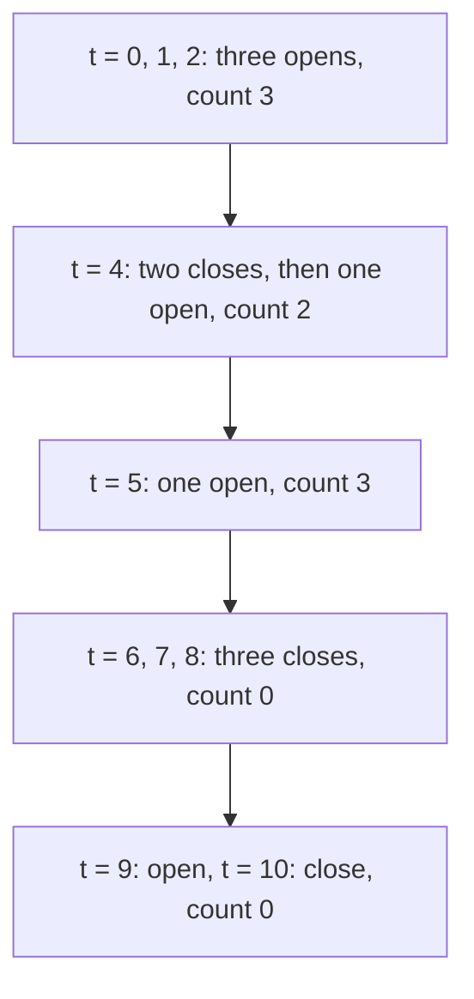

# Sweep lines and events

## The idea

Picture a vertical line moving across the time line from left to right, crossing the intervals as it goes. Between two endpoints nothing changes: the same intervals are open at every moment in between. Things change only where an interval starts or ends. So instead of looking at every moment, look only at the endpoints, in order. That is a **sweep line**.

Each half-open interval `[s, e)` becomes two **events**:

- at time `s`, an **open**, written `+1`;
- at time `e`, a **close**, written `-1`.

Sort all the events by time and walk them, adding each event's `+1` or `-1` to a running count. After the events at time `t`, the count is the number of intervals open at `t`, that is, with `s <= t < e`. The largest count seen is the most intervals open at once.

**Ties decide the answer.** Several events can share a time, and their order matters. A half-open interval that ends at `t` does not contain `t`, and one that starts at `t` does, so the two never share a moment: at equal times, **closes go before opens**. For closed intervals it is the other way round: `[a, t]` and `[t, b]` share the point `t`, so opens go before closes.

In Python, store an event as the tuple `(time, change)`. Tuples sort by their first element, then by the second, and `-1 < +1`, so a plain `sorted` puts closes before opens at equal times: the half-open rule, for free.

## A worked example

A server logs each session as `[connect, disconnect)` in minutes. What is the largest number of sessions open at the same moment?

```python examples/peak_sessions.py
"""A server logs sessions as [connect, disconnect) in minutes. How many sessions were open at once,
at the busiest moment? Each session becomes two events, +1 and -1, swept from left to right."""

Interval = tuple[int, int]
OPEN, CLOSE = +1, -1


def events(sessions: list[Interval]) -> list[tuple[int, int]]:
    """(time, change) pairs. Sorting them puts CLOSE (-1) before OPEN (+1) at equal times."""
    return sorted([(start, OPEN) for start, _ in sessions] + [(end, CLOSE) for _, end in sessions])


def peak(sorted_events: list[tuple[int, int]]) -> int:
    open_now = highest = 0
    for _, change in sorted_events:
        open_now += change
        highest = max(highest, open_now)
    return highest


def peak_by_brute_force(sessions: list[Interval]) -> int:
    return max(sum(start <= t < end for start, end in sessions) for t, _ in sessions)


sessions = [(0, 4), (1, 4), (2, 6), (4, 8), (5, 7), (9, 10)]
open_now = 0
for time, change in events(sessions):
    open_now += change
    print(f"t={time:>2} {'+1' if change == OPEN else '-1'} -> {open_now} open")
print("peak:", peak(events(sessions)), "| brute force:", peak_by_brute_force(sessions))

opens_first = sorted(events(sessions), key=lambda event: (event[0], -event[1]))
print("peak with opens before closes at equal times:", peak(opens_first))
```

It prints:

```output examples/peak_sessions.py
t= 0 +1 -> 1 open
t= 1 +1 -> 2 open
t= 2 +1 -> 3 open
t= 4 -1 -> 2 open
t= 4 -1 -> 1 open
t= 4 +1 -> 2 open
t= 5 +1 -> 3 open
t= 6 -1 -> 2 open
t= 7 -1 -> 1 open
t= 8 -1 -> 0 open
t= 9 +1 -> 1 open
t=10 -1 -> 0 open
peak: 3 | brute force: 3
peak with opens before closes at equal times: 4
```

The six sessions make twelve events. The drawing groups them by time:



<!-- text-of-mermaid sha256:ba099eed33f7473aa4f731a119502fd7c73d76cf9aa139517b628efa66e8dbc7 -->
```text
┌─────────────────────────────────────────┐
│    t = 0, 1, 2: three opens, count 3    │
└────────────────────┬────────────────────┘
                     ▼
┌─────────────────────────────────────────┐
│t = 4: two closes, then one open, count 2│
└────────────────────┬────────────────────┘
                     ▼
┌─────────────────────────────────────────┐
│         t = 5: one open, count 3        │
└────────────────────┬────────────────────┘
                     ▼
┌─────────────────────────────────────────┐
│    t = 6, 7, 8: three closes, count 0   │
└────────────────────┬────────────────────┘
                     ▼
┌─────────────────────────────────────────┐
│   t = 9: open, t = 10: close, count 0   │
└─────────────────────────────────────────┘
```

Read the trace at minute 4. Two sessions, `[0, 4)` and `[1, 4)`, close there, and `[4, 8)` opens. With closes first, the count goes 3, 2, 1, then up to 2: at minute 4 exactly two sessions are open, `[2, 6)` and `[4, 8)`. The peak is 3, and the brute force, which counts the open sessions at every connect time, agrees.

The last line shows the tie rule at work. Sorted with opens first, the session opening at minute 4 is counted while the two that end at 4 are still counted too, and the sweep reports a peak of 4 that never happened.

Why reading the count after every event is safe with closes first: at a time `t`, the closes come first, and while they are handled the count only falls from its value just before `t`, which is the number of sessions open at a real moment. Then the opens come, and while they are handled the count only rises, up to its value after the last open, which is the number open at `t`. A count read in between need not match any moment: with only `[0, 4)` and `[1, 4)`, the count after the first close at 4 is 1, though no session is open at 4. But it is never above a count that does match a moment, so the largest count the sweep reads is a real one. With opens first, the counts during the opens at `t` still include the sessions that close at `t`, and can exceed both.

## Counting overlapping pairs

The count can answer more than "how many at once". How many **pairs** of sessions overlap? Checking every pair costs O(n²). The sweep does it in one pass: when a session opens, it overlaps exactly the sessions open at that moment, so add the count before the `+1`.

```python examples/overlapping_pairs.py
"""How many pairs of sessions overlap? Every overlapping pair is counted once, at the moment the
later of the two opens: it overlaps exactly the sessions that are open at that moment."""

from itertools import combinations, combinations_with_replacement

Interval = tuple[int, int]
OPEN, CLOSE = +1, -1


def overlapping_pairs(sessions: list[Interval]) -> int:
    swept = sorted([(start, OPEN) for start, _ in sessions] + [(end, CLOSE) for _, end in sessions])
    open_now = pairs = 0
    for _, change in swept:
        if change == OPEN:
            pairs += open_now
        open_now += change
    return pairs


def overlapping_pairs_by_brute_force(sessions: list[Interval]) -> int:
    return sum(a[0] < b[1] and b[0] < a[1] for a, b in combinations(sessions, 2))


sessions = [(0, 4), (1, 4), (2, 6), (4, 8), (5, 7), (9, 10)]
by_sweep, by_pairs = overlapping_pairs(sessions), overlapping_pairs_by_brute_force(sessions)
print(f"sweep: {by_sweep} | every pair: {by_pairs}")

every_session = [(start, end) for start in range(5) for end in range(start + 1, 5)]
inputs = [
    list(chosen)
    for size in (1, 2, 3, 4)
    for chosen in combinations_with_replacement(every_session, size)
]
disagree = sum(overlapping_pairs(s) != overlapping_pairs_by_brute_force(s) for s in inputs)
print(f"{len(inputs)} small inputs, repeats allowed: the two disagree on {disagree}")
```

It prints:

```output examples/overlapping_pairs.py
sweep: 6 | every pair: 6
1000 small inputs, repeats allowed: the two disagree on 0
```

Why every overlapping pair is counted exactly once: take two sessions `A` and `B`, and say the sweep handles `A`'s open first, so `A` starts no later than `B`.

- If they overlap, `A` ends after `B` starts. So when `B` opens, `A` has opened and has not closed, even counting the closes at `B`'s start time, which the sweep handles before `B`'s open. `A` is in the count that `B` adds.
- If `A` is in the count when `B` opens, then `A` started no later than `B` and ends after `B` starts, and `B` ends after it starts, so they overlap.

Each pair is counted at the open of the one handled second and at no other time. On the six sessions, the opens at minutes 1, 2, 4 and 5 add 1, 2, 1 and 2: six pairs.

## When to use it

- **"How many at once"**: the most sessions, bookings or connections open at the same moment, or whether any moment exceeds a limit.
- **Counting relations between many intervals** in O(n log n) instead of checking every pair, as with the overlapping pairs.
- **Anything that changes only at endpoints.** If an answer is constant between two consecutive endpoints, a sweep visits each of those stretches once.
- **Not for one interval against a few others.** For a handful of intervals, the overlap test of the [intervals guide](../intervals/guide.md) is simpler and just as fast.

## Common traps

- **The wrong order at ties.** The example's last line: opens before closes reports a peak of 4 for sessions that never had more than 3 open. Write the tie rule down from the statement's convention, half-open or closed, and encode it in the sort key.
- **Stepping through every moment.** A loop over every minute from the first start to the last end does work for times where nothing happens, and with times up to 10^9 it never finishes. Only the 2n endpoints matter.
- **A dictionary of time to change, iterated as it is.** Accumulating changes in a dict is fine, but a Python dict iterates in insertion order, not in order of its keys. Sort the keys before sweeping.
- **Forgetting the convention when converting.** Events are only as right as the intervals they come from. Turning closed intervals into events with the half-open tie rule loses every pair that shares exactly one point.
- **Empty intervals.** `[t, t)` makes a close and an open at the same time. With closes first, its close comes before its own open, so the count dips for an instant and recovers; it never raises the peak, but code that asserts the count is never negative can fail. Drop empty intervals first if they can occur.

## Complexity

| Step | Time | Space |
|------|------|-------|
| Build and sort 2n events | O(n log n) | O(n) |
| Sweep the sorted events | O(n) | O(1) besides the events |
| Brute force: count at every start | O(n²) | O(1) |
| Brute force: check every pair | O(n²) | O(1) |

When the times are small integers, from 0 to some `T`, the sort can go: add `+1` and `-1` into an array of `T + 1` cells at each interval's endpoints, then take running sums. That costs O(n + T) instead of O(n log n), which is only a gain when `T` is small compared with `n log n`.

## Expert notes

- **The tie rule belongs in the key.** `(time, change)` with `-1` for a close encodes the half-open rule; `(time, -change)` encodes the closed one. When events of more kinds share a time, give each kind a small number in the order it must be handled and sort by `(time, kind)`, so the rule is written in one place instead of in the loop.
- **Use integers for times when you can.** Two events that should be at the same time must compare equal, or the tie rule never applies. Times computed with floating-point arithmetic can differ in the last bit; whole milliseconds or minutes compare exactly.
- **The count is the simplest summary.** A sweep can keep any summary of the open intervals that an event can update, not only a count, and a count is the one that updates in O(1).
- **Sorting events does not need a stable sort.** The key `(time, change)` decides every order that matters; events equal in both parts are interchangeable. Python's sort is stable anyway, which matters only when a key leaves ties that you care about.

## Practice

- `cstudy start min-meeting-rooms`: the fewest rooms that can host a day of meetings.
- `cstudy start employee-free-time`: the stretches when nobody in a team is working.
- `cstudy start min-interval-per-query`: for each point, the smallest interval that contains it.

## Further reading

- [Python sorting techniques](https://docs.python.org/3/howto/sorting.html): key functions, and why sorts are stable.
- [Python value comparisons](https://docs.python.org/3/reference/expressions.html#value-comparisons): tuples compare element by element, which is what makes `(time, change)` a tie rule.
- [Python `dict`](https://docs.python.org/3/library/stdtypes.html#mapping-types-dict): dictionaries keep insertion order, not key order.
- [Edsger W. Dijkstra, EWD831, "Why numbering should start at zero"](https://www.cs.utexas.edu/~EWD/transcriptions/EWD08xx/EWD831.html): the case for half-open ranges, whose ends never collide with the next start.
