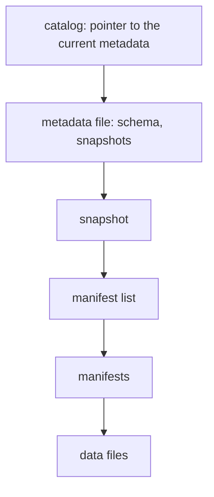
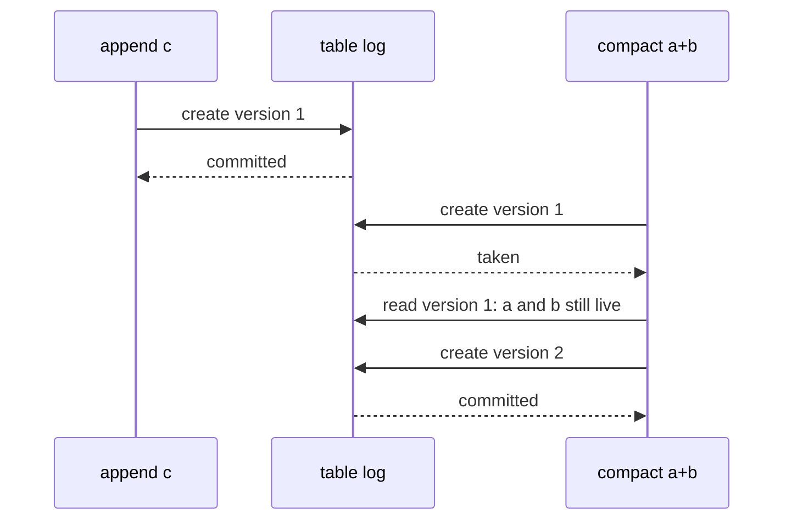

# Table formats: snapshots, time travel and optimistic commits

## The idea

A large analytic table is often stored as many files in a file system or an object store: each file holds some of the table's rows, often grouped by a **partition** such as a month. Such storage is cheap and can hold almost anything, but it lacks what a database gives for free. A reader that lists the files while a job is writing new ones sees half a write. Two jobs that write at once can lose each other's work. Nothing records what the table looked like yesterday.

A **table format** is a specification that adds those guarantees on top of plain files. Apache Iceberg's table specification, the Delta Lake transaction protocol and Apache Hudi are open examples. They differ in detail and share three ideas.

1. **Data files are immutable.** Once written, a file is never changed in place; it is only read, or eventually deleted. Adding rows writes new files. Deleting rows drops files from the table, or records the deleted rows in a small file of their own. Changing rows does both.
2. **A snapshot lists the table's files.** Which files make up the table is kept in metadata: each commit creates a new **snapshot**, the complete list of **live** files after it. A reader picks one snapshot and reads exactly its files, so it never sees half of a commit, and old snapshots still describe the table as it was.
3. **A commit is one atomic step.** All the work, writing data files and metadata, happens where no reader looks. The commit itself is a single operation that either succeeds or fails: swapping a pointer to the new metadata, or creating the next numbered entry of a log.



<!-- text-of-mermaid sha256:b327a8da3e5772175cbc9295db314c9a693f68377875df80922f1a870a7e1a2a -->
```text
┌────────────────────────────────────────┐
│catalog: pointer to the current metadata│
└────────────────────┬───────────────────┘
                     ▼
┌────────────────────────────────────────┐
│    metadata file: schema, snapshots    │
└────────────────────┬───────────────────┘
                     ▼
┌────────────────────────────────────────┐
│                snapshot                │
└────────────────────┬───────────────────┘
                     ▼
┌────────────────────────────────────────┐
│             manifest list              │
└────────────────────┬───────────────────┘
                     ▼
┌────────────────────────────────────────┐
│               manifests                │
└────────────────────┬───────────────────┘
                     ▼
┌────────────────────────────────────────┐
│               data files               │
└────────────────────────────────────────┘
```

The drawing follows Iceberg's layout in its format versions 1 to 3. A **manifest** lists data files with their partition values and statistics, and marks each entry as existing, added or deleted; the snapshot reaches its manifests through a manifest list. A manifest that did not change is shared by the snapshots that use it, so a commit only writes metadata for what it changed. A commit writes a new metadata file and then asks the catalog to swap the table's pointer from the old file to the new one. Delta Lake does the same with a log instead of a pointer: entry `n` of the table's log records which files version `n` adds and removes, and the table at version `n` is the result of applying entries 0 to `n` in order.

Two writers may start from the same snapshot. **Optimistic concurrency** lets both work without locks, assuming they will not collide, and checks at commit time. Only one can turn snapshot 7 into snapshot 8. The other finds that the table moved on, checks whether its own change still makes sense on top of the new snapshot, and either **retries** on it or gives up with a **conflict**. Kung and Robinson described the method in 1981: a transaction reads freely and writes to private copies, a validation step checks that its changes do not break anything, and only then are they made visible; a transaction that fails validation is backed up and starts over.

## A worked example

Three writers all read version 0 of a table that holds `a.data` and `b.data`. One appends `c.data`; one compacts `a.data` and `b.data` into a single `ab.data` holding the same rows; one deletes `b.data`, whose rows must be removed. They commit in that order, each by creating the next log entry, which succeeds only if no one created it first:

```python examples/table_log.py
"""A table kept as a log of numbered commits over immutable files, with optimistic writers.

Commit n records which files it adds and removes. A writer commits by creating entry n + 1, which
succeeds only if no one created it first. When it loses that race it reads the commits it missed,
checks that the files it removes are still in the table, and tries again at the next number.
"""


class TableLog:
    def __init__(self) -> None:
        self.entries: dict[int, dict[str, list[str]]] = {}

    def put_if_absent(self, version: int, adds: list[str], removes: list[str]) -> bool:
        if version in self.entries:
            return False
        self.entries[version] = {"adds": adds, "removes": removes}
        return True

    def latest(self) -> int:
        return max(self.entries, default=-1)

    def files_at(self, version: int) -> list[str]:
        """Time travel: replay the log up to a version."""
        live: set[str] = set()
        for number in range(version + 1):
            live -= set(self.entries[number]["removes"])
            live |= set(self.entries[number]["adds"])
        return sorted(live)


def commit(log: TableLog, name: str, base: int, adds: list[str], removes: list[str]) -> None:
    version = base + 1
    while not log.put_if_absent(version, adds, removes):
        missing = [path for path in removes if path not in log.files_at(log.latest())]
        if missing:
            print(f"{name}: version {version} taken, conflict: {', '.join(missing)} already gone")
            return
        print(f"{name}: version {version} taken, nothing it removes changed, retrying")
        version = log.latest() + 1
    print(f"{name}: committed version {version}")


log = TableLog()
log.put_if_absent(0, ["a.data", "b.data"], [])
# Three writers all read version 0, then commit in this order.
commit(log, "append c", base=0, adds=["c.data"], removes=[])
commit(log, "compact a+b", base=0, adds=["ab.data"], removes=["a.data", "b.data"])
commit(log, "delete b", base=0, adds=[], removes=["b.data"])
for version in range(log.latest() + 1):
    print(f"version {version}: {log.files_at(version)}")
```

It prints:

```output examples/table_log.py
append c: committed version 1
compact a+b: version 1 taken, nothing it removes changed, retrying
compact a+b: committed version 2
delete b: version 1 taken, conflict: b.data already gone
version 0: ['a.data', 'b.data']
version 1: ['a.data', 'b.data', 'c.data']
version 2: ['ab.data', 'c.data']
```



<!-- text-of-mermaid sha256:85c48b7e56a5700af8f25ec4f76bb5cff2655f68c48cd9b796b61dd33d653cd5 -->
```text
┌──────────┐          ┌───────────┐                          ┌─────────────┐
│ append c │          │ table log │                          │ compact a+b │
└─────┬────┘          └─────┬─────┘                          └──────┬──────┘
      │                     │                                       │
      │  create version 1   │                                       │
      │─────────────────────▶                                       │
      │                     │                                       │
      │      committed      │                                       │
      ◀╌╌╌╌╌╌╌╌╌╌╌╌╌╌╌╌╌╌╌╌╌│                                       │
      │                     │                                       │
      │                     │           create version 1            │
      │                     ◀───────────────────────────────────────│
      │                     │                                       │
      │                     │                 taken                 │
      │                     │╌╌╌╌╌╌╌╌╌╌╌╌╌╌╌╌╌╌╌╌╌╌╌╌╌╌╌╌╌╌╌╌╌╌╌╌╌╌╌▶
      │                     │                                       │
      │                     │  read version 1: a and b still live   │
      │                     ◀───────────────────────────────────────│
      │                     │                                       │
      │                     │           create version 2            │
      │                     ◀───────────────────────────────────────│
      │                     │                                       │
      │                     │               committed               │
      │                     │╌╌╌╌╌╌╌╌╌╌╌╌╌╌╌╌╌╌╌╌╌╌╌╌╌╌╌╌╌╌╌╌╌╌╌╌╌╌╌▶
      │                     │                                       │
┌─────┴────┐          ┌─────┴─────┐                          ┌──────┴──────┐
│ append c │          │ table log │                          │ compact a+b │
└──────────┘          └───────────┘                          └─────────────┘
```

The drawing shows the first two writers. The append commits version 1 at once. The compaction loses the race for version 1, but the append removed nothing, so the files it replaces are still there: it is rebased onto version 1 and commits version 2. The delete loses too, and this time its check fails: `b.data` was removed by the compaction, and its rows now live in `ab.data`. Retrying blindly would record the removal of a file that is no longer in the table and leave the rows it meant to delete alive in `ab.data`. The writer must start over from version 2 and delete the rows from `ab.data`.

The last three lines are **time travel**: every version can still be read, because the files of old versions were never changed, only left out of newer snapshots.

## Maintenance

Immutable files and kept snapshots have a cost, and two kinds of upkeep pay it.

- **Expiring snapshots.** A file removed from the table stays in storage as long as some snapshot can still read it. Expiry drops old snapshots, then deletes the files that no remaining snapshot lists. After that, time travel to the expired versions is gone. Iceberg's retention policy keeps the snapshots that are younger than a maximum age or among a minimum number of the latest ones.
- **Compaction.** Streaming writers and frequent small commits leave many small files, and each one costs a read and an entry in the metadata. Compaction rewrites them into fewer, larger files holding the same rows. It is a commit like any other: it changes no data, so Iceberg records it as a `replace`, and it can conflict with a delete of the same files.

## When to use it

- **A table format** for any table on files that more than one job writes, that readers query while it is written, or whose past states matter: audits, reproducible reports, models trained on "the data as of last Monday".
- **Time travel** to reproduce a report, to compare before and after a fix, or to roll back a bad write; keep snapshots long enough for the audits you promise.
- **Optimistic commits** when conflicts are rare: appends from many writers never conflict with each other. When writers often rewrite the same files, retries waste work, and the writers should be coordinated or partitioned instead.
- **Plain files** for data that is written once and never updated, such as raw archives, where none of these guarantees matter.

## Common traps

- **Retrying without checking.** A commit that lost the race must re-validate against the new snapshot. Re-applying it blindly can undo a concurrent delete or remove a file that is already gone.
- **Expiring what someone still reads.** A long query or a job that pinned an old snapshot fails when its files are deleted underneath it. Keep snapshots longer than the longest reader.
- **Treating rename as atomic everywhere.** Committing by renaming a file is safe only where renaming is atomic. Iceberg deprecated its file-system commit scheme as unsafe in object stores and local file systems; commits there go through a catalog that swaps a pointer atomically.
- **Too many small files.** Each commit of a few rows adds files and metadata, and reads get slower with every one. Batch writes, and compact regularly.
- **Orphan files.** A writer that crashes after writing data files but before committing leaves files that no snapshot lists. They are invisible, take storage, and need a separate clean-up that must not touch files of commits still in progress.
- **Expecting time travel by wall clock to be exact.** A snapshot is chosen by its commit time; a query "as of 10:00" returns the snapshot current at 10:00, not the data whose events happened by then.

## Complexity

For a table of `F` live files:

| Operation | Cost |
|-----------|------|
| Plan a scan of one snapshot | The manifests it lists, not a listing of every file in storage; Iceberg's stated goal is O(1) remote calls to plan a scan, not O(n) in the number of partitions or files |
| Commit `k` changed files | New data files, plus metadata for what changed: O(k) with shared manifests, not O(F) |
| Read a version from a log | The log entries since the last checkpoint, a file that stores the table's complete state at one version |
| Time travel | The same as reading the current version, if the snapshot has not expired |
| Expire snapshots | The files that only expired snapshots list, found by comparing their manifests with those of the retained snapshots |

Storage grows with every version's removed files until expiry runs: an hourly rewrite of a 10 GB partition, kept for 7 days, holds up to 168 old copies of it.

## Expert notes

- **Iceberg's guarantees.** Its specification states the goals: reads isolated from concurrent writes, always using a committed snapshot; writes that add and remove files in a single operation and are never partially visible; readers that take no locks. Writers create metadata optimistically and commit by swapping the table's metadata pointer from the base version to the new one; if the base is no longer current, the writer must retry on the new current version. What a writer validates before retrying determines the isolation level it gets.
- **Which commits can retry.** Iceberg's rules: appends can always be applied; replace operations, such as compaction, must verify that the files they delete are still in the table; deletes of specific files must verify the same, while deletes by an expression, such as every row before a date, can always be applied; schema changes must verify that the schema did not change in between. Snapshot operations are named `append`, `replace`, `overwrite` and `delete`.
- **Delta Lake's log.** Each commit is a JSON file in the table's `_delta_log` directory, named by its version number padded to 20 digits, holding an atomic set of actions, such as adding or removing a file, applied to the previous version. The table has a single serial history of versions numbered by contiguous integers. Writers must never overwrite an existing log entry and should use the storage's atomic primitives to prevent it. Checkpoints store the complete state at a version, so readers do not replay the whole log. Files no longer in the latest version can be removed by a vacuum after a retention period, 7 days by default.
- **Hudi's timeline.** Apache Hudi records every action on a table, such as commits, cleans, compactions, rollbacks and savepoints, at instants on a timeline that acts as the source of truth for the table's state; each action moves through the states requested, inflight and completed. A rollback removes the partial files of a failed write, and a savepoint keeps files from being cleaned so that the table can be restored to that point or queried as of it.
- **Version 4.** Iceberg's specification says versions 1 to 3 are complete and adopted, while version 4 is under active development; among other changes it replaces the manifest list with a single root manifest per snapshot.
- **Branches.** Iceberg also names snapshots with tags and branches, each with its own retention, which supports write-audit-publish: write to a branch, check it, then move the main branch to it.

## Practice

- `cstudy start snapshot-table`: immutable data files and snapshots: manifests, deletes and overwrites, time travel, optimistic commits that rebase or conflict, snapshot expiry and compaction.

## Further reading

- [Apache Iceberg, *Table Spec*](https://iceberg.apache.org/spec/): goals, snapshots and manifests, optimistic concurrency, commit conflict resolution and retry, snapshot retention, and point-in-time reads.
- [Delta Lake transaction protocol](https://github.com/delta-io/delta/blob/master/PROTOCOL.md): the log, its actions, checkpoints and the writer requirements.
- [Apache Hudi, *Timeline*](https://hudi.apache.org/docs/timeline): actions, instants and their states.
- [Kung and Robinson, *On Optimistic Methods for Concurrency Control*, ACM Transactions on Database Systems 6(2), 1981](https://www.eecs.harvard.edu/~htk/publication/1981-tods-kung-robinson.pdf): read, validation and write phases.
- [Apache Iceberg, *Branching and Tagging*](https://iceberg.apache.org/docs/latest/branching/): branches, tags and their retention.
