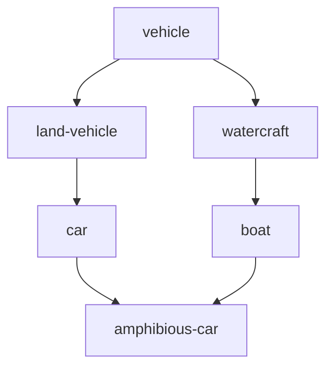

# Taxonomies and SKOS

## The idea

A shop sorts its products under headings: Vehicles, then Land vehicles, then Cars. A library sorts its books by subject. A newsroom tags its articles with topics from a fixed list. Each is a **taxonomy**: a set of **concepts**, the ideas a system wants to name, arranged from general to specific. People use it to browse ("everything under Vehicles"), to search ("a search for Watercraft must also find Boats"), and to make many systems say the same thing about the same idea.

The links between concepts have two directions with two names. If Car is more specific than Land vehicle, then Car is **narrower** than Land vehicle, and Land vehicle is **broader** than Car: one link, read both ways. The broader concept is often called the **parent** and the narrower one the **child**; a concept with no parent is a **root**.

In a **tree**, every concept has exactly one parent, like an org chart. Real taxonomies are looser. An amphibious car is a kind of car and a kind of boat, and forcing it under one of the two makes it impossible to find under the other. A taxonomy where a concept may have several parents is a **polyhierarchy**. As long as no chain of links leads from a concept back to itself, its shape is a **directed acyclic graph**, a DAG: directed, because each link has a direction, and acyclic, because it has no loop.



<!-- text-of-mermaid sha256:81b73476ef8f7390f837de184a7852632c376694082be3033d557a35911fecf2 -->
```text
┌──────────────┐
│   vehicle    │
└──────────────┘
        ▼─────────────────▼
┌──────────────┐    ┌──────────┐
│ land-vehicle │    │watercraft│
└───────┬──────┘    └─────┬────┘
        ▼                 ▼
┌──────────────┐    ┌──────────┐
│     car      │    │   boat   │
└───────┬──────┘    └─────┬────┘
        ▼─────────────────┘
┌──────────────┐
│amphibious-car│
└──────────────┘
```

The drawing is the hierarchy of the example below, with each arrow going from a concept to a narrower one. Two paths lead from `amphibious-car` up to `vehicle`, which is what a polyhierarchy allows and a tree does not.

**SKOS**, the Simple Knowledge Organization System, is the W3C's standard data model for sharing such vocabularies: thesauri, classification schemes, subject heading systems and taxonomies. It writes everything as RDF triples, which the [next guide](../rdf-triples/guide.md) explains; here it is enough to read `A skos:broader B` as "A has the broader concept B". Its main pieces:

- A **concept**, `skos:Concept`, which SKOS describes as "an idea or notion; a unit of thought".
- **Hierarchical links**: `skos:broader` and `skos:narrower`, which by convention state only direct links, and `skos:broaderTransitive` and `skos:narrowerTransitive`, which are not stated but inferred, and hold for every ancestor and every descendant. An **associative** link, `skos:related`, says two concepts are related without one being more general.
- **Labels**: one **preferred label** per language, `skos:prefLabel`, the name to show; any number of **alternative labels**, `skos:altLabel`, such as synonyms and abbreviations; and **hidden labels**, `skos:hiddenLabel`, which search can match but nobody is shown, such as common misspellings.
- **Concept schemes**, `skos:ConceptScheme`: a whole vocabulary, such as one shop's catalogue.
- **Mappings** between concepts of different schemes: `skos:exactMatch`, `skos:closeMatch`, `skos:broadMatch`, `skos:narrowMatch` and `skos:relatedMatch`.

SKOS is careful to say what a hierarchy is not. It is not a formal knowledge representation language: a thesaurus or classification scheme "does not assert any axioms or facts", and its structures "do not have any formal semantics". `A skos:broader B` says that people organize A under B, not that every A is a B. The guide on [reasoning and validation](../reasoning-and-validation/guide.md) covers the vocabularies that do carry logic.

## A worked example

The first program stores direct broader links, derives the narrower links and every ancestor the way SKOS's rules define them, lists the paths up from two concepts, and searches by label:

```python examples/hierarchy.py
"""A small concept scheme with two parents for one concept, read the way SKOS defines its links.

`skos:broader` states direct links only. SKOS makes it a sub-property of `skos:broaderTransitive`,
which is transitive, and `skos:narrower` the inverse of `skos:broader`; applying those rules
until nothing new appears gives every ancestor. Labels: one preferred label per language, any
number of alternative labels, and hidden labels that search can match but nobody is shown.
"""

broader = {  # concept -> its direct broader concepts
    "amphibious-car": {"car", "boat"},
    "car": {"land-vehicle"},
    "boat": {"watercraft"},
    "land-vehicle": {"vehicle"},
    "watercraft": {"vehicle"},
    "hovercraft": {"watercraft", "vehicle"},
    "vehicle": set(),
}
labels = {
    "amphibious-car": {"pref": "Amphibious car", "alt": ["Car-boat"],
                       "hidden": ["amfibious car"]},
    "boat": {"pref": "Boat", "alt": ["Vessel"], "hidden": []},
}

narrower: dict[str, set[str]] = {concept: set() for concept in broader}
for concept, parents in broader.items():  # skos:narrower is the inverse of skos:broader
    for parent in parents:
        narrower[parent].add(concept)

transitive = {concept: set(parents) for concept, parents in broader.items()}
rounds = 0
while True:  # broaderTransitive: a link of a link is a link, until nothing new appears
    rounds += 1
    added = {(c, g) for c, ps in transitive.items() for p in ps for g in transitive[p]
             if g not in ps}
    if not added:
        break
    for concept, ancestor in added:
        transitive[concept].add(ancestor)

print("broader(amphibious-car):", sorted(broader["amphibious-car"]))
print("broaderTransitive(amphibious-car):", sorted(transitive["amphibious-car"]),
      f"after {rounds} rounds")
print("narrower(vehicle):", sorted(narrower["vehicle"]))


def paths_up(concept: str) -> list[list[str]]:
    if not broader[concept]:
        return [[concept]]
    return [[concept, *path] for parent in sorted(broader[concept]) for path in paths_up(parent)]


for path in paths_up("amphibious-car") + paths_up("hovercraft"):
    print(f"path of {len(path) - 1}:", " -> ".join(path))


def search(text: str) -> list[str]:
    wanted = text.casefold()
    return sorted(concept for concept, entry in labels.items()
                  if wanted in {entry["pref"].casefold(), *map(str.casefold, entry["alt"]),
                                *map(str.casefold, entry["hidden"])})


for query in ["vessel", "amfibious car", "Amphibious car"]:
    print(f"search {query!r}:", search(query))
```

It prints:

```output examples/hierarchy.py
broader(amphibious-car): ['boat', 'car']
broaderTransitive(amphibious-car): ['boat', 'car', 'land-vehicle', 'vehicle', 'watercraft'] after 3 rounds
narrower(vehicle): ['hovercraft', 'land-vehicle', 'watercraft']
path of 3: amphibious-car -> boat -> watercraft -> vehicle
path of 3: amphibious-car -> car -> land-vehicle -> vehicle
path of 1: hovercraft -> vehicle
path of 2: hovercraft -> watercraft -> vehicle
search 'vessel': ['boat']
search 'amfibious car': ['amphibious-car']
search 'Amphibious car': ['amphibious-car']
```

- `broader(amphibious-car)` holds only the two direct links that were stated.
- `broaderTransitive` adds the ancestors. The program applies one rule, "a broader concept of a broader concept is an ancestor", until a round adds nothing: the first round adds the grandparents, the second the great-grandparent `vehicle`, and the third finds nothing new and stops.
- `narrower(vehicle)` comes from inverting the stated links: nothing stated it.
- The paths show why "how deep is this concept?" has no single answer in a polyhierarchy. `amphibious-car` happens to be three links from `vehicle` either way, but `hovercraft` is one link away by its direct link to `vehicle`, and two by way of `watercraft`. A rule that assumes one depth per concept, or one parent, breaks here.
- Search matches the alternative label `Vessel` and the hidden misspelling `amfibious car`, ignoring case.

The second program gives `skos:exactMatch` the properties SKOS declares for it, symmetric and transitive, across three schemes, one of which has a mistaken link:

```python examples/mappings.py
"""Mapping links between three schemes, and what transitivity does to one mistaken link.

SKOS declares `skos:exactMatch` symmetric and transitive, and `skos:closeMatch` symmetric only.
Two people each add one exact match that looks right on its own; following the links as far as
transitivity allows then joins concepts that nobody matched.
"""

exact_matches = [
    ("zoo:crane", "encyclopedia:crane"),  # the bird, in a zoo's scheme and an encyclopedia's
    ("encyclopedia:crane", "machines:crane"),  # a mistake: the lifting machine of the same name
    ("zoo:heron", "encyclopedia:heron"),
]

links: dict[str, set[str]] = {}
for first, second in exact_matches:  # symmetric: store both directions
    links.setdefault(first, set()).add(second)
    links.setdefault(second, set()).add(first)


def one_step(concept: str) -> list[str]:
    return sorted(links.get(concept, ()))


def transitive(concept: str) -> list[str]:
    seen, stack = {concept}, [concept]
    while stack:
        for nxt in links.get(stack.pop(), ()):
            if nxt not in seen:
                seen.add(nxt)
                stack.append(nxt)
    return sorted(seen - {concept})


print("stated matches of zoo:crane:", one_step("zoo:crane"))
print("entailed matches of zoo:crane:", transitive("zoo:crane"))
print("entailed matches of zoo:heron:", transitive("zoo:heron"))
```

It prints:

```output examples/mappings.py
stated matches of zoo:crane: ['encyclopedia:crane']
entailed matches of zoo:crane: ['encyclopedia:crane', 'machines:crane']
entailed matches of zoo:heron: ['encyclopedia:heron']
```

Each stated link looks right on its own: a zoo's crane is an encyclopedia's crane, and someone matched the encyclopedia's crane, the bird, with a lifting machine of the same name in a scheme of machines. Transitivity then makes the zoo's bird an exact match of the machine, a link nobody stated. SKOS's reference names this risk: it keeps `skos:closeMatch` non-transitive to avoid "compound errors" when mappings are combined across more than two schemes.

## When to use it

- **Browsing and navigation**: a catalogue, a site's sections, a library's subjects.
- **Search expansion**: a query or a filter on a broad concept also selects everything narrower, which is what `skos:narrowerTransitive` is for.
- **Consistent tagging**: many systems tag their data with the same concept identifiers, so the data can be joined.
- **Aligning vocabularies**: two catalogues map their concepts to each other instead of merging.
- **Not when you need inference.** If "every car is a vehicle" must let a program conclude facts about individual cars, you need classes and rules, as in RDF Schema or OWL, not a SKOS hierarchy.

## Common traps

- **Reading `skos:broader` backwards.** In `A skos:broader B`, the subject A is the narrower concept and B is the broader one: "A has broader B". The name reads naturally only once you know this.
- **Storing every ancestor as a direct link.** Asserting `skos:broader` from a concept to its grandparent hides which links are direct, and the hierarchy can no longer be drawn. SKOS's convention is to state direct links and infer the transitive ones.
- **Assuming one parent.** Code written for trees, such as "the path to the root", "the depth", "the one closest common ancestor", gives wrong or arbitrary answers on a polyhierarchy.
- **Cycles.** SKOS itself does not forbid `A skos:broader B` with `B skos:broader A`, and it calls such a graph consistent. Most applications treat a cycle as an error, since walking up from a concept would never end. Check for one whenever a link is added.
- **Labels as identifiers.** Names change: a concept renamed from "Lorry" to "Truck" must keep its identifier, which other systems have stored. Keep the old name as an alternative label, so searches that used it still work.
- **The same label on different concepts.** "Crane" is a bird and a lifting machine. A search by label can return several concepts, and only their schemes or their broader concepts tell them apart.
- **Trusting transitive mappings.** As the second example shows, one wrong exact match joins whole groups of concepts. Follow mappings one step unless you trust every link.

## Complexity

For `V` concepts and `E` stated broader links:

| Operation | Time | Space |
|-----------|------|-------|
| Direct broader or narrower concepts | O(1) average with a set per concept, plus sorting the answer | O(V + E) for both directions |
| Every ancestor or descendant of one concept | O(V + E) at worst, a walk with a visited set | O(V) |
| Every ancestor of every concept, stored | O(V · (V + E)) to compute | O(V²) at worst |
| Concepts with a given label | O(1) average with a map from label to concepts | O(L) for `L` labels |

The rounds of the example's rule are simple but not cheap: each round looks at every link of every concept again. A walk from one concept, which visits each ancestor once, does the same job for one concept in linear time.

## Expert notes

- **The rules SKOS states.** `skos:broader` is a sub-property of `skos:broaderTransitive`, which is transitive, and `skos:narrower` is the inverse of `skos:broader` (statements S22, S24 and S25 of the reference). `skos:broader` itself is not transitive: `A skos:broader B` and `B skos:broader C` do not entail `A skos:broader C`, only `A skos:broaderTransitive C`. The reference notes that a sub-property of a transitive property is not necessarily transitive.
- **Reflexivity and cycles.** SKOS says nothing on whether `skos:broader` is reflexive, so `A skos:broader A` may or may not appear, and a cycle is consistent with the data model. The reference adds that for many applications both are a potential problem, and leaves their handling to the application. Two paths between the same concepts are explicitly consistent, a pattern it says arises naturally in polyhierarchies.
- **Labels.** `skos:prefLabel`, `skos:altLabel` and `skos:hiddenLabel` are pairwise disjoint, so the same label cannot be both preferred and alternative for one concept (S13), and a resource has at most one preferred label per language tag (S14). Hidden labels are for text search, matching for example a misspelled query, without being shown to the user.
- **Mappings.** `skos:exactMatch` is a sub-property of `skos:closeMatch`, and both are symmetric; `skos:exactMatch` is also transitive (S42, S44, S45). The reference describes `skos:exactMatch` as "a high degree of confidence" that two concepts can be used interchangeably across a wide range of information retrieval applications, and `skos:closeMatch` as concepts "sufficiently similar" to be used interchangeably in some. `skos:exactMatch` is disjoint with `skos:broadMatch` and `skos:relatedMatch` (S46).
- **Related is not broader.** `skos:related` is symmetric, and disjoint with `skos:broaderTransitive` (S23, S27): two concepts cannot be both associatively related and one an ancestor of the other.
- **Concepts and classes.** The reference asserts only that `skos:Concept` is an instance of `owl:Class`, and deliberately says nothing more about how SKOS concepts relate to OWL classes, so a resource can be both. SKOS terms live in the namespace `http://www.w3.org/2004/02/skos/core#`.

## Practice

- `cstudy start taxonomy`: concepts with several parents, ancestors and descendants nearest first, refused cycles and the lowest common ancestors of two concepts in a DAG, labels and search with facet expansion, then stable identifiers across renames and retired concepts, and exact matches between two schemes.

## Further reading

- [W3C, *SKOS Simple Knowledge Organization System Reference*, Recommendation, 18 August 2009](https://www.w3.org/TR/skos-reference/): concepts, schemes, labels, semantic relations and mappings, with their integrity conditions.
