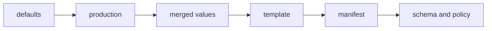

# Layered values, templates and policy checks

## The idea

A service runs in three places: on a laptop, in a test environment and in production. Almost everything about it is the same everywhere: its image, its ports, its labels. A few things differ: production runs three copies instead of one, logs less, and uses a bigger database. Writing three full descriptions repeats almost everything, and sooner or later someone fixes one and forgets the other two.

So the settings that can differ are pulled out as **values**: a tree of named settings, such as `replicas: 3` or `image: {repo: shop/web, tag: "1.5"}`. And the values come in **layers**: a `defaults` layer that sets everything, a `production` layer that sets only what production changes, perhaps an `override` layer for one urgent fix. Merging the layers in order gives the final values; where two layers set the same thing, the later, more specific layer wins.

"The later layer wins" hides real decisions. When both layers set a nested object, does the later one replace it whole, or merge into it member by member (a **deep merge**)? When both set a list, does the later one replace it, append to it, or merge items that share a name? And how does a later layer remove a setting that an earlier one added? Every tool answers these questions somehow, and the answers matter more than they seem. JSON Merge Patch (RFC 7396) is one precise answer: a `null` removes a member, an object merges into an object member by member, and anything else, a list included, replaces what was there.

The values then fill a **template**: the final description, a **manifest**, written once with holes, such as `image: $repo:$tag`, filled from the merged values. Two kinds of templating exist, and the difference matters. **Text templating** pastes values into text that will be parsed again later, so the parser, not you, decides what each pasted value means. **Data templating** builds the document as a data structure and writes it out with a serializer, which quotes and escapes every value for you.

Last comes checking, before anything is deployed. A **schema** says what valid values look like: which keys exist, which are required, what type each has, what range a number may take. JSON Schema is the common open language for this. A **policy** says what is allowed, for reasons the schema cannot know: every workload names the team that owns it, every container has a memory limit, no image is referred to by a tag that can move, such as `latest`. Written as rules in data and checked by a program on every change (**policy as code**), such rules hold every time, where a reviewer would forget them under pressure.



<!-- text-of-mermaid sha256:5f1898e4d7c355edbd41fb9771ea380717b308a1ccaaf3aaef3de73554a84bf5 -->
```text
┌────────┐    ┌──────────┐    ┌─────────────┐    ┌────────┐    ┌────────┐    ┌─────────────────┐
│defaults├───►│production├───►│merged values├───►│template├───►│manifest├───►│schema and policy│
└────────┘    └──────────┘    └─────────────┘    └────────┘    └────────┘    └─────────────────┘
```

The drawing is the whole chain. An error found at the end, by a check, is cheapest to fix when the report says which layer set the value at fault.

## A worked example

The first program looks values up through two layers with Python's `ChainMap`, which searches its mappings in order and returns the first value it finds, then fills a template with `string.Template`:

```python examples/layers.py
"""Layers of values looked up in order, the nested value a shallow lookup loses, a missing value.

ChainMap searches its mappings from the first to the last and returns the first value it finds,
so the most specific layer goes first. It never looks inside a nested dictionary: a nested value
in an upper layer hides the whole nested value below it.
"""

from collections import ChainMap
from string import Template

defaults = {"replicas": 1, "port": 8080, "image": {"repo": "shop/web", "tag": "1.4"}}
production = {"replicas": 3, "image": {"tag": "1.5"}}
values = ChainMap(production, defaults)

print("replicas:", values["replicas"], "| port:", values["port"])
print("image:", values["image"], "<- the repo from defaults is gone")

template = Template("image: $repo:$tag\nreplicas: $replicas")
flat = {"replicas": values["replicas"], **values["image"]}
try:
    print(template.substitute(flat))
except KeyError as missing:
    print("substitute refuses, missing", missing)
print(template.safe_substitute(flat).replace("\n", " | "), "<- safe_substitute ships it")
```

It prints:

```output examples/layers.py
replicas: 3 | port: 8080
image: {'tag': '1.5'} <- the repo from defaults is gone
substitute refuses, missing 'repo'
image: $repo:1.5 | replicas: 3 <- safe_substitute ships it
```

- `replicas` comes from the production layer and `port` from the defaults, as layering promises.
- `image` is the trap. Production set only `tag` inside `image`, meaning "change the tag". But `ChainMap` is shallow: it finds `image` in the production layer and stops there, so the whole `image` object of the defaults, with its `repo`, is hidden. A deep merge would give `{repo: shop/web, tag: 1.5}`.
- `substitute` refuses to fill the template, because `repo` is missing: an error at render time, which is the right outcome. `safe_substitute` fills what it can and leaves `$repo` in the output, a manifest that looks finished and will fail later, far from the cause.

The second program shows what happens to a value pasted unquoted into YAML, the format in which most manifests are written. A YAML parser decides the type of an unquoted (plain) scalar by matching it against a list of regular expressions; the patterns in the program are copied from the YAML 1.2.2 core schema, and from the boolean type of YAML 1.1, which older parsers still follow:

```python examples/scalars.py
"""What a value pasted unquoted into YAML becomes, under the 1.2 core schema and the 1.1 booleans.

A plain (unquoted) scalar is resolved by matching it against regular expressions; the first match
picks its type, and no match leaves it a string. The patterns below are copied from the YAML
1.2.2 core schema (section 10.3.2) and from the YAML 1.1 boolean type. Quoting the value as a
JSON string keeps it a string, since a JSON string is also a YAML 1.2 string.
"""

import json
import re

CORE_1_2 = [
    ("null", r"null|Null|NULL|~|"),
    ("bool", r"true|True|TRUE|false|False|FALSE"),
    ("int", r"[-+]?[0-9]+"),
    ("int (octal)", r"0o[0-7]+"),
    ("int (hex)", r"0x[0-9a-fA-F]+"),
    ("float", r"[-+]?(\.[0-9]+|[0-9]+(\.[0-9]*)?)([eE][-+]?[0-9]+)?"),
]
BOOL_1_1 = r"y|Y|yes|Yes|YES|n|N|no|No|NO|true|True|TRUE|false|False|FALSE|on|On|ON|off|Off|OFF"


def resolve_1_2(text: str) -> str:
    return next((tag for tag, pattern in CORE_1_2 if re.fullmatch(pattern, text)), "str")


for value in ["no", "on", "1.10", "007", "0x1A", "12e3", "true", "web-1"]:
    as_1_1 = "bool" if re.fullmatch(BOOL_1_1, value) else "-"
    print(f"{value:6} 1.2 core: {resolve_1_2(value):12} 1.1 bool: {as_1_1:5}"
          f" quoted: {json.dumps(value)}")
```

It prints:

```output examples/scalars.py
no     1.2 core: str          1.1 bool: bool  quoted: "no"
on     1.2 core: str          1.1 bool: bool  quoted: "on"
1.10   1.2 core: float        1.1 bool: -     quoted: "1.10"
007    1.2 core: int          1.1 bool: -     quoted: "007"
0x1A   1.2 core: int (hex)    1.1 bool: -     quoted: "0x1A"
12e3   1.2 core: float        1.1 bool: -     quoted: "12e3"
true   1.2 core: bool         1.1 bool: bool  quoted: "true"
web-1  1.2 core: str          1.1 bool: -     quoted: "web-1"
```

- `no` and `on` are strings under the YAML 1.2 core schema, and booleans under YAML 1.1's rules. The country code of Norway, pasted unquoted, can arrive as `false`.
- `1.10` is a float, the number 1.1: a version string loses its last digit.
- `007` is an integer, the number 7, and `0x1A` is an integer written in hexadecimal, 26. `12e3` is a float, twelve thousand.
- Written as a JSON string, each value is a quoted string. YAML 1.2 set out to be a strict superset of JSON, so a YAML 1.2 parser reads a JSON string as a string.

## When to use it

- **One service, several environments**: layers for what differs, a template for what does not, so a fix in the template reaches every environment.
- **One template, many services**: the same manifest shape for many teams, each with its own values.
- **Checks at the end of the chain**: a schema for shape and types, policies for what is allowed, both run on every change, before the plan.
- **Rolling out a new policy**: start it in a mode that only warns, fix what it finds, then switch it to deny, so that a new rule does not block every team on the day it appears. An exception needs an owner, a reason and an end date, or exceptions pile up forever.
- **Not for logic.** When a template grows loops inside conditions inside loops, it has become a program in a language without tests. Generate the data in a real programming language and serialize it instead.

## Common traps

- **A shallow merge that drops nested values**, as `image` lost its `repo` above. Know whether your layering merges deeply, and test it on nested values.
- **Lists merged the wrong way.** If a later layer's list replaces the earlier one whole, a layer that adds one port must repeat all the others. If it appends, a layer can never remove an item. Neither is wrong; not knowing which one you have is.
- **A default that replaces "empty" values.** A default meant for a missing value that also fires for `0`, `false` or `""` turns a deliberate `replicas: 0` into the default. Defaults should fill only what is missing.
- **A missing value rendered silently.** Make a missing value an error at render time, as `substitute` does, not a hole in the output.
- **Implicit types.** In text templating, the YAML parser decides what `no`, `1.10` and `007` mean. Quote strings, or build the document as data and let a serializer quote for you. The [guide on output encoding](../output-encoding/guide.md) makes the same point for HTML: encode each value for the place it lands in.
- **A value that changes the structure.** A value holding a newline, a colon or a quote, pasted into text, can add keys to the document or end a string early. That is injection, the same mistake as building a query by pasting text, as the [guide on trust boundaries](../trust-boundaries-and-injection/guide.md) explains.
- **Errors that point at the wrong place.** A check that fails on the final manifest says which line is wrong, not which layer wrote it. Keep track of which layer set each value, so the report can name it.
- **Moving tags.** `web:latest` can be a different image next week, so the same manifest runs different code. A policy can require a fixed tag or a digest, which is computed from the image's content and always names the same image.

## Complexity

For `L` layers holding `N` values in all, a template of `T` characters producing `P` characters of output, and `R` policy rules over `M` manifests:

| Step | Time | Space |
|------|------|-------|
| Deep merge of all layers | O(N) average | O(N) for the merged tree |
| Look up one key through a chain of layers | O(L) average | none |
| Render a template | O(T + P), once the template is parsed | O(P) |
| Validate against a schema | O(N · k) for `k` keywords per location | O(errors) |
| Check every rule on every manifest | O(M · R · c) for a rule costing `c` on one manifest | O(findings) |

A rule with a wildcard, such as "every container", costs as many lookups as there are containers, and a rule that relates two manifests, such as a service and the workloads it selects, costs more than one that reads a single field.

## Expert notes

- **JSON Merge Patch.** RFC 7396 defines the merge as a short recursive function. If the patch is an object, a target that is not an object is first replaced by an empty one; then each member whose value is `null` removes that name from the target, and every other member is merged into the target's member of the same name. If the patch is not an object, it replaces the whole target. So an array can only be replaced whole. The RFC's own test cases show two consequences: `{"a":["b"]}` patched with `{"a":"c"}` becomes `{"a":"c"}`, and a patch cannot add a member whose value is `null`: patching `{"e":null}` with `{"a":1}` keeps `e` because it was already there, but a `null` member in a patch always means "remove".
- **JSON Schema.** Draft 2020-12 splits into a core specification and a validation vocabulary. `type` names one of six primitive types, `null`, `boolean`, `object`, `array`, `number` and `string`, or `integer`, which matches any number with a zero fractional part. An object is valid against `required` if every name in the list is a property of it. `minimum` is an inclusive lower limit. `additionalProperties` applies only to the members whose names `properties` and `patternProperties` do not cover. `default` belongs to a vocabulary of annotations meant for documentation and user interfaces; the specification places no restriction on its value and recommends that it be valid against its schema.
- **YAML's types.** The YAML 1.2 specification, published in 2009, set out to make YAML a strict superset of JSON and removed many of the problematic implicit typing recommendations; YAML 1.2.2 followed in October 2021. Its core schema, the recommended default, resolves plain scalars by the regular expressions the example copies, and leaves a string whatever none of them matches. The boolean type of YAML 1.1, a draft of 2005, also matched `y`, `yes`, `n`, `no`, `on` and `off` in their capitalized forms.
- **`ChainMap` and `Template`.** `collections.ChainMap`, added in Python 3.3, searches its mappings in order on lookup, while writes, updates and deletions change only the first mapping. `string.Template.substitute` raises `KeyError` for a missing placeholder; its documentation notes that `safe_substitute` "may be anything other than safe", since it silently ignores malformed templates.
- **Pointers and patches in policies.** A rule needs to name a field inside a manifest, and JSON Pointer (RFC 6901) is the standard way: `/containers/0/image`. A fix that a policy suggests can be written as a JSON Patch operation (RFC 6902), so that a tool or a person can apply it.

## Practice

- `cstudy start values-templating`: layers of values deep-merged with `null` removing a member and lists replaced whole; templates with defaults, conditions, loops and whitespace control; then validation against a subset of JSON Schema, and the layer that set each value.
- `cstudy start manifest-policy`: rules kept as data that require fields and forbid moving image tags, with wildcards over lists and services checked against the workloads they select; exceptions that expire; then severities, warn and deny modes, and suggested fixes as JSON Patch operations.

## Further reading

- [RFC 7396, *JSON Merge Patch*](https://www.rfc-editor.org/rfc/rfc7396): the merge function and its test cases.
- [JSON Schema Validation, draft 2020-12](https://json-schema.org/draft/2020-12/json-schema-validation): `type`, `enum`, `minimum`, `required` and `default`.
- [JSON Schema Core, draft 2020-12](https://json-schema.org/draft/2020-12/json-schema-core): `properties`, `additionalProperties` and `items`.
- [YAML 1.2.2](https://yaml.org/spec/1.2.2/): the history of 1.2 and the core schema's tag resolution, section 10.3.2.
- [YAML 1.1, Boolean type](https://yaml.org/type/bool.html): the older boolean pattern.
- [Python, `collections.ChainMap`](https://docs.python.org/3/library/collections.html#collections.ChainMap) and [`string.Template`](https://docs.python.org/3/library/string.html#template-strings-strings): the two tools of the first example.
- [RFC 6901, *JSON Pointer*](https://www.rfc-editor.org/rfc/rfc6901) and [RFC 6902, *JSON Patch*](https://www.rfc-editor.org/rfc/rfc6902): naming fields and writing fixes.
