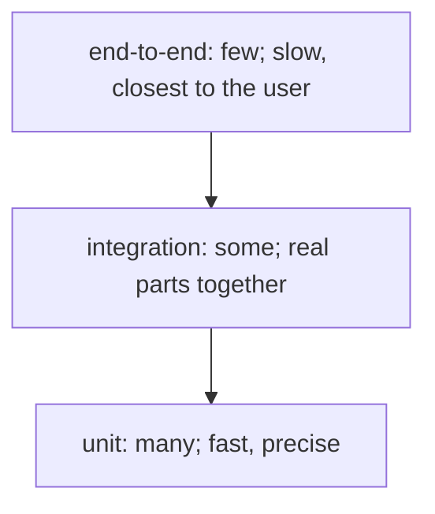

# Designing a test suite: levels, contract tests and golden files

## The idea

A test suite is a portfolio: tests of different sizes, each buying a different kind of confidence at a different price. Three levels are commonly named, by how much of the system a test runs:

| Level | Runs | Strengths | Costs |
|-------|------|-----------|-------|
| **Unit** | One function, class or module, with [doubles](../stubs-spies-mocks-and-fakes/guide.md) for what it depends on | Milliseconds each; deterministic; a failure points at a few lines | Says nothing about how the pieces fit, and doubles can drift from what they replace |
| **Integration** | Several real pieces together: the code and its database, two services, a parser and the files it reads | Finds mistakes at the seams: wrong formats, wrong assumptions about another component | Slower, needs setup, a failure points at a wider area |
| **End-to-end** | The whole system, through the interface a user or a client uses | Closest to what users experience | Slowest, most often flaky, expensive to write and to keep working, and a failure can be anywhere |

The **test pyramid** is a well-known rule of thumb for the mix: many unit tests at the base, fewer integration tests above them, and few end-to-end tests at the top. Its reasoning is an assumption worth stating: that broad tests are slow, brittle and expensive compared with focused ones. Where that assumption fails, for a small program whose end-to-end tests are fast and reliable, the shape can change.



<!-- text-of-mermaid sha256:8f6b5b0b5d3396208dc6286a302df63e2d01164677730d5e4cd6f0dcfa460f12 -->
```text
┌──────────────────────────────────────────┐
│end-to-end: few; slow, closest to the user│
└─────────────────────┬────────────────────┘
                      ▼
┌──────────────────────────────────────────┐
│  integration: some; real parts together  │
└─────────────────────┬────────────────────┘
                      ▼
┌──────────────────────────────────────────┐
│        unit: many; fast, precise         │
└──────────────────────────────────────────┘
```

The drawing lists the levels from the narrow top to the wide base: the further down, the more tests, the faster each one, and the smaller the part of the system each one covers.

Two more kinds of test cut across the levels. A **contract test** checks that two sides of a boundary agree. The side that calls is the **consumer** and the side that answers is the **provider**, and the contract test checks that the double the consumer's unit tests use still behaves like the real provider. A **golden-file test**, also called a snapshot or approval test, saves an approved copy of a large output and compares every later output with it, so that any change shows up as a difference for a person to review.

## A worked example

### A contract that catches drift

The billing code reads accounts from another team's service. Its unit tests use a fake account service: fast, and never down. The danger is that the real service changes and the fake does not, so the unit tests stay green while production breaks. The billing team writes down what it relies on, a **contract**, and checks it against both the fake and each version of the real provider:

```python examples/contract_test.py
"""A consumer's contract, checked against its own fake and against each version of the provider.

The billing code reads accounts from another team's service. Its unit tests use a fake of that
service, which is fast and never fails for network reasons, but can drift from the real thing.
The contract lists only what billing relies on, and the same check runs against the fake and
the real provider, so a drift shows up as a failing contract, not as a bill gone wrong.
"""

CONTRACT = {  # field -> type, for what billing reads from an account
    "id": str,
    "plan": str,
    "seats": int,
}


def fake_account(account_id: str) -> dict:
    """The fake billing's unit tests use."""
    return {"id": account_id, "plan": "team", "seats": 5}


def provider_v1(account_id: str) -> dict:
    return {"id": account_id, "email": "ops@example.org", "plan": "team", "seats": 5,
            "created": "2026-03-01"}


def provider_v2(account_id: str) -> dict:  # drops a field billing never reads
    return {"id": account_id, "plan": "team", "seats": 5, "created": "2026-03-01"}


def provider_v3(account_id: str) -> dict:  # renames plan to tier, sends seats as text
    return {"id": account_id, "tier": "team", "seats": "5", "created": "2026-03-01"}


def check_contract(get_account) -> list[str]:
    account = get_account("acct-7")
    problems = []
    for field, kind in CONTRACT.items():
        if field not in account:
            problems.append(f"missing {field}")
        elif not isinstance(account[field], kind):
            problems.append(f"{field} is {type(account[field]).__name__}, not {kind.__name__}")
    return problems


for source in (fake_account, provider_v1, provider_v2, provider_v3):
    problems = check_contract(source)
    print(f"{source.__name__:<13} {'ok' if not problems else 'broken: ' + '; '.join(problems)}")
```

It prints:

```output examples/contract_test.py
fake_account  ok
provider_v1   ok
provider_v2   ok
provider_v3   broken: missing plan; seats is str, not int
```

Version 2 removed the `email` field, and the contract still passes: billing never reads it, so the contract does not mention it, and the provider is free to drop it. Version 3 renamed `plan` and turned `seats` into text, and the contract fails with both problems named, before any bill goes out. The same check against the fake guards the other direction: if the billing team edits its fake, the contract keeps the fake truthful.

Listing only what the consumer uses is the point. A contract that demanded the provider's whole response would stop the provider from changing anything, including fields no consumer reads. When each consumer hands its contract to the provider, the provider can run all of them in its own build and know, before releasing, which consumers a change would break. That arrangement is called **consumer-driven contracts**.

### A golden file

A report is easier to check as a whole than field by field. A golden-file test renders it, replaces the parts that change on every run, such as the time and a run id, with placeholders, and compares the result with the approved copy:

```python examples/golden_file.py
"""A golden-file test: compare today's output with an approved copy, and show the difference.

The report includes the time it was made and a run id, which change on every run. They are
replaced by placeholders before the comparison, or the test would fail every time. When the
output really changes, the test fails with a line-by-line diff for a person to review.
"""

import difflib
import re

GOLDEN = """\
Invoice summary  generated <TIME>  run <RUN>
customer   items   total
acme           3   42.50
globex         1    9.99
total              52.49
"""


def render(rows: list[tuple[str, int, float]], generated: str, run_id: str) -> str:
    lines = [f"Invoice summary  generated {generated}  run {run_id}", "customer   items   total"]
    lines += [f"{name:<10} {items:>5} {total:>7.2f}" for name, items, total in rows]
    lines.append(f"{'total':<10} {'':>5} {sum(row[2] for row in rows):>7.2f}")
    return "\n".join(lines) + "\n"


def normalize(text: str) -> str:
    text = re.sub(r"generated \S+", "generated <TIME>", text)
    return re.sub(r"run [0-9a-f]{8}", "run <RUN>", text)


def check(output: str) -> list[str]:
    return list(difflib.unified_diff(GOLDEN.splitlines(), normalize(output).splitlines(),
                                     "golden", "actual", lineterm=""))


rows = [("acme", 3, 42.5), ("globex", 1, 9.99)]
today = render(rows, "2026-11-13T09:30:00Z", "3f9a0c1e")
print("same output, new time and run id:", "pass" if not check(today) else "fail")

rows_after_change = [("acme", 3, 42.5), ("globex", 1, 9.99), ("initech", 2, 0.0)]
diff = check(render(rows_after_change, "2026-11-14T08:00:00Z", "77b2e5d0"))
print("after a change:", "pass" if not diff else "fail")
print("\n".join(diff))
```

It prints:

```output examples/golden_file.py
same output, new time and run id: pass
after a change: fail
--- golden
+++ actual
@@ -2,4 +2,5 @@
 customer   items   total
 acme           3   42.50
 globex         1    9.99
+initech        2    0.00
 total              52.49
```

The first comparison passes although the time and the run id differ, because they were normalized away. The second fails because the report gained a row, and the diff shows exactly that row. If the change is intended, a person reads the diff and approves the new output as the golden copy; if not, the test caught a regression. The value of a golden test is only as good as that review: approving a diff without reading it turns the test into a recording of whatever the code does.

## When to use it

- **Unit tests** for logic: calculations, rules, parsing, data structures. Most tests belong here, because they are cheap enough to run on every change and precise enough to point at the bug.
- **Integration tests** for each seam with something real: a database query, a file format, a message sent to another service. One good test per seam often beats many.
- **End-to-end tests** for the few journeys that must never break, such as signing in or paying, and as a second line of defence. When one fails, first reproduce the bug with a unit test, then fix it, so the cheap test guards it from then on.
- **Contract tests** wherever your unit tests rely on a double of something another team owns.
- **Golden files** for large, structured outputs that change rarely: reports, generated code, rendered pages, compiler messages.
- **Regression tests** for every bug fixed, at the lowest level that can show it.

## Common traps

- **An upside-down suite.** Mostly end-to-end tests, few unit tests: the suite is slow, flaky, and its failures do not say where the bug is. The bliki entry on the pyramid calls this shape an ice-cream cone.
- **Unit tests that mock every seam.** Each piece passes against its doubles, and the system breaks where they meet. Keep integration tests for the seams, and contract tests for the doubles.
- **Testing the same thing at every level.** A rule checked by a unit test, an integration test and an end-to-end test triples the maintenance and gives little more confidence. Test each behaviour where it is cheapest to test well.
- **Contracts that ask for too much.** A consumer contract that checks fields the consumer never reads blocks the provider for no reason.
- **Golden files with moving parts.** Times, random ids, absolute paths and unordered output make a golden test fail on every run, until people approve diffs without reading them. Normalize them, or keep them out of the output.
- **Comparing everything as text.** A string comparison fails on a harmless change of spacing or field order. The xUnit patterns vocabulary calls this *sensitive equality*. Normalize the text, or compare structured data where you can.
- **A suite too slow to run.** If the full suite takes an hour, people stop running it before they push. Keep a fast subset for every change, and run the slow tests on a schedule or before release.

## Complexity

A suite's running time is the sum of its tests' times, and the levels differ by orders of magnitude. As an illustration, 2,000 unit tests at 5 ms each take 10 seconds; 200 end-to-end tests at 20 seconds each take about 67 minutes. Parallel runs divide the time but not the cost.

Flakiness compounds across a suite. If each of `n` tests fails at random with probability `p`, independently, the whole suite passes with probability `(1 − p)^n`. With 500 tests that each flake once in a thousand runs, the suite passes only about 61% of the time: two runs in five fail with no bug at all. That is why the flakiest level, end-to-end, should be the smallest, and why each flaky test should be [fixed at its cause](../deterministic-tests/guide.md).

Contract tests cost one check per consumer expectation, run against the fake and against a real provider; golden tests cost one comparison, linear in the size of the output.

## Expert notes

- **Where the pyramid comes from.** The bliki entry *Test Pyramid* (1 May 2012) states its point as having many more low-level unit tests than high-level tests through a graphical interface, which it calls brittle, expensive to write and time consuming to run, and more prone to nondeterminism. It credits the idea's popularity to a 2009 book, *Succeeding with Agile*, which called it the test automation pyramid. The entry also argues for an intermediate layer of tests through a service or API layer, and treats high-level tests as a second line of defence: a bug they find means a unit test is missing.
- **Levels are not the only axis.** The same entry warns that end-to-end, user-interface and customer-facing tests are different properties that teams often conflate: a rich user interface can be unit tested, and business rules written in a customer-facing form can run against one module only.
- **Contract tests in practice.** The bliki entry *Contract Test* (12 January 2011) describes running a separate set of contract tests that check that the calls made against your test doubles return the same results as calls to the external service. They follow the rhythm of changes to the external service rather than to your code, so running them once a day is often plenty, and a failure should start a conversation and an update rather than necessarily break the build. They check the format of the data, not the exact data.
- **Three kinds of contract.** The article *Consumer-Driven Contracts: A Service Evolution Pattern* (12 June 2006) distinguishes the provider contract, which is complete, single and authoritative; consumer contracts, each open and incomplete, one per consumer, expressing only the part of the provider that consumer relies on; and the consumer-driven contract, the provider contract derived from the union of its consumers' expectations. At its simplest, the expectations are written in a document; going a little further, they become unit tests that assert each expectation with each build.
- **Why mocks alone are not enough.** The `unittest.mock` documentation, explaining autospeccing, notes that tests using mocks can pass after a refactoring that breaks the code, and calls this another reason why you need integration tests as well as unit tests.
- **Text comparison as a smell.** In the xUnit patterns, *sensitive equality*, converting objects to strings and comparing them with an expected string, is listed among the causes of fragile tests. A golden file accepts that risk on purpose, for outputs whose text *is* the product, and controls it with normalization and review.
- **Regression suites for answers that vary.** When the system under test is itself nondeterministic, as a language model is, a golden set of inputs replaces golden outputs, each case is run more than once, and the comparison has to separate real changes from noise; the guide on [evaluating LLM applications](../evaluating-llm-applications/guide.md) covers that setting.

## Practice

- `cstudy start eval-release-gate`: a regression suite for a system whose answers vary from run to run: assertions on every output, judge scores checked against human labels, a golden set compared against a baseline, and a release gate that turns each failure on a new case into a proposed golden case.

## Further reading

- [*Test Pyramid* (1 May 2012)](https://martinfowler.com/bliki/TestPyramid.html): the pyramid, its assumption, and its history.
- [*Contract Test* (12 January 2011)](https://martinfowler.com/bliki/ContractTest.html): checking test doubles against the real service.
- [*Consumer-Driven Contracts: A Service Evolution Pattern* (12 June 2006)](https://martinfowler.com/articles/consumerDrivenContracts.html): provider, consumer and consumer-driven contracts.
- [xUnit Patterns, *Fragile Test*](http://xunitpatterns.com/Fragile%20Test.html): sensitive equality and overspecified software.
- [Python, `unittest.mock`: autospeccing](https://docs.python.org/3/library/unittest.mock.html#autospeccing): why passing unit tests with mocks need integration tests beside them.
- [Python, `difflib.unified_diff`](https://docs.python.org/3/library/difflib.html#difflib.unified_diff): the line-by-line diff of the golden-file example.
