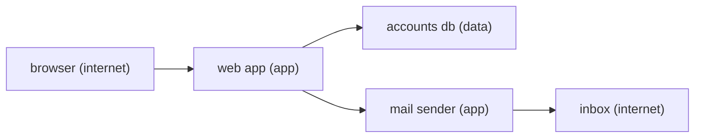

# Threat modeling

## The idea

The earlier guides each covered one kind of attack. A real system has all of them at once, and nobody finds its weaknesses by waiting for a checklist to mention them. **Threat modeling** is the habit of looking for them on purpose, in the design. The Threat Modeling Manifesto, a short statement of the field's values and principles, defines it as analyzing representations of a system to highlight concerns about security and privacy characteristics, and organizes it around four questions:

1. **What are we working on?**
2. **What can go wrong?**
3. **What are we going to do about it?**
4. **Did we do a good enough job?**

The OWASP Threat Modeling Cheat Sheet uses the same four, and places the work early, ideally in design, maintained and refined alongside the system as it changes. In a real project it comes first; it comes last in this path because each kind of threat it finds is now familiar.

**What are we working on?** A drawing of the system that shows where data goes. The usual one is a **data flow diagram** (DFD), which the cheat sheet describes as showing external entities, processes, data stores, data flows and trust boundaries:

| Element | What it is | Example |
|---------|------------|---------|
| External entity | Someone or something outside your control | A user's browser, a partner's server |
| Process | Code that handles data | The web app, a background worker |
| Data store | Where data rests | A database, a queue, a log, a bucket of files |
| Data flow | Data moving between two elements | A request, a query, an email |
| Trust boundary | A line where trust changes, as in the first guide of this path | Between the internet and your app, between the app and the database |

**What can go wrong?** Ask it of every element, and first of every flow that crosses a trust boundary, since that is where an attacker's data enters. **STRIDE** is a mnemonic that turns the question into six narrower ones, each the opposite of a security property. The OWASP cheat sheet pairs them like this:

| Letter | Threat | Property it attacks | Question to ask |
|--------|--------|---------------------|-----------------|
| S | Spoofing | Authentication | Can someone pretend to be another user or component? |
| T | Tampering | Integrity | Can someone change data in transit or at rest? |
| R | Repudiation | Accounting | Can someone deny an action because nothing recorded it? |
| I | Information disclosure | Confidentiality | Can data reach someone who should not see it? |
| D | Denial of service | Availability | Can someone exhaust or block the system? |
| E | Elevation of privilege | Authorization | Can someone gain rights they were not given? |

Confidentiality, integrity and availability are the three classic security objectives, the ones FIPS 199 builds its categories of information on. Lists of common failures help as well: the OWASP Top 10:2025, for a web application, and the OWASP Top 10 for LLM Applications, for features built on a model.

**What are we going to do about it?** Every threat gets a decision. The cheat sheet lists four responses: **mitigate** (reduce the likelihood that it happens), **eliminate** (remove the feature or component that causes it), **transfer** (give contractual or financial responsibility to another party) and **accept** (when none of the others fits the business's needs). Not every threat deserves the same effort, so they are ranked. The cheat sheet says that, in theory, ranking is by the product of a threat's likelihood and its impact, while warning that both are hard to estimate; NIST's glossary defines risk the same way, as typically a function of the adverse impact of an event and the likelihood that it occurs.

**Did we do a good enough job?** Check the result. A test for each mitigation is the most direct check. A verification standard is the broader one: the OWASP Application Security Verification Standard (ASVS), whose current version is 5.0.0, published in May 2025, gives requirements in seventeen chapters, from encoding and sanitization through authentication, authorization, cryptography and logging, at three levels. Level 1 holds around 20% of the requirements, the first-layer defenses against common attacks; the standard says most applications should strive for Level 2, which with Level 1 is around 70% of the requirements; Level 3, the rest, is for applications that must demonstrate the highest levels of security.

## A worked example

A password reset is a small feature with a lot of attack surface: someone who is not signed in proves who they are by reading an email. The model below keeps its DFD as data: five elements in three trust zones, and the five flows between them. It prints the flows that cross a boundary, the STRIDE questions to ask of each, and the threats found, ranked by likelihood times impact on scales from 1 to 3.

```python examples/reset_threat_model.py
"""A small threat model of a password reset feature, kept as data.

The elements and flows are the data flow diagram. A flow whose two ends sit in different trust
zones crosses a trust boundary, and those flows are where to ask the six STRIDE questions first.
Each threat found gets a likelihood and an impact from 1 to 3, and is ranked by their product.
"""

ZONES = {
    "user's browser": "internet",
    "mail inbox": "internet",
    "web app": "app",
    "mail sender": "app",
    "accounts db": "data",
}
FLOWS = [
    ("user's browser", "web app", "reset request with an email address"),
    ("web app", "accounts db", "look up the account, store the token's hash"),
    ("web app", "mail sender", "reset link to send"),
    ("mail sender", "mail inbox", "email with the reset link"),
    ("user's browser", "web app", "token and new password"),
]
STRIDE = {
    "S": "spoofing: can someone pretend to be another user or component?",
    "T": "tampering: can someone change data in transit or at rest?",
    "R": "repudiation: can someone deny an action because nothing recorded it?",
    "I": "information disclosure: can data reach someone who should not see it?",
    "D": "denial of service: can someone exhaust or block the feature?",
    "E": "elevation of privilege: can someone gain rights they were not given?",
}

print("Flows that cross a trust boundary:")
for source, target, data in FLOWS:
    if ZONES[source] != ZONES[target]:
        print(f"  {source} -> {target}: {data} ({ZONES[source]} to {ZONES[target]})")
print("Questions to ask of each:")
for letter, question in STRIDE.items():
    print(f"  {letter}  {question}")

THREATS = [
    ("I", "the response says whether the email has an account", 3, 2),
    ("D", "a script requests thousands of resets for one victim", 3, 1),
    ("S", "a guessable or reusable token resets someone else's password", 2, 3),
    ("I", "the token leaks from the reset page's URL to other sites", 2, 3),
    ("T", "a forged Host header points the emailed link at an attacker", 1, 3),
    ("R", "nobody can tell later who reset an account and from where", 2, 1),
]
print("Ranked by likelihood x impact:")
for kind, threat, likelihood, impact in sorted(THREATS, key=lambda t: (-t[2] * t[3], t[1])):
    print(f"  {likelihood * impact}  {kind}  {threat}")
```

It prints:

```output examples/reset_threat_model.py
Flows that cross a trust boundary:
  user's browser -> web app: reset request with an email address (internet to app)
  web app -> accounts db: look up the account, store the token's hash (app to data)
  mail sender -> mail inbox: email with the reset link (app to internet)
  user's browser -> web app: token and new password (internet to app)
Questions to ask of each:
  S  spoofing: can someone pretend to be another user or component?
  T  tampering: can someone change data in transit or at rest?
  R  repudiation: can someone deny an action because nothing recorded it?
  I  information disclosure: can data reach someone who should not see it?
  D  denial of service: can someone exhaust or block the feature?
  E  elevation of privilege: can someone gain rights they were not given?
Ranked by likelihood x impact:
  6  S  a guessable or reusable token resets someone else's password
  6  I  the response says whether the email has an account
  6  I  the token leaks from the reset page's URL to other sites
  3  T  a forged Host header points the emailed link at an attacker
  3  D  a script requests thousands of resets for one victim
  2  R  nobody can tell later who reset an account and from where
```



<!-- text-of-mermaid sha256:edfe1084afbfbc10f0d16cb69b3748eedebc3ccba4ede059856eb29ef86bddbe -->
```text
┌──────────────────┐    ┌─────────────┐    ┌──────────────────┐    ┌────────────────┐
│browser (internet)├───►│web app (app)├───►│accounts db (data)│    │inbox (internet)│
└──────────────────┘    └──────┬──────┘    └──────────────────┘    └────────────────┘
                               │                                            ▲
                               │           ┌──────────────────┐             │
                               └──────────►│mail sender (app) ├─────────────┘
                                           └──────────────────┘
```

The diagram is the DFD of the example, each element labeled with its zone. Four of its flows cross a boundary, since the request and the later form with the token both travel from the browser to the web app; only the flow from the web app to the mail sender stays inside one zone.

Each ranked threat then gets its answer. Most of them have well-known mitigations, which the OWASP Forgot Password Cheat Sheet lists:

| Threat | Response |
|--------|----------|
| A guessable or reusable token | Mitigate: tokens randomly generated by a cryptographically safe algorithm, long enough to resist guessing, stored securely, single use, and expiring after a suitable time. The guide on secrets shows why storing only their hash is safe |
| The response reveals which emails have accounts | Mitigate: the same message, in the same amount of time, for accounts that exist and those that do not |
| The token leaks through the reset page's URL | Mitigate: a `Referrer-Policy` of `no-referrer` on the reset page, so the browser does not send the page's address to other sites |
| A forged `Host` header sets the link's address | Mitigate: build the link from a fixed address, or one checked against a list of trusted domains, never from the request |
| Thousands of resets for one victim | Mitigate: rate limits per account; and change nothing about the account, such as locking it, until a valid token is presented |
| Nobody can tell who reset an account | Mitigate: log it; the OWASP Logging Cheat Sheet lists authentication successes and failures among the events to always log |

None of these is new by now: random tokens and their storage come from the guide on secrets, consistent answers from the one on authorization, and the logging from both. Threat modeling did not invent the defenses; it found where each one was needed.

## When to use it

- **When designing a feature or a system**, before its shape is fixed, when changes are cheap. The cheat sheet's ideal is during the design phase.
- **When something changes**: a new integration, a new kind of data, a new trust boundary, such as letting customers give you URLs to call, or files to store.
- **After an incident**, to ask what else shares the weakness that was used.
- **Before a security review or a fix round**, as in the practice problems: list the boundaries and the flows across them first, then read the code with those questions.
- **At the right size.** A whiteboard and the four questions for a small change; a written model with owners and tests for a new system.

## Common traps

- **A model made once.** Systems change, and a model that does not is a picture of a system that no longer exists. The manifesto values continuous refinement over a single delivery.
- **The tool before the people.** The manifesto also values people and collaboration over processes, methodologies and tools: the people who build and run the system know where data really goes.
- **Threats without decisions.** A long list with no responses changes nothing. Every threat ends mitigated, eliminated, transferred or accepted, with someone who owns the choice.
- **Only the attacker from outside.** STRIDE's questions apply to insiders, compromised components and your own suppliers. The OWASP Top 10:2025 has a category for software supply chain failures and another for security misconfiguration.
- **Forgetting the stores.** Logs, backups, caches and queues are data stores too, and often less guarded than the database.
- **A checklist as a model.** Lists such as the OWASP Top 10 name common failures, not your system's. The manifesto contrasts finding and fixing design issues with checkbox compliance.
- **Ranking by fear.** The scariest threat is not always the likeliest. Write down likelihood and impact separately, so that people can disagree about the right number.

## Complexity

The work grows with the diagram. Asking the six STRIDE questions of every flow that crosses a boundary means 6b questions for b such flows: 24 for the four of the example. Asking them of every element as well adds six per element. Ranking t threats is a sort, O(t log t), and the real cost is the discussion behind each likelihood and impact.

The cost that matters is when the work happens. A threat found in design costs a changed drawing; the same threat found in production costs a fix, a migration, perhaps a disclosure. That is the whole argument for doing it early and keeping it current.

## Expert notes

- **Attack surface.** NIST's glossary describes it as the points of a system where an attacker can try to enter, cause an effect on, or extract data. The trust boundaries in a DFD mark exactly those points.
- **Defense in depth.** One of the definitions in NIST's glossary is the application of multiple countermeasures in a layered or stepwise manner, so that attacks missed by one are caught by another. A threat model shows where one layer would be the only one.
- **Design principles as answers.** Saltzer and Schroeder's principles from 1975 are a vocabulary for mitigations: least privilege, fail-safe defaults, complete mediation, economy of mechanism, separation of privilege, where a mechanism that needs two keys is more robust than one that needs one, and open design, where the design should not be secret.
- **SSRF moved.** The OWASP Top 10:2025 maps server-side request forgery (CWE-918) into its first category, broken access control: a server that fetches URLs chosen by users can be made to reach places they could not.
- **ASVS as a contract.** The standard says an organization should choose its level from its own risk, not have the standard prescribe it, and that a fork for a domain is encouraged as long as requirement numbers keep their meaning.
- **Error handling is a category of its own.** The 2025 list adds A10, mishandling of exceptional conditions: what a system does when a dependency fails is part of the model, as the guide on authorization's note on Indeterminate decisions shows.
- **Models are threats too.** For a feature built on a language model, the OWASP Top 10 for LLM Applications is the list to walk; the guide on the security of LLM applications covers it.

## Practice

Each practice problem below is a whole service. Before writing code, draw its data flows and trust boundaries, and ask the STRIDE questions of every flow that crosses one.

- `cstudy start fix-the-flaws-typescript`: a working notes service and a security review's findings: notes that are not yours, names and fields from the request, text that becomes a query, logs and errors.
- `cstudy start ssrf-safe-webhook-dispatcher-typescript`: customers choose the URLs your service sends events to; deliver them, signed and on time, without letting a URL point your service at your own network.
- `cstudy start secure-file-upload-typescript`: every part of an upload is written by the sender, its size, its name, its claimed type and its bytes; store and serve files so that none of them can do harm.
- `cstudy start multi-tenant-api-typescript`: many organizations share one database; none may see, change or learn of another's rows, even through a forgotten filter.

## Further reading

- [Threat Modeling Manifesto](https://www.threatmodelingmanifesto.org/): the definition, the four questions, values and principles.
- [OWASP Threat Modeling Cheat Sheet](https://cheatsheetseries.owasp.org/cheatsheets/Threat_Modeling_Cheat_Sheet.html): data flow diagrams, STRIDE and its properties, responses and ranking.
- [OWASP Forgot Password Cheat Sheet](https://cheatsheetseries.owasp.org/cheatsheets/Forgot_Password_Cheat_Sheet.html): the mitigations of the worked example.
- [OWASP Top 10:2025](https://top10.owasp.org/2025): the ten categories of web application risk.
- [OWASP Application Security Verification Standard 5.0.0](https://github.com/OWASP/ASVS/blob/v5.0.0_release/5.0/en/0x03-What-is-the-ASVS.md): scope, chapters and the three levels; the project lives at [asvs.owasp.org](https://asvs.owasp.org/).
- [NIST glossary: risk](https://csrc.nist.gov/glossary/term/risk), [attack surface](https://csrc.nist.gov/glossary/term/attack_surface) and [defense in depth](https://csrc.nist.gov/glossary/term/defense_in_depth); [FIPS 199](https://csrc.nist.gov/pubs/fips/199/final).
- [Saltzer and Schroeder, *The Protection of Information in Computer Systems* (1975)](https://web.mit.edu/Saltzer/www/publications/protection/Basic.html): the design principles.
