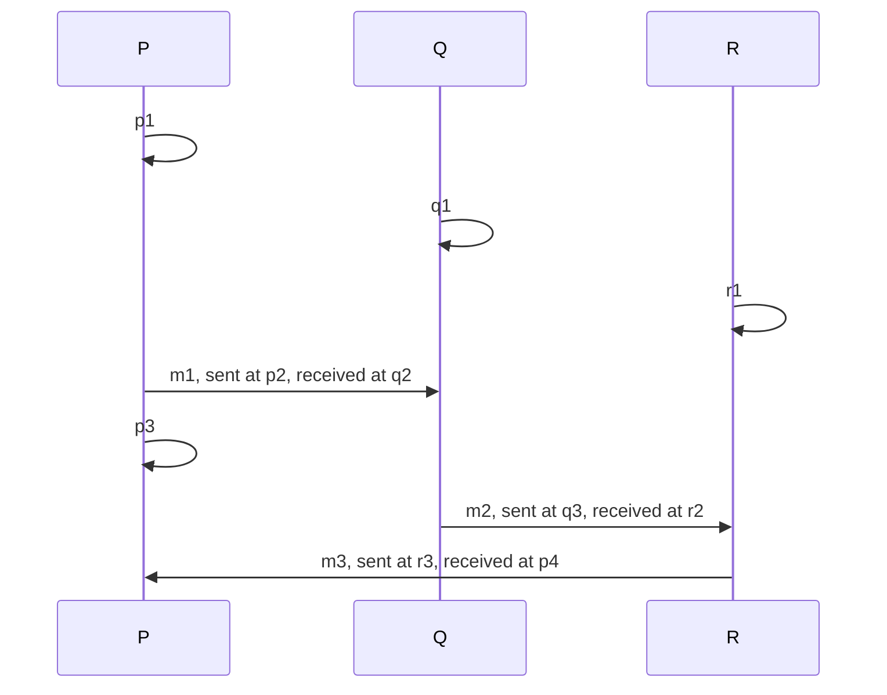

# Time and order: happened-before, Lamport clocks and vector clocks

## The idea

Machines' clocks disagree, so "which came first?" cannot be answered by comparing their readings, as the guide on why distributed systems are hard shows. Leslie Lamport's 1978 paper answers a different question that turns out to be the one that matters: **which event could have influenced which?**

An **event** is one step of one process: a step of a computation, sending a message, or receiving one. Lamport defines the relation **happened before**, written `a → b`, as the smallest relation with three rules:

1. If `a` and `b` are events of the same process and `a` comes first, then `a → b`.
2. If `a` is the sending of a message and `b` is the receipt of that same message, then `a → b`.
3. If `a → b` and `b → c`, then `a → c`.

Two different events are **concurrent** when neither happened before the other. In Lamport's words, `a → b` means that it is possible for `a` to causally affect `b`, and concurrent events are those that cannot causally affect each other. Concurrent does not mean "at the same moment": two events an hour apart are concurrent if no chain of messages connects them. The relation is a **partial order**: some pairs are ordered and some are not, and the paper says that in a distributed system it is sometimes impossible to say which of two events occurred first.

A **logical clock** gives every event a number, or a list of numbers, computed from the messages alone, so that the numbers reflect happened-before.

**Lamport clocks.** Each process keeps a counter. The paper states two implementation rules: a process increments its counter between any two of its events; and every message carries the sender's counter, and a process that receives a message sets its counter to at least its present value and to more than the message's stamp. The usual choice is the smallest that obeys them: add 1 for every event, and on a receive take the larger of the counter and the stamp, then add 1. The rules guarantee the paper's **clock condition**: if `a → b`, then the stamp of `a` is smaller than the stamp of `b`. The converse does not hold. A smaller stamp does not mean "happened before", because concurrent events get stamps in any order.

**Vector clocks.** Friedemann Mattern's 1989 paper gives each process a vector of counters, one entry per process; entry `j` of a process's vector counts the events of process `j` that it knows of. A process adds 1 to its own entry at each event. Every message carries the sender's vector, and the receiver takes the larger of each pair of entries, the componentwise maximum, before counting its own event. Vectors are compared entry by entry: `u ≤ v` when every entry of `u` is at most the one in `v`, `u < v` when also `u ≠ v`, and `u` and `v` are incomparable when neither is `<` the other. Mattern's theorem is the property Lamport's clock lacked: `a → b` exactly when the vector of `a` is `<` the vector of `b`, and `a` and `b` are concurrent exactly when their vectors are incomparable. Mattern notes that C. J. Fidge suggested vectors of logical clocks independently, in a paper of 1988.

## A worked example

Three processes, `P`, `Q` and `R`, exchange three messages: `p2` sends `m1` to `Q`, where `q2` receives it; `q3` sends `m2` to `R`, where `r2` receives it; and `r3` sends `m3` to `P`, where `p4` receives it. The other events are local steps. The program replays the history and stamps each event both ways:

```python examples/stamps.py
"""Replay a fixed history of three processes and stamp every event two ways.

A Lamport clock is one counter per process: +1 on every event, and on a receive first jump past
the message's stamp. A vector clock keeps one counter per process: an event adds one to its own
entry, and a receive first takes the larger of each entry from the message. Comparing the
stamps of two events shows what each kind of clock can and cannot tell.
"""

PROCESSES = ["P", "Q", "R"]
HISTORY = [  # (event, process, kind, message): in an order the events could have happened
    ("p1", "P", "local", None),
    ("q1", "Q", "local", None),
    ("r1", "R", "local", None),
    ("p2", "P", "send", "m1"),
    ("q2", "Q", "receive", "m1"),
    ("p3", "P", "local", None),
    ("q3", "Q", "send", "m2"),
    ("r2", "R", "receive", "m2"),
    ("r3", "R", "send", "m3"),
    ("p4", "P", "receive", "m3"),
]

lamport = {p: 0 for p in PROCESSES}
vector = {p: (0, 0, 0) for p in PROCESSES}
in_flight: dict[str, tuple[int, tuple[int, ...]]] = {}  # message -> the stamps it carries
stamps: dict[str, tuple[int, tuple[int, ...]]] = {}

for event, p, kind, message in HISTORY:
    if kind == "receive":
        carried_lamport, carried_vector = in_flight.pop(message)
        lamport[p] = max(lamport[p], carried_lamport)
        vector[p] = tuple(max(a, b) for a, b in zip(vector[p], carried_vector))
    lamport[p] += 1
    own = PROCESSES.index(p)
    vector[p] = tuple(n + 1 if i == own else n for i, n in enumerate(vector[p]))
    stamps[event] = (lamport[p], vector[p])
    if kind == "send":
        in_flight[message] = stamps[event]
    print(f"{event} on {p} ({kind:<7}) Lamport {lamport[p]}  vector {list(vector[p])}")


def happened_before(a: str, b: str) -> bool:
    va, vb = stamps[a][1], stamps[b][1]
    return va != vb and all(x <= y for x, y in zip(va, vb))


for a, b in [("p1", "r2"), ("r1", "p4"), ("p3", "q3"), ("p3", "r3")]:
    if happened_before(a, b):
        order = "before"
    elif happened_before(b, a):
        order = "after"
    else:
        order = "concurrent"
    print(f"{a} vs {b}: Lamport {stamps[a][0]} vs {stamps[b][0]}, vectors say {order}")
```

It prints:

```output examples/stamps.py
p1 on P (local  ) Lamport 1  vector [1, 0, 0]
q1 on Q (local  ) Lamport 1  vector [0, 1, 0]
r1 on R (local  ) Lamport 1  vector [0, 0, 1]
p2 on P (send   ) Lamport 2  vector [2, 0, 0]
q2 on Q (receive) Lamport 3  vector [2, 2, 0]
p3 on P (local  ) Lamport 3  vector [3, 0, 0]
q3 on Q (send   ) Lamport 4  vector [2, 3, 0]
r2 on R (receive) Lamport 5  vector [2, 3, 2]
r3 on R (send   ) Lamport 6  vector [2, 3, 3]
p4 on P (receive) Lamport 7  vector [4, 3, 3]
p1 vs r2: Lamport 1 vs 5, vectors say before
r1 vs p4: Lamport 1 vs 7, vectors say before
p3 vs q3: Lamport 3 vs 4, vectors say concurrent
p3 vs r3: Lamport 3 vs 6, vectors say concurrent
```



<!-- text-of-mermaid sha256:7bd5e0b811ab67deb17dae90460c2b57263818ec52930d0c0c5c7b8733e810ab -->
```text
 ┌───┐                               ┌───┐                               ┌───┐
 │ P │                               │ Q │                               │ R │
 └─┬─┘                               └─┬─┘                               └─┬─┘
   │                                   │                                   │
   ├───┐                               │                                   │
   │   │ p1                            │                                   │
   ◀───┘                               │                                   │
   │                                   │                                   │
   │                                   ├───┐                               │
   │                                   │   │ q1                            │
   │                                   ◀───┘                               │
   │                                   │                                   │
   │                                   │                                   ├───┐
   │                                   │                                   │   │ r1
   │                                   │                                   ◀───┘
   │                                   │                                   │
   │  m1, sent at p2, received at q2   │                                   │
   │───────────────────────────────────▶                                   │
   │                                   │                                   │
   ├───┐                               │                                   │
   │   │ p3                            │                                   │
   ◀───┘                               │                                   │
   │                                   │                                   │
   │                                   │  m2, sent at q3, received at r2   │
   │                                   │───────────────────────────────────▶
   │                                   │                                   │
   │                    m3, sent at r3, received at p4                     │
   ◀───────────────────────────────────────────────────────────────────────│
   │                                   │                                   │
 ┌─┴─┐                               ┌─┴─┐                               ┌─┴─┐
 │ P │                               │ Q │                               │ R │
 └───┘                               └───┘                               └───┘
```

In the drawing, time runs down each process's line, and each arrow between lines is a message. One event happened before another exactly when you can go from the first to the second by moving down the lines and along the arrows. Trace the four comparisons:

- **`p1` before `r2`**: down `P` to `p2`, along `m1` to `q2`, down `Q` to `q3`, along `m2` to `r2`. Both clocks agree: 1 is less than 5, and `[1, 0, 0]` is below `[2, 3, 2]` in every entry. `p1` could have influenced `r2`, although `P` never sent anything to `R`.
- **`r1` before `p4`**: down `R` to `r3`, along `m3`. The receive at `p4` jumps past `m3`'s stamp of 6, so `p4` gets 7 although `P` had counted only to 3.
- **`p3` and `q3`**: no way from one to the other, so they are concurrent. The Lamport stamps, 3 and 4, would suggest that `p3` came first, and the vectors show why it did not: `[3, 0, 0]` has more of `P` than `[2, 3, 0]`, which has more of `Q`. Each event knows something the other does not.
- **`p3` and `r3`**: concurrent too, with stamps 3 and 6. `r3` knows of `p1` and `p2` through `m1` and `m2`, but nothing that happened at `P` after `m1` left. A gap in Lamport stamps proves nothing.

Lamport's clock is exact in one direction only: if `a → b`, the stamps increase, but increasing stamps do not show `a → b`. The vectors decide every pair.

## When to use it

- **Ordering events for everyone alike.** Lamport stamps, with ties broken by an agreed order of the processes, give one **total order** of all events, in which every pair is ordered, and which every process computes the same way without asking anyone. Lamport's paper shows that this order extends happened-before, and uses it to grant a shared resource to requests in the order they were made.
- **Detecting concurrent updates.** When two copies of the same data can each be changed, vector stamps on the versions tell a later version, which replaces an earlier one, from a concurrent one, which must be kept or merged. The guides on replication and on CRDTs come back to this.
- **Recognizing stale information.** A counter that only grows, carried in every message, lets a receiver spot a message from the past. Raft's terms work this way.
- **Debugging and tracing.** Stamped events of several services can be sorted in an order that never puts an effect before its cause, and vectors show which events could have influenced a failure.
- **What to use instead**: when only one machine produces the events, its own sequence numbers already order them; and when you need to know when something happened in real time, a logical clock alone says nothing about it, since its numbers are counts, not times.

## Common traps

- **Reading a smaller Lamport stamp as "happened before".** Only the other direction holds. Comparing Lamport stamps to decide causality silently treats concurrent events as ordered.
- **Forgetting the jump on a receive.** Adding 1 without first taking the larger of the counter and the message's stamp breaks the clock condition the first time a message comes from a process that is ahead.
- **Mistaking the total order for real time.** The tie-break by process is arbitrary, and so is the order of concurrent events. The total order is consistent, not true; Lamport's paper calls the behavior that follows from mixing them up anomalous.
- **Sharing the vector instead of copying it.** A stamp is the vector at one moment. In languages where a list is a reference, storing the process's own list in an event means later events change earlier stamps.
- **Merging without counting the receive.** The receive is an event too: after taking the componentwise maximum, the process still adds 1 to its own entry.
- **Vectors whose length changes.** A vector has one entry per process. When processes come and go, entries must be added, and dropping one is only safe once nobody can still hold a stamp that mentions it.

## Complexity

For `n` processes:

| Clock | Work per event | Size of a stamp, and of each message | Comparing two stamps |
|-------|---------------|--------------------------------------|----------------------|
| Lamport | O(1) | One integer | O(1), but it decides causality in one direction only |
| Vector | O(n) on a receive, for the componentwise maximum; O(1) otherwise when updated in place | `n` integers | O(n), and it decides causality exactly |

The vector's cost grows with the number of processes, not with the number of events. Each entry is at most the number of events of its process, so it fits a small integer.

## Expert notes

- **Lamport's rules are conditions, not formulas.** The paper requires only that a process increments its counter between any two of its events, and that a receive sets the counter to at least its present value and to more than the message's stamp. Any increase that meets both works; the `+ 1` and `max(...) + 1` of the example are the smallest.
- **The total order is one of many.** The paper notes that the total order depends on the clocks and is not unique, and that for any total order that extends happened-before there is a system of clocks that yields it: only the partial order is fixed by the events themselves.
- **Why a central scheduler does not solve it.** Lamport's paper shows that granting a resource in the order requests reach a central process breaks "first requested, first served": `P1` sends a request to the scheduler and then a message to `P2`, and `P2`'s request, sent after receiving it, can reach the scheduler first.
- **Vector time is a lattice.** Mattern shows that vectors of `n` counters, ordered by `≤`, form a lattice whose least upper bound is the componentwise maximum, and that at any instant a process's own entry is the largest anyone holds for it, since only it advances that entry. The paper also uses vector time to recognize **consistent cuts**: sets of events that include, with every event, everything that happened before it, which are the states of a system that could have been observed at one instant.
- **The receive tick, before or after the maximum.** Mattern describes ticking as happening before the other actions of an event; the example ticks after taking the maximum. The result is the same, because the message cannot carry a larger value of the receiver's own entry than the receiver already holds.
- **Logical clocks inside other algorithms.** The Raft paper says that its terms act as a logical clock and let servers detect obsolete information such as stale leaders: every message carries the sender's term, and a server that sees a larger one adopts it.

## Practice

- `cstudy start logical-clocks`: stamp a scripted message history with Lamport clocks and a total order, then with vector clocks and a comparison of any two events; the path comes back to the problem's later levels, concurrent writes and hybrid clocks, after the guide on CRDTs.

## Further reading

- [Lamport, *Time, Clocks, and the Ordering of Events in a Distributed System*, Communications of the ACM 21(7), 1978](https://lamport.azurewebsites.net/pubs/time-clocks.pdf): happened-before, the clock condition, the implementation rules IR1 and IR2, the total order and the mutual exclusion example.
- [Mattern, *Virtual Time and Global States of Distributed Systems*, 1989](https://www.vs.inf.ethz.ch/publ/papers/VirtTimeGlobStates.pdf): sections 7 and 8, vector time, its lattice and the theorem that it characterizes causality; consistent cuts.
- [Ongaro and Ousterhout, *In Search of an Understandable Consensus Algorithm (Extended Version)*, 2014](https://raft.github.io/raft.pdf): section 5.1, terms as a logical clock.
