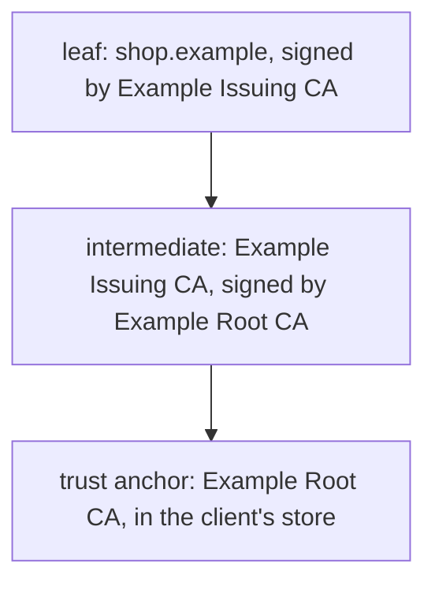
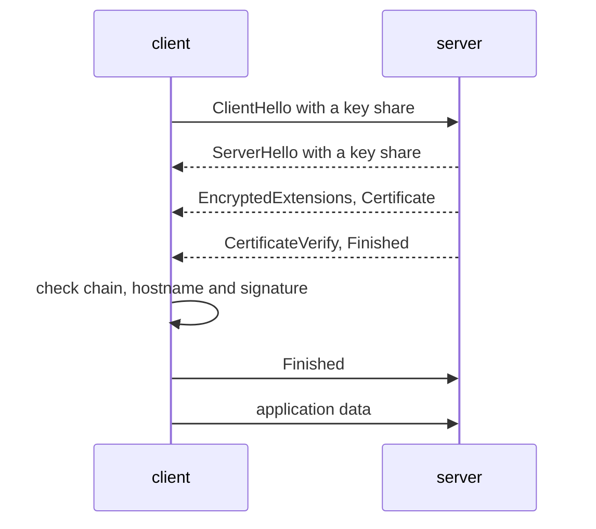

# TLS, certificates and chain validation

## The idea

Between your program and the server it talks to sit networks you do not control: a café's wireless network, an internet provider, routers along the way. Anyone in that path can read the bytes that pass and change them. **TLS**, Transport Layer Security, builds a secure channel over such a network. RFC 9846, which defines TLS 1.3 and obsoletes RFC 8446, names three properties: **authentication** (the server side of the channel is always authenticated, the client side optionally), **confidentiality** (data sent after the channel is set up is visible only to the two endpoints) and **integrity** (attackers cannot change that data without being detected).

Encryption alone would not be enough. If you encrypt carefully to the wrong party, an attacker in the middle reads everything. So the hard part is authentication: being sure that the key you are about to trust belongs to `shop.example` and not to whoever sits on the path. TLS gets there with **public-key signatures**. A key pair has a **private key**, which only its owner holds, and a **public key**, which anyone may have. NIST's glossary describes a digital signature as an operation in which the private key signs data and the public key verifies the signature, giving authenticity, integrity and non-repudiation, though not confidentiality or protection against replay.

A **certificate** applies that to names. RFC 5280, the profile of X.509 certificates used on the internet, describes certificates as data structures that bind public key values to subjects. A certificate says, in effect, "this public key belongs to `shop.example`", and it is signed by a **certificate authority** (CA), whose signature the client can check. Its main fields:

| Field | What it holds |
|-------|---------------|
| Subject | Who the certificate is about |
| Issuer | The CA that signed it |
| Validity | `notBefore` and `notAfter`; RFC 5280 makes the period run from one through the other, inclusive |
| Subject alternative name | The identities it is for, such as DNS names |
| Basic constraints | Whether its key may be used to verify signatures on other certificates, the `cA` flag, and how many intermediate CAs may follow it, `pathLenConstraint` |
| Key usage | What its key may do; `keyCertSign` means signing certificates |

The CA that signed a server's certificate is rarely one the client knows directly. Its certificate was signed by another CA, and so on, up to a **trust anchor**, a CA that the client was configured to trust, for example from the operating system's store of root certificates. The server's certificate is the **leaf**, the ones in between are **intermediates**, and the sequence from leaf to anchor is a **certification path**, or chain. RFC 5280's path validation algorithm takes the trust anchor as an input, using its name and public key, and walks the path from the anchor down. For each certificate it checks that:

- the signature on it verifies with the public key of the certificate before it;
- its validity period includes the current time;
- it is not revoked at the current time;
- its issuer name is the subject name of the certificate before it;

and for each intermediate, before moving on, that the basic constraints extension is present with `cA` set, that the number of intermediates allowed below it has not run out, and that its key usage, if present, includes `keyCertSign`.

Then the leaf must be for the name you asked for. RFC 9525, the current rules for service identity in TLS, says the subject's Common Name must not be used to identify a service: only identities such as the DNS names in the subject alternative name count. DNS names compare without regard to ASCII case, and a **wildcard** is allowed only as the complete left-most label, as in `*.shop.example`, where it matches exactly one label: `api.shop.example`, but neither `shop.example` nor `a.b.shop.example`. A name with a wildcard anywhere else is invalid and must be ignored.

TLS itself leaves all of this to the certificate profile: RFC 9846 says detailed certificate validation procedures are out of scope for TLS and points to RFC 5280. What TLS 1.3 adds is the proof that the server holds the private key of the certificate it sent, and keys that nobody on the path can compute. In a key exchange, each side sends a public value, its key share, and both compute the same secret from them; someone who sees only the shares cannot.

## A worked example

The program below shows what a signature on a certificate proves, with **textbook RSA**: a public key is a pair `(n, e)`, the private key is `d`, signing a digest `h` computes `h^d mod n`, and checking computes `s^e mod n` and compares it with the digest. The primes are tiny and there is no padding, so it is a toy, but the logic is the real one.

```python examples/toy_signatures.py
"""What a signature on a certificate proves, with textbook RSA on small numbers.

The numbers are far too small to be secure, and real signatures add padding: this shows the
idea only. Signing uses the private exponent d, which only the key's owner has; checking uses
the public pair (n, e), which anyone may have.
"""

import hashlib


def is_prime(n: int) -> bool:
    return n > 1 and all(n % k for k in range(2, int(n**0.5) + 1))


def make_key(p: int, q: int, e: int = 65537) -> dict:
    assert is_prime(p) and is_prime(q)
    return {"n": p * q, "e": e, "d": pow(e, -1, (p - 1) * (q - 1))}


def digest(text: str, n: int) -> int:
    return int.from_bytes(hashlib.sha256(text.encode()).digest()) % n


def sign(text: str, key: dict) -> int:
    return pow(digest(text, key["n"]), key["d"], key["n"])


def checks(text: str, signature: int, public: dict) -> bool:
    return pow(signature, public["e"], public["n"]) == digest(text, public["n"])


ca = make_key(1_000_003, 1_000_033)
attacker = make_key(1_000_037, 1_000_039)
ca_public = {"n": ca["n"], "e": ca["e"]}

certificate = "subject=shop.example; issuer=Example CA; key=<shop's public key>"
signature = sign(certificate, ca)
print("genuine certificate checks:", checks(certificate, signature, ca_public))

edited = certificate.replace("shop.example", "bank.example")
print("edited after signing:      ", checks(edited, signature, ca_public))

forged = "subject=bank.example; issuer=Example CA; key=<attacker's public key>"
print("names the CA, signed by someone else:", checks(forged, sign(forged, attacker), ca_public))
```

It prints:

```output examples/toy_signatures.py
genuine certificate checks: True
edited after signing:       False
names the CA, signed by someone else: False
```

The genuine certificate checks against the CA's public key. Changing one name after signing breaks the check, since the signature was made over the original text. The forged certificate *says* `issuer=Example CA`, and anyone can write that; it was signed with the attacker's key, so it fails against the CA's. This is why a chain is linked by signatures and not by names: a matching issuer name is where to look for the signer, not proof that it signed.



<!-- text-of-mermaid sha256:4e4d3562f844575eddd7dd2bf2e708867601defb766b513b74ed4b2de9af0093 -->
```text
┌───────────────────────────────────────────────────────────┐
│      leaf: shop.example, signed by Example Issuing CA     │
└─────────────────────────────┬─────────────────────────────┘
                              ▼
┌───────────────────────────────────────────────────────────┐
│intermediate: Example Issuing CA, signed by Example Root CA│
└─────────────────────────────┬─────────────────────────────┘
                              ▼
┌───────────────────────────────────────────────────────────┐
│    trust anchor: Example Root CA, in the client's store   │
└───────────────────────────────────────────────────────────┘
```

The diagram shows a chain of three: each arrow points from a certificate to the CA that signed it, ending at a trust anchor the client was configured with, whose own certificate is not checked.

TLS 1.3's handshake puts the certificate to work:



<!-- text-of-mermaid sha256:a4ba275ae79929278560660b4e69020c5a70fedb91100e7b78eeec6574dce3ee -->
```text
┌────────┐                            ┌────────┐
│ client │                            │ server │
└────┬───┘                            └────┬───┘
     │                                     │
     │    ClientHello with a key share     │
     │─────────────────────────────────────▶
     │                                     │
     │    ServerHello with a key share     │
     ◀╌╌╌╌╌╌╌╌╌╌╌╌╌╌╌╌╌╌╌╌╌╌╌╌╌╌╌╌╌╌╌╌╌╌╌╌╌│
     │                                     │
     │  EncryptedExtensions, Certificate   │
     ◀╌╌╌╌╌╌╌╌╌╌╌╌╌╌╌╌╌╌╌╌╌╌╌╌╌╌╌╌╌╌╌╌╌╌╌╌╌│
     │                                     │
     │     CertificateVerify, Finished     │
     ◀╌╌╌╌╌╌╌╌╌╌╌╌╌╌╌╌╌╌╌╌╌╌╌╌╌╌╌╌╌╌╌╌╌╌╌╌╌│
     │                                     │
     ├───┐                                 │
     │   │ check chain, hostname and signature
     ◀───┘                                 │
     │                                     │
     │              Finished               │
     │─────────────────────────────────────▶
     │                                     │
     │          application data           │
     │─────────────────────────────────────▶
     │                                     │
┌────┴───┐                            ┌────┴───┐
│ client │                            │ server │
└────────┘                            └────────┘
```

The client offers a key share in its `ClientHello`, the server answers with its own in the `ServerHello`, and RFC 9846 encrypts every handshake message after the `ServerHello`. The server then sends its `Certificate` and a `CertificateVerify`, a signature over the entire handshake so far made with the private key of that certificate, which RFC 9846 describes as explicit proof that the server possesses the private key. The `Finished` messages provide key confirmation and bind the endpoint's identity to the keys exchanged. A recorded certificate is public and anyone can replay it; the `CertificateVerify` over this handshake cannot be replayed.

Python's `ssl` module shows which of these checks a client performs:

```python examples/client_settings.py
"""What Python's TLS client checks by default, and the two switches that turn the checks off."""

import ssl

context = ssl.create_default_context()
print("verify_mode:   ", context.verify_mode.name)
print("check_hostname:", context.check_hostname)
print("TLS 1.2 or newer only:", context.minimum_version >= ssl.TLSVersion.TLSv1_2)
print("falls back to the common name:", context.hostname_checks_common_name)

try:
    context.verify_mode = ssl.CERT_NONE
except ValueError as error:
    print("ValueError:", error)

# Turning verification off takes two steps, in this order. Both are mistakes in a client.
context.check_hostname = False
context.verify_mode = ssl.CERT_NONE
print("after both:", context.verify_mode.name, context.check_hostname)

server_side = ssl.SSLContext(ssl.PROTOCOL_TLS_SERVER)
print("a server context checks clients:", server_side.verify_mode.name)
```

It prints:

```output examples/client_settings.py
verify_mode:    CERT_REQUIRED
check_hostname: True
TLS 1.2 or newer only: True
falls back to the common name: True
ValueError: Cannot set verify_mode to CERT_NONE when check_hostname is enabled.
after both: CERT_NONE False
a server context checks clients: CERT_NONE
```

`create_default_context()` requires a certificate and checks the hostname; the documentation recommends it for clients that have no special requirements. Python 3.10 made TLS 1.2 the minimum version for its client and server protocols. The context will not drop to `CERT_NONE` while hostname checking is on, so code that disables verification has to turn off `check_hostname` first; seeing both lines in a code review means a client that will trust anyone on the path. A context created for a server does not ask clients for certificates unless told to, which is how most TLS works: the server is authenticated, the client only optionally.

## When to use it

- **Every connection that crosses a network you do not control**, which includes the networks between your own services.
- **The platform's defaults** for clients: in Python, `ssl.create_default_context()`, with the system's root store. Hand-built settings are where verification gets lost.
- **Client certificates**, mutual TLS, when a service must authenticate the client at the TLS layer, typically between services; the server then has to require them, as Python's documentation notes for server mode.
- **Validation code of your own** only in tools that inspect or test certificates; production clients use their platform's verifier.
- **Government guidance as a floor**: NIST SP 800-52 Rev. 2 requires TLS 1.2 support for US government servers and clients, and support for TLS 1.3 by January 1, 2024.

## Common traps

- **Turning verification off "for now."** A test setting that ships disables authentication for good, and nothing visibly breaks.
- **Checking the chain but not the name.** A valid certificate for `attacker.example` has a perfect chain. Python's documentation says `CERT_REQUIRED` is not sufficient by itself: you also have to check that the certificate matches the service, which `check_hostname` does.
- **Using the Common Name.** RFC 9525 forbids it. Python's `hostname_checks_common_name` still defaults to true, falling back to the common name when a certificate has no subject alternative name extension; the example prints it.
- **Off by one second.** The validity period includes both `notBefore` and `notAfter`.
- **Linking by name alone**, as the toy example's forgery shows; and, the other way round, a valid signature from a certificate whose subject is not the issuer name is no link either.
- **Any certificate as a CA.** Without the `cA` check, the owner of any ordinary site certificate could sign a certificate for another site with its key.
- **Loose wildcards.** A wildcard in the middle of a name, inside a label, or matching several labels widens a certificate far beyond what its owner was issued.

## Complexity

| Step | Cost |
|------|------|
| Checking one certificate | One signature verification, which dominates, plus a few comparisons of dates, names and flags |
| Validating a path of length n | n signature verifications and O(n) checks |
| Building the path | A search over the certificates the server sent and the client knows, since cross-signed CAs give several candidate chains; RFC 4158 notes that path building, unlike validation, is not addressed by the standards |
| Checking revocation | A lookup in a certificate revocation list, or an online status query, which costs a network round trip unless the answer is cached |
| The handshake | A key exchange and one signature from the server; every handshake message after the `ServerHello` is encrypted |

Signature checks are the expensive computation, one per certificate in the path.

## Expert notes

- **Path length.** `pathLenConstraint` gives the maximum number of non-self-issued intermediate certificates that may follow a certificate in a valid path. A **self-issued** certificate, whose subject and issuer are the same, does not count.
- **CA flag and key usage agree.** RFC 5280 says that if `cA` is not asserted, the `keyCertSign` bit must not be asserted either. Validation still checks both, since a certificate may break the rule.
- **The anchor is configuration.** Path validation takes the anchor's name and public key as inputs, and processes only the certificates below it: the anchor is trusted because it was configured.
- **Revocation.** A certificate revocation list (CRL) is a time-stamped list of revoked certificates signed by a CA (RFC 5280). The Online Certificate Status Protocol (OCSP, RFC 6960) answers about one certificate at a time with `good`, `revoked` or `unknown`; `unknown` usually means the responder does not serve that certificate's issuer.
- **Certificate Transparency** (RFC 9162) logs certificates publicly as they are issued, so that anyone can audit what CAs issue and notice suspect certificates.
- **Forward secrecy.** In TLS 1.3, every public-key key exchange provides forward secrecy: the static RSA and Diffie-Hellman exchanges were removed. RFC 9846 defines the property: if long-term keying material is compromised after the handshake is complete, the session key stays secure. The exception is early data, 0-RTT, for which RFC 9846 gives no forward secrecy guarantee and no guarantee against replay between connections.
- **Weak signatures.** RFC 9846 requires aborting the handshake with a `bad_certificate` alert when a certificate the client would need to validate is signed with an MD5-based algorithm, and recommends the same for SHA-1; neither rule applies to self-signed certificates or trust anchors, whose signatures the client does not need to validate.
- **Hostname checks moved.** Since Python 3.7, the hostname is matched by the underlying TLS library during the handshake, which is aborted early on a mismatch, instead of by Python's own `match_hostname()`.
- **Wildcards and their risk.** RFC 9525's security considerations note that a wildcard certificate vouches for every single-label name in its domain, though not for deeper levels, which risks vouching for rogue or buggy hosts.

## Practice

- `cstudy start cert-chain-validator`: decide whether to trust a server's certificate, with signatures given as data: dates and names, a chain to a trust anchor, CA constraints, revocation, and a reason for every rejected path.

## Further reading

- [RFC 9846, The Transport Layer Security (TLS) Protocol Version 1.3](https://www.rfc-editor.org/rfc/rfc9846), which obsoletes RFC 8446: the properties, the handshake, `CertificateVerify` and `Finished`, forward secrecy and 0-RTT.
- [RFC 5280, Internet X.509 Public Key Infrastructure Certificate and CRL Profile](https://www.rfc-editor.org/rfc/rfc5280): certificate fields, validity, basic constraints, key usage, CRLs and path validation (section 6.1).
- [RFC 9525, Service Identity in TLS](https://www.rfc-editor.org/rfc/rfc9525): no Common Name, DNS name and wildcard matching, and wildcard risks.
- [RFC 4158, Certification Path Building](https://www.rfc-editor.org/rfc/rfc4158), [RFC 6960, OCSP](https://www.rfc-editor.org/rfc/rfc6960) and [RFC 9162, Certificate Transparency Version 2.0](https://www.rfc-editor.org/rfc/rfc9162).
- [NIST SP 800-52 Rev. 2, Guidelines for the Selection, Configuration, and Use of TLS Implementations](https://csrc.nist.gov/pubs/sp/800/52/r2/final).
- [NIST glossary, digital signature](https://csrc.nist.gov/glossary/term/digital_signature).
- [Python `ssl`](https://docs.python.org/3/library/ssl.html): `create_default_context`, `check_hostname`, `verify_mode`, `hostname_checks_common_name` and the security considerations.
