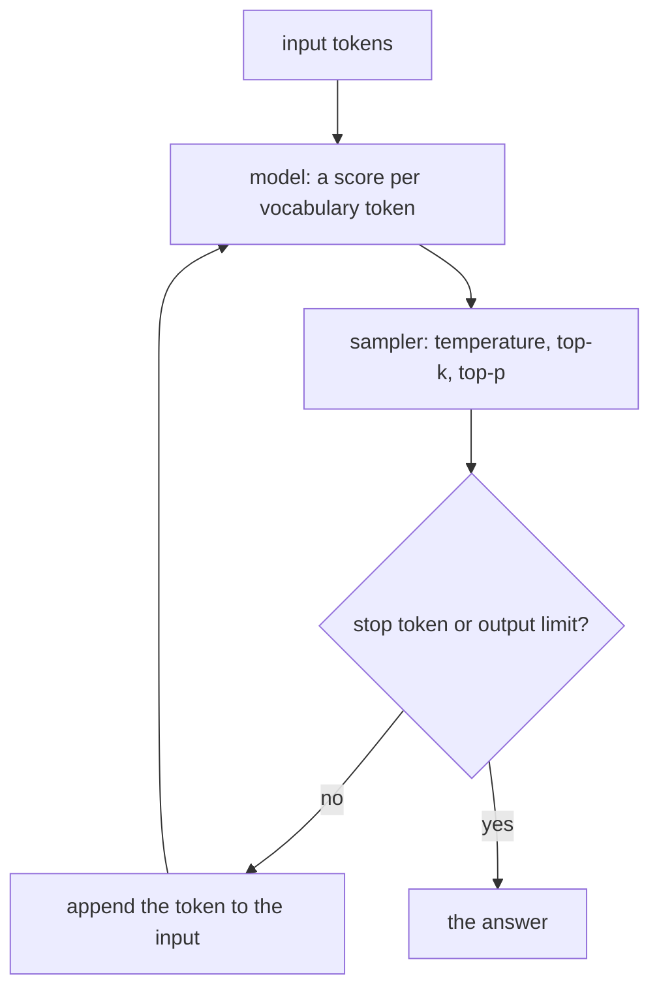

# Tokens, context windows and sampling

## The idea

A language model is a function that reads a sequence of pieces of text and gives a score to every piece it could write next. Those pieces are **tokens**, and almost everything you will build around a model is counted in them: what you send, what you get back, how much fits, how long it takes and what it costs.

A token is neither a character nor a word. The model has a fixed **vocabulary**, a list of pieces chosen once, before the model was trained, and every text is cut into pieces from that list. Common words are usually one piece each; rare words, names, numbers and code are cut into several. A model never sees letters directly, only the numbers of the pieces in its vocabulary.

Three ideas follow, and this guide takes them in order:

1. **Tokenization**: how a text becomes tokens, and why the count is not the number of words.
2. **The context window**: the most tokens a model can take into account at once. Everything the model knows about your request, the instructions, the conversation, the documents you pasted in, and the answer it is writing, has to fit in it.
3. **Sampling**: the model does not write a sentence in one go. It scores every possible next token, one token is chosen, it is appended to the input, and the model runs again. How that one token is chosen decides whether the output is predictable or varied.

## A worked example

### Cutting text into tokens

One common way to build a vocabulary is **byte pair encoding** (BPE), adapted to text by Sennrich, Haddow and Birch in 2016 from a compression method. Start with single characters, and an end-of-word marker so that a piece at the end of a word stays distinct from the same letters inside one. Count every pair of neighbouring symbols across a corpus, weighting each word by how often it occurs. Merge the most frequent pair into a new symbol, everywhere. Repeat. Each merge adds one symbol to the vocabulary, so the number of merges decides its size. Frequent words end up as a single symbol; rare ones stay as several.

```python examples/bpe_merges.py
"""Byte pair encoding on a toy corpus: learn merges from word counts, then split words with them."""

from collections import Counter

END = "_"  # ends every word, so a piece at the end of a word differs from the same letters inside one


def merge(symbols: tuple[str, ...], pair: tuple[str, str]) -> tuple[str, ...]:
    merged, i = [], 0
    while i < len(symbols):
        if symbols[i : i + 2] == pair:
            merged.append(symbols[i] + symbols[i + 1])
            i += 2
        else:
            merged.append(symbols[i])
            i += 1
    return tuple(merged)


def learn(word_counts: dict[str, int], rounds: int) -> list[tuple[str, str]]:
    words = {(*word, END): count for word, count in word_counts.items()}
    merges = []
    for _ in range(rounds):
        pairs: Counter[tuple[str, str]] = Counter()
        for symbols, count in words.items():
            for pair in zip(symbols, symbols[1:]):
                pairs[pair] += count
        best = max(sorted(pairs), key=pairs.__getitem__)  # equal counts: the first pair in sorted order
        merges.append(best)
        words = {merge(symbols, best): count for symbols, count in words.items()}
    return merges


def split(word: str, merges: list[tuple[str, str]]) -> list[str]:
    symbols = (*word, END)
    for pair in merges:
        symbols = merge(symbols, pair)
    return list(symbols)


corpus = {"play": 6, "played": 4, "playing": 3, "replay": 2, "stay": 3, "staying": 2}
merges = learn(corpus, rounds=10)
print("merges, in the order learned:")
for number, (left, right) in enumerate(merges, start=1):
    print(f"  {number}. {left} + {right} -> {left + right}")

for word in ["playing", "replayed", "staged", "zebra"]:
    pieces = split(word, merges)
    print(f"{word:>9}: {len(word)} letters -> {len(pieces)} tokens {pieces}")
```

It prints:

```output examples/bpe_merges.py
merges, in the order learned:
  1. a + y -> ay
  2. l + ay -> lay
  3. p + lay -> play
  4. play + _ -> play_
  5. g + _ -> g_
  6. i + n -> in
  7. in + g_ -> ing_
  8. s + t -> st
  9. st + ay -> stay
  10. d + _ -> d_
  playing: 7 letters -> 2 tokens ['play', 'ing_']
 replayed: 8 letters -> 5 tokens ['r', 'e', 'play', 'e', 'd_']
   staged: 6 letters -> 5 tokens ['st', 'a', 'g', 'e', 'd_']
    zebra: 5 letters -> 6 tokens ['z', 'e', 'b', 'r', 'a', '_']
```

The first merges glue `a` and `y`, then `l` and `ay`, then `p` and `lay`: `play` is the most frequent run of letters in the corpus, so it becomes one symbol after three rounds. `ing_` follows, since `playing` and `staying` share it. Then:

- **A frequent word costs few tokens.** `playing` is 7 letters and 2 tokens.
- **An unseen word still splits.** `replayed` never occurred in the corpus, but it is cut into pieces the vocabulary knows, with `play` in the middle. As long as its characters are in the vocabulary, nothing is "unknown": in the worst case a word falls back to single characters.
- **A word from nowhere costs the most.** `zebra` shares nothing with the corpus, so each letter is its own token, plus the end marker: 6 tokens for 5 letters.

A real vocabulary is learned the same way from a large corpus, with many more merges, 59,500 in one of Sennrich and colleagues' setups, so its pieces fit the kinds of text that were common in that corpus. Text unlike it, as `zebra` shows on a small scale, falls back to shorter pieces and so takes more tokens per character. Different models can use different vocabularies, so the same text can have a different token count for each, and the only reliable count is the one made with that model's own tokenizer.

### From scores to one token

A model's output for one step is a **logit** per token of its vocabulary: a raw score, any real number, higher meaning more likely. The **softmax** turns logits into probabilities: raise `e` to each score, then divide by the total, so every probability is positive and they add up to 1. **Temperature** `t` divides every logit before the softmax:

```text
p(token) = exp(logit(token) / t) / sum over every token v of exp(logit(v) / t)
```

A temperature below 1 sharpens the distribution, so likely tokens get likelier; above 1 flattens it. Two common ways cut off the unlikely tail before drawing: **top-k** keeps the `k` most likely tokens, and **top-p**, also called nucleus sampling, keeps the fewest most likely tokens whose probabilities add up to at least `p`. Either way the kept probabilities are divided by their total, so they add up to 1 again, and one token is drawn from them.

```python examples/sampling.py
"""From a model's scores for the next token to one chosen token: softmax, temperature, top-k, top-p."""

import math

# A fake model's scores (logits) for the token after "The cat sat on the".
LOGITS = {"mat": 4.0, "sofa": 3.2, "floor": 3.0, "roof": 1.5, "moon": -1.0}


def softmax(logits: dict[str, float], temperature: float = 1.0) -> dict[str, float]:
    scaled = {token: score / temperature for token, score in logits.items()}
    highest = max(scaled.values())
    weights = {token: math.exp(score - highest) for token, score in scaled.items()}
    total = sum(weights.values())
    return {token: weight / total for token, weight in weights.items()}


def best_first(probs: dict[str, float]) -> list[str]:
    return sorted(probs, key=lambda token: -probs[token])


def renormalized(probs: dict[str, float], kept: list[str]) -> dict[str, float]:
    total = sum(probs[token] for token in kept)
    return {token: probs[token] / total for token in kept}


def top_k(probs: dict[str, float], k: int) -> dict[str, float]:
    return renormalized(probs, best_first(probs)[:k])


def top_p(probs: dict[str, float], p: float) -> dict[str, float]:
    """The fewest most likely tokens whose probabilities add up to at least p."""
    kept, mass = [], 0.0
    for token in best_first(probs):
        kept.append(token)
        mass += probs[token]
        if mass >= p:
            break
    return renormalized(probs, kept)


def draw(probs: dict[str, float], u: float) -> str:
    """Pick a token with a number u in [0, 1), which stands in for a random draw."""
    cumulative = 0.0
    for token in best_first(probs):
        cumulative += probs[token]
        if u < cumulative:
            return token
    return best_first(probs)[-1]


def show(probs: dict[str, float]) -> str:
    return "  ".join(f"{token} {probs[token]:.3f}" for token in best_first(probs))


for temperature in (0.5, 1.0, 2.0):
    print(f"temperature {temperature}: {show(softmax(LOGITS, temperature))}")

probs = softmax(LOGITS)
print("greedy:", best_first(probs)[0])
print("top-k, k=2:", show(top_k(probs, 2)))
print("top-p, p=0.9:", show(top_p(probs, 0.9)))
draws = [0.10, 0.55, 0.80, 0.97, 0.999]
print("draws from the full distribution:", [draw(probs, u) for u in draws])
print("draws after top-p 0.9:          ", [draw(top_p(probs, 0.9), u) for u in draws])
```

It prints:

```output examples/sampling.py
temperature 0.5: mat 0.744  sofa 0.150  floor 0.101  roof 0.005  moon 0.000
temperature 1.0: mat 0.525  sofa 0.236  floor 0.193  roof 0.043  moon 0.004
temperature 2.0: mat 0.378  sofa 0.253  floor 0.229  roof 0.108  moon 0.031
greedy: mat
top-k, k=2: mat 0.690  sofa 0.310
top-p, p=0.9: mat 0.550  sofa 0.247  floor 0.202
draws from the full distribution: ['mat', 'sofa', 'floor', 'roof', 'moon']
draws after top-p 0.9:           ['mat', 'mat', 'floor', 'floor', 'floor']
```

The fake model scores five candidates for the word after "The cat sat on the". Reading the output line by line:

- **Temperature reshapes, it never reorders.** `mat` is the most likely at every temperature: 0.744 at 0.5, 0.525 at 1.0, 0.378 at 2.0. At 2.0 even `moon` gets 3%.
- **Greedy decoding** always takes the most likely token, `mat`. It is the limit of a temperature going to 0.
- **Top-k** with `k = 2` keeps `mat` and `sofa`, however much probability the others had. `floor` had 0.193, almost as much as `sofa`, and is gone.
- **Top-p** with `p = 0.9` keeps `mat`, `sofa` and `floor`, which add up to 0.954; `roof` and `moon` together had less than 5%. How many tokens top-p keeps changes from step to step with the shape of the distribution, which a fixed `k` cannot do.
- **The draws** stand in for random numbers, so the example prints the same every run. From the full distribution, a draw of 0.999 lands on `moon`; after top-p, the same draw lands on `floor`. Over a long answer, those rare tail tokens are where text starts to go wrong.

### The generation loop



<!-- text-of-mermaid sha256:fc1ca17e39291fa1405d1eda43bf2e4361951899fa7c7d8bc20439dadda9ed2e -->
```text
┌───────────────────────────────────┐
│            input tokens           │
└─────────────────┬─────────────────┘
                  ▼────────────────────┐
┌───────────────────────────────────┐  │
│model: a score per vocabulary token│  │
└─────────────────┬─────────────────┘  │
                  ▼                    │
┌───────────────────────────────────┐  │
│ sampler: temperature, top-k, top-p│  │
└─────────────────┬─────────────────┘  │
                  ▼                    │
◇───────────────────────────────────◇  │
│    stop token or output limit?    ├──┼──────yes
◇────────────────no─────────────────◇  │       │
                  ▼                    │       ▼
┌───────────────────────────────────┐  │ ┌──────────┐
│   append the token to the input   │  │ │the answer│
└─────────────────┬─────────────────┘  │ └──────────┘
```

The drawing shows why writing costs more time per token than reading: every token of the answer is one more run of the model, each one waiting for the token before it, while the prompt is read in one pass. The paper that introduced the **transformer**, a neural network design for sequences, describes its decoder as auto-regressive, "consuming the previously generated symbols as additional input when generating the next". Two settings stop the loop: a **stop sequence**, a token or string that ends the answer, and an **output limit**, often called `max_tokens`, the most tokens the answer may use. An answer cut by the limit simply ends mid-sentence, so check whether the answer stopped or was cut.

Because each token is ready before the next one exists, an answer can be shown while it is written. That is **streaming**. Over HTTP it is often sent as server-sent events: a response of type `text/event-stream` in which each `data:` line adds to an event, a blank line sends it, and a line starting with a colon is a comment. A client that waits for the whole answer before showing anything throws that advantage away.

### The context window

The **context window** is the most tokens the model can take into account at once. Since the model reads its own output as input on every step, the window holds the prompt and the answer together. A request that fills the window with its prompt leaves no room to answer.

Plan a request like a budget. Suppose a window of 16,000 tokens and answers of up to 1,000:

| Part | Tokens |
|------|--------|
| Instructions | 600 |
| Conversation so far | 4,200 |
| Retrieved documents | 9,000 |
| Room kept for the answer | 1,000 |
| Margin, for counting errors | 1,200 |
| **Total** | **16,000** |

When the conversation grows, something has to give: the oldest turns are dropped or summarized, fewer documents are retrieved, or the documents are cut shorter. Choosing what goes in, under a budget, is a small optimization problem of its own, and the later guides on retrieval and agent memory come back to it.

## When to use it

- **Estimating cost and speed.** Context limits are counted in tokens, and so is usage wherever a model is billed by the token. Count tokens with the model's own tokenizer, not words or characters.
- **Sizing a prompt.** Check that the prompt plus the longest answer you allow fits the window, with a margin. Decide in advance what to cut when it does not.
- **Choosing sampling settings.** Use greedy decoding or a low temperature where there is one right answer: extraction, classification, code that must compile, structured output. Use a higher temperature with top-p where variety helps: brainstorming, several candidate answers to choose from.
- **Streaming.** Stream whenever a person waits for the answer, so that the first words appear while the rest is written.

## Common traps

- **Counting words or characters.** A budget computed in words is wrong by a factor that changes with the language and the content. Numbers, code, URLs and non-English text are the usual surprises.
- **Forgetting the answer's share of the window.** A prompt that fills the window leaves the model nothing to write with. Reserve the output limit before you fill the rest.
- **Treating a cut answer as a whole one.** An answer that hit the output limit ends abruptly, and if it was meant to be JSON, it is broken JSON. Check why generation stopped before you use the answer.
- **Expecting the same output twice.** With sampling on, the same prompt gives different answers by design, so tests should check properties of an answer, not its exact text.
- **Stuffing the context.** More text is not always better. Models tend to use information at the start and the end of a long context better than information in the middle, so ten relevant passages can beat fifty.
- **Assuming one tokenizer.** Two models with different vocabularies give the same text different token counts, and so different limits and costs.

## Complexity

A transformer is a stack of **layers**. Each layer holds every token as a vector of `d` numbers and updates it by relating it to the other tokens of the sequence, a step called **self-attention**. For a prompt of `n` tokens and an answer of `m` tokens:

| Step | Cost |
|------|------|
| Tokenize a text of `L` characters | Roughly linear in `L` in practice |
| Self-attention over a sequence of `n` tokens, per layer | O(n² · d), as the transformer paper's comparison table gives it |
| Read the prompt | One pass over `n` tokens, which runs in parallel |
| Write the answer | `m` sequential steps, one token each |
| Memory for keys and values kept between steps | Grows with `n + m`, per request |

The quadratic term is one reason long contexts are expensive and windows are limited. The sequential term is why the length of the answer, more than the length of the prompt, decides how long a person waits. Self-attention computes, for each token in each layer, two vectors called its **key** and its **value**. Serving systems keep them for the tokens already processed, the **KV cache**, so that each new step only computes the new token's; its memory grows with every token of the request.

## Expert notes

- **Where BPE came from.** Byte pair encoding began as a data compression method that repeatedly replaces the most frequent pair of bytes with an unused byte. Sennrich, Haddow and Birch applied it to characters and character sequences to give translation models an open vocabulary: rare and unknown words become sequences of subword units, and the number of merges is the algorithm's only hyperparameter. They also did not merge across word boundaries, which is why the example keeps words apart.
- **Temperature, top-k and top-p together.** Holtzman and colleagues showed that maximization-based decoding, such as beam search, leads to degeneration, output that is "bland, incoherent, or gets stuck in repetitive loops", and proposed nucleus sampling, which truncates the unreliable tail and lets the size of the kept set rise and fall with the model's confidence. Top-k sampling, used by Fan, Lewis and Dauphin with `k = 10`, keeps a fixed number of candidates, too few where the distribution is flat and too many where it is peaked. A temperature applied before either one reshapes the distribution first.
- **Lost in the middle.** Liu and colleagues measured question answering with the relevant passage moved through a long context: accuracy was highest with the passage at the start or the end, and dropped in the middle, even for models built for long contexts. Put what matters most first or last.
- **The KV cache is per request.** The keys and values for a request's tokens are kept between steps and grow with it. Requests that share a long identical start, such as the same instructions, can share that cached part, which is the basis of prompt caching in the guide on cost.
- **Usage is reported, not computed by you.** A provider's own count of prompt and completion tokens is the one that is billed. A client-side count is an estimate, useful for budgeting before the request; reconcile with the reported usage after.

## Practice

- `cstudy start context-packer`: choose which stored items go into a model's context so that their tokens fit a budget, then add pinned items, caps per category and near-duplicates. It is the budget table of this guide, made exact.
- `cstudy start llm-gateway-typescript`: a gateway that streams answers piece by piece as they arrive, passes on the output limit, and counts the tokens each team used. Streaming without buffering is level 1.

## Further reading

- [Sennrich, Haddow and Birch, *Neural Machine Translation of Rare Words with Subword Units* (2016)](https://arxiv.org/abs/1508.07909): byte pair encoding for subword vocabularies.
- [Vaswani and others, *Attention Is All You Need* (2017)](https://arxiv.org/abs/1706.03762): the transformer, its auto-regressive decoder, and the O(n² · d) cost of self-attention per layer.
- [Holtzman and others, *The Curious Case of Neural Text Degeneration* (2020)](https://arxiv.org/abs/1904.09751): temperature, top-k and nucleus (top-p) sampling.
- [Fan, Lewis and Dauphin, *Hierarchical Neural Story Generation* (2018)](https://arxiv.org/abs/1805.04833): top-k sampling from the 10 most likely candidates.
- [Liu and others, *Lost in the Middle: How Language Models Use Long Contexts* (2023)](https://arxiv.org/abs/2307.03172): where in a long context models find information best.
- [Kwon and others, *Efficient Memory Management for Large Language Model Serving with PagedAttention* (2023)](https://arxiv.org/abs/2309.06180): the KV cache, its growth per request, and sharing it within and across requests.
- [HTML Living Standard, server-sent events](https://html.spec.whatwg.org/multipage/server-sent-events.html): the `text/event-stream` format used to stream answers over HTTP.
