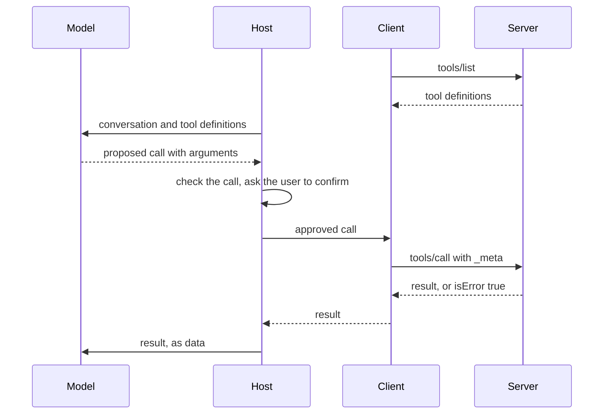

# Tools and the Model Context Protocol

## The idea

A model can only produce text. A **tool** lets that text cause something: the application describes a function to the model, with a name, a description and a schema for its arguments, and the model may reply with a request to call it, such as `get_order` with `{"order_id": "A-1002"}`. The application decides whether to run it, runs it, and sends the result back as another message. The model never runs anything itself. It proposes; the application disposes.

That division is the most important fact about tools. Everything the model asks for is a proposal from a component that can be wrong or manipulated, so the application checks every call: is this tool offered to this user, do the arguments fit the schema, is this action allowed without a person confirming it. The model's choice of tool is a suggestion, never an authorization.

Every application used to wire its tools in its own way. The **Model Context Protocol** (MCP) is an open standard for that wiring, so that a tool server written once can be used by any application that speaks the protocol. Its current revision, dated 2026-07-28, defines:

- **Three roles.** A **host** is the application the user works in, which runs the model and enforces consent. A **client**, created by the host, talks to exactly one **server**. A server offers capabilities: a database, a file system, an issue tracker.
- **What servers offer**: **tools**, functions for the model to call; **resources**, data for the user or the model to read; and **prompts**, templated messages for users.
- **What clients offer**, when a server asks within its reply: **elicitation**, asking the user for more information. The revision still defines **sampling** (asking the host's model for a completion) and **roots** (directories the client points the server to, as a hint and not a permission), but deprecates both: new implementations should not adopt them.
- **The messages.** JSON-RPC 2.0: requests with an id, results or errors that answer them, and notifications that expect no answer.
- **Statelessness.** Every request carries its own protocol version and client capabilities in a `_meta` field, and a server must not rely on earlier requests on the same connection. Earlier revisions opened a session with an `initialize` handshake; this one does not.
- **Two transports.** **stdio**, newline-delimited messages over the standard streams of a subprocess the client launched, for local servers; and **Streamable HTTP**, where each message is a POST to one endpoint and the reply is JSON or a stream of server-sent events, for remote ones.

## A worked example

Host, client and server run in one process, with the protocol's message shapes but no network. The server offers two tools over a table of orders: `get_order`, marked read-only, and `cancel_order`. A scripted model proposes five calls, and a scripted user answers the host's confirmation prompts.

```python examples/mcp_exchange.py
"""A tool call over the Model Context Protocol's message shapes, in one process: host, client and server.

The messages follow the 2026-07-28 revision: JSON-RPC 2.0, every request carrying its protocol version
and client capabilities in _meta, results tagged with resultType. The model and the user are scripted.
"""

import json

VERSION = "2026-07-28"
ORDERS = {"A-1001": "shipped", "A-1002": "processing"}
TOOLS = [
    {"name": "get_order", "description": "Read the status of one order.",
     "inputSchema": {"type": "object", "properties": {"order_id": {"type": "string", "pattern": "^A-[0-9]{4}$"}},
                     "required": ["order_id"], "additionalProperties": False},
     "annotations": {"readOnlyHint": True}},
    {"name": "cancel_order", "description": "Cancel an order that has not shipped.",
     "inputSchema": {"type": "object", "properties": {"order_id": {"type": "string", "pattern": "^A-[0-9]{4}$"}},
                     "required": ["order_id"], "additionalProperties": False}},
]


def schema_problem(schema: dict, arguments: dict) -> str:
    """Only the required keys; a real server checks the whole schema with a JSON Schema validator."""
    missing = [name for name in schema["required"] if name not in arguments]
    return f"missing {', '.join(missing)}" if missing else ""


def server(request: dict) -> dict:
    meta = request.get("params", {}).get("_meta", {})
    reply = {"jsonrpc": "2.0", "id": request["id"]}
    if "io.modelcontextprotocol/protocolVersion" not in meta or "io.modelcontextprotocol/clientCapabilities" not in meta:
        return reply | {"error": {"code": -32602, "message": "missing required _meta fields"}}
    if request["method"] == "tools/list":
        return reply | {"result": {"resultType": "complete", "tools": TOOLS}}
    name, arguments = request["params"]["name"], request["params"].get("arguments", {})
    tool = next((t for t in TOOLS if t["name"] == name), None)
    if tool is None:  # a protocol error: the request itself is wrong
        return reply | {"error": {"code": -32602, "message": f"Unknown tool: {name}"}}
    problem = schema_problem(tool["inputSchema"], arguments)  # tool execution errors: the model can fix these
    if not problem and arguments["order_id"] not in ORDERS:
        problem = f"no order {arguments['order_id']}"
    if not problem and name == "cancel_order" and ORDERS[arguments["order_id"]] == "shipped":
        problem = "a shipped order cannot be cancelled"
    if problem:
        return reply | {"result": {"resultType": "complete", "content": [{"type": "text", "text": problem}], "isError": True}}
    if name == "cancel_order":
        ORDERS[arguments["order_id"]] = "cancelled"
    text = f"{arguments['order_id']}: {ORDERS[arguments['order_id']]}"
    return reply | {"result": {"resultType": "complete", "content": [{"type": "text", "text": text}], "isError": False}}


class Client:
    """One client per server; every request is self-contained."""

    def __init__(self) -> None:
        self.next_id = 1

    def request(self, method: str, params: dict | None = None) -> dict:
        meta = {"io.modelcontextprotocol/protocolVersion": VERSION, "io.modelcontextprotocol/clientCapabilities": {}}
        message = {"jsonrpc": "2.0", "id": self.next_id, "method": method, "params": {**(params or {}), "_meta": meta}}
        self.next_id += 1
        return server(message)


client = Client()
listing = client.request("tools/list")
print("tools offered to the model:", [tool["name"] for tool in listing["result"]["tools"]])

proposed = [  # what the scripted model asked for, in order
    ("get_order", {"order_id": "A-1002"}),
    ("get_order", {}),
    ("get_order", {"order_id": "A-9999"}),
    ("refund_order", {"order_id": "A-1002"}),
    ("cancel_order", {"order_id": "A-1001"}),
    ("cancel_order", {"order_id": "A-1002"}),
]
user_approves = {"A-1001": True, "A-1002": False}  # the person's answers to the confirmation prompts
for name, arguments in proposed:
    if name == "cancel_order" and not user_approves[arguments["order_id"]]:
        print(f"{name}{arguments}: the user declined, so the host never called the server")
        continue
    reply = client.request("tools/call", {"name": name, "arguments": arguments})
    if "error" in reply:
        print(f"{name}{arguments}: protocol error {reply['error']['code']}: {reply['error']['message']}")
    else:
        result = reply["result"]
        print(f"{name}{arguments}: isError={result['isError']}, {result['content'][0]['text']}")

print("a request without _meta:", server({"jsonrpc": "2.0", "id": 99, "method": "tools/list"})["error"])
print("the first request on the wire:")
print(" ", json.dumps({"jsonrpc": "2.0", "id": 1, "method": "tools/list", "params": {"_meta": {
    "io.modelcontextprotocol/protocolVersion": VERSION, "io.modelcontextprotocol/clientCapabilities": {}}}}))
```

It prints:

```output examples/mcp_exchange.py
tools offered to the model: ['get_order', 'cancel_order']
get_order{'order_id': 'A-1002'}: isError=False, A-1002: processing
get_order{}: isError=True, missing order_id
get_order{'order_id': 'A-9999'}: isError=True, no order A-9999
refund_order{'order_id': 'A-1002'}: protocol error -32602: Unknown tool: refund_order
cancel_order{'order_id': 'A-1001'}: isError=True, a shipped order cannot be cancelled
cancel_order{'order_id': 'A-1002'}: the user declined, so the host never called the server
a request without _meta: {'code': -32602, 'message': 'missing required _meta fields'}
the first request on the wire:
  {"jsonrpc": "2.0", "id": 1, "method": "tools/list", "params": {"_meta": {"io.modelcontextprotocol/protocolVersion": "2026-07-28", "io.modelcontextprotocol/clientCapabilities": {}}}}
```

What each line shows:

- **`tools/list`** returns the definitions the host shows to the model: a name, a description, an `inputSchema` in JSON Schema, and optional annotations. The schema is how the model learns what arguments to send.
- **A good call.** `get_order` with `A-1002` returns `isError=False` and the status as text content.
- **Bad arguments.** A call without `order_id` lacks a required argument, and `A-9999` is not an order the server knows. The server answers each with a **tool execution error**: a normal result with `isError: true` and a message the model can read and correct. This server checks only the required keys; a real one checks the whole `inputSchema` with a JSON Schema validator. The specification counts input validation, failed API calls and business rules among these, and advises clients to pass them back to the model.
- **An unknown tool.** `refund_order` was never offered. That is a **protocol error**, a JSON-RPC error with code `-32602`, because the request itself is wrong and the model is less likely to recover from it.
- **A business rule.** Cancelling a shipped order fails at the server, as a tool execution error.
- **A declined call.** For the second cancellation the user said no, so the host never sent the request. Confirmation happens in the host, before the server hears of the call.
- **A request without `_meta`** is malformed under this revision and is refused with `-32602`: the version and the capabilities travel with every request, not once per connection.



<!-- text-of-mermaid sha256:52c89612c3f2e61357d5bc0d6a6ed24fc6bbf39682b3afb1f1018c69a83f1581 -->
```text
 ┌───────┐                              ┌──────┐          ┌────────┐                   ┌────────┐
 │ Model │                              │ Host │          │ Client │                   │ Server │
 └───┬───┘                              └───┬──┘          └────┬───┘                   └────┬───┘
     │                                      │                  │                            │
     │                                      │                  │        tools/list          │
     │                                      │                  │────────────────────────────▶
     │                                      │                  │                            │
     │                                      │                  │     tool definitions       │
     │                                      │                  ◀╌╌╌╌╌╌╌╌╌╌╌╌╌╌╌╌╌╌╌╌╌╌╌╌╌╌╌╌│
     │                                      │                  │                            │
     │  conversation and tool definitions   │                  │                            │
     ◀──────────────────────────────────────│                  │                            │
     │                                      │                  │                            │
     │    proposed call with arguments      │                  │                            │
     │╌╌╌╌╌╌╌╌╌╌╌╌╌╌╌╌╌╌╌╌╌╌╌╌╌╌╌╌╌╌╌╌╌╌╌╌╌╌▶                  │                            │
     │                                      │                  │                            │
     │                                      ├───┐              │                            │
     │                                      │   │ check the call, ask the user to confirm   │
     │                                      ◀───┘              │                            │
     │                                      │                  │                            │
     │                                      │  approved call   │                            │
     │                                      │──────────────────▶                            │
     │                                      │                  │                            │
     │                                      │                  │   tools/call with _meta    │
     │                                      │                  │────────────────────────────▶
     │                                      │                  │                            │
     │                                      │                  │  result, or isError true   │
     │                                      │                  ◀╌╌╌╌╌╌╌╌╌╌╌╌╌╌╌╌╌╌╌╌╌╌╌╌╌╌╌╌│
     │                                      │                  │                            │
     │                                      │     result       │                            │
     │                                      ◀╌╌╌╌╌╌╌╌╌╌╌╌╌╌╌╌╌╌│                            │
     │                                      │                  │                            │
     │           result, as data            │                  │                            │
     ◀──────────────────────────────────────│                  │                            │
     │                                      │                  │                            │
 ┌───┴───┐                              ┌───┴──┐          ┌────┴───┐                   ┌────┴───┐
 │ Model │                              │ Host │          │ Client │                   │ Server │
 └───────┘                              └──────┘          └────────┘                   └────────┘
```

The drawing shows where the decisions sit. The model only proposes. The host checks and asks. The server validates again and enforces its own rules, because it cannot assume every host behaves. Each hop is a place to refuse.

## When to use it

- **A tool per capability the model needs**, and no more: read an order, search the help centre, open a ticket. Narrow tools with strict schemas are easier for the model to use correctly and for you to secure.
- **MCP when tools are shared** between applications, teams or vendors, or when you want to use servers others have written. A single application calling three of its own functions does not need a protocol.
- **stdio for local servers** that the host launches and stops; **Streamable HTTP for remote ones**, with the protocol's authorization framework.
- **A confirmation step for anything that changes the world**: sending, deleting, paying, publishing. The specification asks for a human in the loop who can deny tool invocations.

## Common traps

- **Open-ended tools.** A tool that runs a shell command or fetches any URL turns every mistake of the model into whatever a shell or the internet can do. Write specific tools: "write this report file" rather than "run a command".
- **Trusting annotations.** `readOnlyHint` says what a server claims about a tool. The specification says annotations are hints and must be treated as untrusted unless the server is trusted. Decide what needs confirmation from your own policy, not from the server's description.
- **Skipping server-side validation.** The host's checks protect the user; the server's protect the data. A server must validate every input as if no host had checked it, and enforce access control on every call.
- **Treating results as instructions.** A tool's result may contain text anyone could have written: a customer's note, a web page. It goes back to the model as data, and nothing in it can grant a permission the user did not.
- **Mixing up the two kinds of error.** A tool execution error, with `isError: true`, is information for the model to act on. A protocol error means the request was wrong. Collapsing both into one generic failure makes the model retry what it cannot fix, or give up on what it could.
- **Name collisions.** Tool names are unique only within one server. A host that combines servers should prefix each tool with its server, or two `search` tools will collide.
- **Relying on connection state.** Under the current revision, a server must not tie meaning to a connection. State that spans calls, such as a shopping basket, travels as an explicit handle in the arguments, checked against the caller's authorization on every call.
- **Fetching schema references from the network.** A `$ref` in a schema can point at any URL. The specification forbids dereferencing network references automatically.

## Complexity

For a model offered `t` tools whose definitions take `d` tokens each, during a conversation with `c` tool calls:

| Cost | Size |
|------|------|
| Tool definitions in the prompt | About `t · d` tokens, on every model call |
| One tool call | A model call to propose it, the tool's own work, and the result's tokens added to the conversation |
| `tools/list` | One request; a server may paginate a long list |
| Validating arguments against a schema | Proportional to the arguments' size, negligible next to the model call |

Tool definitions are paid on every call, which is a reason to offer only the tools a task needs. The specification also asks servers to return tools in a stable order, which it notes improves prompt cache hit rates when the definitions are part of the model's context.

## Expert notes

- **Where MCP comes from.** The specification says it takes inspiration from the Language Server Protocol, which standardized how editors talk to language tools. The same promise holds: implement a server once, use it from every host that speaks the protocol.
- **Isolation by design.** One of the protocol's design principles is that servers should not be able to read the whole conversation, nor see into other servers: they receive only the information they need, and the host controls every interaction between them. A server you connect to learns what its tool calls tell it, not what the user said elsewhere.
- **Consent is the host's job.** The specification's security principles say users must explicitly consent to data access and operations, that hosts must obtain explicit user consent before invoking any tool, and that tools represent arbitrary code execution. The protocol cannot enforce any of that; implementations must.
- **Annotations, precisely.** The current schema defines four hints: `readOnlyHint`, defaulting to false; `destructiveHint`, defaulting to true, meaningful when the tool is not read-only; `idempotentHint`; and `openWorldHint`, defaulting to true, for tools that reach external entities such as a web search. The defaults are the cautious reading: an unannotated tool may change things, destructively, in an open world.
- **Structured results.** A tool may declare an `outputSchema` and return `structuredContent` that conforms to it, which clients should validate. The specification notes that this is server-produced data and unrelated to a model's structured outputs.
- **Server-side rules the specification lists.** Servers must validate all inputs, implement access controls, rate-limit invocations and sanitize outputs. Clients should confirm sensitive operations, show tool inputs to the user before calling, validate results before passing them to the model, set timeouts and log tool use.
- **Excessive agency.** The 2026 OWASP Top 10 for LLM Applications advises minimizing the tools offered, the functions each implements and the permissions each holds, running tools in the user's own security context, requiring approval for high-impact actions, and enforcing authorization in code rather than letting the model decide what is allowed.

## Practice

- `cstudy start tool-calling-agent-loop-typescript`: run only the calls each caller's role may make, refuse unknown tools and invalid arguments with messages the model can read, and send tool results back as untrusted data.
- `cstudy start tool-permission-gate`: the decision the host makes before a call reaches a server.

## Further reading

- [Model Context Protocol specification, revision 2026-07-28](https://modelcontextprotocol.io/specification/2026-07-28): roles, features, statelessness, and the security and trust principles.
- [MCP: architecture](https://modelcontextprotocol.io/specification/2026-07-28/architecture): hosts, clients and servers, design principles and capability negotiation.
- [MCP: base protocol](https://modelcontextprotocol.io/specification/2026-07-28/basic): JSON-RPC messages, `_meta`, error codes and JSON Schema usage.
- [MCP: transports](https://modelcontextprotocol.io/specification/2026-07-28/basic/transports): stdio and Streamable HTTP.
- [MCP: tools](https://modelcontextprotocol.io/specification/2026-07-28/server/tools): definitions, results, the two kinds of error, and security considerations.
- [MCP schema, revision 2026-07-28](https://github.com/modelcontextprotocol/specification/blob/main/schema/2026-07-28/schema.ts): `ToolAnnotations` and their defaults.
- [JSON-RPC 2.0 specification](https://www.jsonrpc.org/specification): requests, responses and notifications.
- [OWASP Top 10 for LLM Applications 2026](https://genai.owasp.org/resource/owasp-genai-llm-top-10-2026/): LLM03 Excessive Agency and its mitigations.
