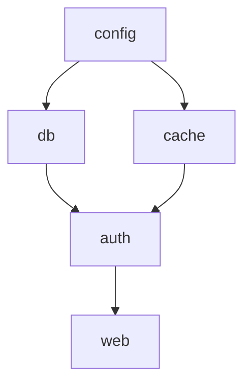

# Topological order

## The idea

Many tasks wait for others: a service starts after the services it needs, a module compiles after the modules it imports, a cell of a spreadsheet is computed after the cells it reads. Draw an arrow from each task to every task that waits for it, and you have a directed graph. A **topological order** lists all its nodes so that every arrow points forward: each task comes after everything it waits for.

Such an order exists exactly when the graph has no directed cycle. A graph with no directed cycle is a **DAG**, a directed acyclic graph. If `a` waits for `b`, `b` for `c` and `c` for `a`, none of the three can go first, and no order works. Finding an order and detecting the cycle are the same job.

Two algorithms do it in linear time:

1. **Kahn's algorithm** counts, for each node, how many arrows still point into it, its **in-degree**. A node at 0 waits for nothing, so it can go next. Take one, append it to the order, and remove its outgoing arrows by lowering the count of each node they point to; any node whose count reaches 0 becomes ready. Repeat until nothing is ready. If the order then holds every node, it is a topological order; if not, the nodes left over are stuck behind a cycle.
2. **Depth-first search** finishes a node only after everything reachable from it is finished. So for every arrow from `u` to `v`, `v` finishes before `u`, and the finish order read **backwards** is a topological order. Meeting a grey node during the search means a cycle, as in the [three colours](../depth-first-search/guide.md) of depth-first search.

## A worked example

### Starting services

Six services, each listing the ones it needs to be running first. `metrics` needs nothing and nothing needs it.



<!-- text-of-mermaid sha256:2bcda24a662f127a7cccef0141bcea60bafd7d39da62f40e0c493b763dcd3a4e -->
```text
┌──────┐
│config│
└──────┘
    ▼──────────▼
┌──────┐    ┌─────┐
│  db  │    │cache│
└───┬──┘    └──┬──┘
    ▼──────────┘
┌──────┐
│ auth │
└───┬──┘
    ▼
┌──────┐
│ web  │
└──────┘
```

Each arrow points from a service to one that waits for it. `auth` has two arrows coming in, so it waits for two services; `config` has none, so it can start at once, and so can `metrics`, which the drawing leaves out. The program finds a start order with Kahn's algorithm, using a heap so that ties go to the smallest name and the output is the same on every run, then with depth-first search, then with a mistake that adds a cycle.

```python examples/start_order.py
"""A start order for services that need other services running first: Kahn's algorithm and DFS.

`needs[s]` lists the services that must start before s. Ties are broken by name, so that the output
is the same on every run."""

import heapq

needs = {
    "config": [],
    "metrics": [],
    "db": ["config"],
    "cache": ["config"],
    "auth": ["db", "cache"],
    "web": ["auth"],
}


def kahn(needs: dict[str, list[str]], trace: bool = False) -> list[str]:
    unlocks: dict[str, list[str]] = {service: [] for service in needs}
    waiting_for = {service: len(before) for service, before in needs.items()}
    for service, before in needs.items():
        for dependency in before:
            unlocks[dependency].append(service)
    ready = [service for service, count in waiting_for.items() if count == 0]
    heapq.heapify(ready)
    order = []
    while ready:
        service = heapq.heappop(ready)
        order.append(service)
        for later in unlocks[service]:
            waiting_for[later] -= 1
            if waiting_for[later] == 0:
                heapq.heappush(ready, later)
        if trace:
            print(f"  start {service:<8} ready: {sorted(ready)}")
    return order


def dfs_order(needs: dict[str, list[str]]) -> list[str]:
    unlocks: dict[str, list[str]] = {service: [] for service in needs}
    for service, before in needs.items():
        for dependency in before:
            unlocks[dependency].append(service)
    finished: list[str] = []
    seen: set[str] = set()

    def visit(service: str) -> None:
        seen.add(service)
        for later in unlocks[service]:
            if later not in seen:
                visit(later)
        finished.append(service)  # everything that must come after it is already finished

    for service in sorted(needs):
        if service not in seen:
            visit(service)
    return finished[::-1]


print("Kahn's algorithm:")
order = kahn(needs, trace=True)
print("order:", order)
print("DFS, reversed finish order:", dfs_order(needs))

needs["config"] = ["auth"]  # a mistake: config now waits for auth, which waits for config
stuck = kahn(needs)
print("with a cycle, Kahn's algorithm starts only", stuck)
print("never ready:", sorted(set(needs) - set(stuck)))
```

It prints:

```output examples/start_order.py
Kahn's algorithm:
  start config   ready: ['cache', 'db', 'metrics']
  start cache    ready: ['db', 'metrics']
  start db       ready: ['auth', 'metrics']
  start auth     ready: ['metrics', 'web']
  start metrics  ready: ['web']
  start web      ready: []
order: ['config', 'cache', 'db', 'auth', 'metrics', 'web']
DFS, reversed finish order: ['metrics', 'config', 'db', 'cache', 'auth', 'web']
with a cycle, Kahn's algorithm starts only ['metrics']
never ready: ['auth', 'cache', 'config', 'db', 'web']
```

Trace Kahn's algorithm with the in-degrees: config 0, metrics 0, db 1, cache 1, auth 2, web 1.

- `config` and `metrics` are ready; `config` comes first by name. Starting it lowers db and cache to 0, so both become ready.
- `cache` starts, and auth goes down to 1: it still waits for `db`.
- `db` starts, auth reaches 0 and becomes ready.
- `auth` starts and frees `web`; then `metrics`, then `web`.

The depth-first order is different, `metrics`, `config`, `db`, `cache`, `auth`, `web`, and also correct: a graph usually has many topological orders, and any of them is an answer unless the question adds a rule, such as "smallest name first", that picks one.

With the mistake, `config` waits for `auth`, which waits for `db` and `cache`, which wait for `config`. Kahn's algorithm starts `metrics` and then has nothing ready. The five services never ready are everything on a cycle plus everything waiting behind one: `web` is on no cycle, but it waits for `auth`. Kahn's algorithm proves that a cycle exists; to name one, use the three colours, or the standard library.

### The standard library

Python has had a topological sort since 3.9: `graphlib.TopologicalSorter`, which takes a mapping from each node to the nodes that must come before it, the same shape as `needs`.

```python examples/graphlib_order.py
"""Python's standard library sorts a graph topologically: graphlib.TopologicalSorter, since 3.9.

It takes the same shape as `needs`: each node mapped to the nodes that must come before it."""

from graphlib import CycleError, TopologicalSorter

needs = {
    "db": ["config"],
    "cache": ["config"],
    "auth": ["db", "cache"],
    "web": ["auth"],
}
print("order:", list(TopologicalSorter(needs).static_order()))

needs["config"] = ["auth"]
try:
    list(TopologicalSorter(needs).static_order())
except CycleError as error:
    print("CycleError, one cycle:", error.args[1])
```

It prints:

```output examples/graphlib_order.py
order: ['config', 'db', 'cache', 'auth', 'web']
CycleError, one cycle: ['db', 'auth', 'config', 'db']
```

`static_order()` gives one topological order. On a cycle it raises `CycleError`, a subclass of `ValueError`, whose second argument is one cycle as a list in which each node comes before the next and the first and last are the same: `db` before `auth` before `config` before `db`. The documentation warns that when several nodes are ready at once, their order may depend on the order in which the graph was built.

## Why it works

**No cycle, then an order exists, and Kahn's algorithm finds it.** Take the nodes not yet in the order. If one of them still has an incoming arrow from another remaining node, step back along that arrow, and again, and again. With no cycle, the walk never returns to a node it has seen, so in a finite graph it must stop, and it stops at a remaining node with no remaining incoming arrow: a ready node. So as long as nodes remain, one is ready, and Kahn's algorithm only stops when every node is in the order. Every arrow points forward, because a node is only taken once all the nodes pointing into it have been taken.

**A cycle, then no order exists.** In any list of the nodes, look at the cycle's node that comes first. The node before it on the cycle comes later in the list, and its arrow points backwards.

**The reversed finish order of DFS is an order.** Take an arrow from `u` to `v` in a graph with no cycle. When the search at `u` looks at `v`, either `v` is white, and then it is entered and finished inside the visit of `u`, before `u` finishes; or `v` is black, finished already. It cannot be grey, since that would be a cycle. Either way `v` finishes before `u`, so in the reversed finish order `u` comes before `v`.

## When to use it

- **Dependencies of any kind**: builds, installs, start-up and shut-down orders, migrations, the steps of a data pipeline, the cells of a spreadsheet. Shut-down is the same order reversed.
- **Checking that dependencies make sense**: a cycle in "what waits for what" is usually a bug in the data, and both algorithms report it in the same pass.
- **Computing over a DAG**: when each node's value depends on the values of the nodes before it, process the nodes in topological order and each value is ready when it is needed.

Kahn's algorithm is the one to reach for when you also want to know what is ready at each moment, or which nodes are blocked by a cycle; it is iterative, so it has no recursion limit. The DFS order comes almost free when you are already running a depth-first search, for instance to report the cycle itself.

## Common traps

- **The arrows the wrong way round.** "`[a, b]` means `a` needs `b`" and "`[a, b]` means `a` comes before `b`" are opposite graphs. Built backwards, the algorithm happily returns a reversed order. Write down what one pair means, and draw the arrow from what must come first.
- **Forgetting nodes with no arrows.** `metrics` appears in no arrow. If the nodes are collected from the arrows alone, it is missing from the order.
- **Duplicate arrows.** If the same pair is listed twice, count it twice in the in-degree and remove it twice, or remove duplicates first. Counting it twice but storing it once leaves a node waiting forever, and the algorithm reports a cycle that is not there.
- **Expecting one answer.** Unless the problem picks one, any valid order is right, and a test that compares with a single expected order is wrong. When you need a stable output, break ties explicitly, as the heap does.
- **An undirected cycle check on a directed graph.** `app` importing `auth` both directly and through `ui` is not a cycle. Use in-degrees or the three colours.
- **A node that needs itself.** An arrow from a node to itself is a cycle of one node: its in-degree never reaches 0.

## Complexity

With V nodes and E arrows:

| Algorithm | Time | Memory |
|-----------|------|--------|
| Kahn's algorithm with a queue | O(V + E): each node is taken once and each arrow lowers one count once | O(V + E) for the lists of arrows, the counts and the queue |
| Kahn's algorithm with a heap, for ties | O(V log V + E): each push and pop costs O(log V) | O(V + E) |
| Depth-first search | O(V + E) | O(V + E), with a recursion depth of up to V |

## Expert notes

- **Kahn, 1962.** A. B. Kahn's paper "Topological Sorting of Large Networks" presents, in its abstract, a very general method for obtaining topological order, a procedure needed for many problems of network analysis, PERT among them. It states that a network of 30,000 activities could be ordered in less than one hour of machine time on the 7090, and, candidly, that the method had not been programmed and there were no plans to implement it.
- **When the order is unique.** A DAG has exactly one topological order when each pair of neighbors in that order is joined by an arrow. If some neighbors `x`, `y` are not joined, swapping them breaks no arrow, since no arrow joins them and every other node keeps its side of both, so there is a second order. If every pair is joined, the arrows themselves fix the whole sequence. One run of Kahn's algorithm can check it: the order is unique exactly when no step ever has more than one node ready.
- **The smallest order by name.** Taking the smallest ready node each time, as the heap does, gives the topological order that comes first in dictionary order: any valid order must start with a ready node, so the smallest ready node is the best possible first entry, and after it the same reasoning applies to what remains.
- **Python's `graphlib`.** Added in Python 3.9. `static_order()` raises `CycleError` on a cycle; the cycle is in `args[1]`, with each node an immediate predecessor of the next and the first node repeated at the end, and when several cycles exist only one is reported. The order of nodes that become ready together can depend on the insertion order.

## Practice

- `cstudy start course-schedule`: can every course be completed?
- `cstudy start course-schedule-ii`: in what order?
- `cstudy start parallel-courses`: how few terms are needed when you may take many courses at once?
- `cstudy start all-possible-recipes`: which recipes can be cooked from what is in the pantry?
- `cstudy start alien-dictionary`: recover an alphabet from a sorted list of words.
- `cstudy start longest-increasing-path-matrix`: the longest climb through a grid of numbers.

## Further reading

- A. B. Kahn, [Topological Sorting of Large Networks](https://doi.org/10.1145/368996.369025), Communications of the ACM 5(11), 1962, pages 558 to 562.
- [Python `graphlib`](https://docs.python.org/3/library/graphlib.html): `TopologicalSorter`, `static_order()` and `CycleError`.
- [What's new in Python 3.9](https://docs.python.org/3/whatsnew/3.9.html): the new `graphlib` module.
