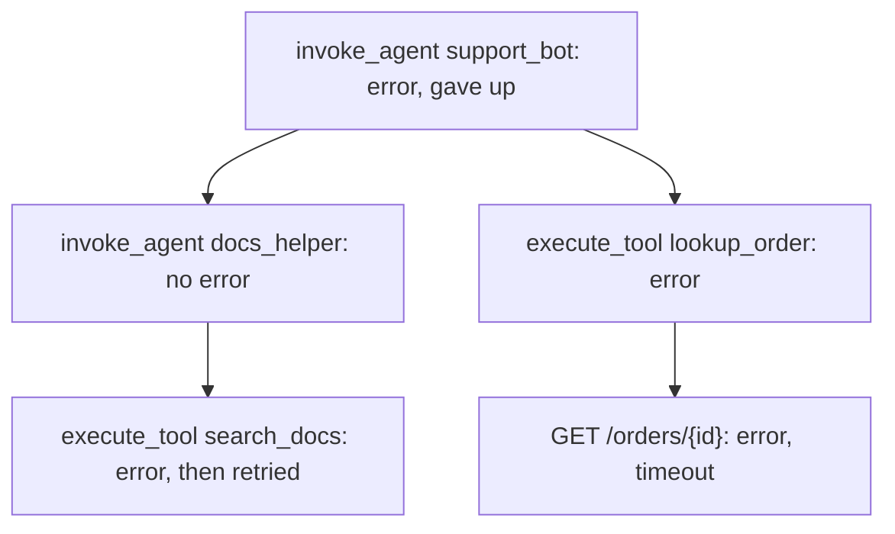

# Tracing agent runs

## The idea

An agent answers one request in many steps: it calls a model to decide what to do, calls tools, perhaps hands part of the work to another agent, and calls the model again. When a run is slow, costs too much or gives up, its final answer does not say why. A **trace** does. It is the record of one run, step by step: what each step was, when it started and ended, what ran inside it, what it used, and how it ended.

The words for it come from **OpenTelemetry**, an open-source framework, agnostic of vendors and tools, for the telemetry that software emits, such as traces, metrics and logs. Its specification defines the pieces this guide uses, and its tracing API is stable:

| Term | What it is |
|------|------------|
| **Span** | One operation within a trace: one model call, one tool call, one agent invocation. It has a name, a start time and an end time |
| **Parent and children** | Each span has zero or one parent, the operation it ran inside, and zero or more children, the operations that ran inside it |
| **Root span** | A span with no parent. In an agent run it is usually the invocation of the agent that received the request |
| **Trace** | A tree of related spans. All the spans of a trace share one trace id of 16 bytes; each span has its own span id of 8 bytes, and records the span id of its parent, which is empty for a root |
| **Attributes** | Key and value pairs that describe a span, such as the model it asked or the tokens it read |
| **Events** | Records inside a span, each with a name, a timestamp and attributes of its own |
| **Status** | How the operation ended: `Unset`, the default; `Ok`, which an application developer or operator sets when they have checked that it succeeded; or `Error`. A description may go with `Error` only |

So a trace is a tree, and each span is a node with a time interval and a bag of facts. Code that creates spans is called **instrumentation**; an **exporter** is the part that sends finished spans to wherever traces are stored.

The facts are only useful if every tool names them the same way. OpenTelemetry publishes **semantic conventions** for that: agreed names for attributes and spans. The conventions for generative AI, the `gen_ai.*` names, have moved to a repository of their own. Their overview and the pages this guide uses are marked **Development**, the stage before stable, where names can still change, and so is every `gen_ai.*` attribute of their registry. These are the three spans an agent run is made of:

| Operation | Span name | `gen_ai.operation.name` | Attributes it carries |
|-----------|-----------|-------------------------|-----------------------|
| A model call | `{gen_ai.operation.name} {gen_ai.request.model}`, such as `chat small-model` | `chat`, `text_completion`, `generate_content`, `embeddings` and others | `gen_ai.request.model`, the model asked; `gen_ai.response.model`, the model name the response returned; `gen_ai.usage.input_tokens` and `gen_ai.usage.output_tokens`; `gen_ai.usage.cache_read.input_tokens`, the input tokens served from a cache the provider keeps |
| An agent invocation | `invoke_agent {gen_ai.agent.name}`, such as `invoke_agent trip_planner` | `invoke_agent` | `gen_ai.agent.name`, and token counts of its own are recommended too |
| A tool call | `execute_tool {gen_ai.tool.name}`, such as `execute_tool search_flights` | `execute_tool` | `gen_ai.tool.name`, required; `gen_ai.tool.call.id`, when the model supplied one; and, only if you opt in, `gen_ai.tool.call.arguments` and `gen_ai.tool.call.result` |

When an operation fails, its span's status is `Error`, and the attribute `error.type`, which is stable, names the class of error, such as `timeout`. When it succeeds, its status stays `Unset`. That rule comes from the conventions' page on recording errors, which is also in Development.

Read as a tree, a trace answers four questions, and this guide takes them in turn:

| Question | How the tree answers it |
|----------|-------------------------|
| What ran inside what? | Rebuild the tree from the spans' parent ids |
| What did it cost? | Add each span's tokens and money to every span above it |
| Did it go round in circles? | Group the tool calls by tool and arguments, and look for the same call made again and again |
| Why did it fail? | Follow the failed spans down from the root to the deepest one, not the one where the error surfaced |

## A worked example

### Rebuilding the tree and rolling up cost

A span is sent once it ends: an exporter receives finished spans, either one at a time as soon as each finishes or in batches of finished spans. A child usually ends before its parent, so it usually arrives first, and the root of the run usually arrives last. So you cannot build the tree as the spans come in, top down. Index them first, by id and by parent id, then walk the tree from the roots.

The run below plans a trip. The agent `trip_planner` calls a small model, searches for flights and converts a currency at the same time, then calls a large model to write the answer. The currency tool hands its work to a second agent, `currency_helper`, which calls the small model and fetches exchange rates. The spans are fake, listed in the order they ended, and priced with made-up prices for made-up models. Prices are whole units per million tokens, so a cost in millionths of a unit is just tokens times price, an exact whole number.

```python examples/trace_tree.py
"""Rebuild the tree of an agent run from its spans, then roll tokens and cost up the tree.

The spans are fake, shaped like OpenTelemetry spans with the generative AI attributes, and listed
in the order an exporter would send them: each span once it ends, so children come before their
parents. Times are milliseconds from the start of the run.
"""

from collections import defaultdict

MODEL_CALLS = {"chat", "generate_content", "text_completion", "embeddings"}

# Price per million tokens, in whole units of some currency, so that tokens * price is an exact
# whole number of millionths of a unit. Made-up prices for made-up models.
PRICES = {
    "small-model": {"input": 2, "cached": 1, "output": 8},
    "large-model": {"input": 20, "cached": 5, "output": 80},
}

SPANS = [  # (span id, parent id, name, start, end, attributes)
    ("s2", "s1", "chat small-model", 100, 900, {
        "gen_ai.operation.name": "chat", "gen_ai.request.model": "small-model",
        "gen_ai.usage.input_tokens": 1200, "gen_ai.usage.output_tokens": 150}),
    ("s6", "s5", "chat small-model", 1100, 1500, {
        "gen_ai.operation.name": "chat", "gen_ai.request.model": "small-model",
        "gen_ai.usage.input_tokens": 300, "gen_ai.usage.output_tokens": 40}),
    ("s3", "s1", "execute_tool search_flights", 1000, 2200, {
        "gen_ai.operation.name": "execute_tool", "gen_ai.tool.name": "search_flights"}),
    ("s7", "s5", "execute_tool fetch_rates", 1550, 2450, {
        "gen_ai.operation.name": "execute_tool", "gen_ai.tool.name": "fetch_rates"}),
    ("s5", "s4", "invoke_agent currency_helper", 1050, 2550, {
        "gen_ai.operation.name": "invoke_agent", "gen_ai.agent.name": "currency_helper",
        "gen_ai.usage.input_tokens": 300, "gen_ai.usage.output_tokens": 40}),
    ("s4", "s1", "execute_tool convert_currency", 1000, 2600, {
        "gen_ai.operation.name": "execute_tool", "gen_ai.tool.name": "convert_currency"}),
    ("s8", "s1", "chat large-model", 2700, 4900, {
        "gen_ai.operation.name": "chat", "gen_ai.request.model": "large-model",
        "gen_ai.usage.input_tokens": 4000, "gen_ai.usage.cache_read.input_tokens": 2500,
        "gen_ai.usage.output_tokens": 700}),
    ("s1", None, "invoke_agent trip_planner", 0, 5000, {
        "gen_ai.operation.name": "invoke_agent", "gen_ai.agent.name": "trip_planner"}),
]

spans = {}
children = defaultdict(list)
roots = []
for span_id, parent_id, name, start, end, attributes in SPANS:
    spans[span_id] = {"name": name, "start": start, "end": end, "attributes": attributes}
    if parent_id is None:
        roots.append(span_id)
    else:
        children[parent_id].append(span_id)
for siblings in children.values():
    siblings.sort(key=lambda span_id: spans[span_id]["start"])


def own_usage(span_id: str) -> tuple[int, int, int]:
    """Input tokens, output tokens and cost in millionths of a unit, for a model call only."""
    attributes = spans[span_id]["attributes"]
    if attributes["gen_ai.operation.name"] not in MODEL_CALLS:
        return 0, 0, 0  # an agent's own token counts would repeat its model calls' counts
    model = attributes.get("gen_ai.response.model", attributes["gen_ai.request.model"])
    price = PRICES[model]
    inputs = attributes.get("gen_ai.usage.input_tokens", 0)
    cached = attributes.get("gen_ai.usage.cache_read.input_tokens", 0)  # already counted in inputs
    outputs = attributes.get("gen_ai.usage.output_tokens", 0)
    cost = (inputs - cached) * price["input"] + cached * price["cached"] + outputs * price["output"]
    return inputs, outputs, cost


subtree = {}


def roll_up(span_id: str) -> tuple[int, int, int]:
    """The span's own usage plus everything below it, computed children first."""
    total = list(own_usage(span_id))
    for child in children[span_id]:
        for i, value in enumerate(roll_up(child)):
            total[i] += value
    subtree[span_id] = tuple(total)
    return subtree[span_id]


def show(span_id: str, depth: int) -> None:
    span = spans[span_id]
    label = "  " * depth + span["name"]
    ms = span["end"] - span["start"]
    cost = own_usage(span_id)[2]
    inputs, outputs, total_cost = subtree[span_id]
    print(f"{label:<34}{ms:>6}{cost:>8}{total_cost:>9}{inputs:>8}/{outputs}")
    for child in children[span_id]:
        show(child, depth + 1)


print(f"{len(spans)} spans, {len(roots)} root; cost in millionths of a unit")
print(f"{'span':<34}{'ms':>6}{'own':>8}{'subtree':>9}  tokens in/out")
for root in roots:
    roll_up(root)
    show(root, 0)
agent = spans["s5"]["attributes"]
print("currency_helper's own counts:", agent["gen_ai.usage.input_tokens"], "in,",
      agent["gen_ai.usage.output_tokens"], "out, the same tokens as its model call, not added")
```

It prints:

```output examples/trace_tree.py
8 spans, 1 root; cost in millionths of a unit
span                                  ms     own  subtree  tokens in/out
invoke_agent trip_planner           5000       0   103020    5500/890
  chat small-model                   800    3600     3600    1200/150
  execute_tool search_flights       1200       0        0       0/0
  execute_tool convert_currency     1600       0      920     300/40
    invoke_agent currency_helper    1500       0      920     300/40
      chat small-model               400     920      920     300/40
      execute_tool fetch_rates       900       0        0       0/0
  chat large-model                  2200   98500    98500    4000/700
currency_helper's own counts: 300 in, 40 out, the same tokens as its model call, not added
```

Each line is one span, indented under its parent, with its duration in milliseconds (its end minus its start), its own cost, the cost of its subtree, and the tokens of its subtree:

- **The tree comes out the same whatever order the spans arrived in.** `s1`, the root, came last; walking from it after every span was indexed puts each child under its parent, sorted by start time.
- **A span's own cost and its subtree's cost are different questions.** `execute_tool convert_currency` spent nothing itself, but its subtree cost 920 millionths, because the tool handed its work to an agent that called a model. A view of own costs alone would call the tool free. The **subtree** of a span is the span and everything below it; the root's subtree is the whole run: 5500 input tokens, 890 output tokens and 103,020 millionths of a unit.
- **Cached tokens are part of the input count, not extra.** The conventions say `gen_ai.usage.input_tokens` should include cached tokens, and that the detailed counts, such as `gen_ai.usage.cache_read.input_tokens`, are parts of that total. So the large model's 4000 input tokens are 1500 at the full price and 2500 at the cached price: 1500 × 20 + 2500 × 5 + 700 × 80 = 98,500. Adding the 2500 cached tokens to the 4000 would count them twice.
- **Each token is counted once.** The agent span `currency_helper` carries token counts of its own, which the conventions recommend on an agent invocation, and here they are the same 300 and 40 tokens as its model call. The roll-up adds only the spans of model calls, which report what the provider counted, so the agent's counts are not added a second time.
- **The price follows the model that answered.** `own_usage` reads `gen_ai.response.model`, the model name the response returned, when the span has it, and the model asked otherwise. The example has no response model, so the model asked is priced.

Money stays a whole number of millionths from the first span to the total, so the sum never drifts; it would be rounded only for display.

### Repeated calls and the root cause

The second run failed. A support agent was asked about order A17. It looked up the customer twice, asked a helper agent to search the documentation, and called `lookup_order` three times. Every lookup failed, because the request it made to the order service timed out, and the agent gave up. Here a tool call's arguments are JSON text, written a little differently from one call to the next.

```python examples/what_went_wrong.py
"""Find the repeated tool calls of a failed agent run, and where its failure started.

The spans are fake, shaped like OpenTelemetry spans with the generative AI attributes, and listed
in the order they started; their times are left out. A tool call's arguments arrive as JSON text,
written a little differently from one call to the next.
"""

import json
from collections import Counter, defaultdict

LOOKUP = "execute_tool lookup_order"
GET = "GET /orders/{id}"


def agent(name: str) -> dict[str, str]:
    return {"gen_ai.operation.name": "invoke_agent", "gen_ai.agent.name": name}


def tool(name: str, arguments: str, error_type: str = "") -> dict[str, str]:
    attributes = {"gen_ai.operation.name": "execute_tool", "gen_ai.tool.name": name,
                  "gen_ai.tool.call.arguments": arguments}
    return attributes | ({"error.type": error_type} if error_type else {})


CHAT = {"gen_ai.operation.name": "chat"}
TIMEOUT = {"error.type": "timeout"}
SPANS = [  # (span id, parent id, name, status, status description, attributes)
    ("r1", None, "invoke_agent support_bot", "error", "gave up: could not look up the order",
     agent("support_bot")),
    ("m1", "r1", "chat small-model", "unset", "", CHAT),
    ("c1", "r1", "execute_tool get_customer", "unset", "",
     tool("get_customer", '{"email": "kim@example.com"}')),
    ("h1", "r1", "invoke_agent docs_helper", "unset", "", agent("docs_helper")),
    ("d1", "h1", "execute_tool search_docs", "error", "the index refused: too many requests",
     tool("search_docs", '{"query": "refund policy"}', "rate_limited")),
    ("d2", "h1", "execute_tool search_docs", "unset", "",
     tool("search_docs", '{"query":"refund policy"}')),
    ("m2", "r1", "chat small-model", "unset", "", CHAT),
    ("c2", "r1", "execute_tool get_customer", "unset", "",
     tool("get_customer", '{"email":"kim@example.com"}')),
    ("t1", "r1", LOOKUP, "error", "the order service did not answer",
     tool("lookup_order", '{"order_id": "A17", "fields": ["status"]}', "timeout")),
    ("g1", "t1", GET, "error", "no answer after 2 s", TIMEOUT),
    ("m3", "r1", "chat small-model", "unset", "", CHAT),
    ("t2", "r1", LOOKUP, "error", "the order service did not answer",
     tool("lookup_order", '{"fields": ["status"], "order_id": "A17"}', "timeout")),
    ("g2", "t2", GET, "error", "no answer after 2 s", TIMEOUT),
    ("m4", "r1", "chat small-model", "unset", "", CHAT),
    ("t3", "r1", LOOKUP, "error", "the order service did not answer",
     tool("lookup_order", '{ "order_id" : "A17", "fields" : [ "status" ] }', "timeout")),
    ("g3", "t3", GET, "error", "no answer after 2 s", TIMEOUT),
    ("m5", "r1", "chat small-model", "unset", "", CHAT),
]

spans = {}
children = defaultdict(list)
for span_id, parent_id, name, status, description, attributes in SPANS:
    spans[span_id] = {"parent": parent_id, "name": name, "status": status,
                      "description": description, "attributes": attributes}
    if parent_id is not None:
        children[parent_id].append(span_id)
root = next(span_id for span_id, span in spans.items() if span["parent"] is None)


def fingerprint(attributes: dict[str, str]) -> str:
    """The tool and its arguments in one canonical form: parsed, keys sorted, no spaces."""
    arguments = json.loads(attributes["gen_ai.tool.call.arguments"])
    canonical = json.dumps(arguments, sort_keys=True, separators=(",", ":"))
    return f"{attributes['gen_ai.tool.name']} {canonical}"


def calling_agent(span_id: str) -> str:
    """The name of the nearest enclosing agent span."""
    parent = spans[span_id]["parent"]
    while spans[parent]["attributes"].get("gen_ai.operation.name") != "invoke_agent":
        parent = spans[parent]["parent"]
    return spans[parent]["attributes"]["gen_ai.agent.name"]


calls = defaultdict(list)  # (agent, fingerprint) -> statuses, in the order the calls started
for span_id, span in spans.items():
    if span["attributes"].get("gen_ai.operation.name") == "execute_tool":
        calls[(calling_agent(span_id), fingerprint(span["attributes"]))].append(span["status"])

print("repeated tool calls:")
for (agent_name, call), statuses in calls.items():
    if len(statuses) < 2:
        continue
    failed = statuses.count("error")
    if failed == len(statuses):
        verdict = "a retry loop, every call failed"
    elif failed:
        verdict = "retried until it worked"
    else:
        verdict = "the same result fetched again"
    print(f"  {agent_name} called {call}")
    print(f"    {len(statuses)} calls, {failed} failed: {verdict}")

origins = Counter()


def follow_failures(span_id: str, path: list[str]) -> None:
    """Walk down along failed children, to the failed spans that have no failed child."""
    failed = [child for child in children[span_id] if spans[child]["status"] == "error"]
    if not failed:
        span = spans[span_id]
        cause = f"error.type {span['attributes'].get('error.type')}: {span['description']}"
        origins[(" > ".join(spans[step]["name"] for step in path), cause)] += 1
    for child in failed:
        follow_failures(child, [*path, child])


print(f"the run failed: {spans[root]['name']}: {spans[root]['description']}")
follow_failures(root, [root])
print("where it started, following the failed children down from the root:")
for (path, cause), count in origins.items():
    print(f"  {count} times: {path}")
    print(f"    {cause}")
print("failures that were handled, under a parent that did not fail:")
for span in spans.values():
    parent = spans.get(span["parent"])
    if span["status"] == "error" and parent and parent["status"] != "error":
        print(f"  {span['name']} under {parent['name']}: {span['description']}")
```

It prints:

```output examples/what_went_wrong.py
repeated tool calls:
  support_bot called get_customer {"email":"kim@example.com"}
    2 calls, 0 failed: the same result fetched again
  docs_helper called search_docs {"query":"refund policy"}
    2 calls, 1 failed: retried until it worked
  support_bot called lookup_order {"fields":["status"],"order_id":"A17"}
    3 calls, 3 failed: a retry loop, every call failed
the run failed: invoke_agent support_bot: gave up: could not look up the order
where it started, following the failed children down from the root:
  3 times: invoke_agent support_bot > execute_tool lookup_order > GET /orders/{id}
    error.type timeout: no answer after 2 s
failures that were handled, under a parent that did not fail:
  execute_tool search_docs under invoke_agent docs_helper: the index refused: too many requests
```

**Repeated calls.** Two calls are the same call when they use the same tool with the same arguments. The arguments are compared in one canonical form: parsed as JSON, then written back with the keys sorted and no spaces, which is what `json.dumps` does with `sort_keys=True` and `separators=(",", ":")`. The three `lookup_order` calls are written three ways, with the keys in another order and spaces in other places, and they are one call. The conventions expect `gen_ai.tool.call.arguments` to be an object, and ask instrumentation that only has the text to make a best effort to parse it, so a trace may hold an object or, where parsing failed, the text; bringing both into one form is the point. The calls are grouped under the agent that made them, and each group gets a verdict:

- **The same result fetched again**: `get_customer` twice, both successful. Nothing broke, but the second call cost time and, if the result went back into the model's context, tokens.
- **Retried until it worked**: the first `search_docs` was refused for too many requests, and the second worked. That is what a retry is for.
- **A retry loop**: `lookup_order` three times, failing three times. The agent asked for the same thing with nothing changed, and got the same failure. Compared with giving up after the first timeout, the loop cost two more lookups, two more timeouts and two more model calls, in a run that could not succeed.

**The root cause.** The failure **surfaced** at the root: its status description, "gave up: could not look up the order", says how the run ended. It **started** further down. The walk follows the failed children of the root, then their failed children, until it reaches failed spans that have no failed child: `GET /orders/{id}`, a request to the order service that timed out. The tool spans between them failed only because their child did; reporting them would blame the tool for the service. The three chains end at the same span name with the same `error.type`, so they are counted as one cause seen three times: the same timeout every time, which retrying without a change could not fix.

**Handled failures are not causes.** The refused `search_docs` call failed too, but its parent, `docs_helper`, did not: it retried, and the retry worked. OpenTelemetry's conventions say that errors that were retried or handled, letting an operation complete, should not be recorded on the span of that operation. So a failed span under a parent without an error is a failure that was dealt with, and the walk from the root never reaches it.



<!-- text-of-mermaid sha256:015dd6701acefcb9c86f1c5eaf9841b38e45039dd0b949b0ca96dbdd16b26a9a -->
```text
┌─────────────────────────────────────────────┐
│   invoke_agent support_bot: error, gave up  │
└─────────────────────────────────────────────┘
                       ▼────────────────────────────────────────────▼
┌─────────────────────────────────────────────┐    ┌────────────────────────────────┐
│      invoke_agent docs_helper: no error     │    │execute_tool lookup_order: error│
└──────────────────────┬──────────────────────┘    └────────────────┬───────────────┘
                       ▼                                            ▼
┌─────────────────────────────────────────────┐    ┌────────────────────────────────┐
│execute_tool search_docs: error, then retried│    │GET /orders/{id}: error, timeout│
└─────────────────────────────────────────────┘    └────────────────────────────────┘
```

The drawing keeps one of the three `lookup_order` calls. Read it from the top: the root failed and its description says why the run ended. Of its children, only `lookup_order` failed, and of its children only the request did, so the chain of failures ends there. The search on the left failed under a parent that did not, so it is not on the chain.

## When to use it

- **Every agent that runs for someone else.** Record a trace for each run from the start. The question "why did that run take four minutes?" comes after the run, and the trace that answers it has to be recorded during the run.
- **A run that was slow, expensive, or gave up.** Rebuild the tree, roll up the cost to find the subtree that spent it, look for repeated calls, and follow the failures down from the root.
- **Before and after a change.** Run the same tasks on a new prompt, model or tool, and compare the traces: number of steps, tokens per run, repeated calls. A change that keeps answers right but doubles the tool calls shows up here and not in the answers.
- **Budgets and limits.** The roll-up of a subtree tells you which step to cap; the groups of repeated calls tell you where a loop guard would have stopped the run.

Use something else when the question is different. Metrics answer totals over many runs, such as tokens per day or the share of runs that fail, more cheaply than reading traces. Evaluation answers whether an answer was right: a trace shows what the agent did, not whether the result was correct.

## Common traps

- **Expecting the spans in order.** Spans arrive as they finish, children before parents, and runs that overlap interleave. Build the tree once every span you will wait for has arrived, or update it as parents turn up.
- **Dropping a span whose parent never arrived.** The specification says each trace includes a single root span, the shared ancestor of all its other spans, but the spans you receive may not: a process can crash, and an exporter can fail, before a parent is sent. A span whose parent is missing still holds real time, tokens and errors; show it as the root of a tree of its own rather than lose it.
- **Counting tokens twice.** Agent spans may carry totals of their own; cached input tokens are already inside `gen_ai.usage.input_tokens`; and the conventions say `gen_ai.usage.output_tokens` should include reasoning tokens. Add the counts of model calls only, and treat the other counts as parts or totals to check against.
- **Pricing by the wrong model.** The conventions keep the model asked and the model name the response returned in two attributes. Price a call by the second when the span has it.
- **Treating a missing price as zero.** A call to a model with no price looks free and lowers the total without a sign. List such calls, so that someone adds the price.
- **Rounding each call, then adding.** Rounded amounts drift from the rounded total. Keep amounts exact, in whole small units, and round once, at the end.
- **Comparing arguments as raw text.** `{"a": 1, "b": 2}` and `{"b":2,"a":1}` are the same call. The opposite trap is normalizing too much: two orders whose ids differ only in case may be two different orders, so change the form of the arguments, not their values.
- **Blaming the span where the error surfaced.** The root failed because something below it did. Follow the failures down.
- **Blaming every failed span.** A failure under a parent that did not fail was handled. It may be worth fixing, as a source of slowness, but it did not end the run.
- **Reading `Unset` as unknown.** `Unset` is what a successful span has: the conventions say a span that ended without an error keeps status `Unset`. `Ok` means that an application developer or operator checked the result, and instrumentation libraries should not set it unless configured to.
- **Trusting the clocks.** Ending a span has no effect on its children, which may still be running and end later, and the clocks of different machines need not agree. A child can end after its parent or start before it; clip it to its parent's interval before doing arithmetic with both.
- **Recording everything.** Prompts, answers, tool arguments and tool results are opt-in in the conventions, which warn that tool arguments and results may contain sensitive information. Decide what to keep, what to redact and who may read it before you turn them on.

## Complexity

For a trace of `n` spans of depth `h`, whose tool arguments total `A` characters:

| Step | Time | Space |
|------|------|-------|
| Index the spans by id and by parent | O(n) on average, with hash maps | O(n) |
| Sort each span's children by start | O(n log n) over the whole tree | O(n) |
| Walk the tree for the outline | O(n) | O(h) for the walk's stack |
| Roll up tokens and cost, children first | O(n) | O(n) for the totals of every subtree |
| Fingerprint and group the tool calls | O(A) to parse and write the arguments, plus the sorting of each object's keys | O(A) |
| Find each tool call's agent | O(h) per call by climbing, so O(n · h) at worst; O(n) in all by passing the agent down a walk | O(h) for the walk |
| Follow the failures down from the root | O(n) | O(h) |

With the agent passed down a walk, every step reads each span a few times at most, so the whole analysis is O(n log n), for sorting the children, plus the work on the arguments. A recursive walk needs a call stack as deep as the trace; an explicit stack avoids running out of it on a very deep one.

## Expert notes

- **What `Ok` means.** The three status codes form a total order, `Ok > Error > Unset`, and once a span's status is `Ok` it should be considered final: later attempts to change it should be ignored. So an `Ok` set too early would keep a later error off the span, and the specification says instrumentation libraries should not set `Ok` unless they are configured to.
- **Events, exceptions and logs.** OpenTelemetry is deprecating the API for recording new span events, `AddEvent` and `RecordException`, in favour of events written as logs that are correlated with the current span. It deprecates the API, not the events: span events already in traces stay part of the trace data model, and views that show them keep working. In the same direction, the page on recording errors says an exception should be recorded as a log record, and the older convention for an exception recorded on a span, an event named `exception` with `exception.type`, `exception.message` and `exception.stacktrace`, is marked deprecated. A tool that reads traces of every age looks in both places.
- **Retries one level down.** The conventions for HTTP, which are stable, ask for one span per attempt to send a request over the wire, and number the repeats with `http.request.resend_count`, also stable. A tool whose instrumented HTTP client retries therefore shows up as several client spans under one tool span: a retry loop one level below the agent's.
- **Span kinds.** Separate from the operation, every span has a kind. A model call should be `CLIENT`, a request to another process, and may be `INTERNAL` when the model runs in the same process; an agent invoked in process and a tool execution should be `INTERNAL`. Kind says how a span relates to other processes, such as a request to a remote service or an internal operation; the operation name says what the work was.
- **Across services.** A trace can cross processes: OpenTelemetry propagates a span's context, which identifies it in its trace, to its child spans and across process boundaries. Over HTTP, the W3C Trace Context recommendation carries it in the `traceparent` header: a version; the trace id, the ID of the whole trace (16 bytes, 32 hexadecimal digits); the parent id, the ID of the request as known by the caller (8 bytes); and flags, as in `00-4bf92f3577b34da6a3ce929d0e0e4736-00f067aa0ba902b7-01`.
- **More than a tree.** OpenTelemetry's overview describes a trace as a directed acyclic graph of spans, whose edges are the parent and child relationships, and lets a span carry links to spans in the same trace or in other traces, for example for a batch started by several spans. A conversation that runs over many requests can span many traces; the conventions' `gen_ai.conversation.id` ties a model call to its conversation.
- **Names for groups, attributes for details.** A span name should be the most general string that identifies an interesting class of spans: `get_account` is a good name, and `get_account/42` is too specific, with the 42 better kept as an attribute. That is why a tool span is named after the tool, never its arguments, and why, in the example, the order id is in `gen_ai.tool.call.arguments` while the request's span name holds the template `/orders/{id}`, not the id.
- **Billed counts.** When a provider reports both the tokens it billed and the tokens the model consumed, the conventions ask instrumentation to record the billed count, so that `gen_ai.usage.input_tokens` and `gen_ai.usage.output_tokens` match the units the customer is charged for. A cost roll-up built on them then counts what was billed, not what was consumed.
- **Versions and stability.** At the time of writing, the specification is at 1.62.0 and the semantic conventions at 1.45.0. The tracing API is stable, as are the HTTP conventions and `error.type`; the generative AI pages this guide uses, every `gen_ai.*` attribute, and the page on recording errors are in Development, and the convention for exceptions recorded on spans is deprecated. Pin the version of the conventions your tools read, and expect names in Development to change.

## Practice

- `cstudy start agent-trace-analyzer`: rebuilding a trace's tree from events that arrive out of order, repeated or broken; where the time went; what each subtree cost; and the retry loops and the root cause of a failed run, over four levels.

## Further reading

- [OpenTelemetry, Tracing API](https://opentelemetry.io/docs/specs/otel/trace/api/): spans, parents and the root span, events, status codes and their order, span names, and ending a span.
- [OpenTelemetry, Tracing SDK](https://opentelemetry.io/docs/specs/otel/trace/sdk/): span processors that pass finished spans to an exporter.
- [OpenTelemetry, overview](https://opentelemetry.io/docs/specs/otel/overview/): a trace as a graph of spans, and links.
- [OpenTelemetry protocol, `trace.proto`](https://github.com/open-telemetry/opentelemetry-proto/blob/main/opentelemetry/proto/trace/v1/trace.proto): the fields of a span as it travels, including the empty parent id of a root.
- [OpenTelemetry semantic conventions for generative AI](https://github.com/open-telemetry/semantic-conventions-genai), in Development: [client inference](https://github.com/open-telemetry/semantic-conventions-genai/blob/main/docs/gen-ai/client-inference.md), [agent spans](https://github.com/open-telemetry/semantic-conventions-genai/blob/main/docs/gen-ai/gen-ai-agent-spans.md), [execute tool](https://github.com/open-telemetry/semantic-conventions-genai/blob/main/docs/gen-ai/execute-tool.md) and the [attribute registry](https://github.com/open-telemetry/semantic-conventions-genai/blob/main/docs/registry/attributes/gen-ai.md).
- [OpenTelemetry semantic conventions, recording errors](https://opentelemetry.io/docs/specs/semconv/general/recording-errors/): status `Error` and `error.type` on failure, `Unset` on success, and handled errors.
- [OpenTelemetry semantic conventions, HTTP spans](https://opentelemetry.io/docs/specs/semconv/http/http-spans/): one span per attempt, and `http.request.resend_count`.
- [OpenTelemetry semantic conventions, exceptions on spans](https://opentelemetry.io/docs/specs/semconv/exceptions/exceptions-spans/): the deprecated `exception` event.
- [OpenTelemetry blog, *Deprecating Span Events API* (2026)](https://opentelemetry.io/blog/2026/deprecating-span-events/): events as logs correlated with a span.
- [W3C, *Trace Context*, W3C Recommendation, 23 November 2021](https://www.w3.org/TR/trace-context/): the `traceparent` header.
- [Python `json`](https://docs.python.org/3/library/json.html): `sort_keys` and compact `separators` for a canonical form of the arguments.
