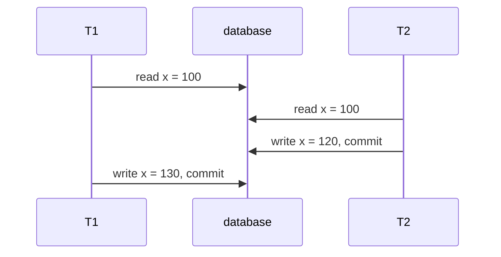
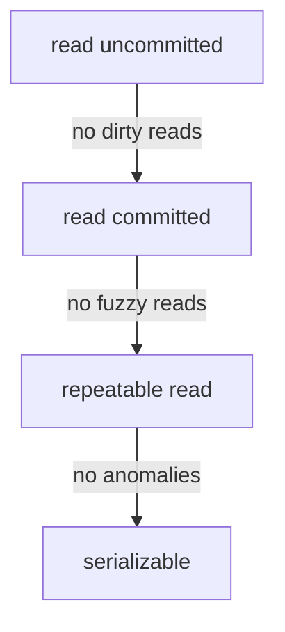

# Transactions: ACID, isolation levels and locking

## The idea

A **transaction** is a group of reads and writes that the database treats as one unit. Berenson and others, in their 1995 critique of the SQL isolation levels, describe it as a set of actions that transform the database from one consistent state to another. Moving 40 from account x to account y reads both balances and writes both; no one should ever see the money in neither account, or in both.

Härder and Reuter's 1983 paper on recovery lists four properties of a transaction, abbreviated **ACID**:

- **Atomicity**: all of its writes take effect or none do, and the user knows which.
- **Consistency**: a transaction that commits preserves the consistency of the database; each successful transaction commits only legal results.
- **Isolation**: what happens inside a transaction is hidden from transactions running at the same time.
- **Durability**: once committed, its results survive any later failure.

The guide on write-ahead logging covers atomicity and durability. This one is about isolation: what a transaction may see of the others while they run.

A database runs many transactions at once, and their actions interleave. Berenson and others write an interleaving, a **history**, in a compact notation: `r1[x]` is a read of x by transaction 1, `w2[y]` a write of y by transaction 2, `c1` the commit of transaction 1 and `a1` its abort. The gold standard is **serializability**: a history is serializable if it is equivalent to a **serial** history, one that runs the transactions one at a time, in some order. Two actions **conflict** when they come from different transactions, touch the same item and at least one is a write. Each conflicting pair, in the order it happens, is an edge between the two transactions in the history's **dependency graph**, and two histories are equivalent when they have the same committed transactions and the same dependency graph. In practice: a history is serializable when its dependency graph has no cycle.

Weaker promises let more work run in parallel, at the price of **anomalies**, outcomes no serial order produces. Berenson and others name them, each as a pattern of history:

| Name | Pattern | What goes wrong |
|------|---------|-----------------|
| P0, dirty write | `w1[x] ... w2[x] ...` before T1 ends | T2 overwrites a value T1 may still roll back; if either aborts, the right value of x is unclear |
| P1, dirty read | `w1[x] ... r2[x] ...` before T1 ends | T2 reads a value that may never be committed |
| P2, fuzzy or non-repeatable read | `r1[x] ... w2[x] ... c2 ... r1[x]` | T1 reads x twice and gets two values |
| P3, phantom | `r1[P] ... w2[y in P] ... c2 ... r1[P]` | T1 reads the rows matching a condition P, T2 adds or changes a row that matches, and T1's second read sees a different set |
| P4, lost update | `r1[x] ... w2[x] ... w1[x] ... c1` | T1 writes a value computed from what it read before T2's write, and T2's update is lost |
| A5A, read skew | `r1[x] ... w2[x] ... w2[y] ... c2 ... r1[y]` | T1 sees x before T2's change and y after it, a state that never existed |
| A5B, write skew | `r1[x] ... r2[y] ... w1[y] ... w2[x]`, both commit | each writes on the basis of what the other is about to change, and a rule linking x and y breaks |



<!-- text-of-mermaid sha256:dd6a8499095bad00ca4dd5fe7df9be403f648a403a317516437f0f67db9acb0c -->
```text
┌────┐                  ┌──────────┐                  ┌────┐
│ T1 │                  │ database │                  │ T2 │
└──┬─┘                  └─────┬────┘                  └──┬─┘
   │                          │                          │
   │      read x = 100        │                          │
   │──────────────────────────▶                          │
   │                          │                          │
   │                          │      read x = 100        │
   │                          ◀──────────────────────────│
   │                          │                          │
   │                          │  write x = 120, commit   │
   │                          ◀──────────────────────────│
   │                          │                          │
   │  write x = 130, commit   │                          │
   │──────────────────────────▶                          │
   │                          │                          │
┌──┴─┐                  ┌─────┴────┐                  ┌──┴─┐
│ T1 │                  │ database │                  │ T2 │
└────┘                  └──────────┘                  └────┘
```

This is Berenson and others' history H4. T2 meant to add 20 and T1 to add 30; run one after the other, x would end at 150. Interleaved, the final 130 contains only T1's change.

The SQL standard defines four **isolation levels**. Serializable is defined as serializable; the three others by which phenomena they forbid:

| Level | Dirty read | Fuzzy read | Phantom |
|-------|------------|------------|---------|
| Read uncommitted | possible | possible | possible |
| Read committed | not possible | possible | possible |
| Repeatable read | not possible | not possible | possible |
| Serializable | not possible | not possible | not possible |

Berenson and others showed that these definitions are weaker than they look. The English phenomena are ambiguous, and read strictly they allow non-serializable histories even at the top: their history H1, a transfer of 40 between x and y while another transaction reads both, shows a total balance of 60 instead of 100 without matching any of the three strict patterns. They argue that dirty writes should be forbidden at every level, and that lost updates and the skews need names of their own. And the most common multiversion technique, **snapshot isolation**, fits none of the levels: it forbids all three strict phenomena, yet allows write skew. The guide on MVCC is about it.



<!-- text-of-mermaid sha256:ba9e4137f1d170fef197e054692da030b5b0e641115863fa86df1661ef31427f -->
```text
┌────────────────┐
│read uncommitted│
└─no─dirty─reads─┘
         ▼
┌────────────────┐
│ read committed │
└─no─fuzzy─reads─┘
         ▼
┌────────────────┐
│repeatable read │
└──no─anomalies──┘
         ▼
┌────────────────┐
│  serializable  │
└────────────────┘
```

Each arrow names what the next level adds. Snapshot isolation has no place on this line: it is stronger than read committed, and neither stronger nor weaker than repeatable read.

How does a database enforce isolation? The classic answer is **locking**. A transaction takes a **read lock** (shared) before reading an item and a **write lock** (exclusive) before writing it; two locks on the same item conflict when at least one is a write lock, and a conflicting request waits until the holder releases its lock. A **predicate lock** covers every row that matches a condition, including rows that do not exist yet, which is what it takes to stop phantoms. A lock is of **long duration** when it is held until the transaction commits or aborts. Berenson and others state the fundamental theorem: transactions that lock every item before touching it, and never take a new lock after releasing one, which is **two-phase locking**, produce only serializable histories. They also describe each SQL level by its locks:

| Locking level | Read locks | Write locks |
|---------------|------------|-------------|
| Read uncommitted | none | long |
| Read committed | short, released right after each read | long |
| Repeatable read | long on items, short on predicates | long |
| Serializable | long on items and predicates | long |

Write locks are long at every level. That is also what recovery needs: Berenson and others point out that without it, rolling back by restoring before-images can wipe out another transaction's write.

## A worked example

### Which histories are serializable?

This program builds the dependency graph of four histories, three of them from Berenson and others' paper, and looks for a cycle with Python's `graphlib`:

```python examples/schedules.py
"""Is a history serializable? Build its dependency graph and look for a cycle.

A history is written as in Berenson and others' critique of the ANSI isolation levels: r1[x] is a
read of x by transaction 1, w2[y] a write of y by transaction 2, c1 the commit of transaction 1.
Two actions conflict when they come from different transactions, touch the same item, and at
least one is a write. Each conflicting pair adds an edge from the earlier action's transaction to
the later one's. With no cycle, the transactions in an order that follows every edge form an
equivalent serial history; with a cycle, no serial order explains the history.
"""

import re
from graphlib import CycleError, TopologicalSorter

HISTORIES = {
    "lost update (H4)": "r1[x] r2[x] w2[x] c2 w1[x] c1",
    "inconsistent analysis (H1)": "r1[x] w1[x] r2[x] r2[y] c2 r1[y] w1[y] c1",
    "interleaved, but harmless": "r1[x] w1[x] r2[x] w2[x] r1[y] w1[y] c1 r2[y] w2[y] c2",
    "write skew (H5)": "r1[x] r1[y] r2[x] r2[y] w1[y] w2[x] c1 c2",
}


def analyse(history: str) -> None:
    actions = re.findall(r"([rw])(\d)\[(\w)\]", history)
    edges: dict[tuple[str, str], str] = {}
    for i, (op1, t1, item1) in enumerate(actions):
        for op2, t2, item2 in actions[i + 1 :]:
            if t1 != t2 and item1 == item2 and "w" in (op1, op2):
                why = f"{op1}{t1}[{item1}] before {op2}{t2}[{item2}]"
                edges.setdefault((f"T{t1}", f"T{t2}"), why)
    graph: dict[str, set[str]] = {f"T{t}": set() for _, t, _ in actions}
    for (a, b), why in sorted(edges.items()):
        graph[b].add(a)
        print(f"    {a} -> {b}  ({why})")
    try:
        order = list(TopologicalSorter(graph).static_order())
        print(f"    no cycle: equivalent to running {', then '.join(order)}")
    except CycleError as error:
        cycle = error.args[1][:-1]  # the first node is repeated at the end
        start = cycle.index(min(cycle))  # start the report at T1 whatever node was found first
        cycle = [*cycle[start:], *cycle[:start], cycle[start]]
        print(f"    cycle {' -> '.join(cycle)}: not serializable")


for name, history in HISTORIES.items():
    print(f"{name}: {history}")
    analyse(history)
```

It prints:

```output examples/schedules.py
lost update (H4): r1[x] r2[x] w2[x] c2 w1[x] c1
    T1 -> T2  (r1[x] before w2[x])
    T2 -> T1  (r2[x] before w1[x])
    cycle T1 -> T2 -> T1: not serializable
inconsistent analysis (H1): r1[x] w1[x] r2[x] r2[y] c2 r1[y] w1[y] c1
    T1 -> T2  (w1[x] before r2[x])
    T2 -> T1  (r2[y] before w1[y])
    cycle T1 -> T2 -> T1: not serializable
interleaved, but harmless: r1[x] w1[x] r2[x] w2[x] r1[y] w1[y] c1 r2[y] w2[y] c2
    T1 -> T2  (r1[x] before w2[x])
    no cycle: equivalent to running T1, then T2
write skew (H5): r1[x] r1[y] r2[x] r2[y] w1[y] w2[x] c1 c2
    T1 -> T2  (r1[x] before w2[x])
    T2 -> T1  (r2[y] before w1[y])
    cycle T1 -> T2 -> T1: not serializable
```

- **The lost update** has edges both ways: T1 read x before T2 wrote it, so T1 must come first; T2 read x before T1 wrote it, so T2 must come first. No order satisfies both.
- **The inconsistent analysis** is H1: T2 read x after T1's write and y before it. Neither the dirty read nor the fuzzy read pattern matches it exactly, yet the graph has a cycle.
- **The harmless interleaving** has only edges from T1 to T2, so it is equivalent to running T1, then T2, although their actions alternate.
- **The write skew** has the same cycle shape as the lost update, but on two different items: each transaction read the item the other wrote.

### Locks, waits and deadlocks

The second program runs two transactions under strict two-phase locking, one step each in turn. A transaction whose lock is refused waits, and a detector aborts the younger one when each waits for the other:

```python examples/two_phase_locking.py
"""Strict two-phase locking with a deadlock detector, on two small transactions taking turns.

Reading takes a shared lock; reading "for update" and writing take an exclusive lock, and a
writer that holds the shared lock asks to upgrade it. Locks are held until commit. The two
transactions take turns, one step each; a transaction whose lock is refused waits and tries the
same step on its next turn. When each waits for a lock the other holds, the detector aborts the
younger one (the higher number), which releases its locks and gives up.
"""


def run(title: str, programs: dict[str, list[tuple]], db: dict[str, int]) -> None:
    locks: dict[str, dict[str, str]] = {}  # item -> {transaction: "S" or "X"}
    local: dict[str, dict[str, int]] = {t: {} for t in programs}
    position = dict.fromkeys(programs, 0)
    waiting: dict[str, str] = {}  # transaction -> the transaction it waits for
    events = []

    def grant(t: str, item: str, mode: str) -> str | None:
        """None when granted, else the holder that blocks t."""
        holders = locks.setdefault(item, {})
        others = [h for h in holders if h != t]
        if not others or (mode == "S" and all(holders[h] == "S" for h in others)):
            holders[t] = "X" if mode == "X" or holders.get(t) == "X" else "S"
            return None
        return others[0]

    def finish(t: str, how: str) -> None:
        for holders in locks.values():
            holders.pop(t, None)
        position[t] = len(programs[t])
        waiting.pop(t, None)
        events.append(f"{t} {how}")

    while any(position[t] < len(p) for t, p in programs.items()):
        for t, program in programs.items():
            if position[t] == len(program):
                continue
            op, item, *rest = program[position[t]]
            if op == "commit":
                finish(t, "commits")
                continue
            blocker = grant(t, item, "S" if op == "read" else "X")
            if blocker is None:
                waiting.pop(t, None)
                if op in ("read", "read for update"):
                    local[t][item] = db[item]
                    events.append(f"{t} {op} {item}={db[item]}")
                else:
                    db[item] = local[t][item] + rest[0]
                    events.append(f"{t} writes {item}={db[item]}")
                position[t] += 1
            else:
                if t not in waiting:
                    events.append(f"{t} waits for {blocker}")
                waiting[t] = blocker
                if waiting.get(blocker) == t:
                    finish(max(t, blocker), "is aborted: deadlock")
    print(f"{title}:")
    line = ""
    for event in events:  # wrap between events, never inside one
        if line and len(line) + len(event) + 2 > 92:
            print(f"    {line};")
            line = ""
        line = f"{line}; {event}" if line else event
    print(f"    {line}\n    final: {db}")


def increment(read: str) -> list[tuple]:
    return [(read, "stock"), ("write", "stock", 1), ("commit", None)]


def transfer(source: str, target: str) -> list[tuple]:
    return [
        ("read for update", source),
        ("read for update", target),
        ("write", source, -10),
        ("write", target, 10),
        ("commit", None),
    ]


run("two increments, plain reads", {"T1": increment("read"), "T2": increment("read")}, {"stock": 5})
run(
    "two increments, reads for update",
    {"T1": increment("read for update"), "T2": increment("read for update")},
    {"stock": 5},
)
run(
    "transfers in opposite orders",
    {"T1": transfer("a", "b"), "T2": transfer("b", "a")},
    {"a": 50, "b": 50},
)
run(
    "transfers in the same order",
    {"T1": transfer("a", "b"), "T2": transfer("a", "b")},
    {"a": 50, "b": 50},
)
```

It prints:

```output examples/two_phase_locking.py
two increments, plain reads:
    T1 read stock=5; T2 read stock=5; T1 waits for T2; T2 waits for T1; T2 is aborted: deadlock;
    T1 writes stock=6; T1 commits
    final: {'stock': 6}
two increments, reads for update:
    T1 read for update stock=5; T2 waits for T1; T1 writes stock=6; T1 commits;
    T2 read for update stock=6; T2 writes stock=7; T2 commits
    final: {'stock': 7}
transfers in opposite orders:
    T1 read for update a=50; T2 read for update b=50; T1 waits for T2; T2 waits for T1;
    T2 is aborted: deadlock; T1 read for update b=50; T1 writes a=40; T1 writes b=60; T1 commits
    final: {'a': 40, 'b': 60}
transfers in the same order:
    T1 read for update a=50; T2 waits for T1; T1 read for update b=50; T1 writes a=40;
    T1 writes b=60; T1 commits; T2 read for update a=40; T2 read for update b=60; T2 writes a=30;
    T2 writes b=70; T2 commits
    final: {'a': 30, 'b': 70}
```

- **Two increments with plain reads** both get shared locks on `stock`, then both ask to upgrade to an exclusive lock, and each waits for the other: a **deadlock**. The detector aborts T2; T1 finishes with 6, and T2 would retry and make it 7. The lost update is prevented, at the cost of an abort.
- **Reading for update** takes the exclusive lock at the read, so T2 waits from its first step and then reads 6: 7, with no abort. This is what `SELECT ... FOR UPDATE` does in SQL.
- **Transfers in opposite orders** deadlock: T1 holds `a` and wants `b`, T2 holds `b` and wants `a`.
- **Transfers in the same order** never deadlock: whoever takes `a` first also gets `b`, and the other waits.

The number of possible interleavings explains why concurrency bugs are hard to find by testing: two transactions of 3 and 5 steps can interleave in C(8, 3) = 56 ways, and two of 10 steps each in C(20, 10) = 184,756.

## When to use it

- **Read committed**, PostgreSQL's default, for statements that read and write the same rows in one go. Its documentation's example is an `UPDATE` that adds to a balance: the second of two concurrent updates waits for the first and then applies its change to the updated row, so nothing is lost.
- **A row lock** for read-then-write at read committed: `SELECT ... FOR UPDATE` locks the rows it returns, and other transactions that try to update, delete or lock them wait until this transaction ends. Row locks do not block plain reads.
- **One statement instead of two**: an `UPDATE` whose `WHERE` clause carries the condition checks and writes in one step (at read committed, PostgreSQL re-evaluates the `WHERE` clause on the newest version of a row another transaction just updated), and a unique key or a check constraint refuses what must never happen, whatever the interleaving.
- **Serializable** when correctness depends on several rows that other transactions may change, such as a rule across accounts, and you would rather the database find conflicts than reason about every interleaving. Be ready to retry: PostgreSQL's documentation says applications at repeatable read or serializable must be prepared to retry transactions that fail with SQLSTATE 40001, `serialization_failure`.
- **`SKIP LOCKED`** for many workers taking items from a queue-like table: rows that cannot be locked at once are skipped instead of waited for. PostgreSQL's documentation warns that this gives an inconsistent view of the data, so it is not for general-purpose queries.

## Common traps

- **Reading, deciding, then writing at read committed.** Between the read and the write another transaction can change the row; the write then rests on a stale read. Lock the row at the read, or let one statement do both.
- **Believing repeatable read means serializable.** In PostgreSQL, repeatable read is snapshot isolation; its documentation warns that enforcing business rules at this level is not likely to work without careful use of explicit locks. Write skew passes it, as the guide on MVCC shows.
- **Not retrying.** Serialization failures and deadlock aborts are normal at the stronger levels. PostgreSQL's documentation advises retrying the whole transaction from the beginning, including the decisions made from what it read, and may advise retrying deadlocks (SQLSTATE 40P01) too.
- **Locking in different orders.** PostgreSQL detects deadlocks and resolves them by aborting one of the transactions involved; its documentation calls acquiring locks on multiple objects in a consistent order the best defense.
- **Acting on reads before commit.** PostgreSQL's documentation notes that at serializable, data read from a table should not be considered valid until the transaction that read it has committed.
- **Assuming a level name means the same everywhere.** PostgreSQL's documentation points out that some other systems offer repeatable read and snapshot isolation as two distinct levels; its own repeatable read is snapshot isolation.
- **Holding a transaction open while waiting for a person.** Every lock it holds stays held, and every transaction that needs one waits behind it.

## Complexity

| Quantity | Cost |
|----------|------|
| Checking a history of n actions for serializability, as in the example | O(n²) pairs of actions to find the edges, then a cycle search linear in the transactions and edges |
| A lock | held for the rest of the transaction under two-phase locking, so a long transaction blocks others for as long as it runs |
| A deadlock | found as a cycle in the graph of which transaction waits for which; one transaction is aborted and its work done again |
| Interleavings of transactions of a and b steps | C(a + b, a), far too many to test one by one beyond tiny cases |

The real cost of isolation is not CPU but waiting and retrying: the stronger the level, the more transactions wait for locks or abort and run again, and the shorter transactions must be to keep that cost low.

## Expert notes

- **Degrees of consistency.** The levels go back to the degrees of consistency of Gray, Lorie, Putzolu and Traiger, first published in 1977, which Berenson and others relate to locking: degrees 1, 2 and 3 correspond to locking read uncommitted, read committed and serializable, and no degree matches locking repeatable read. They also record that the name "repeatable read" first meant serializable, and call its later meaning, which lets phantoms through, unfortunate.
- **Cursor stability.** Between read committed and repeatable read, Berenson and others describe cursor stability, which holds a read lock on the row a cursor is positioned on, preventing the lost update for rows read through a cursor.
- **PostgreSQL's levels.** You can request any of the four, but PostgreSQL implements three: read uncommitted behaves like read committed. Its repeatable read also prevents phantoms, which the standard allows there. Its serializable level is serializable snapshot isolation, whose predicate locks never block anyone and so cannot cause a deadlock; they only detect dangerous patterns, as the guide on MVCC explains. A unique-key violation can be in effect a serialization failure, its documentation notes, when two transactions choose the same new key at once.
- **SQLite's serializability.** Apart from one special shared-cache setting, SQLite's documentation says all its transactions are serializable, achieved by actually serializing the writes: only one connection writes at a time.
- **Isolation is not replica consistency.** An isolation level speaks of transactions over many items; a consistency model, such as linearizability, speaks of single operations on replicated data. The guide on consistency models in the distributed systems path covers the second.
- **Where the word comes from.** Härder and Reuter trace the transaction, as a unit of database work with its current name, to a 1976 paper by Eswaran and others.

## Practice

- `cstudy start supplier-records-locking-typescript`: a service where several people edit the same records; it refuses a save based on a stale read, merges where that is safe, and keeps a counter that loses no update, without taking a lock.
- `cstudy start inventory-reservations-typescript`: checkouts racing for the last items of a shop on Postgres, which must never sell what it does not have, and orders whose rows must be locked without deadlocking.
- `cstudy start postgres-job-queue-typescript`: a job queue on Postgres in which twenty workers asking at once each get a different job.

## Further reading

- [H. Berenson, P. Bernstein, J. Gray, J. Melton, E. O'Neil and P. O'Neil, *A Critique of ANSI SQL Isolation Levels*, SIGMOD 1995](https://arxiv.org/abs/cs/0701157): histories and dependency graphs, the phenomena, the locking levels, and snapshot isolation.
- [T. Haerder and A. Reuter, *Principles of Transaction-Oriented Database Recovery*, ACM Computing Surveys 15(4), 1983](https://doi.org/10.1145/289.291): the ACID properties.
- [PostgreSQL documentation, *Transaction Isolation*](https://www.postgresql.org/docs/current/transaction-iso.html): the levels as PostgreSQL implements them.
- [PostgreSQL documentation, *Explicit Locking*](https://www.postgresql.org/docs/current/explicit-locking.html) and [*SELECT*, the locking clause](https://www.postgresql.org/docs/current/sql-select.html#SQL-FOR-UPDATE-SHARE): row locks, deadlocks, `NOWAIT` and `SKIP LOCKED`.
- [PostgreSQL documentation, *Serialization Failure Handling*](https://www.postgresql.org/docs/current/mvcc-serialization-failure-handling.html): which errors to retry.
- [SQLite, *Isolation In SQLite*](https://www.sqlite.org/isolation.html): serializable by serializing writes.
- [Python, `graphlib`](https://docs.python.org/3/library/graphlib.html): topological sorting and the cycle `CycleError` reports.
