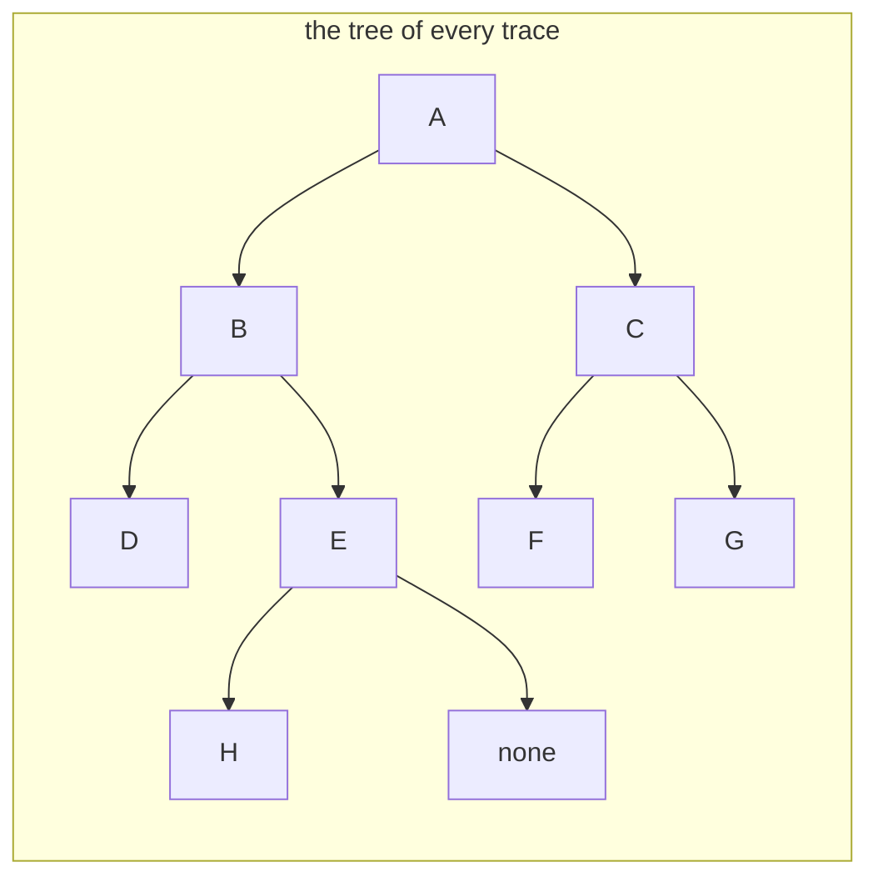

# Tree traversals

## The idea

A **traversal** visits every node of a tree exactly once. A list has one natural order, front to back; a tree has several, and each one suits different work. They come in two families.

**Depth first.** Go all the way down one branch before starting the next. In a binary tree, a depth-first walk of a node does three things: handle the node itself, walk its left subtree, walk its right subtree. The three orders differ only in *when* the node is handled:

| Order | Handles a node | Read it as |
|-------|----------------|------------|
| **Pre-order** | before both of its subtrees | node, left, right |
| **In-order** | between its left and its right subtree | left, node, right |
| **Post-order** | after both of its subtrees | left, right, node |

Left always comes before right. Picture a pencil tracing round the outside of the tree, starting at the root and going down the left side first. It passes every node three times: on its way down, from the left side; underneath, between the two subtrees; and on its way back up, from the right side. Pre-order writes a node at the first pass, in-order at the second, post-order at the third. In-order needs exactly two children's places, so it is defined for binary trees; pre-order and post-order work for any tree.

**Breadth first**, also called **level order**. Visit the root, then every node at depth 1, then every node at depth 2, and so on, left to right within a depth. The walk spreads out across the tree instead of diving down.

Each walk can be written two ways. Recursively, the language's call stack remembers where to come back to. Iteratively, you keep that memory yourself: a **stack** (last in, first out) for depth first, a **queue** (first in, first out) for breadth first.

## A worked example

Every trace below uses this tree. It is not a search tree: the letters are just names. E has a left child, H, and no right child; the drawing marks the missing one "none".



<!-- text-of-mermaid sha256:ec748ee32ed961052c6ceb4e2d555ef6088d6d2bad7a465f5c4ea2d7657e0840 -->
```text
┌─────────────────────────────┐
│   the tree of every trace   │
│                             │
│                             │
│ ┌─┐                         │
│ │A├─────┐                   │
│ └┬┘     │                   │
│  ▼      ▼                   │
│ ┌─┐    ┌─┐                  │
│ │B├──┐ │C├────┬──┐          │
│ └┬┘  │ └─┘    └──┼───────┐  │
│  ▼   └──▼        ▼       ▼  │
│ ┌─┐    ┌─┐    ┌────┐    ┌─┐ │
│ │D│    │E├──┐ │ F  │    │G│ │
│ └─┘    └┬┘  │ └────┘    └─┘ │
│         ▼   └────▼          │
│        ┌─┐    ┌────┐        │
│        │H│    │none│        │
│        └─┘    └────┘        │
│                             │
└─────────────────────────────┘
```

**Pre-order** writes a node, then everything below it on the left, then everything below it on the right. Start at A and write it. Go left to B and write it. B's left subtree is just D: write D. B's right subtree is E with its child H: write E, then H. B is finished, and so is the left side of A. Now the right side: C, then F, then G. The result is `A B D E H C F G`. Notice that every node comes before all of its descendants.

**In-order** writes a node only after its whole left subtree. From A, go left to B, and from B left to D. D has no left subtree, so write D, then its (empty) right subtree. Back at B, its left side is done: write B. Then B's right subtree: E has a left child H, so write H first, then E. Back up to A: write A. Then C's subtree in the same way: F, C, G. The result is `D B H E A F C G`. Every node sits between its left descendants and its right descendants.

**Post-order** writes a node only after both of its subtrees. D first; then H, then E, since E's subtree must be finished before E; then B. On the right, F, G, then C. The root comes last: `D H E B F G C A`. Every node comes after all of its descendants.

**Level order** writes depth by depth: `A`, then `B C`, then `D E F G`, then `H`, giving `A B C D E F G H`.

Here are all four, each written recursively and again with a stack or a queue, checked against each other.

```python examples/traversals.py
"""The four classic orders for visiting a binary tree, each written twice: recursively, and with
an explicit stack or queue. Both versions must agree."""

from collections import deque
from dataclasses import dataclass


@dataclass
class Node:
    label: str
    left: "Node | None" = None
    right: "Node | None" = None


# The tree drawn in the guide:
#          A
#        /   \
#       B     C
#      / \   / \
#     D   E F   G
#        /
#       H
tree = Node(
    "A",
    Node("B", Node("D"), Node("E", Node("H"))),
    Node("C", Node("F"), Node("G")),
)


def preorder(node: Node | None, out: list[str]) -> list[str]:
    if node:
        out.append(node.label)  # the node first,
        preorder(node.left, out)  # then its whole left subtree,
        preorder(node.right, out)  # then its whole right subtree
    return out


def inorder(node: Node | None, out: list[str]) -> list[str]:
    if node:
        inorder(node.left, out)
        out.append(node.label)  # the node between its two subtrees
        inorder(node.right, out)
    return out


def postorder(node: Node | None, out: list[str]) -> list[str]:
    if node:
        postorder(node.left, out)
        postorder(node.right, out)
        out.append(node.label)  # the node after both subtrees
    return out


def with_stack(root: Node | None, order: str) -> list[str]:
    """Any of the three depth-first orders, with a stack of (node, ready) pairs.

    A pair that is not ready stands for "this whole subtree, still to do"; a ready pair stands
    for "visit this node now". Expanding a subtree pushes its plan in reverse, because a stack
    hands back the last thing pushed first."""
    out: list[str] = []
    stack: list[tuple[Node | None, bool]] = [(root, False)]
    while stack:
        node, ready = stack.pop()
        if node is None:
            continue
        if ready:
            out.append(node.label)
            continue
        visit, left, right = (node, True), (node.left, False), (node.right, False)
        plan = {
            "pre": [visit, left, right],
            "in": [left, visit, right],
            "post": [left, right, visit],
        }[order]
        stack.extend(reversed(plan))
    return out


def level_order(root: Node | None) -> list[str]:
    """Breadth first: a queue hands nodes back in the order they were added."""
    out: list[str] = []
    queue: deque[Node | None] = deque([root])
    while queue:
        node = queue.popleft()
        if node is None:
            continue
        out.append(node.label)
        queue.append(node.left)
        queue.append(node.right)
    return out


for name, recursive in (("pre", preorder), ("in", inorder), ("post", postorder)):
    walked = recursive(tree, [])
    same = walked == with_stack(tree, name)
    print(f"{name + '-order:':<12} {' '.join(walked)}   (stack version agrees: {same})")
print(f"{'level order:':<12} {' '.join(level_order(tree))}")
```

It prints:

```output examples/traversals.py
pre-order:   A B D E H C F G   (stack version agrees: True)
in-order:    D B H E A F C G   (stack version agrees: True)
post-order:  D H E B F G C A   (stack version agrees: True)
level order: A B C D E F G H
```

The recursive versions are almost the definitions. The only difference between the three depth-first functions is the line that records the node. The base case, an empty subtree, does nothing.

### With an explicit stack

Recursion keeps its place on the call stack: each call remembers what it still has to do after the call it is waiting for returns. `with_stack` keeps that memory in a list instead. Each entry is either "this whole subtree is still to do" (`ready` false) or "write this node now" (`ready` true). Popping a subtree replaces it with its plan: for in-order, "do the left subtree, write the node, do the right subtree". Since a stack returns the last entry pushed, the plan goes on in reverse, so that its first step comes off first.

Here is the in-order walk of B's subtree, step by step. The stack is written with its top on the right; the code also pushes the empty children and throws them away when they come off, which the table leaves out.

| Step | Pop | What happens | Stack after |
|------|-----|--------------|-------------|
| 1 | do B | Plan: do D, write B, do E. Push it reversed | do E, write B, do D |
| 2 | do D | Plan: write D (D has no children) | do E, write B, write D |
| 3 | write D | Output D | do E, write B |
| 4 | write B | Output B | do E |
| 5 | do E | Plan: do H, write E (E has no right child) | write E, do H |
| 6 | do H | Plan: write H | write E, write H |
| 7 | write H | Output H | write E |
| 8 | write E | Output E | empty |

The output is `D B H E`, B's part of the in-order walk. Changing the plan to "write, left, right" gives pre-order, and "left, right, write" gives post-order, with no other change. Pre-order also has a shorter form that needs no flags: pop a node, write it, then push its right child and then its left child, so that the left one comes off first.

### Level order with a queue

A queue returns entries in the order they went in. Start with the root in it. Repeatedly take the front node, write it, and add its children to the back. Children always join behind everything already waiting, and everything already waiting is no deeper than they are, so the nodes come out ordered by depth, and left to right within a depth.

| Step | Take from the front | Output so far | Queue after, front on the left |
|------|---------------------|---------------|--------------------------------|
| 1 | A | A | B C |
| 2 | B | A B | C D E |
| 3 | C | A B C | D E F G |
| 4 | D | A B C D | E F G |
| 5 | E | A B C D E | F G H |
| 6 | F | A B C D E F | G H |
| 7 | G | A B C D E F G | H |
| 8 | H | A B C D E F G H | empty |

In Python the queue is a `collections.deque`, whose documentation promises appends and pops at either end in roughly O(1). A plain `list` is the wrong tool: its documentation warns that `pop(0)` costs O(n), because every remaining element moves.

## When to use it

Choose the walk by what each node needs to know when you handle it.

- **Pre-order** when a node must be handled before its children: creating a copy of a tree, where the parent must exist before its children can be attached; or printing a nested listing where each heading comes before its contents.
- **In-order** when the left-to-right position matters. Its great use is the [binary search tree](../binary-search-trees/guide.md), where in-order visits the keys in sorted order.
- **Post-order** when a node needs something from its children first: deleting a tree, where children must go before their parent, or any computation that combines the results of two subtrees. The [recursion guide](../recursion-on-trees/guide.md) is mostly about those.
- **Level order** when distance from the root matters: anything described by depth, or work that should touch the nodes near the root before the deep ones.

Choose the style by the depth you expect. Recursion is the clearest code and the right default when the tree is reasonably balanced. When a tree can be a long path, such as one built from sorted input or from a long chain of records, use an explicit stack or queue.

## Common traps

- **A missing base case.** Every recursive walk must do nothing for an empty subtree; otherwise it fails on `None` at the first leaf.
- **Pushing children in the wrong order onto a stack.** A stack hands back the last child pushed first. Pushing left before right walks the tree right to left, which looks almost right on small examples and then fails a test.
- **Using a list as a queue.** `list.pop(0)` moves every remaining element, so a breadth-first walk over n nodes costs O(n²). Use `collections.deque` in Python and `ArrayDeque` in Java.
- **Recursing on a deep tree.** Each call takes a frame of the call stack, and the stack is limited. CPython stops at the recursion limit, 1000 by default, with `RecursionError`, as the example below shows; Java throws `StackOverflowError`, which its documentation describes as thrown when an application recurses too deeply.
- **Changing the tree during the walk.** Moving or removing a subtree you have not visited yet makes the walk skip it, or visit it twice. Finish the walk, or make sure each change only touches nodes the walk has already left.
- **Confusing the orders.** They are easy to mix up on paper. Check your understanding on a small asymmetric tree, like the one above, where every order gives a different sequence.

## Complexity

Every traversal visits each node once and does a constant amount of work there, so each one takes **O(n)** time. They differ in memory:

| Walk | Extra memory | Worst case |
|------|--------------|------------|
| Depth first, recursive | O(h) frames on the call stack, for height h | O(n) for a path |
| Depth first, explicit stack | O(h) stack entries | O(n) for a path |
| Breadth first, queue | O(w), for the widest level w | about n/2 for a perfect tree, whose last level holds over half of its nodes |

The two shapes pull in opposite directions: a path is as deep as possible and as narrow as possible, a perfect tree as shallow and as wide. This example measures both.

```python examples/memory.py
"""What a walk keeps in memory. Recursion and an explicit stack grow with the height of the
tree; a queue grows with its widest level."""

import sys
from collections import deque


class Node:
    __slots__ = ("left", "right")

    def __init__(self, left: "Node | None" = None, right: "Node | None" = None) -> None:
        self.left, self.right = left, right


def path(n: int) -> Node | None:
    """A degenerate tree: n nodes, each the left child of the one above."""
    root = None
    for _ in range(n):
        root = Node(left=root)
    return root


def perfect(height: int) -> Node | None:
    """A perfect tree: every level full, 2 ** (height + 1) - 1 nodes."""
    if height < 0:
        return None
    return Node(perfect(height - 1), perfect(height - 1))


def visit_recursively(node: Node | None, seen: list[Node]) -> None:
    if node:
        visit_recursively(node.left, seen)
        seen.append(node)
        visit_recursively(node.right, seen)


def visit_with_stack(root: Node | None) -> tuple[int, int]:
    """In-order with a stack of (node, ready) pairs; returns (nodes visited, largest stack)."""
    visited, peak = 0, 0
    stack: list[tuple[Node | None, bool]] = [(root, False)]
    while stack:
        peak = max(peak, len(stack))
        node, ready = stack.pop()
        if node is None:
            continue
        if ready:
            visited += 1
        else:
            stack.extend([(node.right, False), (node, True), (node.left, False)])
    return visited, peak


def visit_with_queue(root: Node | None) -> tuple[int, int]:
    """Level order; returns (nodes visited, largest queue)."""
    visited, peak = 0, 0
    queue = deque([root] if root else [])
    while queue:
        peak = max(peak, len(queue))
        node = queue.popleft()
        visited += 1
        queue.extend(child for child in (node.left, node.right) if child)
    return visited, peak


deep = path(100_000)
print("recursion limit:", sys.getrecursionlimit())
try:
    visit_recursively(deep, [])
except RecursionError:
    print("path of 100,000 nodes, recursive walk: RecursionError")
visited, peak = visit_with_stack(deep)
print(f"path of 100,000 nodes, stack walk: visited {visited}, stack peaked at {peak}")

bushy = perfect(16)
visited, peak = visit_with_stack(bushy)
print(f"perfect tree of height 16, stack walk: visited {visited}, stack peaked at {peak}")
visited, peak = visit_with_queue(bushy)
print(f"perfect tree of height 16, queue walk: visited {visited}, queue peaked at {peak}")
```

It prints:

```output examples/memory.py
recursion limit: 1000
path of 100,000 nodes, recursive walk: RecursionError
path of 100,000 nodes, stack walk: visited 100000, stack peaked at 200001
perfect tree of height 16, stack walk: visited 131071, stack peaked at 35
perfect tree of height 16, queue walk: visited 131071, queue peaked at 65536
```

On a path of 100,000 nodes, the recursive walk hits CPython's limit of 1000 frames. The explicit stack does not care: it simply grows, here to two entries per level. On a perfect tree of height 16, the stack never holds more than 35 entries, about two per level, while the queue at its peak holds the whole last level, 65,536 nodes.

## Expert notes

- **Every recursion can become a loop with a stack.** A call frame holds the function's arguments, its local variables and the point it will resume from. The `(node, ready)` pair is a frame reduced to what a traversal needs: `ready` says whether the resume point is "expand" or "write". More complex recursive functions need more state per entry, but the conversion is always possible, and it is what you do when the input may be deep.
- **CPython's recursion limit is a guard, not the stack itself.** The `sys` documentation says the limit prevents infinite recursion from overflowing the C stack and crashing Python. `sys.setrecursionlimit` raises it, but the documentation warns that a limit too high for the platform can crash the interpreter. Raising it is a patch; an explicit stack is a fix.
- **Java's choice of stack and queue.** The documentation of `java.util.Stack` itself recommends the `Deque` interface instead, and `ArrayDeque`'s documentation says it is likely faster than `Stack` used as a stack and than `LinkedList` used as a queue.
- **Iterative pre-order needs less than iterative in-order.** Pre-order writes a node the moment it is popped, so the node never has to come back. In-order and post-order must remember a node while its left side is walked, which is why the general version needs the `ready` flag, or some other way to know which visit it is.
- **Breadth first is the tree case of a graph search.** The same queue, plus a set of visited nodes, walks any graph outward from a starting node. The argument above still holds, since nothing already waiting is farther from the start than what joins behind it, so it reaches nodes in order of their number of edges from the start. In a tree no node can be reached twice, so the set is unnecessary.
- **Memory decides between the families on huge trees.** Depth first holds about one path's worth of entries, breadth first up to one level's worth. For a wide, shallow tree, depth first is the lighter walk; for a tree that is a long chain, breadth first is.

## Practice

- `cstudy start invert-binary-tree`: rearrange every node of a tree, recursively and then without recursion.
- `cstudy start level-order-traversal`: list a tree's values level by level, as one list per level.
- `cstudy start right-side-view`: report the nodes you would see looking at the tree from its right side.

## Further reading

- [Python `collections.deque`](https://docs.python.org/3/library/collections.html#collections.deque): O(1) appends and pops at both ends, and the O(n) cost of `list.pop(0)`.
- [Python `sys.getrecursionlimit` and `sys.setrecursionlimit`](https://docs.python.org/3/library/sys.html#sys.setrecursionlimit): what the limit protects and why raising it needs care; [`RecursionError`](https://docs.python.org/3/library/exceptions.html#RecursionError).
- [Java `ArrayDeque`](https://docs.oracle.com/en/java/javase/21/docs/api/java.base/java/util/ArrayDeque.html) and [Java `Stack`](https://docs.oracle.com/en/java/javase/21/docs/api/java.base/java/util/Stack.html): which to use as a stack and as a queue.
- [Java `StackOverflowError`](https://docs.oracle.com/en/java/javase/21/docs/api/java.base/java/lang/StackOverflowError.html): thrown when an application recurses too deeply.
