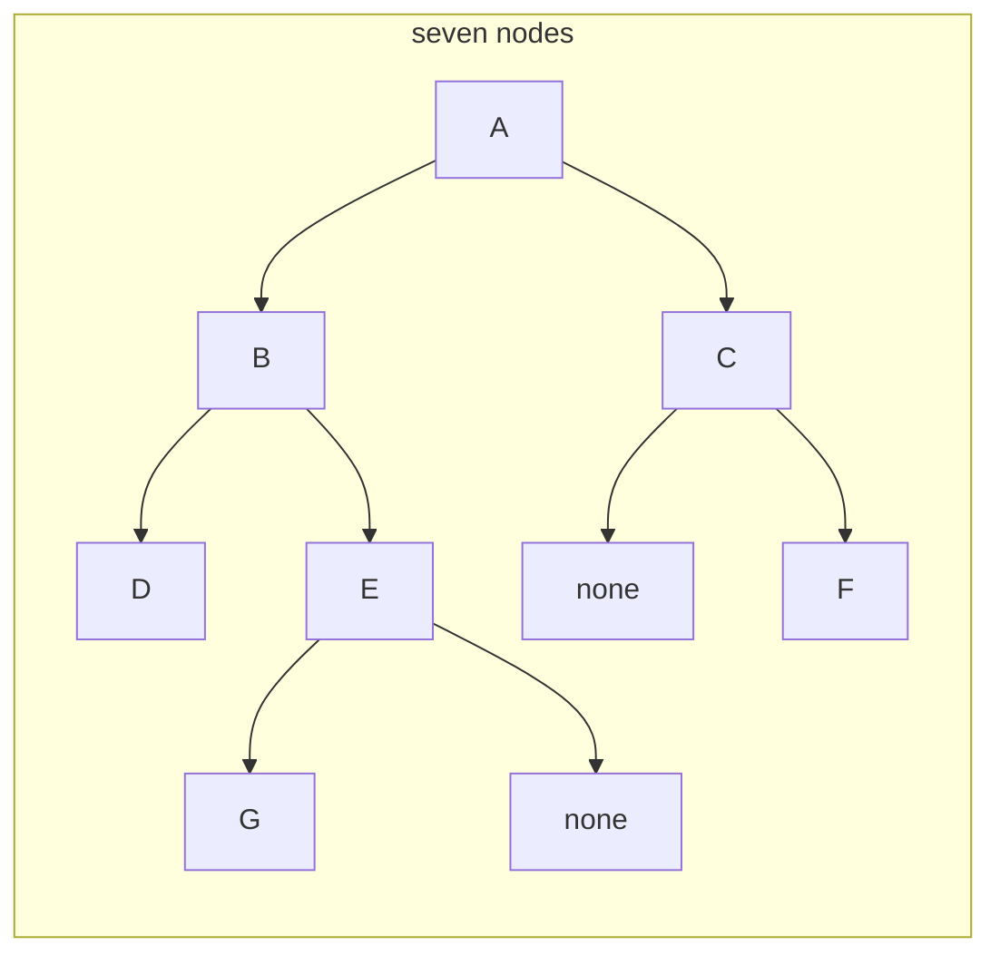
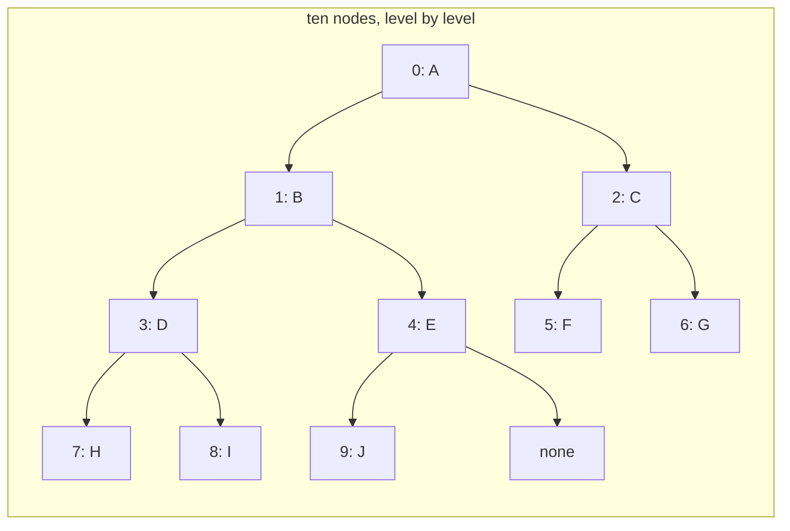

# Trees and binary trees

## The idea

A **tree** is a set of **nodes** joined by **edges** so that there is exactly one way to get from any node to any other. You meet trees everywhere: folders inside folders, the elements of a web page, a company's reporting lines, the moves of a game, the parts of an arithmetic expression. Each of them has one thing at the top and things that branch out below it, and nothing below ever loops back up.

Trees are drawn upside down, with the top at the top. The words for their parts come from two pictures at once, a family and a plant:

| Word | Meaning |
|------|---------|
| **Root** | The one node at the top. It has no parent |
| **Parent** and **child** | Joined by an edge, the parent above, the child below. Every node except the root has exactly one parent |
| **Siblings** | Children of the same parent |
| **Leaf** | A node with no children. A node that has children is an **internal** node |
| **Ancestor** and **descendant** | Your parent, its parent and so on up to the root are your ancestors; you are their descendant |
| **Subtree** | A node together with all of its descendants. It is a tree of its own, with that node as its root |
| **Depth** of a node | The number of edges between it and the root. The root has depth 0, its children depth 1 |
| **Height** of a node | The number of edges on the longest path from it down to a leaf. A leaf has height 0 |
| **Height** of the tree | The height of its root, which is the same as the largest depth of any node |
| **Level** | All the nodes of one depth |
| **Size** | The number of nodes |

Depth looks up, height looks down: depth asks "how far am I from the top?", height asks "how far down does my subtree go?". Both count edges in this guide, as most textbooks do. Some problems count nodes instead, so that an empty tree has height 0 and a single node height 1; each problem in the catalog says which it means, and the difference is always exactly one.

A **binary tree** is a tree in which every node has at most two children, and the two places are named: a **left** child and a **right** child. The side matters. A node whose only child hangs on the left and a node whose only child hangs on the right are different binary trees, even with the same values. Most of the trees in coding problems are binary, and so are the search trees and the heaps of the next guides.

## A worked example

Here is a binary tree of seven nodes. Node C has a right child and no left child; node E has a left child and no right child. In the drawing, a box marked "none" stands in for a missing child, so that F appears on C's right and G on E's left.



<!-- text-of-mermaid sha256:c2383f14e43e765d000336fbb3c969a4f4885f6406adb05aee486bb65c53f302 -->
```text
┌─────────────────────────────┐
│         seven nodes         │
│                             │
│                             │
│ ┌─┐                         │
│ │A├─────┐                   │
│ └┬┘     │                   │
│  ▼      ▼                   │
│ ┌─┐    ┌─┐                  │
│ │B├──┐ │C├────┬──┐          │
│ └┬┘  │ └─┘    └──┼───────┐  │
│  ▼   └──▼        ▼       ▼  │
│ ┌─┐    ┌─┐    ┌────┐    ┌─┐ │
│ │D│    │E├──┐ │none│    │F│ │
│ └─┘    └┬┘  │ └────┘    └─┘ │
│         ▼   └────▼          │
│        ┌─┐    ┌────┐        │
│        │G│    │none│        │
│        └─┘    └────┘        │
│                             │
└─────────────────────────────┘
```

Read each node's facts off the drawing, one at a time.

1. **A** has no parent, so it is the root, at depth 0. Its children are B and C.
2. **B** and **C** are A's children, so they are siblings, both at depth 1.
3. **D** and **E** hang below B, at depth 2. **F** hangs below C, also at depth 2, on the right side.
4. **G** hangs below E, at depth 3. Count its edges up to the root: G to E, E to B, B to A, three edges.
5. The leaves are the nodes with no children: **D**, **F** and **G**. Every other node is internal.
6. Heights go the other way, starting from the leaves at 0. E's longest path down is E to G, one edge, so E has height 1. C's is C to F, height 1. B's longest path down goes through E to G, two edges, while its other path, to D, has only one: the longest one counts, so B has height 2. A's longest path down is A, B, E, G: height 3.

| Node | Parent | Children | Depth | Height | Leaf |
|------|--------|----------|-------|--------|------|
| A | none | B (left), C (right) | 0 | 3 | no |
| B | A | D (left), E (right) | 1 | 2 | no |
| C | A | F (right) | 1 | 1 | no |
| D | B | none | 2 | 0 | yes |
| E | B | G (left) | 2 | 1 | no |
| F | C | none | 2 | 0 | yes |
| G | E | none | 3 | 0 | yes |

So the tree has size 7 and height 3, which is also the depth of its deepest node, G. Counted in nodes instead of edges, the longest path from the root down, A, B, E, G, has 4 nodes: the tree has 4 levels.

Notice also the subtrees. The subtree of B holds B, D, E and G, and it is a binary tree in its own right, with root B and height 2. Every node is the root of its own subtree, and a leaf is the root of a subtree of one node. That is the property the next two guides build on: a question about a tree can often be answered by asking it of the two subtrees first.

## Shapes of binary trees

Some shapes have names, and the names are used precisely:

| Shape | Rule |
|-------|------|
| **Full** | Every node has zero or two children, never one |
| **Perfect** | Full, with every leaf at the same depth |
| **Complete** | Every level is full except possibly the deepest, whose nodes sit as far left as possible |
| **Degenerate** | Every internal node has exactly one child: the tree is a path |

The tree of the worked example is none of these: C and E have one child each, so it is not full, and its levels have gaps, so it is not complete.

How tall can a binary tree with `n` nodes be? Level `d` holds at most `2^d` nodes, because each node of the level above has at most two children. A perfect tree of height `h` fills every level, so it holds `1 + 2 + 4 + ... + 2^h = 2^(h+1) - 1` nodes, just over half of them, `2^h`, in its last level. Turning that around: a tree of height `h` holds at most `2^(h+1) - 1` nodes, so `n` nodes need a height of at least `floor(log2 n)`. A complete tree reaches that minimum. At the other extreme, a degenerate tree puts one node on each level and reaches height `n - 1`.

```python examples/shapes.py
"""How many nodes fit under a given height, and how tall a binary tree with n nodes can be.

Heights count edges here: a tree of one node has height 0."""

print("perfect tree: height  leaves  nodes")
for height in range(5):
    leaves = 2**height
    nodes = 2 ** (height + 1) - 1
    print(f"{height:>19} {leaves:>7} {nodes:>6}")

for n in (1, 7, 8, 1_000, 1_000_000):
    shortest = n.bit_length() - 1  # floor(log2 n): every level full except the last
    tallest = n - 1  # one node per level: the tree is a path
    print(f"{n:>9} nodes: height at least {shortest:>2}, at most {tallest}")
```

It prints:

```output examples/shapes.py
perfect tree: height  leaves  nodes
                  0       1      1
                  1       2      3
                  2       4      7
                  3       8     15
                  4      16     31
        1 nodes: height at least  0, at most 0
        7 nodes: height at least  2, at most 6
        8 nodes: height at least  3, at most 7
     1000 nodes: height at least  9, at most 999
  1000000 nodes: height at least 19, at most 999999
```

This gap, between about 20 and about a million for a million nodes, is the most important number in the trees and heaps guides. Many tree operations walk one path from the root down, so they cost time proportional to the height. A compact tree makes them fast; a stringy one makes them as slow as scanning a list. [Binary search trees](../binary-search-trees/guide.md) are about keeping the height small, and [heaps](../heaps/guide.md) keep it small by staying complete.

## Storing a tree

**With links.** The usual way gives each node an object holding its value and links to its children: `left` and `right` in a binary tree, or a list of children when a node may have any number of them. A missing child is a null link (`None` in Python, `null` in Java and JavaScript, `nil` in Go). A program holds the root, and reaches everything else by following links down. Some trees also keep a link from each node up to its parent, which makes moving up cheap at the cost of one more link to keep right.

```python
class Node:
    def __init__(self, value, left=None, right=None):
        self.value = value
        self.left = left
        self.right = right

# The worked example's tree, built from the leaves up.
root = Node("A", Node("B", Node("D"), Node("E", Node("G"))), Node("C", None, Node("F")))
```

**In an array.** A complete binary tree needs no links at all. Write its nodes into a list level by level, left to right, and the positions alone say who is whose child: with indexes counted from 0, the children of index `i` sit at `2i + 1` and `2i + 2`, and its parent at `(i - 1) // 2`. Here is a complete tree of ten nodes, labelled with the index each one gets.



<!-- text-of-mermaid sha256:37cb04aa25d683b548ddbf53b329d8aaf05926c460c9e6fb276770992f47d600 -->
```text
┌──────────────────────────────────────┐
│      ten nodes, level by level       │
│                                      │
│                                      │
│ ┌────┐                               │
│ │0: A├───────┐                       │
│ └──┬─┘       │                       │
│    ▼         ▼                       │
│ ┌────┐    ┌────┐                     │
│ │1: B├──┐ │2: C├────┬──┐             │
│ └──┬─┘  │ └────┘    └──┼─────────┐   │
│    ▼    └────▼         ▼         ▼   │
│ ┌────┐    ┌────┐    ┌────┐    ┌────┐ │
│ │3: D├──┐ │4: E├──┐ │5: F│    │6: G│ │
│ └──┬─┘  │ └────┘  │ └────┘    └────┘ │
│    ▼    └────▼    └────▼─────────▼   │
│ ┌────┐    ┌────┐    ┌────┐    ┌────┐ │
│ │7: H│    │8: I│    │9: J│    │none│ │
│ └────┘    └────┘    └────┘    └────┘ │
│                                      │
└──────────────────────────────────────┘
```

```python examples/array_layout.py
"""A complete binary tree stored in a plain list, with no links at all.

The list holds the nodes level by level, left to right. Index arithmetic finds a node's parent
and children, and the depth of index i is floor(log2(i + 1))."""

tree = ["A", "B", "C", "D", "E", "F", "G", "H", "I", "J"]


def parent(i: int) -> int | None:
    return (i - 1) // 2 if i > 0 else None


def children(i: int) -> list[int]:
    return [c for c in (2 * i + 1, 2 * i + 2) if c < len(tree)]


for i, label in enumerate(tree):
    up = "-" if parent(i) is None else tree[parent(i)]
    down = " ".join(tree[c] for c in children(i)) or "none, a leaf"
    depth = (i + 1).bit_length() - 1
    print(f"index {i}: {label}, depth {depth}, parent {up}, children {down}")
```

It prints:

```output examples/array_layout.py
index 0: A, depth 0, parent -, children B C
index 1: B, depth 1, parent A, children D E
index 2: C, depth 1, parent A, children F G
index 3: D, depth 2, parent B, children H I
index 4: E, depth 2, parent B, children J
index 5: F, depth 2, parent C, children none, a leaf
index 6: G, depth 2, parent C, children none, a leaf
index 7: H, depth 3, parent D, children none, a leaf
index 8: I, depth 3, parent D, children none, a leaf
index 9: J, depth 3, parent E, children none, a leaf
```

The arithmetic works because a complete tree has no gaps: level `d` starts at index `2^d - 1`, and each node's two children take the next two free places of the level below. Adding a node means appending to the list, which keeps the tree complete. This layout is what a binary heap uses. It only suits complete trees: a tree with gaps would leave holes in the list, and a degenerate tree of height `h` would need `2^(h+1) - 1` slots for its `h + 1` nodes.

## When to use it

Reach for a tree when the data itself is a hierarchy, or when a hierarchy makes a question fast:

- **The data is nested.** Folders, menus, documents, organisation charts, the structure of a program or an expression: anything where each part belongs to exactly one larger part.
- **You want "between" and "nearest", not only "equal to".** A hash map finds an exact key in O(1) on average but has no order; a [binary search tree](../binary-search-trees/guide.md) keeps keys in order and finds the nearest key, or every key in a range, in time proportional to its height.
- **You want the smallest or largest, over and over.** A [heap](../heaps/guide.md) is a complete binary tree that always has the smallest (or largest) item at its root.
- **The connections can form loops or a node can have several parents.** Then it is not a tree but a graph, and walking it needs a record of visited nodes so that you do not go round forever.

## Common traps

- **Counting edges when the problem counts nodes, or the reverse.** Read the definition of depth and height in each problem. Check it on a single node: is its height 0 or 1?
- **Forgetting the empty tree.** A tree of zero nodes is a valid input almost everywhere. Code that reads `root.value` before checking that `root` exists fails on it.
- **Assuming a tree is balanced.** A tree built from real data can be a long path. An operation that is fast on a tree of height 20 may be a million steps on a degenerate one, and a recursive walk of a very deep tree can run out of call stack; [tree traversals](../tree-traversals/guide.md) shows how to walk it without recursion.
- **Treating a graph as a tree.** If a node can be reached along two paths, a walk that assumes a tree visits it twice, and a cycle makes it loop forever.

## Complexity

| Question | Cost |
|----------|------|
| Visit every node | O(n) |
| Follow one path from the root down | O(h), where h is the height |
| Height of a binary tree with n nodes | from `floor(log2 n)`, when complete, to `n - 1`, when a path |
| Nodes in a perfect binary tree of height h | `2^(h+1) - 1`, of which `2^h` are leaves |
| Memory, with links | O(n): one node object, with two links, per node |
| Memory, in an array | O(n) for a complete tree, with no links at all |

The difference between O(log n) and O(n) height is the reason balanced trees and heaps exist: for a million nodes, the path from the root is about 20 steps long in a complete tree and up to 999,999 in a degenerate one.

## Expert notes

- **Definitions vary, so state yours.** NIST's Dictionary of Algorithms and Data Structures defines depth by edges (the root at 0, every other node one more than its parent), the height as the largest depth, a one-node tree's height as 0, and an empty tree's height as undefined. Problems and libraries that count nodes are just as common. Write down the convention before you compare two answers.
- **A binary tree is defined recursively.** The same dictionary's formal definition says a binary tree is either empty, or a root with a left binary tree and a right binary tree. That definition is why recursion fits trees so well: a function that handles "empty" and "a root with two subtrees" handles every binary tree. The [recursion guide](../recursion-on-trees/guide.md) is about writing such functions.
- **A tree with n nodes has exactly n - 1 edges.** Every node except the root has exactly one edge to its parent, and every edge is some node's edge to its parent. That makes a quick sanity check when data claims to describe a tree: n nodes need exactly n - 1 parent links, one for every node but the root.
- **Full, complete and perfect are often mixed up.** A full tree can be lopsided; a complete tree can have a node with one child (the last internal node, like E in the array example); a perfect tree is both full and complete. NIST also notes that a perfect tree can be stored in an array with the children of index `i` at `2i` and `2i + 1` and its parent at `i / 2`: that version counts from 1. Python's `heapq` counts from 0, which gives `2i + 1`, `2i + 2` and `(i - 1) // 2`. Mixing the two is a classic off-by-one.
- **Any tree fits in two links per node.** A node with any number of children can keep a link to its first child and a link to its next sibling instead of a list. Read sideways, that is a binary tree, so every algorithm on binary trees can serve trees of any branching.
- **Links cost memory and cache misses.** Each linked node is a separate allocation holding the value and two pointers, and following a link usually lands somewhere else in memory. The array layout of a complete tree avoids both. Rust's `BTreeMap` documentation gives the same two costs, an allocation per insertion and a likely cache miss per comparison, as its reason for putting many keys in each node.

## Practice

This guide has no practice problems of its own: every tree problem needs a way to walk the tree first. Read [tree traversals](../tree-traversals/guide.md) next; its practice starts with `cstudy start invert-binary-tree`. Before you go, check the worked example yourself: cover the table, then work out each node's depth and height from the drawing.

## Further reading

- [NIST, Dictionary of Algorithms and Data Structures: tree](https://xlinux.nist.gov/dads/HTML/tree.html), [binary tree](https://xlinux.nist.gov/dads/HTML/binarytree.html), [depth](https://xlinux.nist.gov/dads/HTML/depth.html) and [height](https://xlinux.nist.gov/dads/HTML/height.html): the definitions this guide uses.
- [NIST: full binary tree](https://xlinux.nist.gov/dads/HTML/fullBinaryTree.html), [complete binary tree](https://xlinux.nist.gov/dads/HTML/completeBinaryTree.html) and [perfect binary tree](https://xlinux.nist.gov/dads/HTML/perfectBinaryTree.html): the named shapes, and the 1-based array layout.
- [Python `heapq`](https://docs.python.org/3/library/heapq.html): the 0-based array layout, `heap[k] <= heap[2*k+1]` and `heap[k] <= heap[2*k+2]`.
- [Rust `BTreeMap`](https://doc.rust-lang.org/std/collections/struct.BTreeMap.html), section "Background": why a node per key costs allocations and cache misses.
