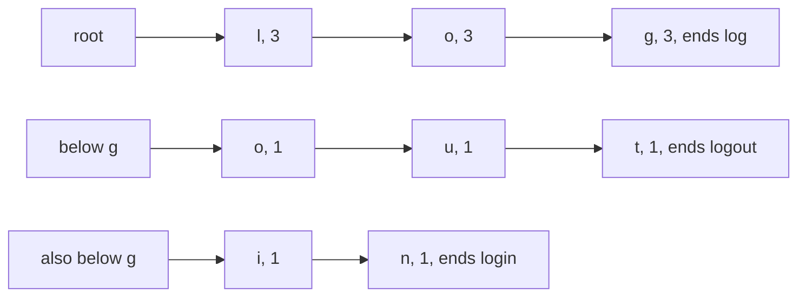

# Tries

## The idea

A **trie**, or **prefix tree**, stores strings letter by letter along paths that start at a root. Every node stands for a prefix: the root for the empty prefix, its child `c` for "c", that node's child `l` for "cl", and so on. A node has one child for each letter that follows its prefix in some stored key, and a **mark** that says whether a stored key ends exactly there. Keys that begin alike share their path for as long as their letters agree.

Three operations follow the same walk from the root, one letter at a time:

- **Insert** a key: follow its letters, creating each child that is missing, then mark the last node.
- **Look up** a key: follow its letters. If a letter has no child, the key is not stored. If the walk reaches the end of the key, the key is stored only if the last node is **marked**: an unmarked node means the key is merely the beginning of longer keys.
- **Ask about a prefix**: follow the prefix's letters. Every key stored below that node starts with the prefix, and no other key does.

Each walk takes one step per letter of the key or prefix, whether the trie holds ten keys or ten million. That is what a trie offers over a [hash set](../hash-maps-and-sets/guide.md): questions about **prefixes**, which a hash set cannot answer without looking at every key, at the cost of exact lookups that are no faster, and more memory.

## A worked example

### A table of commands

A command-line tool has ten commands, and it lets you type any abbreviation that no other command shares: `br` for `branch`, but not `bu`, which could be `build` or `bump`. Store the names in a trie, and give every node one more field: **how many names pass through it**. Inserting a name adds one to the count of every node on its path.

Here is the part of the trie that holds the three commands starting with `l`: `log`, `login` and `logout`, with each node's count. The three share the path `l`, `o`, `g`; `log` ends at a marked node in the middle of it, and the path splits there into `o`, `u`, `t` for `logout` and `i`, `n` for `login`. The drawing gives the shared path its own row, then one row for each branch below `g`.



<!-- text-of-mermaid sha256:1bd0f927f82d00c216a77db7609565b213bb4e017d677e67f243f0340484c6c2 -->
```text
┌────────────┐    ┌────┐    ┌────────────────┐    ┌─────────────────┐
│    root    ├───►│l, 3├───►│      o, 3      ├───►│  g, 3, ends log │
└────────────┘    └────┘    └────────────────┘    └─────────────────┘

┌────────────┐    ┌────┐    ┌────────────────┐    ┌─────────────────┐
│  below g   ├───►│o, 1├───►│      u, 1      ├───►│t, 1, ends logout│
└────────────┘    └────┘    └────────────────┘    └─────────────────┘

┌────────────┐    ┌────┐    ┌────────────────┐
│also below g├───►│i, 1├───►│n, 1, ends login│
└────────────┘    └────┘    └────────────────┘
```

The counts answer three questions with one walk each:

- **How many commands start with a prefix?** Walk the prefix and read the count of the node you reach: one step per letter of the prefix.
- **What is the shortest abbreviation of a command that no other command shares?** Walk its name and stop at the first node whose count is 1: only this command passes there.
- **What does an abbreviation mean?** Walk it. A marked node is a complete name, which wins. A count of 1 means exactly one command continues from here, so follow the only path down to its mark. A larger count means the abbreviation is ambiguous.

```python examples/commands.py
"""A table of command names stored in a trie: exact lookup, counts by prefix, the shortest
abbreviation of each command that no other command shares, and what an abbreviation means.

Every node counts the commands whose name passes through it, so the number of commands that start
with a prefix is the count of the prefix's last node.
"""

COMMANDS = {
    "branch": "list or create branches",
    "build": "compile the project",
    "bump": "raise the version number",
    "check": "run the linters",
    "clean": "delete build output",
    "clone": "copy a repository",
    "commit": "record changes",
    "log": "show the history",
    "login": "store credentials",
    "logout": "forget credentials",
}


class Node:
    def __init__(self) -> None:
        self.children: dict[str, Node] = {}
        self.passing = 0  # how many stored names go through this node
        self.help: str | None = None  # set when a stored name ends exactly here


class CommandTrie:
    def __init__(self) -> None:
        self.root = Node()

    def walk(self, prefix: str) -> Node | None:
        node = self.root
        for letter in prefix:
            node = node.children.get(letter)
            if node is None:
                return None
        return node

    def insert(self, name: str, summary: str) -> None:
        existing = self.walk(name)
        if existing is not None and existing.help is not None:
            existing.help = summary  # already stored: replace its help, but count it only once
            return
        node = self.root
        node.passing += 1
        for letter in name:
            node = node.children.setdefault(letter, Node())
            node.passing += 1
        node.help = summary

    def lookup(self, name: str) -> str | None:
        node = self.walk(name)
        return None if node is None else node.help

    def count_starting_with(self, prefix: str) -> int:
        node = self.walk(prefix)
        return 0 if node is None else node.passing

    def shortest_unique_prefix(self, name: str) -> str:
        node = self.root
        for length, letter in enumerate(name, start=1):
            node = node.children[letter]
            if node.passing == 1:
                return name[:length]
        return name  # another name starts with this whole name: only typing all of it is unique

    def resolve(self, typed: str) -> str:
        node = self.walk(typed)
        if node is None:
            return "unknown"
        if node.help is not None:
            return typed  # a complete name wins, even when longer names start with it
        if node.passing > 1:
            return f"ambiguous, {node.passing} commands"
        while node.help is None:  # one name passes here: follow its only path to the end
            ((letter, node),) = node.children.items()
            typed += letter
        return typed


def count_nodes(node: Node) -> int:
    return sum(1 + count_nodes(child) for child in node.children.values())


table = CommandTrie()
for name, summary in COMMANDS.items():
    table.insert(name, summary)

print("lookup('clone'):", table.lookup("clone"))
print("lookup('clo'):  ", table.lookup("clo"), "(a prefix, not a command)")
for prefix in ("c", "cl", "lo", "b", "x"):
    print(f"commands starting with {prefix!r}: {table.count_starting_with(prefix)}")
print("shortest unique prefixes:", ", ".join(table.shortest_unique_prefix(n) for n in COMMANDS))
for typed in ("br", "bu", "co", "log", "logi", "logo", "z"):
    print(f"{typed!r} means: {table.resolve(typed)}")
letters = sum(len(name) for name in COMMANDS)
print(f"{len(COMMANDS)} names, {letters} letters, {count_nodes(table.root)} nodes below the root")
```

It prints:

```output examples/commands.py
lookup('clone'): copy a repository
lookup('clo'):   None (a prefix, not a command)
commands starting with 'c': 4
commands starting with 'cl': 2
commands starting with 'lo': 3
commands starting with 'b': 3
commands starting with 'x': 0
shortest unique prefixes: br, bui, bum, ch, cle, clo, co, log, logi, logo
'br' means: branch
'bu' means: ambiguous, 2 commands
'co' means: commit
'log' means: log
'logi' means: login
'logo' means: logout
'z' means: unknown
10 names, 50 letters, 37 nodes below the root
```

Look at the corner cases. `lookup('clo')` walks to a real node, but the node is not marked, so `clo` is not a command: the mark, not the walk, decides. `log` cannot be abbreviated, because its whole path is shared with `login` and `logout`: its count never drops to 1, and only typing the complete name, which is marked, picks it. `insert` checks for a name already stored, since inserting it twice would count it twice on every node of its path.

### Branching: suggestions for a typo

When a user types `clome`, a helpful tool asks "did you mean `clone`?". Here a suggestion is a command of the same length with at most one letter changed. Comparing the typed word with every command works, but the trie can rule out most commands without looking at them.

Walk the trie with the typed word and a budget of one change. At each node, look at every child:

- a child whose letter matches the next typed letter continues for free;
- any other child continues only by spending the change, and only if it is still unspent.

So the walk follows one path where the letters agree and **branches** into the other children where one may differ. A branch that has spent its change and meets a second difference stops, and with it every command below it.

```python examples/typos.py
"""Suggest commands for a mistyped name: every command of the same length with at most one letter
changed, found by walking the trie and branching into the other children where a letter may differ.
"""

COMMANDS = ["branch", "build", "bump", "check", "clean", "clone", "commit", "log", "login", "logout"]


class Node:
    def __init__(self) -> None:
        self.children: dict[str, Node] = {}
        self.is_command = False


def build(names: list[str]) -> Node:
    root = Node()
    for name in names:
        node = root
        for letter in name:
            node = node.children.setdefault(letter, Node())
        node.is_command = True
    return root


def suggestions(root: Node, typed: str) -> tuple[list[str], int]:
    """The commands at most one changed letter away from `typed`, and how many nodes it visited."""
    found: list[str] = []
    visited = 0

    def visit(node: Node, depth: int, spelled: str, changes_left: int) -> None:
        nonlocal visited
        visited += 1
        if depth == len(typed):
            if node.is_command:
                found.append(spelled)
            return
        for letter, child in sorted(node.children.items()):
            if letter == typed[depth]:
                visit(child, depth + 1, spelled + letter, changes_left)
            elif changes_left > 0:  # branch: spend the one change on this letter
                visit(child, depth + 1, spelled + letter, changes_left - 1)

    visit(root, 0, "", changes_left=1)
    return found, visited


def by_comparing_every_command(typed: str) -> list[str]:
    return [
        name
        for name in sorted(COMMANDS)
        if len(name) == len(typed) and sum(a != b for a, b in zip(name, typed, strict=True)) <= 1
    ]


root = build(COMMANDS)
for typed in ("clome", "chesk", "lug", "logon", "clean", "bulid", "xyz"):
    found, visited = suggestions(root, typed)
    same = found == by_comparing_every_command(typed)
    print(f"{typed!r:<8} -> {found!s:<11} visited {visited:>2} nodes, matches a full scan: {same}")
```

It prints:

```output examples/typos.py
'clome'  -> ['clone']   visited 11 nodes, matches a full scan: True
'chesk'  -> ['check']   visited 11 nodes, matches a full scan: True
'lug'    -> ['log']     visited  7 nodes, matches a full scan: True
'logon'  -> ['login']   visited 11 nodes, matches a full scan: True
'clean'  -> ['clean']   visited 12 nodes, matches a full scan: True
'bulid'  -> []          visited  8 nodes, matches a full scan: True
'xyz'    -> []          visited  4 nodes, matches a full scan: True
```

`bulid` finds nothing, because swapping two letters changes two positions: this budget counts changes, not swaps. And `xyz` stops after 4 nodes: the root, then each of its three children, where the change is spent at once and the next letter matches nothing.

### What a trie costs in memory

A hash set of strings stores each key once, in full. A trie stores one node per distinct prefix, so keys with long common beginnings share most of their nodes, and keys with little in common need nearly a node per letter.

```python examples/sharing.py
"""How many trie nodes a set of keys needs, compared with the number of letters in the keys.

Keys that share their beginnings share nodes. Keys that share little need a node for most of
their letters, and a node is a whole object with a map of children, much larger than a letter.
"""


def count_nodes(keys: list[str]) -> int:
    root: dict = {}
    nodes = 0
    for key in keys:
        node = root
        for letter in key:
            if letter not in node:
                node[letter] = {}
                nodes += 1
            node = node[letter]
    return nodes


def scattered_keys(count: int, length: int) -> list[str]:
    """Keys of random-looking letters, from a fixed linear congruential generator."""
    state, keys = 12345, []
    for _ in range(count):
        letters = []
        for _ in range(length):
            state = (state * 1103515245 + 12345) % 2**31
            letters.append(chr(ord("a") + (state >> 16) % 26))
        keys.append("".join(letters))
    return keys


datasets = {
    "user0000 to user9999": [f"user{number:04}" for number in range(10_000)],
    "10,000 scattered keys": scattered_keys(10_000, 8),
}
for label, keys in datasets.items():
    letters = sum(len(key) for key in keys)
    nodes = count_nodes(keys)
    print(f"{label}: {letters:,} letters, {nodes:,} nodes, {nodes / letters:.0%} of the letters")
```

It prints:

```output examples/sharing.py
user0000 to user9999: 80,000 letters, 11,114 nodes, 14% of the letters
10,000 scattered keys: 80,000 letters, 58,241 nodes, 73% of the letters
```

Ten thousand numbered user names need 11,114 nodes for 80,000 letters, since `user` and the leading digits are shared. Ten thousand scattered keys share only their first two or three letters and need 58,241 nodes. That would still look like a saving, but a node is not a letter: each one is an object with its own map of children, many times the size of the letter it stands for. So a trie usually takes more memory than a hash set of the same keys, and pays for itself only through the prefix questions it can answer.

## When to use it

- **Questions about prefixes** of a fixed set of keys: how many start with this, what this abbreviation means, what completes it as you type.
- **Searches that branch**: patterns with wildcards, or near matches, where one walk through the trie prunes every key that cannot match instead of testing the keys one by one.
- **Keys that come as a sequence of parts**, compared part by part from the start: letters of words, digits of numbers, bits of addresses.

What to use instead: when you only ever look up whole keys, a hash set or a hash map is simpler and smaller. Use a trie when the prefixes are the question.

## Common traps

- **Treating "the walk finished" as "the key is stored".** Every prefix of a stored key reaches a node. Only the mark says a key ends there.
- **Forgetting keys that are prefixes of other keys.** `log` shares its path with `login` and `logout`, and has no abbreviation of its own. Code that assumes every key ends at a leaf, a node without children, breaks here.
- **Counting a key twice.** Inserting a key that is already stored must not add to the counts again.
- **Deleting without updating.** To remove a key, unmark its node, take one off every count along its path, and remove nodes whose count drops to 0, or the prefix counts go stale and dead branches stay.
- **Recursing on long keys.** A recursive walk goes one call deeper per letter. Keys of thousands of characters can exceed a language's recursion limit; walk with a loop, as `walk` and `insert` do, or keep [your own stack](../stacks/guide.md).
- **Expecting a trie to save memory.** As the measurement shows, it saves letters only where keys share beginnings, and every node costs far more than a letter.

## Complexity

With L the length of the key or prefix, n the number of keys, S the total number of letters in the keys, and the children of a node in a hash map:

| Operation | Time | Condition |
|-----------|------|-----------|
| Insert, look up, count a prefix | O(L) steps | Each step is one lookup in a node's map of children, expected O(1) |
| Shortest unique prefix, resolving an abbreviation | O(length of the name) | Using the counts kept on the path |
| Suggestions within one change | At most about σ · L² steps | σ is the number of different letters: at each of the L positions, the walk may branch into each other child once, then must follow the rest of the word exactly |
| Memory | O(S) nodes at most, fewer when keys share prefixes | Each node holds a map of its children |

Compare a hash set: a lookup hashes the whole key and compares it, O(L) expected, but to find the keys that start with a prefix it has nothing better than looking at every key, O(S).

## Expert notes

- **The name.** The structure's name appears in the title of Edward Fredkin's paper "Trie memory", Communications of the ACM, volume 3, issue 9, pages 490 to 499, September 1960.
- **Compressed tries.** Many nodes of a trie have a single child, like the `i` and the `l` that lead to the `d` at the end of `build`. A compressed trie, also called a radix tree, merges each such chain into a single edge labelled with a string, so the number of nodes is at most about twice the number of keys, whatever their length. Lookups then compare whole labels instead of single letters.
- **How a node holds its children** is the main lever on a trie's memory. A map per node, as here, stores only the letters that occur, at the price of a whole map for every node.
- **A trie is also a map.** The command table stores a summary at each marked node, so it maps names to values, just like a hash map, with prefix questions on top.

## Practice

- `cstudy start count-words-by-prefix`: how many words of a list begin with each of several prefixes.
- `cstudy start implement-trie`: the trie itself: stored words, and whether any stored word starts with a prefix.
- `cstudy start replace-words`: replace each word of a sentence by the shortest stored root it starts with.
- `cstudy start wildcard-word-dictionary`: stored words searched with patterns in which a dot matches any one letter.
- `cstudy start search-suggestions`: up to three suggestions after each letter typed in a search box.
- `cstudy start word-search-ii`: many words to find at once in a grid of letters.

## Further reading

- E. Fredkin, ["Trie memory"](https://doi.org/10.1145/367390.367400), Communications of the ACM 3(9), 1960.
- [Python `dict`](https://docs.python.org/3/library/stdtypes.html#mapping-types-dict): `get` and `setdefault`, which the examples use for a node's children.
- The [hash maps and sets](../hash-maps-and-sets/guide.md) guide, for what a hash set costs and promises.
