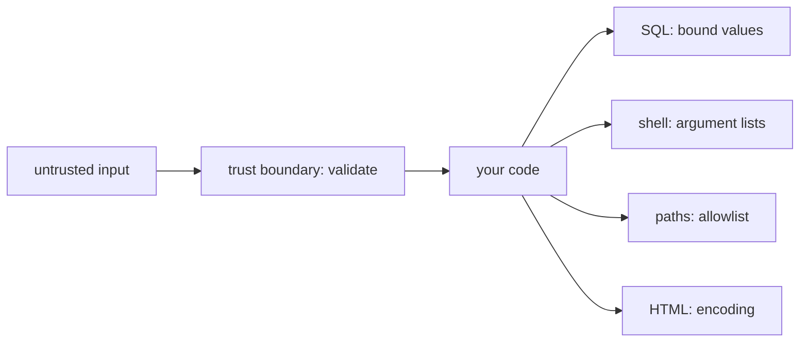

# Trust boundaries and injection

## The idea

Security starts with one question about every piece of data in a program: who controls it? A program reads data from many places: a form, a URL, an HTTP header, an uploaded file, a message from another service, a row that someone else wrote into the database. Any of it that an attacker can influence is **untrusted**. An **attacker** here is simply anyone who uses your system on purpose in a way you did not intend, and on the internet you have to assume they exist.

A **trust boundary** is a line in a system where data passes from a part you trust less into a part you trust more: from the internet into your server, from a request into a database query, from a partner's feed into your queue. The places where an attacker can reach such a line are the system's **attack surface**, which the glossary of NIST, the US standards institute, describes as the points where an attacker can try to enter, cause an effect on, or extract data from a system. A boundary does not have to face the internet. OWASP, an open community that publishes security guidance, asks in its Input Validation Cheat Sheet that you validate data from internal APIs, partner feeds, queues and stored records whenever it crosses a trust boundary, because, in its words, "an internal transport does not establish that a value meets the receiving component's rules."

Most of the damage done at those lines has one shape. Many parts of a program are **interpreters**: they read a language and act on it. A database reads SQL, a shell reads command lines, a browser reads HTML and JavaScript, a file system reads paths, a language model reads prompts. Each language has characters that are **structure** rather than content: a quote that ends a string, a `;` that starts a new command, a `<` that opens a tag, a `../` that climbs out of a folder. When a program builds a sentence in one of these languages by gluing untrusted text into it, the text can bring structure of its own and change what the sentence means. That is **injection**. The 2025 edition of the OWASP Top 10, a list of the main security risks of web applications, names it A05:2025, describing an application flaw that lets untrusted input be sent to an interpreter and causes the interpreter to execute parts of that input as commands; its injection category includes both SQL injection and cross-site scripting.

The defenses come in a clear order of preference:

| Defense | What it does | Example |
|---------|--------------|---------|
| Keep data out of the language | Use an interface that takes the command and the data separately, so the interpreter never parses the data as language | A parameterized SQL query; a program and its arguments as a list |
| Choose structure from an allowlist | When the user must pick part of the structure, map their choice to fixed text your code wrote, and refuse anything else | A sort order picked from `newest`, `biggest` or `item` |
| Encode for the language | When text must be written into the language, turn its special characters into a form the interpreter reads as plain characters | HTML entities, the subject of the guide on output encoding |

Two more habits sit around them. **Validate input** where it crosses the boundary: check both its syntax (the expected type and format) and its meaning (whether the value makes sense for the operation), accept only what the field allows rather than trying to recognize every malicious string, and do it on the server, since a check in the browser is easy to skip. Validation narrows what can reach an interpreter, but it is not the defense against injection: the input validation cheat sheet itself points to parameterized queries for SQL and context-aware output encoding for cross-site scripting. And **limit privilege**: the database account that runs your queries, or the process that runs your commands, should hold only the rights the job needs, so that a defense that fails still leaves little to take. Saltzer and Schroeder put it as the principle of least privilege in their 1975 paper on protection: every program and every user should operate using the least set of privileges necessary to complete the job.

## A worked example

A small shop keeps orders in a SQL database. A search box asks for a customer's name, and the code looks up that customer's orders. The program below does it two ways, with Python's built-in `sqlite3` and an in-memory database: `glued` builds the SQL text by concatenation, and `bound` sends the SQL with a `?` **placeholder** and passes the value separately, so the database receives the statement and the value apart.

```python examples/query_injection.py
"""Untrusted text crossing into a SQL interpreter: glued into the query, then bound as a value."""

import sqlite3

db = sqlite3.connect(":memory:")
db.execute("CREATE TABLE orders (id INTEGER PRIMARY KEY, customer TEXT, item TEXT, total INTEGER)")
db.executemany(
    "INSERT INTO orders (customer, item, total) VALUES (?, ?, ?)",
    [("mia", "lamp", 40), ("mia", "desk", 220), ("raj", "chair", 95), ("d'arcy", "rug", 130)],
)


def glued(customer: str) -> list:
    """Builds the SQL text from the input: the input can end the string and add SQL of its own."""
    return db.execute("SELECT customer, item FROM orders WHERE customer = '" + customer + "'").fetchall()


def bound(customer: str) -> list:
    """Sends the SQL and the value apart: the value can only ever be a value."""
    return db.execute("SELECT customer, item FROM orders WHERE customer = ?", (customer,)).fetchall()


for text in ["raj", "x' OR 1=1 --", "d'arcy"]:
    for query in (glued, bound):
        try:
            answer = query(text)
        except sqlite3.Error as error:
            answer = f"error: {error}"
        print(f"{query.__name__:6} {text!r:15} {answer}")

# A placeholder stands for a value, never for a column name or a keyword such as DESC.
# So a sort order chosen by the user is looked up in a fixed table of SQL the code wrote.
SORTS = {"newest": "id DESC", "biggest": "total DESC", "item": "item"}


def sorted_items(choice: str) -> list:
    order = SORTS.get(choice)
    if order is None:
        return [f"refused: unknown sort {choice!r}"]
    return [item for (item,) in db.execute(f"SELECT item FROM orders ORDER BY {order}")]


print(sorted_items("biggest"))
print(sorted_items("total; DROP TABLE orders"))
```

It prints:

```output examples/query_injection.py
glued  'raj'           [('raj', 'chair')]
bound  'raj'           [('raj', 'chair')]
glued  "x' OR 1=1 --"  [('mia', 'lamp'), ('mia', 'desk'), ('raj', 'chair'), ("d'arcy", 'rug')]
bound  "x' OR 1=1 --"  []
glued  "d'arcy"        error: near "arcy": syntax error
bound  "d'arcy"        [("d'arcy", 'rug')]
['desk', 'rug', 'chair', 'lamp']
["refused: unknown sort 'total; DROP TABLE orders'"]
```

Row by row:

- **`raj`** is an ordinary name, and both versions find his chair. Injection bugs survive testing because normal input works.
- **`x' OR 1=1 --`** is not a name. In `glued`, its quote closes the string the code opened, `OR 1=1` adds a condition that is always true, and `--` starts a SQL comment that hides the code's closing quote. The query becomes `WHERE customer = 'x' OR 1=1 --'` and returns every order in the shop. In `bound`, the same text is only a value: no customer is called `x' OR 1=1 --`, so nothing comes back.
- **`d'arcy`** is a real name with an apostrophe. In `glued` it breaks the SQL, which is a bug for d'Arcy and a signal to an attacker that the input reaches the query. In `bound` it is just a name.
- **The sort order.** A placeholder stands for a value, never for a column name or a keyword such as `DESC`, so a choice like "sort by total" cannot be bound. The code maps the user's choice to SQL text it wrote itself and refuses anything else, which is the allowlist defense the OWASP SQL Injection Prevention Cheat Sheet recommends for exactly this case.



<!-- text-of-mermaid sha256:4635764db052290d70e27045e952ee85c8d96fde518af496cad49d4ed8587cdf -->
```text
┌───────────────┐    ┌────────────────────────┐    ┌─────────┐    ┌─────────────────────┐
│untrusted input├───►│trust boundary: validate├───►│your code├───►│  SQL: bound values  │
└───────────────┘    └────────────────────────┘    └────┬────┘    └─────────────────────┘
                                                        │
                                                        │         ┌─────────────────────┐
                                                        ├────────►│shell: argument lists│
                                                        │         └─────────────────────┘
                                                        │
                                                        │         ┌─────────────────────┐
                                                        ├────────►│   paths: allowlist  │
                                                        │         └─────────────────────┘
                                                        │
                                                        │         ┌─────────────────────┐
                                                        └────────►│    HTML: encoding   │
                                                                  └─────────────────────┘
```

The diagram shows the whole picture: input crosses a boundary into your code, and from there it can reach several interpreters, each with its own language and its own way of keeping data as data.

The same mistake and the same cure appear with commands. A program that runs another program can pass it a list of arguments, or a line of text for a **shell** (the command-line interpreter) to read:

```python examples/argument_lists.py
"""A file name crossing into a command line: as one item of a list, then glued into shell text."""

import shlex
import subprocess
import sys

name = "notes.txt; rm -rf ~"

# As one item of a list, the name reaches the program as one argument, and no shell reads it.
# The program here is a second Python that prints the arguments it received.
child = subprocess.run(
    [sys.executable, "-c", "import sys; print(sys.argv[1:])", name],
    capture_output=True,
    text=True,
    check=True,
)
print("the program received:", child.stdout.strip())

# Glued into one string for a shell, the same name splits at ';' into a second command.
tokens = shlex.shlex("wc -l " + name, posix=True, punctuation_chars=True)
tokens.whitespace_split = True
print("a shell would read:  ", list(tokens))
```

It prints:

```output examples/argument_lists.py
the program received: ['notes.txt; rm -rf ~']
a shell would read:   ['wc', '-l', 'notes.txt', ';', 'rm', '-rf', '~']
```

As one item of a list, the name arrives as exactly one argument, `;` and all; Python's `subprocess` does not call a shell unless you ask it to with `shell=True`, so no character in the name means anything. Glued into a command line, the same name splits at `;`, and a shell would run a second command, `rm -rf ~`, after `wc`. The second half uses Python's `shlex` module, with `punctuation_chars` set, only to show how a shell splits that line; nothing is run.

## When to use it

- **Wherever text is glued into a language.** The signs in code are string concatenation, formatting or templates that build SQL, shell commands, file paths, URLs, HTML, regular expressions, log lines or prompts. Each one is a place where data meets an interpreter.
- **Reach for the separating interface first.** Placeholders for SQL, a list of arguments for processes, an API call instead of a shell command. The OWASP OS Command Injection Defense Cheat Sheet names avoiding the call to an operating system command altogether as its primary defense.
- **Allowlists for structure.** Table names, column names, sort directions, file names and command names that come from a user are chosen from a fixed set your code owns.
- **Encoding when the output is itself a language**, as a web page is: see the guide on output encoding.
- **Validation at every boundary**, for correctness as much as for security: the right type, length, range and format, checked on the server.
- **When there is no interpreter**, for example bytes stored and returned as they are, validation and size limits are enough; the danger starts when something parses the data.

## Common traps

- **Denylists.** Removing `SELECT`, `<script>` or `;` from input fails, because languages offer many ways to say the same thing, and the filter also mangles honest input. Accept what a field allows instead of hunting for what is malicious.
- **Escaping by hand.** Doubling quotes yourself looks like it works until a character you did not think of arrives. The SQL cheat sheet calls manual escaping strongly discouraged and says to use parameterized queries instead.
- **Trusting data because it came from inside.** A value stored safely today can be glued into another query tomorrow. Data read back from your own database is still data that a user once wrote, and the SQL cheat sheet applies its controls whether data comes from a request, another service or previously stored data.
- **Checking a value that is not the one used.** Text is often decoded on its way in, and `%2e%2e%2f` becomes `../` after one round of URL decoding. The input validation cheat sheet says to decode according to the protocol before checking field rules, and the OWASP page on path traversal lists such encoded variants. Check the form that the interpreter will see.
- **Checks only in the browser.** Anything the browser enforces, the user controls; send the request with any tool and the check is gone.
- **Placeholders for names.** A placeholder binds a value. A column, a table or `ASC` and `DESC` cannot be bound and need the allowlist.
- **A shell with quoting.** `shell=True` plus careful quoting moves the problem rather than removing it. Python documents `shlex.quote` as designed only for Unix shells, warns that on other shells its result can open a command injection, and suggests passing arguments as a list instead.
- **Arguments that look like options.** Even in a list, a value that starts with `-` can be read as an option by the program that receives it. The OWASP command injection cheat sheet calls this argument injection, notes that every command injection is also one, and advises `--` to end option parsing for programs that support it.

## Complexity

Doing this right costs almost nothing at run time:

| Defense | Cost |
|---------|------|
| A bound parameter | No extra work for the program: the value is sent next to the statement instead of inside it |
| An allowlist lookup | O(1) on average with a hash map from the user's choice to the fixed text |
| Validation | O(n) in the length of the input for format checks; more when a check needs a lookup, such as "does this account exist" |
| An argument list | Less work than a shell, which is another program that has to start and parse the line |
| Least privilege | Nothing at run time; it is configuration |

The real cost is in review: finding every place where text reaches an interpreter, including the ones built three function calls away from the input. Code that funnels each interpreter through one safe interface, one query helper and one way of starting processes, keeps that review short.

## Expert notes

- **Why parameters work.** With a bound parameter, the statement and the value travel apart, and the value fills a slot that the statement already defines, so no character of it can change the statement's structure. Encoding tries to reach the same result by rewriting the value so that the parser treats it as content, which works only if the encoder knows every rule of that parser.
- **One statement per call.** Python's `sqlite3` documents that `execute` runs a single SQL statement and raises `ProgrammingError` when the text holds more than one; `executescript` exists for scripts. That stops one classic payload, a second statement after `;`, but not `OR 1=1`, which stays inside the first statement.
- **Stored procedures are not a cure by themselves.** The SQL cheat sheet points out that binding a procedure's arguments protects the call, not dynamic SQL built inside the procedure.
- **Least privilege as a second layer.** The same cheat sheet treats minimal database privileges as hardening, to limit the damage of a successful injection, and warns against giving application accounts administrator access.
- **Normalizing text.** Some fields need Unicode normalization, so that text that should compare equal does. For those, the input validation cheat sheet asks for one normalization policy applied the same way before validation, storage and comparison, and notes that normalization is not sanitization and does not replace output encoding.
- **Shells on other systems.** Python's `subprocess` notes that on some operating systems, batch files may be started in a system shell whatever arguments are passed, so their arguments are parsed by shell rules without Python's escaping.
- **Design principles.** Saltzer and Schroeder's 1975 paper lists the principles behind these defenses. Besides least privilege, it names fail-safe defaults, "base access decisions on permission rather than exclusion", which is the allowlist; complete mediation, "every access to every object must be checked for authority"; and economy of mechanism, keeping the design as simple and small as possible.
- **Interpreters without a data channel.** A language model reads instructions and data in one stream, so there is no placeholder to bind a value into a prompt. Prompt injection is defended around the model instead, as the guide on the security of LLM applications describes. Delimiters around stored text, as in the first practice problem, are structure to the model in the same way a quote is structure to SQL.

## Practice

- `cstudy start memory-write-sanitizer`: text from a conversation is stored and later read back to an assistant inside delimiters; neutralize what would close its block early, cap its length and flag lines that address the assistant.
- `cstudy start sql-guard`: check SQL that a language model wrote before it runs: one read-only statement, tables and columns from an allowlist, and values that belong in placeholders.
- `cstudy start fix-the-flaws-typescript`: a working notes service with a security review's findings; level 2 takes names and fields from the request, and level 3 takes text that becomes a query.

## Further reading

- [OWASP Top 10:2025, A05 Injection](https://top10.owasp.org/2025/A05_2025-Injection/): what injection is, what it includes, and how to prevent it.
- [OWASP SQL Injection Prevention Cheat Sheet](https://cheatsheetseries.owasp.org/cheatsheets/SQL_Injection_Prevention_Cheat_Sheet.html): parameterized queries, allowlists for identifiers and sort order, why manual escaping is discouraged, stored procedures and least privilege.
- [OWASP Input Validation Cheat Sheet](https://cheatsheetseries.owasp.org/cheatsheets/Input_Validation_Cheat_Sheet.html): syntax and meaning, server-side checks, trust boundaries, decoding and normalization.
- [OWASP OS Command Injection Defense Cheat Sheet](https://cheatsheetseries.owasp.org/cheatsheets/OS_Command_Injection_Defense_Cheat_Sheet.html): avoiding commands, separate arguments, argument injection and `--`.
- [OWASP, Path Traversal](https://community.owasp.org/attacks/Path_Traversal): climbing out of a folder with `../` and its encoded forms.
- [Python `sqlite3`: how to use placeholders to bind values in SQL queries](https://docs.python.org/3/library/sqlite3.html), and `execute`, which runs a single statement.
- [Python `subprocess`, security considerations](https://docs.python.org/3/library/subprocess.html) and [Python `shlex`](https://docs.python.org/3/library/shlex.html): no implicit shell, arguments as a sequence, `quote` and its warning, `punctuation_chars`.
- [NIST glossary, attack surface](https://csrc.nist.gov/glossary/term/attack_surface).
- [Saltzer and Schroeder, *The Protection of Information in Computer Systems* (1975)](https://web.mit.edu/Saltzer/www/publications/protection/Basic.html): the design principles of protection.
