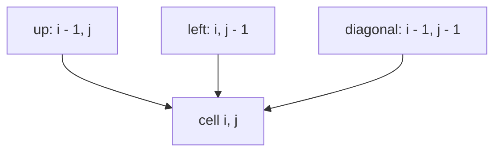
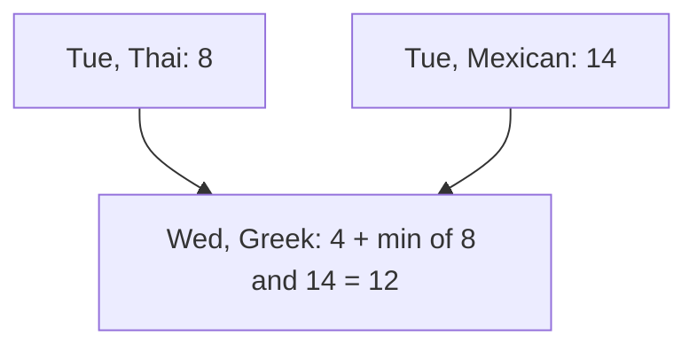
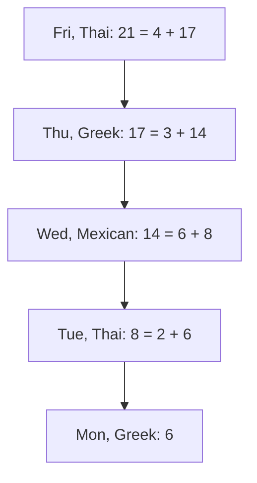

# Two-dimensional tables

## The idea

A one-dimensional table works when one number says everything about what is left to solve. Often one number is not enough. Comparing two words, you need to know how far you are in each; planning a sequence of days where today's choice limits tomorrow's, you need to know both the day and what was chosen on it. The state then takes **two numbers**, `(i, j)`, and the table becomes a grid of rows and columns.

The four decisions of a [one-dimensional table](../one-dimensional-tables/guide.md) stay the same: a sentence for what one cell means, the recurrence and its base cases, an order of filling in which every cell is ready before it is read, and how much of the table to keep. Three shapes come up again and again:

| Shape | Cell `(i, j)` means | The answer is in |
|-------|---------------------|------------------|
| **A grid** | the answer for the square in row `i` and column `j`: for paths that end there, or that start there | the corner where paths end, or where they start |
| **Two sequences** | the answer for the first `i` items of one sequence and the first `j` items of the other | the last cell, `(len(a), len(b))` |
| **A position and a choice** | the answer for positions `0` to `i`, given that position `i` took choice `j` | the best cell of the last row |

### Two sequences: prefixes, and an empty row

For two sequences `a` and `b`, the table has `len(a) + 1` rows and `len(b) + 1` columns, not `len(a)` and `len(b)`: row 0 stands for the empty prefix of `a`, and column 0 for the empty prefix of `b`. Those borders are the base cases, the answers when one side has nothing left, and they are usually easy to write down. Cell `(i, j)` is about the prefixes `a[:i]` and `b[:j]`, whose last items are `a[i - 1]` and `b[j - 1]`; mixing up "prefix of length `i`" with "the item at index `i`" is the easiest off-by-one to make in these tables.

A recurrence over two prefixes asks what becomes of their last items, and each possibility points at a smaller pair of prefixes: one item shorter in `a` (the cell one row up), one item shorter in `b` (one column left), or one shorter in both (diagonally up and left). Which cases exist, and how they combine, is the problem; where they point is almost always the same three cells.



<!-- text-of-mermaid sha256:100b9041870c9176418e7757b793eedfddd5555e9330b9a9839a1d5887aef4d8 -->
```text
┌────────────┐    ┌──────────────┐    ┌──────────────────────┐
│up: i - 1, j│    │left: i, j - 1│    │diagonal: i - 1, j - 1│
└──────┬─────┘    └───────┬──────┘    └───────────┬──────────┘
       ▼──────────────────┴───────────────────────┘
┌────────────┐
│ cell i, j  │
└────────────┘
```

Filling **row by row, left to right** has all three ready: the row above is complete, and the cell to the left was just filled.

## A worked example

A café serves one lunch special a day, Monday to Friday, from three cuisines: Thai, Greek and Mexican. Regulars complain when the same cuisine comes twice in a row, so two consecutive days never share one. What each cuisine costs to prepare changes with the market, day by day:

| Day | Thai | Greek | Mexican |
|-----|------|-------|---------|
| Mon | 5 | 6 | 9 |
| Tue | 2 | 8 | 9 |
| Wed | 7 | 4 | 6 |
| Thu | 6 | 3 | 8 |
| Fri | 4 | 7 | 5 |

What is the cheapest week? One number is not a state: knowing the cheapest plan up to Tuesday is useless without knowing what it serves on Tuesday, since that decides what Wednesday may serve. So the state is a position and a choice.

**The state.** `best[d][c]` is the cost of the cheapest plan for the days up to `d` that serves cuisine `c` on day `d`.

**The recurrence.** A plan that serves `c` on day `d` served something else the day before, and the cheapest such plan takes the cheapest of those:

```text
best[d][c] = price[d][c] + the smallest best[d - 1][other], over the cuisines other than c
best[0][c] = price[0][c]
```

**The order.** Each row reads only the row above, so fill Monday's row, then Tuesday's, and so on. Tuesday's row by hand: Thai is `2 + min(6, 9) = 8`, from Greek or Mexican on Monday; Greek is `8 + min(5, 9) = 13`; Mexican is `9 + min(5, 6) = 14`.



<!-- text-of-mermaid sha256:84cbbb5639f843f169d33acfc92d849608b4b9e15aab3d50f96797e417670490 -->
```text
┌────────────────────────────────────┐    ┌────────────────┐
│            Tue, Thai: 8            │    │Tue, Mexican: 14│
└──────────────────┬─────────────────┘    └────────┬───────┘
                   ▼───────────────────────────────┘
┌────────────────────────────────────┐
│Wed, Greek: 4 + min of 8 and 14 = 12│
└────────────────────────────────────┘
```

```python examples/lunch_menu.py
"""Plan a week of lunch specials: one cuisine a day, never the same cuisine two days running, at the
lowest total cost. A table with one row per day and one column per cuisine."""

from itertools import pairwise, product

DAYS = ["Mon", "Tue", "Wed", "Thu", "Fri"]
CUISINES = ["Thai", "Greek", "Mexican"]
PRICES = [  # PRICES[day][cuisine]: what serving that cuisine costs on that day
    [5, 6, 9],
    [2, 8, 9],
    [7, 4, 6],
    [6, 3, 8],
    [4, 7, 5],
]


def fill(prices: list[list[int]]) -> list[list[int]]:
    """best[d][c]: the cheapest plan for days 0..d that serves cuisine c on day d."""
    best = [prices[0][:]]  # day 0: nothing before it, so the plan costs that day's price
    for day in range(1, len(prices)):  # row by row: each row reads only the row above
        above = best[day - 1]
        best.append(
            [
                prices[day][c] + min(above[other] for other in range(len(above)) if other != c)
                for c in range(len(above))
            ]
        )
    return best


def read_back(best: list[list[int]], prices: list[list[int]]) -> list[int]:
    """Walk from the cheapest cell of the last row up to the first, one cell per day."""
    cuisine = min(range(len(best[-1])), key=lambda c: best[-1][c])
    plan = [cuisine]
    for day in range(len(best) - 1, 0, -1):
        rest = best[day][cuisine] - prices[day][cuisine]  # what days 0..day-1 must have cost
        above = best[day - 1]
        cuisine = next(c for c in range(len(above)) if c != cuisine and above[c] == rest)
        plan.append(cuisine)
    return plan[::-1]


best = fill(PRICES)
print("best[d][c]" + "".join(f"{name:>9}" for name in CUISINES))
for day, cells in zip(DAYS, best, strict=True):
    print(f"{day:10}" + "".join(f"{cell:>9}" for cell in cells))

plan = read_back(best, PRICES)
print("cheapest week:", ", ".join(CUISINES[c] for c in plan), "=", min(best[-1]))

greedy, yesterday = [], None
for day in PRICES:  # the cheapest cuisine today that differs from yesterday's
    yesterday = min((c for c in range(len(day)) if c != yesterday), key=lambda c: day[c])
    greedy.append(yesterday)
greedy_cost = sum(PRICES[day][c] for day, c in enumerate(greedy))
print("cheapest each day:", ", ".join(CUISINES[c] for c in greedy), "=", greedy_cost)

every_plan = (
    sum(PRICES[day][c] for day, c in enumerate(candidate))
    for candidate in product(range(len(CUISINES)), repeat=len(DAYS))
    if all(a != b for a, b in pairwise(candidate))
)
print("checking all 3^5 plans:", min(every_plan))


def cheapest_cost_two_rows(prices: list[list[int]]) -> int:
    """The same total keeping only the previous row; the plan itself can no longer be read back."""
    above = prices[0][:]
    for day in prices[1:]:
        above = [
            day[c] + min(above[other] for other in range(len(above)) if other != c)
            for c in range(len(above))
        ]
    return min(above)


print("two rows only:", cheapest_cost_two_rows(PRICES))
```

It prints:

```output examples/lunch_menu.py
best[d][c]     Thai    Greek  Mexican
Mon               5        6        9
Tue               8       13       14
Wed              20       12       14
Thu              18       17       20
Fri              21       25       22
cheapest week: Greek, Thai, Mexican, Greek, Thai = 21
cheapest each day: Thai, Greek, Mexican, Greek, Thai = 26
checking all 3^5 plans: 21
two rows only: 21
```

The cheapest week costs 21, the smallest cell of Friday's row. The table says how much, but not which plan; **reading the answer back** recovers it. Start at the cell that holds the answer, Friday Thai at 21. Its price is 4, so the days before it cost 17, and the cell of Thursday's row that is not Thai and holds 17 is Greek. From Thursday Greek, 17 minus 3 leaves 14: Wednesday Mexican. Then Tuesday Thai, then Monday Greek:



<!-- text-of-mermaid sha256:4d379f91731d268f1413e8d886cad0af5390ad2bed18d2442f656f99d65c58cf -->
```text
┌────────────────────────┐
│ Fri, Thai: 21 = 4 + 17 │
└────────────┬───────────┘
             ▼
┌────────────────────────┐
│Thu, Greek: 17 = 3 + 14 │
└────────────┬───────────┘
             ▼
┌────────────────────────┐
│Wed, Mexican: 14 = 6 + 8│
└────────────┬───────────┘
             ▼
┌────────────────────────┐
│  Tue, Thai: 8 = 2 + 6  │
└────────────┬───────────┘
             ▼
┌────────────────────────┐
│     Mon, Greek: 6      │
└────────────────────────┘
```

Two more lines check the result. Choosing the cheapest allowed cuisine day by day starts with Thai at 5 on Monday, which forbids Thai on Tuesday, the cheapest cell of the week; it ends at 26. Paying 1 more on Monday for Greek frees Tuesday's 2, and no day-by-day rule can see that, because the price of a choice includes what it does to the next day. Going through all `3⁵ = 243` sequences of cuisines and keeping the allowed ones agrees on 21.

The last line keeps only two rows, the one being filled and the one above, which is all the recurrence reads. It finds the same 21 with memory for two rows instead of five, but the plan can no longer be read back: the rows it would walk through are gone.

## When to use it

- **One number cannot name what is left to solve**: two positions, in two sequences or along two axes of a grid, or a position together with something chosen there.
- **A grid** whose answer at a square comes from the squares a path can arrive from.
- **Two strings or arrays compared item by item**, where an item of one may be paired with an item of the other, or skipped.
- **A sequence of choices where each limits the next**, as yesterday's cuisine limits today's.
- **Use something else** when one index is enough, or when the second number takes so many values that the table does not fit in memory; then look for a smaller state, or keep two rows if only the value is wanted.

## Common traps

- **Mixing prefix lengths with indices.** Cell `(i, j)` of a two-sequence table is about `a[:i]` and `b[:j]`, whose last items are `a[i - 1]` and `b[j - 1]`. Comparing `a[i]` with `b[j]` there is off by one, and fails at the last item or at the borders.
- **Forgetting the borders.** Row 0 and column 0, the empty prefixes, must be filled before the loop, from what the problem says about nothing being left; they are not always all zeros.
- **Filling in an order that reads unfilled cells.** Check the three cells the recurrence reads against the order of the loops. A table filled column by column, when a cell reads the cell to its right, reads cells not yet filled.
- **Choosing greedily row by row.** The cheapest allowed choice for today ignores what it does to tomorrow, as the café's 26 shows. That is why each cell keeps one answer per possible choice, not only the best one.
- **Dropping rows you still need.** Two rows are enough for the value, not for the plan. If the plan is wanted, keep the whole table, or record in each cell which cell it came from.

## Complexity

| Table | Cells | Work per cell | Time | Space |
|-------|-------|---------------|------|-------|
| Two sequences of lengths `m` and `n` | `(m + 1)(n + 1)` | usually O(1) | O(m · n) | O(m · n), or O(n) for two rows |
| `d` days and `k` choices, each reading the row above | `d · k` | O(k) | O(d · k²) | O(d · k), or O(k) for two rows |

The rule is the one-dimensional rule: the number of cells times the work of one cell. For the café, `d = 5` and `k = 3`. Keeping two rows saves memory but not time, and costs the ability to read the answer back.

## Expert notes

- **From O(k²) to O(k) per row.** Each cell of the café's table needs the smallest value of the row above, leaving out its own column. Find the smallest and the second smallest of the row above once: a cell whose own column holds the smallest uses the second smallest, every other cell uses the smallest. That makes each row O(k), which matters when there are many choices.
- **A table of choices.** Instead of working the plan out backwards from the costs, store in each cell the column it took its value from. The plan is then read by following those pointers back, with no arithmetic. When several cells tie, the stored pointer also fixes which of the equally cheap plans you get, which a test with one expected answer may care about.
- **Read the answer back from the cell that holds it.** The walk starts at the cell where the answer is: the corner of a grid, the last cell of two sequences, the best cell of the last row. Starting anywhere else reconstructs a plan for a different question.
- **The shape of the dependencies decides the order, and the space.** Draw the arrows for one cell before writing the loops: every cell an arrow starts from must be filled before the cell it points to, and only the rows the arrows still reach need to stay in memory. Some tables must be filled in an order other than row by row: by diagonals, by the length of a stretch, or from the bottom-right corner.

## Practice

- `cstudy start minimum-path-sum`: the smallest total toll on a route across a grid when every move goes one cell right or one cell down.
- `cstudy start unique-paths`: count the routes across a grid when every move goes one cell right or one cell down.
- `cstudy start longest-common-subsequence`: the length of the longest subsequence that two strings share.
- `cstudy start line-diff-and-merge`, level 1: the lines two files share and the diff between them, from a longest common subsequence of their lines. Its later levels build unified hunks, patches and a three-way merge.
- `cstudy start maximal-square`: the area of the largest square made only of ones in a grid.
- `cstudy start edit-distance`: the fewest single-character insertions, deletions and replacements that turn one word into another.
- `cstudy start interleaving-string`: whether a string is a merge of two others that keeps the order of each.
- `cstudy start regex-matching`: whether a pattern with `.` and `*` matches a whole string.

## Further reading

- [Python `itertools.pairwise`](https://docs.python.org/3/library/itertools.html#itertools.pairwise): successive overlapping pairs, which the example uses to check that no two consecutive days repeat a cuisine (Python 3.10 and later).
- [Python `itertools.product`](https://docs.python.org/3/library/itertools.html#itertools.product): every sequence of cuisines for the brute-force check.
