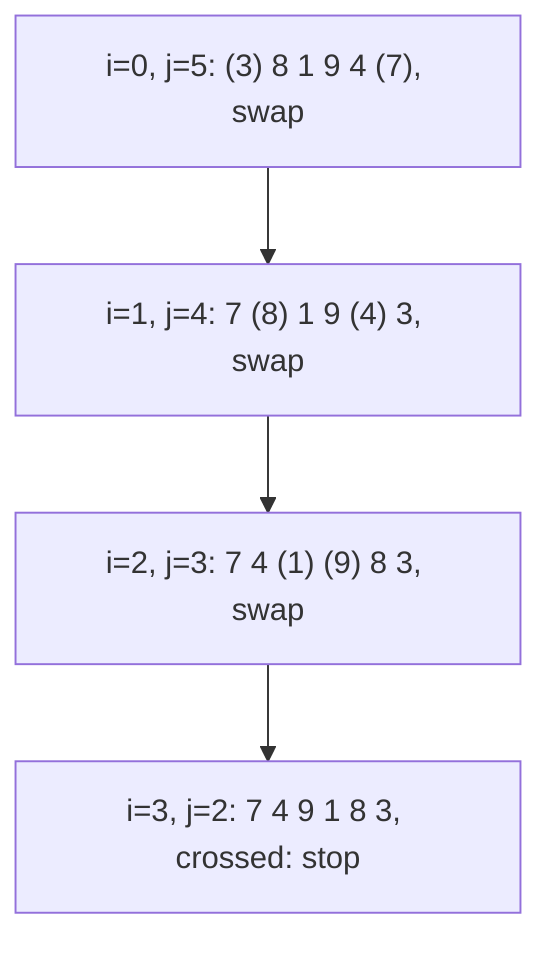
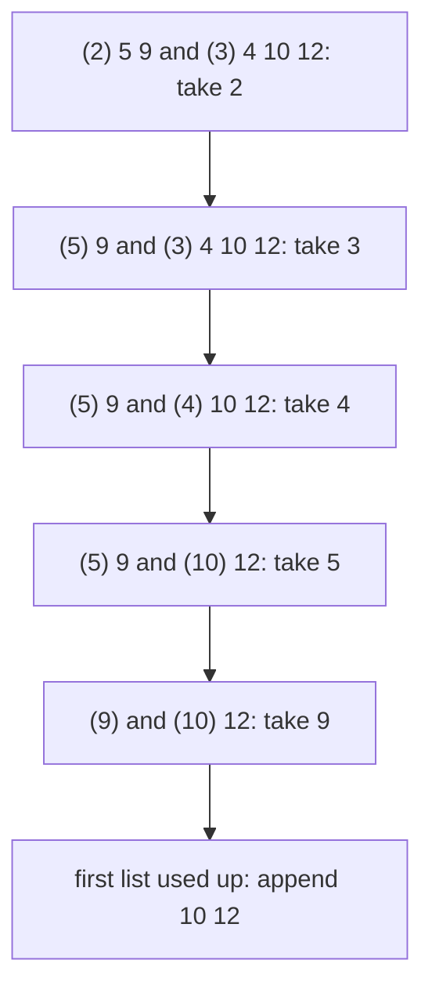

# Two pointers

## The idea

Many questions about an array are really about **pairs of positions**: does the first character match the last, which two values add up to a target, where does this element belong. An array of `n` values has `n(n - 1) / 2` pairs of positions, so checking every pair takes O(n²) time: for 10,000 values, about 50 million pairs.

**Two pointers** are two indices into the array, often called `i` and `j`, or `left` and `right`, together with a rule that moves one or both of them at each step. The rule never moves a pointer backward. That alone bounds the work: each pointer can travel at most `n` positions, so a loop in which every step moves a pointer ends after at most `2n` steps. One pass, O(n) time, and O(1) extra space for the two indices.

The loop is the easy part. The real content is the **rule**: a pointer may move past a position only once that position can no longer matter. Every guide of this path is a different reason why a position can be left behind for good.

The pointers come in two shapes:

| Shape | Start | Moves | Ends | Used for |
|-------|-------|-------|------|----------|
| **Opposite ends** | `i` at the first position, `j` at the last | Toward each other | When they meet or cross | Symmetry, settling one end per step, [pairs in a sorted array](../pairs-in-sorted-arrays/guide.md) |
| **Same direction** | Both at the start, or one in each of two lists | Both forward, at different speeds | When the faster one runs off the end | Merging sorted lists, [compacting an array in place](../in-place-compaction/guide.md), [sliding windows](../fixed-size-windows/guide.md) |

To see why the loop is right, name an **invariant**: a statement about the positions the pointers have already passed that is true before the first step, stays true after every step, and answers the question once the loop ends. For reversing an array in place, the invariant is "every position before `i` and every position after `j` already holds its final value". Before the first step, no position has been passed, so it holds trivially. When the pointers meet, every position has been passed, so the whole array is reversed.

## A worked example

**Opposite ends: reverse in place.** Take `[3, 8, 1, 9, 4, 7]`. Start with `i = 0` and `j = 5`. The value at `i` belongs at `j` and the other way round, so swap them; now both positions hold their final values, and both pointers move inward. Repeat while `i < j`.



<!-- text-of-mermaid sha256:1f6ea76ec8ef8dbb1b4a5a84a149c8f8a44823feabf1c9d1a480e0ced32f78d5 -->
```text
┌────────────────────────────────────┐
│  i=0, j=5: (3) 8 1 9 4 (7), swap   │
└──────────────────┬─────────────────┘
                   ▼
┌────────────────────────────────────┐
│  i=1, j=4: 7 (8) 1 9 (4) 3, swap   │
└──────────────────┬─────────────────┘
                   ▼
┌────────────────────────────────────┐
│  i=2, j=3: 7 4 (1) (9) 8 3, swap   │
└──────────────────┬─────────────────┘
                   ▼
┌────────────────────────────────────┐
│i=3, j=2: 7 4 9 1 8 3, crossed: stop│
└────────────────────────────────────┘
```

The values in parentheses are the ones under the pointers. Each step settles two positions, so six values take three swaps. With an odd length, say five values, the pointers end on the same position, the middle one, which is already in its place: the loop condition is `i < j`, not `i <= j`, and the middle value is never swapped with itself.

**Same direction: merge two sorted lists.** Two sensors each report sorted timestamps, `[2, 5, 9]` and `[3, 4, 10, 12]`, and you want one sorted list. Put one pointer at the front of each list. The smaller of the two front values is the smallest value not yet taken: each list is sorted, so its front value is its smallest remaining one. Take it, advance that list's pointer, and repeat. When one list runs out, the rest of the other is sorted and no smaller than anything taken, so it goes at the end as it is.



<!-- text-of-mermaid sha256:e3473f0281eba0018d7389cb46a9b51b4191bb0b6998d32edc37e40a7bc6065c -->
```text
┌────────────────────────────────┐
│(2) 5 9 and (3) 4 10 12: take 2 │
└────────────────┬───────────────┘
                 ▼
┌────────────────────────────────┐
│ (5) 9 and (3) 4 10 12: take 3  │
└────────────────┬───────────────┘
                 ▼
┌────────────────────────────────┐
│  (5) 9 and (4) 10 12: take 4   │
└────────────────┬───────────────┘
                 ▼
┌────────────────────────────────┐
│   (5) 9 and (10) 12: take 5    │
└────────────────┬───────────────┘
                 ▼
┌────────────────────────────────┐
│    (9) and (10) 12: take 9     │
└────────────────┬───────────────┘
                 ▼
┌────────────────────────────────┐
│first list used up: append 10 12│
└────────────────────────────────┘
```

Both programs, with a line per step:

```python examples/two_pointers.py
"""Two pointers: from both ends toward each other, and one per list in the same direction."""


def reverse_in_place(values: list[int]) -> None:
    """Swap the two ends, then move both pointers inward, until they meet."""
    i, j = 0, len(values) - 1
    while i < j:  # i == j is the middle of an odd length: nothing to swap
        print(f"  i={i} j={j}: swap {values[i]} and {values[j]}")
        values[i], values[j] = values[j], values[i]
        i, j = i + 1, j - 1
    print(f"  i={i} j={j}: stop")


def merge(first: list[int], second: list[int]) -> list[int]:
    """One pointer per sorted list; take the smaller front value each time."""
    i = j = 0
    merged: list[int] = []
    while i < len(first) and j < len(second):
        if first[i] <= second[j]:  # on a tie, take from first: equal values keep their order
            print(f"  i={i} j={j}: {first[i]} <= {second[j]}, take {first[i]} from the first list")
            merged.append(first[i])
            i += 1
        else:
            print(f"  i={i} j={j}: {first[i]} > {second[j]}, take {second[j]} from the second list")
            merged.append(second[j])
            j += 1
    print(f"  one list is used up; append the rest: {first[i:] + second[j:]}")
    merged += first[i:] + second[j:]  # at most one of the two slices is non-empty
    return merged


values = [3, 8, 1, 9, 4, 7]
print("reverse", values)
reverse_in_place(values)
print("result:", values)

odd = [1, 2, 3, 4, 5]
builtin = odd.copy()
builtin.reverse()  # the list method also works in place, and returns None
print("reverse", odd)
reverse_in_place(odd)
print("result:", odd, "| list.reverse agrees:", odd == builtin)

print("merge [2, 5, 9] and [3, 4, 10, 12]")
print("result:", merge([2, 5, 9], [3, 4, 10, 12]))
```

It prints:

```output examples/two_pointers.py
reverse [3, 8, 1, 9, 4, 7]
  i=0 j=5: swap 3 and 7
  i=1 j=4: swap 8 and 4
  i=2 j=3: swap 1 and 9
  i=3 j=2: stop
result: [7, 4, 9, 1, 8, 3]
reverse [1, 2, 3, 4, 5]
  i=0 j=4: swap 1 and 5
  i=1 j=3: swap 2 and 4
  i=2 j=2: stop
result: [5, 4, 3, 2, 1] | list.reverse agrees: True
merge [2, 5, 9] and [3, 4, 10, 12]
  i=0 j=0: 2 <= 3, take 2 from the first list
  i=1 j=0: 5 > 3, take 3 from the second list
  i=1 j=1: 5 > 4, take 4 from the second list
  i=1 j=2: 5 <= 10, take 5 from the first list
  i=2 j=2: 9 <= 10, take 9 from the first list
  one list is used up; append the rest: [10, 12]
result: [2, 3, 4, 5, 9, 10, 12]
```

The reversal of six values stops after three swaps with the pointers crossed; the reversal of five stops with both pointers on the middle. The merge made five comparisons for seven values: every comparison takes one value, and the last two values needed none.

## When to use it

- The question is about **pairs of positions**, or about the two ends of a sequence: symmetry, matching the outside in.
- The input has an **order** that tells you which pointer to move: sorted values, as in the next guides, or a structure such as the two ends of a string.
- The answer must be computed **in place**, with O(1) extra space.
- Two sorted sequences must be walked **together**: merging, intersecting, comparing.

When there is no order to exploit, a pointer has no reason to move one way rather than the other. To find a pair with a given sum in an unsorted array, a [hash map](../hash-maps-and-sets/guide.md) answers in one pass, O(n) on average with O(n) space; sorting first and using two pointers takes O(n log n) and loses the original positions unless you carry them along.

## Common traps

- **`i < j` against `i <= j`.** Decide what `i == j` means before writing the loop. For a reversal it is the middle element, which needs nothing. For a pair of different positions it is not a pair at all. Getting this wrong swaps an element with itself, which is harmless, or pairs a value with itself, which is a wrong answer.
- **An inner loop that forgets the bounds.** When a pointer skips several positions in a loop of its own, that loop must check `i < j`, or the array's length, too. Otherwise it runs past the other pointer or off the end.
- **Moving both pointers when only one position is settled.** A swap settles both ends; a comparison usually settles only one. Moving both after settling one skips a position that still mattered.
- **Empty and one-element inputs.** With `n = 0`, `j` starts at `-1`; with `n = 1`, at `0`. The condition `i < j` is false at once in both cases, which is right, but code that reads `values[j]` before checking the condition fails on the empty array.
- **Strings cannot change in place in Python.** A Python `str` is immutable: an in-place algorithm needs a `list` of its characters, which costs O(n) extra space. Reading a string from both ends needs no copy.

## Complexity

| Approach | Time | Space |
|----------|------|-------|
| Check every pair of positions | O(n²) | O(1) |
| Opposite ends, every step moves a pointer | O(n) | O(1) |
| Merge sorted lists of lengths `m` and `n` | O(m + n) | O(m + n) for the output |

The bound comes from a quantity that only goes down. With opposite ends, the gap `j - i` starts at `n - 1`, and every step makes it smaller by at least 1, so there are at most `n` steps. With a merge, `i + j` grows by 1 at every comparison and cannot pass `m + n`. Each step must do O(1) work for the whole to be O(n); a step that scans the array would bring back O(n²).

## Expert notes

- **The invariant is the proof.** A two-pointer loop is correct when three things hold: the invariant is true before the first step, every step keeps it true, and the invariant together with the loop's end gives the answer. A measure that strictly decreases, such as `j - i`, proves the loop ends. Writing the invariant down as a comment catches most off-by-one errors before they happen.
- **Stability of the merge.** Taking from the first list on a tie (`<=`, not `<`) keeps equal values in the order they had, first-list values before second-list values. A sort built from merges keeps that property, which is why merge-based sorts can be stable.
- **Fast and slow pointers.** Two pointers can move in the same direction at different speeds through anything with a "next": an array, or a linked list. If one pointer moves two steps for every step of the other, then when the fast one reaches the end, the slow one has covered half the distance: it is at the middle, or next to it for an even length. And if a linked list loops back on itself, the fast pointer never reaches an end: both pointers end up in the loop, where the fast one gains exactly one position per step on the slow one, so the gap between them closes within as many steps as the loop has nodes, and they meet. The catalog's linked-list problems use this.
- **Python's own tools.** `list.reverse()` reverses in place and returns `None`, to remind you that it works by side effect. Slicing, as in `values[::-1]`, always builds a new list.

## Practice

- `cstudy start valid-palindrome`: opposite ends over a line of text, with characters that do not count.
- `cstudy start almost-palindrome`: opposite ends again, with one decision to make when the two ends disagree.

## Further reading

- [Python mutable sequence methods: `reverse`](https://docs.python.org/3/library/stdtypes.html#mutable-sequence-types): reverses in place for economy of space, and returns `None` to remind you of the side effect.
- [Python text sequence type `str`](https://docs.python.org/3/library/stdtypes.html#text-sequence-type-str): strings are immutable sequences of Unicode code points.
- [Python tutorial, lists](https://docs.python.org/3/tutorial/introduction.html#lists): every slice operation returns a new list.
