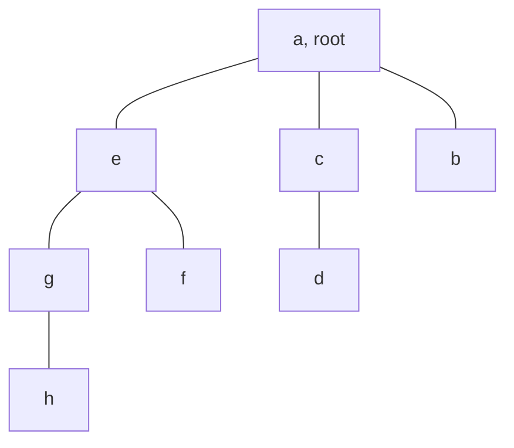
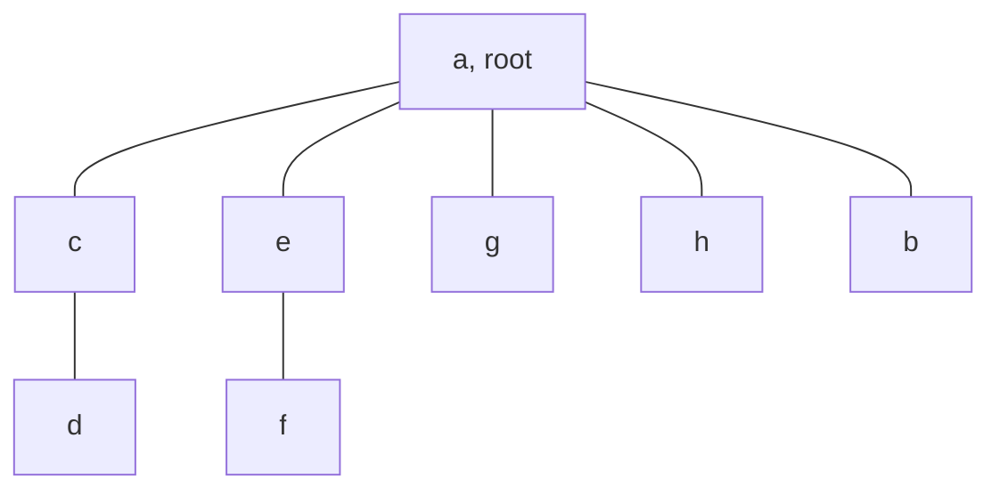

# Union-find

## The idea

Some questions about a graph are only about who is connected to whom: not the route, not its length, just "are these two in the same piece?". When the edges arrive over time, with questions in between, running a [search](../depth-first-search/guide.md) after every new edge repeats almost all the work of the previous one. **Union-find** answers the same question incrementally. It keeps the nodes split into disjoint groups and supports two operations:

- `find(x)`: the **representative** of the group that holds `x`, one chosen member that stands for the whole group. Two nodes are connected exactly when `find` gives them the same representative.
- `union(a, b)`: merge the group of `a` with the group of `b`, because an edge joins them now.

Each group is stored as a tree drawn upside down: every node points to a **parent**, and the **root**, which points to itself, is the representative. `find` follows parent pointers up to the root. `union` finds both roots and makes one of them the parent of the other, which merges the two trees in one step. All of it fits in one array or dictionary of parents. The structure is also called a disjoint-set forest.

Done naively, the trees can grow into long chains, and `find` then walks the whole chain. Two rules prevent it:

1. **Union by size.** Keep the size of each tree at its root, and hang the smaller tree under the root of the larger one. A tree can then never be deeper than log₂ n.
2. **Path compression.** After `find` has located the root, walk the same path again and point every node on it straight at the root. The next `find` from any of them takes one step.

Together they make each operation cost almost constant time, averaged over a sequence of operations.

## A worked example

### Doors opening in a game level

A game level has eight rooms, `a` to `h`, and its doors open one at a time as the player solves puzzles. Between openings, the game asks whether two rooms are joined. Each door is a `union`; each question compares two `find`s.

```python examples/opening_doors.py
"""Union-find with union by size and path compression, on the rooms of a game level.

Doors open one at a time, and between openings the game asks whether two rooms are joined."""


class UnionFind:
    def __init__(self, items: list[str]) -> None:
        self.parent = {item: item for item in items}  # a root is its own parent
        self.size = dict.fromkeys(items, 1)  # kept up to date for roots only

    def find(self, item: str) -> str:
        root = item
        while self.parent[root] != root:  # first walk: up to the root
            root = self.parent[root]
        while self.parent[item] != root:  # second walk: point everything on the way at the root
            self.parent[item], item = root, self.parent[item]
        return root

    def union(self, a: str, b: str) -> bool:
        root_a, root_b = self.find(a), self.find(b)
        if root_a == root_b:
            return False  # already joined
        if self.size[root_a] < self.size[root_b]:
            root_a, root_b = root_b, root_a
        self.parent[root_b] = root_a  # hang the smaller tree under the larger one's root
        self.size[root_a] += self.size[root_b]
        return True

    def depth(self, item: str) -> int:
        steps = 0
        while self.parent[item] != item:
            item, steps = self.parent[item], steps + 1
        return steps


rooms = UnionFind(list("abcdefgh"))
for a, b in [("a", "b"), ("c", "d"), ("a", "c"), ("e", "f"), ("g", "h"), ("e", "g")]:
    rooms.union(a, b)
    print(f"open {a}-{b}: parents {rooms.parent}")
print("b and f joined?", rooms.find("b") == rooms.find("f"))
print("open a-e, a new door:", rooms.union("a", "e"))

print("parents:", rooms.parent)
print("depth of h before a find:", rooms.depth("h"))
print("b and h joined?", rooms.find("b") == rooms.find("h"))
print("parents:", rooms.parent)
print("depth of h after it:", rooms.depth("h"), "| depth of g:", rooms.depth("g"))
print("open d-h, a new door:", rooms.union("d", "h"))
```

It prints:

```output examples/opening_doors.py
open a-b: parents {'a': 'a', 'b': 'a', 'c': 'c', 'd': 'd', 'e': 'e', 'f': 'f', 'g': 'g', 'h': 'h'}
open c-d: parents {'a': 'a', 'b': 'a', 'c': 'c', 'd': 'c', 'e': 'e', 'f': 'f', 'g': 'g', 'h': 'h'}
open a-c: parents {'a': 'a', 'b': 'a', 'c': 'a', 'd': 'c', 'e': 'e', 'f': 'f', 'g': 'g', 'h': 'h'}
open e-f: parents {'a': 'a', 'b': 'a', 'c': 'a', 'd': 'c', 'e': 'e', 'f': 'e', 'g': 'g', 'h': 'h'}
open g-h: parents {'a': 'a', 'b': 'a', 'c': 'a', 'd': 'c', 'e': 'e', 'f': 'e', 'g': 'g', 'h': 'g'}
open e-g: parents {'a': 'a', 'b': 'a', 'c': 'a', 'd': 'c', 'e': 'e', 'f': 'e', 'g': 'e', 'h': 'g'}
b and f joined? False
open a-e, a new door: True
parents: {'a': 'a', 'b': 'a', 'c': 'a', 'd': 'c', 'e': 'a', 'f': 'e', 'g': 'e', 'h': 'g'}
depth of h before a find: 3
b and h joined? True
parents: {'a': 'a', 'b': 'a', 'c': 'a', 'd': 'c', 'e': 'a', 'f': 'e', 'g': 'a', 'h': 'a'}
depth of h after it: 1 | depth of g: 1
open d-h, a new door: False
```

Follow the parents line by line. Opening `a-b` hangs `b` under `a`; `c-d` hangs `d` under `c`. Opening `a-c` joins two trees of size 2, a tie, so `c`'s tree goes under `a`, and `d` is now two steps from the root. The same happens on the other side: `f` under `e`, `h` under `g`, then `g`'s tree under `e`. `b` and `f` are not joined yet: their roots are `a` and `e`.

Opening `a-e` joins two trees of 4 rooms each, and `e`'s tree goes under `a`. Here is the forest before any further `find`:



<!-- text-of-mermaid sha256:2077530956b37c2a424692f75be3d831dea14cc1a60926087cf2ea3ec53aa1b4 -->
```text
┌───────┐
│a, root│
└───────┘
    ├─────────┬──────┐
┌───────┐    ┌─┐    ┌─┐
│   e   │    │c├──┐ │b│
└───────┘    └─┘  │ └─┘
    ├─────────┐   └──┐
┌───────┐    ┌─┐    ┌─┐
│   g   │    │f│    │d│
└───┬───┘    └─┘    └─┘
    │
┌───────┐
│   h   │
└───────┘
```

Each line joins a room to its parent, the room above it. `h` is three steps from the root: `h`, `g`, `e`, `a`. Asking whether `b` and `h` are joined runs `find(h)`, which walks those steps to `a`, and then walks them again, pointing `h` and `g` straight at `a`. `e` already pointed there.



<!-- text-of-mermaid sha256:c10efe706f28200da5542681585c36023e68eddbc82554bc47e8f986d34f03d7 -->
```text
┌───────┐
│a, root│
└───────┘
    ├─────────┬──────┬──────┬──────┐
┌───────┐    ┌─┐    ┌─┐    ┌─┐    ┌─┐
│   c   │    │e│    │g│    │h│    │b│
└───┬───┘    └┬┘    └─┘    └─┘    └─┘
    │         │
┌───────┐    ┌─┐
│   d   │    │f│
└───────┘    └─┘
```

The answer is the same and the tree is flatter: `h` and `g` are one step from the root. Only the nodes on the path that was walked moved; `d` and `f` keep their parents until a `find` passes through them. Finally, opening the door `d-h` returns `False`: both rooms already have root `a`, so the door adds no new connection.

### How deep the trees get

Why both rules? The next program builds trees of 1,024 elements with and without them, in two orders of unions, and measures the depth of every element: the number of steps a `find` takes without compression.

```python examples/tree_depth.py
"""How deep the trees get with and without union by size and path compression, for 1,024 elements.

Two orders of unions are tried: a chain (0 with 1, then 1 with 2, ...) and a tournament (pairs,
then pairs of pairs, ...), which is the worst order for union by size."""

N = 1024


class Forest:
    def __init__(self, by_size: bool) -> None:
        self.parent = list(range(N))
        self.size = [1] * N
        self.by_size = by_size

    def find(self, x: int, compress: bool = False) -> int:
        root = x
        while self.parent[root] != root:
            root = self.parent[root]
        while compress and self.parent[x] != root:
            self.parent[x], x = root, self.parent[x]
        return root

    def union(self, a: int, b: int) -> None:
        root_a, root_b = self.find(a), self.find(b)
        if root_a == root_b:
            return
        if self.by_size and self.size[root_a] < self.size[root_b]:
            root_a, root_b = root_b, root_a
        self.parent[root_b] = root_a  # plain linking always hangs b's tree under a's root
        self.size[root_a] += self.size[root_b]

    def depths(self) -> list[int]:
        result = []
        for x in range(N):
            steps = 0
            while self.parent[x] != x:
                x, steps = self.parent[x], steps + 1
            result.append(steps)
        return result


chain = [(i + 1, i) for i in range(N - 1)]
tournament = []
width = 1
while width < N:
    tournament += [(start, start + width) for start in range(0, N, 2 * width)]
    width *= 2

for name, unions in [("chain", chain), ("tournament", tournament)]:
    for by_size in (False, True):
        forest = Forest(by_size)
        for a, b in unions:
            forest.union(a, b)
        depth = forest.depths()
        rule = "union by size" if by_size else "plain linking"
        print(f"{name:>10}, {rule}: deepest {max(depth):>4}, sum of depths {sum(depth):>6}")

forest = Forest(by_size=True)
for a, b in tournament:
    forest.union(a, b)
for x in range(N):
    forest.find(x, compress=True)
depth = forest.depths()
print(f"tournament, union by size, then one compressing find of each: deepest {max(depth)}")
```

It prints:

```output examples/tree_depth.py
     chain, plain linking: deepest 1023, sum of depths 523776
     chain, union by size: deepest    1, sum of depths   1023
tournament, plain linking: deepest   10, sum of depths   5120
tournament, union by size: deepest   10, sum of depths   5120
tournament, union by size, then one compressing find of each: deepest 1
```

- **The chain with plain linking** is the disaster. Each union hangs the whole tree built so far under a new single element, so the tree becomes one long path: the deepest element is 1,023 steps down, and finding every element once costs 523,776 steps, n²/2.
- **The chain with union by size** is a star: the single element always goes under the big tree's root, so nobody is deeper than 1.
- **The tournament** merges trees of equal size, round after round, so union by size cannot help: each round adds one level, and 1,024 elements take 10 rounds. That is the worst case for union by size, and it is only log₂ 1,024 = 10.
- **Path compression** then flattens the tournament's trees: after one compressing `find` of each element, every element points straight at the root.

Why union by size keeps trees shallow: an element only moves one step further from its root when its root is hung under another root, and union by size only does that when its tree is no larger than the other one. So every time an element gets one step deeper, the tree it belongs to at least doubles. A tree of n elements can double at most log₂ n times, so no element is ever more than log₂ n steps deep.

## When to use it

Union-find beats a search when:

- **Edges keep arriving** and questions come in between: "are these two connected now?", "how many groups are there now?", "how big is this one's group?". A search would start over after each edge; union-find updates in almost constant time.
- **An equivalence is spread over many facts**, each saying that two things belong together. Each fact is a union, and the groups fall out at the end.
- **Minimum spanning trees.** Tarjan's 1974 report lists finding them among the uses of set union.

A search is the better tool when:

- You need a **route**, a distance or the order of a walk. Union-find only knows the groups.
- Edges are **removed** as well as added. Union-find cannot split a group.
- The graph is **directed** and the question is "can `a` reach `b`?". Union-find treats every connection as two-way, which suits undirected graphs and symmetric relations only.
- The graph is given whole and the question is asked once. One BFS or DFS over all nodes labels every component in O(V + E), which is just as good and needs no new structure.

## Common traps

- **Comparing parents instead of roots.** `parent[a] == parent[b]` is not "connected": two nodes of one tree can have different parents. Compare `find(a)` and `find(b)`.
- **Linking the nodes instead of the roots.** `parent[a] = b` cuts `a` out of its own tree and leaves the rest of the tree behind. Always link `find(a)` and `find(b)`.
- **Updating the size of a non-root.** Only a root's size is meaningful. Add the smaller tree's size to the new root.
- **A recursive `find` without union by size.** The chain above is 1,023 deep, and Python's default recursion limit is 1,000. Write `find` with loops, as here, or keep the trees shallow.
- **Elements that appear late.** When elements are names that show up as they come, add each one, as its own root of size 1, the first time you see it; a dictionary of parents is simpler than numbering everything up front.

## Complexity

For n elements:

| Rules | Worst-case cost |
|-------|-----------------|
| Plain linking, no compression | O(n) per `find`: a tree can be one chain |
| Union by size only | O(log n) per `find`, by the doubling argument above |
| Path compression only | For n − 1 unions and n finds, a total of order n log n |
| Both | For n − 1 unions intermixed with m ≥ n finds, a total of order m · α(m, n) |

`union` costs two `find`s plus constant work. Memory is O(n): a parent and a size per element.

α is related to a functional inverse of Ackermann's function. Ackermann's function grows so fast that its inverse is, in Tarjan's words, very slowly growing, which is why the combined cost is described as almost constant per operation. It is still not quite constant: Tarjan proved the bound with both rules is tight, up to constant factors, so this algorithm is not linear in the number of operations.

## Expert notes

- **History.** Robert Tarjan's 1974 report "Efficiency of a Good But Not Linear Set Union Algorithm" credits the idea of representing sets as trees to Galler and Fischer, whose 1964 paper "An Improved Equivalence Algorithm" assigned storage from EQUIVALENCE declarations with a tree structure, identifying all equivalence classes in one scan of the declarations. The same report says Knuth attributes the collapsing rule, path compression, to Tritter, that McIlroy and Morris used it independently in an algorithm for spanning trees, and that Bob Morris apparently first described the weighted union rule, union by size.
- **The bounds.** In the same report, for n finds and n − 1 unions: without either rule the worst case is of order n²; with only the weighted rule, or only path compression (lower bound by Fischer, upper by Paterson), it is of order n log n; with both, Tarjan proves it is between k₁ · n · α(n) and k₂ · n · α(n). The 1975 journal version states it for m ≥ n finds: of order m · α(m, n).
- **One-pass compression.** Tarjan and van Leeuwen's 1984 "Worst-case Analysis of Set Union Algorithms" analysed many variants of path compression and showed that two one-pass methods proposed by van Leeuwen and van der Weide are asymptotically optimal, while several others are slower than the best methods. A one-pass method changes pointers during the single walk up to the root, instead of walking the path a second time.
- **Many uses.** Tarjan's report lists, among others, handling EQUIVALENCE and COMMON statements in FORTRAN, finding minimum spanning trees, computing dominators in directed graphs, and computing least common ancestors in trees.
- **Deletions known in advance.** Union-find cannot split a group, but when all the removals are known before the questions are asked, you can run the whole sequence backwards: start from the final graph, and each removal, read in reverse, becomes a union.
- **Extra data at the root.** The root is a natural place to keep facts about the whole group: its size, its smallest member, a count or a sum. Merge them in `union`, where the two roots meet.

## Practice

- `cstudy start village-paths`: which villages can reach each other, and how large their groups are, while footpaths are built one at a time.
- `cstudy start count-connected-components`: how many pieces a graph falls into.
- `cstudy start redundant-connection`: which edge to remove so that a network is a tree again.
- `cstudy start duplicate-contractor-records`: which records describe the same subcontractor, when a match on either of two fields counts.
- `cstudy start accounts-merge`: which accounts belong to the same person.
- `cstudy start smallest-string-with-swaps`: the smallest string reachable by repeating allowed swaps.
- `cstudy start evaluate-division`: answer quotients from a list of known ones.
- `cstudy start number-of-islands-ii`: the number of islands after each cell turns to land.
- `cstudy start referral-rewards`: a referral network that grows to a million people, where loops must be refused quickly.

## Further reading

- R. E. Tarjan, [Efficiency of a Good But Not Linear Set Union Algorithm](https://doi.org/10.1145/321879.321884), Journal of the ACM 22(2), 1975, pages 215 to 225; the 1974 report [ERL-M434](https://www2.eecs.berkeley.edu/Pubs/TechRpts/1974/28764.html), from the University of California, Berkeley, is an earlier version, with the history of the rules and the bounds without them.
- B. A. Galler and M. J. Fischer, [An Improved Equivalence Algorithm](https://doi.org/10.1145/364099.364331), Communications of the ACM 7(5), 1964, pages 301 to 303.
- R. E. Tarjan and J. van Leeuwen, [Worst-case Analysis of Set Union Algorithms](https://doi.org/10.1145/62.2160), Journal of the ACM 31(2), 1984, pages 245 to 281.
