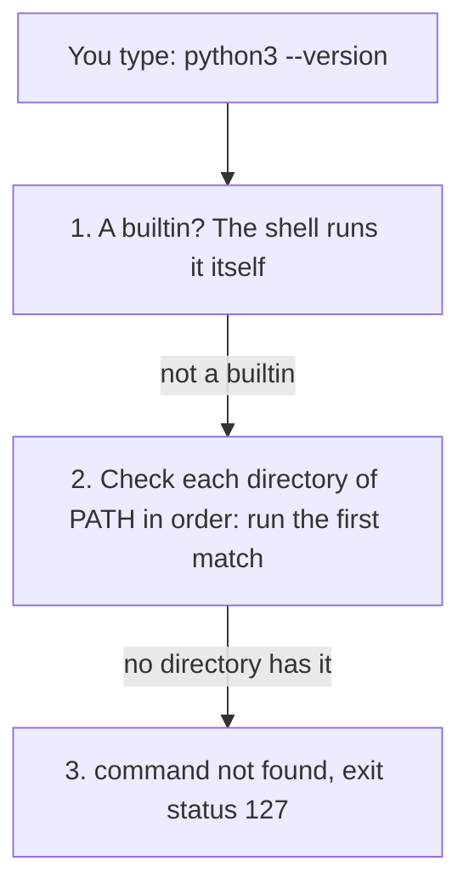

# Using the terminal

## The idea

cstudy is a command-line tool: you type `cstudy start`, `cstudy test` and `cstudy done` into a terminal. This guide covers what you need to be comfortable there.

A **terminal** is an app that shows a window of text. You type a line, press Return, and it shows what the program you ran prints. On a Mac the app is called Terminal and lives in `/Applications/Utilities`. On Linux, use your desktop's terminal app. On Windows, Windows Terminal hosts the shells there, including bash through WSL (see [package managers](../package-managers/guide.md)).

A **shell** is the program running inside the terminal. It reads the line you typed, finds the program you named, runs it, waits for it to finish, and shows its prompt again. The bash manual calls a Unix shell "both a command interpreter and a programming language": you can type commands one at a time, or save them in a file as a script.

The two shells you are most likely to meet are **bash** and **zsh**.

- On a Mac, zsh is the default. Apple's support page says that starting with macOS 10.15 (Catalina, released on 7 October 2019), a Mac uses zsh as the default login shell and interactive shell, and that bash was the default in macOS 10.14 and earlier. A **login shell** is the shell started when you log in, or one started with `--login`; an **interactive shell** is one that reads the commands you type in a terminal, rather than from a script.
- For everything in this guide, bash and zsh behave the same way. They differ in their config files and in the wording of some messages, which the sections below point out.

To see which shell your account starts, print the `SHELL` variable:

```console
$ echo $SHELL
/bin/zsh
```

The `$` at the start of a line is the prompt, the shell's way of saying it is ready. You type what comes after it. Lines without a `$` are what the command printed. Your prompt may look different, for example `%` in zsh, or your user name and folder before the sign.

cstudy itself runs on macOS and Linux, not on Windows. On Windows, WSL runs a Linux distribution such as Ubuntu inside Windows, and there you follow the Linux steps; cstudy is not tested inside WSL.

## How the shell finds a command

When you type `python3 --version`, the first word, `python3`, is the command and the rest are its arguments. The shell has to find out what `python3` is:

1. If it is a **builtin**, a command the shell does itself, such as `cd`, `pwd` or `export`, the shell runs it. No program is started.
2. Otherwise the shell looks through the directories listed in the **`PATH`** variable, in order, for a program with that name. The bash manual defines `PATH` as "a colon-separated list of directories in which the shell looks for commands".
3. It runs the first match. Later directories are never checked.
4. If no directory has it, the shell prints an error and the command ends with **exit status** 127. Every program ends by reporting a number, its exit status: 0 for success, anything else for a failure, and 127 is the shell's number for a command it could not find ([reading an error message](#reading-an-error-message) has more). bash says `bash: pyhton3: command not found`, and zsh says `zsh: command not found: pyhton3`.



<!-- text-of-mermaid sha256:56fa9d4e9730bece68ef175a0f511705afd3f45d71e9d571f601e879cb06a408 -->
```text
┌─────────────────────────────────────────────────────────────┐
│                 You type: python3 --version                 │
└──────────────────────────────┬──────────────────────────────┘
                               ▼
┌─────────────────────────────────────────────────────────────┐
│            1. A builtin? The shell runs it itself           │
└────────────────────────not─a─builtin────────────────────────┘
                               ▼
┌─────────────────────────────────────────────────────────────┐
│2. Check each directory of PATH in order: run the first match│
└─────────────────────no─directory─has─it─────────────────────┘
                               ▼
┌─────────────────────────────────────────────────────────────┐
│            3. command not found, exit status 127            │
└─────────────────────────────────────────────────────────────┘
```

The diagram shows the order: builtins first, then the directories of `PATH` from left to right, then an error.

Two commands tell you what a name means before you run it. `command -v` prints the path of the program the shell would run, or just the name for a builtin. `type` says it in words. Both work in bash and zsh:

```console
$ echo $PATH
/opt/homebrew/bin:/usr/bin:/bin
$ command -v python3
/opt/homebrew/bin/python3
$ type cd
cd is a shell builtin
```

Your `PATH` will be different; that is the point of checking it. This program models the search, on a pretend computer where three directories hold a `python3`:

```python examples/command_search.py
"""How a shell finds a command: a builtin first, then each directory of PATH in order."""

BUILTINS = {"cd", "pwd", "export"}

# A pretend computer: each directory and the programs it holds.
PROGRAMS = {
    "/opt/homebrew/bin": {"python3", "uv"},
    "/usr/local/bin": {"python3"},
    "/usr/bin": {"python3", "git", "ls"},
    "/bin": {"cat", "ls"},
}


def find(name: str, path: str) -> str:
    if name in BUILTINS:
        return f"{name}: a shell builtin, no search needed"
    for checked, directory in enumerate(path.split(":"), start=1):
        if name in PROGRAMS.get(directory, set()):
            return f"{name}: runs {directory}/{name} (directory {checked} of PATH)"
    return f"{name}: command not found (searched all {len(path.split(':'))} directories)"


path = "/opt/homebrew/bin:/usr/local/bin:/usr/bin:/bin"
print("PATH =", path)
for name in ("python3", "git", "cat", "cd", "pyhton3"):
    print(" ", find(name, path))

reordered = "/usr/bin:/opt/homebrew/bin:/usr/local/bin:/bin"
print("PATH =", reordered)
print(" ", find("python3", reordered))

short = "/usr/bin:/bin"
print("PATH =", short)
print(" ", find("uv", short))
```

It prints:

```output examples/command_search.py
PATH = /opt/homebrew/bin:/usr/local/bin:/usr/bin:/bin
  python3: runs /opt/homebrew/bin/python3 (directory 1 of PATH)
  git: runs /usr/bin/git (directory 3 of PATH)
  cat: runs /bin/cat (directory 4 of PATH)
  cd: a shell builtin, no search needed
  pyhton3: command not found (searched all 4 directories)
PATH = /usr/bin:/opt/homebrew/bin:/usr/local/bin:/bin
  python3: runs /usr/bin/python3 (directory 1 of PATH)
PATH = /usr/bin:/bin
  uv: command not found (searched all 2 directories)
```

- With three `python3` programs installed, the one in the first directory wins.
- Putting `/usr/bin` first changes which `python3` runs, without installing or removing anything.
- A typo searches every directory and fails. So does a program that is installed in a directory that is not on `PATH`: `uv` exists, but not in `/usr/bin` or `/bin`.

That last line is the most common setup problem: you install a tool, and the shell says `command not found`. The tool is there, but its directory is not on your `PATH` yet.

To add a directory, put it in front of the current value and export the result:

```console
$ export PATH="$HOME/bin:$PATH"
```

`$HOME` is your home directory, and `$PATH` expands to the old value, so this keeps everything that was there and checks `~/bin` first. It lasts until you close the terminal; [shell config files](#shell-config-files) make it permanent.

## Moving around and reading files

The shell always has a **current directory**, the folder that file names are relative to. These commands are the ones you will use every day. `cd` and `pwd` are builtins; the others are programs that macOS and Linux both provide, and the options shown are the ones the POSIX standard defines, so they work on both.

| Command | What it does |
|---------|--------------|
| `pwd` | Print the current directory |
| `cd practice` | Go into `practice`, a folder inside the current one |
| `cd ..` | Go up to the parent folder |
| `cd` | Go to your home directory |
| `cd -` | Go back to the previous directory |
| `ls` | List the files in the current directory |
| `ls -a` | List them all, including names that start with a dot, such as `.zshrc` |
| `ls -l` | List them in long format: size, date and permissions |
| `mkdir practice` | Make a directory |
| `cat notes.txt` | Print a whole file |
| `head -n 5 notes.txt` | Print its first 5 lines (10 without `-n`) |
| `tail -n 5 notes.txt` | Print its last 5 lines (10 without `-n`) |
| `less notes.txt` | Read a long file a screen at a time: Space goes forward, `q` quits, `h` shows help |

`~` is short for your home directory, so `cd ~/practice` works from anywhere. A name with spaces needs quotes, `cd "my notes"`, because the shell splits a line into words at spaces.

**Redirection** sends a command's output to a file instead of the screen. `>` creates the file, or empties it first if it exists. `>>` adds to its end.

```console
$ echo "banana" > fruit.txt
$ echo "apple" >> fruit.txt
```

## Pipes

A **pipe**, written `|`, connects two commands: the output of the one on the left becomes the input of the one on the right. A **process** is a program while it runs, and each command in a pipeline runs as a process of its own. Small tools that each do one thing combine into a bigger one.


<!-- text-of-mermaid sha256:97ba8c930df6276c6234dd714895bb982b6db1aa25b63a609d233d8956064664 -->
```text
┌──┐            ┌───────┐                ┌─────────┐    ┌────────┐
│ls├file─names─►│sort -r├reversed─names─►│head -n 3├───►│terminal│
└──┘            └───────┘                └─────────┘    └────────┘
```

In `ls | sort -r | head -n 3`, `ls` lists the files, `sort -r` sorts them in reverse order, and `head -n 3` keeps the first three: the last three names in alphabetical order. None of the three knows about the others; each reads its input and writes its output.

## Environment variables

A **variable** is a name with a text value. The shell expands `$NAME` to the value, which is how `echo $SHELL` worked. Some variables are part of the **environment**: a list of names and values that every program you start receives a copy of. `PATH`, `HOME` and `SHELL` are environment variables, which is how a program such as `cstudy` can read them.

```console
$ GREETING=hello
$ export GREETING
```

- `NAME=value` sets a variable in the current shell. There are no spaces around `=`.
- `export NAME` marks it to be passed to every command you start from then on. `export NAME=value` does both at once.

Programs read settings from the environment. `cstudy start`, for example, opens your files in the editor that the `VISUAL` or `EDITOR` variable names.

A program receives a **copy**. Whatever it changes stays in its own copy: a child can never change its parent's environment. This program shows that, and one more thing every program reports when it ends: its **exit status**.

```python examples/environment.py
"""A program gets a copy of its parent's environment, and ends with an exit status."""

import os
import subprocess
import sys


def run(code: str) -> subprocess.CompletedProcess[str]:
    """Run a small Python program as a child process, the way a shell runs a command."""
    return subprocess.run([sys.executable, "-c", code], capture_output=True, text=True)


os.environ["GREETING"] = "hello"
child = run("import os; print(os.environ.get('GREETING'))")
print("the child sees GREETING =", child.stdout.strip())

child = run("import os; os.environ['GREETING'] = 'changed'; print(os.environ['GREETING'])")
print("the child changed its copy to", child.stdout.strip())
print("the parent still has GREETING =", os.environ["GREETING"])

child = run("import os; print(os.environ.get('NOT_SET_ANYWHERE', '(not set)'))")
print("a variable nobody set:", child.stdout.strip())

success = run("print('all good')")
print("success: exit status", success.returncode, "| output:", success.stdout.strip())

failure = run("print(10 / 0)")
print("failure: exit status", failure.returncode, "| output:", repr(failure.stdout))
print("the error went to standard error; its last line is:")
print(" ", failure.stderr.strip().splitlines()[-1])
```

It prints:

```output examples/environment.py
the child sees GREETING = hello
the child changed its copy to changed
the parent still has GREETING = hello
a variable nobody set: (not set)
success: exit status 0 | output: all good
failure: exit status 1 | output: ''
the error went to standard error; its last line is:
  ZeroDivisionError: division by zero
```

- The child sees the variable its parent exported.
- The child's change does not reach the parent. This is why a script that runs `export` or `cd` cannot change the shell you started it from.
- A program that succeeds ends with status 0; one that fails ends with another number, here 1.
- A program has two output streams: **standard output** for its results and **standard error** for its messages. Both show in your terminal, but a pipe or a `>` takes only standard output, so errors still reach you.

## Shell config files

A new shell starts with only the environment it inherited from the program that started it, then reads a config file, which is a script of commands. That is where an `export PATH=...` line goes when you want it in every terminal.

| Shell | Read by an interactive shell | Also read by a login shell |
|-------|------------------------------|----------------------------|
| zsh | `~/.zshrc` | `~/.zprofile` and `~/.zlogin` |
| bash | `~/.bashrc`, when the shell is not a login shell | the first of `~/.bash_profile`, `~/.bash_login` and `~/.profile` that exists |

- **zsh**: put your settings in `~/.zshrc`. zsh reads it for every interactive shell, login or not.
- **bash**: a login shell reads `~/.bash_profile` and not `~/.bashrc`. The bash manual suggests this line in `~/.bash_profile`, so that both kinds of shell get the same settings:

  ```bash
  if [ -f ~/.bashrc ]; then . ~/.bashrc; fi
  ```

A config file is read when a shell starts, so a change does not reach terminals that are already open. Open a new one, or read the file again in the current one with `source ~/.zshrc` (or `source ~/.bashrc`). `source` runs the file in the current shell, so its `export` lines stay; running it as a separate program would not, as the example above showed.

Installers often add lines to these files, and tell you so. Homebrew, for example, prints the line to add when it finishes ([package managers](../package-managers/guide.md)).

## Optional: Oh My Zsh

Oh My Zsh describes itself as "an open source, community-driven framework for managing your zsh configuration". It bundles themes, which change how the prompt looks, and plugins, which add shortcuts and completions. Some people like it; many use zsh without it. cstudy does not need it, and nothing in these guides assumes it.

If you try it, know what it changes:

- Its installer renames your existing `~/.zshrc` to `~/.zshrc.pre-oh-my-zsh` and writes a new one.
- Plugins are listed in a `plugins=(...)` line in `~/.zshrc`, and the theme is the `ZSH_THEME` line.
- `uninstall_oh_my_zsh` removes it.
- Its project recommends inspecting an install script from a project you do not know before you run it, which is good advice for any install command you paste into a terminal.

## Reading an error message

Errors look alarming, but they follow a pattern. Read them from the bottom up, or from the first line that names a file.

1. **Who is talking.** The first word often names the program: `bash:`, `zsh:`, `ls:`, `error:`. A shell error means the command never ran; a program's error means it ran and failed.
2. **What went wrong.** The message says it in plain words: `command not found`, `No such file or directory`, `permission denied`.
3. **Where.** A compiler or a test names a file and a line, such as `two_sum.py:13`. Open that line.
4. **What to do.** Many tools end with a suggested fix. cstudy does: `` error: the Python workspace is not set up (python/.venv/bin/python is missing): run `uv sync --directory python` ``.

A Python error comes as a **traceback**, which starts with `Traceback (most recent call last):` and lists the calls that led to the error, the most recent last. The Python tutorial puts it this way: "The last line of the error message indicates what happened". So read the last line first, then the line above it that points into your own file.

```text
Traceback (most recent call last):
  File "<stdin>", line 1, in <module>
    10 * (1/0)
          ~^~
ZeroDivisionError: division by zero
```

The exit status tells you how the last command ended even when it printed nothing. The shell keeps it in `$?`:

```console
$ ls no-such-folder
ls: cannot access 'no-such-folder': No such file or directory
$ echo $?
2
```

That is Linux's `ls`; the words and the number differ a little on macOS. In every shell, 0 means success and anything else means failure. The bash manual lists two values worth knowing: 127 when a command is not found, and 126 when it is found but cannot be run. Other values belong to each program; cstudy documents its own, such as 1 when a test fails and 4 when a toolchain is missing.

## A worked example

Here is a short session that uses most of the above. The paths are examples: yours will name your own home directory.

```console
$ pwd
/Users/ada
$ mkdir practice
$ cd practice
$ echo "banana" > fruit.txt
$ echo "apple" >> fruit.txt
$ echo "cherry" >> fruit.txt
$ ls
fruit.txt
$ cat fruit.txt
banana
apple
cherry
$ sort fruit.txt | head -n 2
apple
banana
$ echo "kiwi" > fruit.txt
$ cat fruit.txt
kiwi
$ pyhton3 --version
zsh: command not found: pyhton3
$ echo $?
127
$ command -v python3
/opt/homebrew/bin/python3
```

Step by step:

1. `pwd` shows where the session starts: the home directory.
2. `mkdir practice` and `cd practice` make a folder and move into it. Everything after this happens inside it.
3. The first `echo ... >` creates `fruit.txt` with one line, and each `>>` adds a line. `ls` shows the file, and `cat` prints it.
4. `sort fruit.txt | head -n 2` sorts the lines and keeps the first two. `sort` reads the file itself; `head` reads what `sort` wrote into the pipe.
5. `echo "kiwi" > fruit.txt` uses a single `>`, which emptied the file before writing. The three fruits are gone: `>` replaces, `>>` adds.
6. `pyhton3` is a typo. zsh searched every directory of `PATH`, found nothing, said so, and set the exit status to 127, which `echo $?` shows.
7. `command -v python3` shows the program the correctly spelled name runs, and from which directory.

## When to use it

Use the terminal whenever a tool is a command: cstudy, the language toolchains (`python3`, `node`, `java`, `go`, `cargo`), git and package managers. Most of them have no window of their own.

- **The terminal inside your editor** is the same thing in a panel. VS Code's integrated terminal, for example, starts your system's default shell at the root of the folder you opened.
- **Scripts** are worth writing once you type the same commands often. The bash manual covers them.
- **A graphical tool** is fine for browsing files. The terminal wins when you need to repeat, combine or copy exact steps, which is what installation instructions are made of.

## Common traps

- **Typing the prompt.** In instructions, `$ cstudy doctor` means type `cstudy doctor`. Copying the `$` gives `command not found: $`.
- **Spaces around `=`.** `GREETING = hello` does not set a variable: the shell reads `GREETING` as a command name with `=` and `hello` as its arguments, and says `command not found`.
- **Editing a config file and expecting the open terminal to change.** A shell reads its config when it starts. Open a new terminal or `source` the file.
- **The wrong config file.** zsh does not read `~/.bashrc`, and bash does not read `~/.zshrc`. Check `echo $SHELL` before you edit.
- **`>` when you meant `>>`.** `>` empties the file first, and there is no undo.
- **A tool installed but `command not found`.** Its directory is not on `PATH`, or the installer added it to a config file that this terminal has not read yet. Open a new terminal first; if that does not help, check `echo $PATH` against where the tool was installed.
- **Two copies of a tool.** `command -v` shows only the one that runs. The other is ignored, however new it is, until its directory comes first in `PATH`.
- **A long-running command you want to stop.** Press Ctrl-C. `cstudy test --watch` and `cstudy serve` keep running until you do.

## Complexity

The shell does very little work of its own; these costs explain two behaviours that surprise people.

| Step | Cost | Why |
|------|------|-----|
| Finding a command the first time | Up to one check per directory of `PATH` | The directories are checked in order until one has the name, so a missing command, or a typo, checks them all |
| Finding it again | One lookup | bash remembers the full path of each command it found in a hash table; zsh does the same by default (its `HASH_CMDS` option) |
| A pipeline of k commands | k processes | Each command runs as its own process, its output connected by a pipe to the next one's input |
| `sort` in a pipeline | Reads all its input before it prints a line | The last line it reads might be the one that sorts first |

The remembered paths have a side effect. If you install a second copy of a tool in a directory earlier on `PATH`, a shell that already ran the tool may keep running the old copy. `hash -r` makes bash or zsh forget every remembered path (zsh also has `rehash`); a new terminal starts with none.

## Expert notes

- **The full lookup order.** Both manuals list shell functions before builtins, and both before the `PATH` search. `type` reports which one a name is, and in zsh `whence -v` does too. A function defined in a config file can therefore hide a program of the same name.
- **`command -v` is the portable way to ask.** It is defined by POSIX, so it works in any POSIX shell, including in scripts. `which` gives similar answers, but it is a builtin in zsh and a separate program in bash, so its output varies.
- **zsh's `path` array.** zsh keeps `PATH` and a lowercase array, `path`, in step: `path` holds the same directories, one per element.
- **Login and interactive shells.** A shell can be both at once. zsh reads `~/.zprofile` for login shells and `~/.zshrc` for interactive ones, so an interactive login shell reads both; bash's rules are in the table above.
- **A pipeline's exit status** is the status of its last command, so `failing-command | head` succeeds. bash's `pipefail` option, `set -o pipefail`, makes it fail when any command fails.
- **Changing the default shell.** On macOS, `chsh -s /bin/zsh` (or `/bin/bash`) changes your login shell, with a path from `/etc/shells`. Terminal's settings can also open a different shell. macOS shows a message that the default interactive shell is now zsh when you start bash while zsh is the default.

## Practice

This guide has no cstudy problem of its own: you practise it by using cstudy. Try the commands of the worked example in a folder of your own, then read [package managers](../package-managers/guide.md) to install the toolchains, the guide for your language, which package managers lists, and [your first problem](../your-first-problem/guide.md), which runs the whole cstudy loop in the terminal.

## Further reading

- [GNU Bash manual](https://www.gnu.org/software/bash/manual/): what a shell is, command search, `PATH`, startup files, pipelines, redirection, exit status, and the builtins `cd`, `pwd`, `export`, `source`, `hash` and `type`.
- [Bash Reference Manual on the Bash home page](https://tiswww.case.edu/php/chet/bash/bashref.html): the same manual on one page, from the Bash maintainer's site.
- [zsh manual: startup files](https://zsh.sourceforge.io/Doc/Release/Files.html): `.zshenv`, `.zprofile`, `.zshrc` and `.zlogin`, and when each is read.
- [zsh manual: command execution](https://zsh.sourceforge.io/Doc/Release/Command-Execution.html): how zsh finds a command, and `command not found`.
- [zsh manual: options](https://zsh.sourceforge.io/Doc/Release/Options.html): `HASH_CMDS`.
- [Use zsh as the default shell on Mac](https://support.apple.com/en-us/102360): Apple's page on zsh as the default since macOS 10.15.
- [About the security content of macOS Catalina 10.15](https://support.apple.com/en-us/103107): Apple's record of the release date, 7 October 2019.
- [Open or quit Terminal on Mac](https://support.apple.com/guide/terminal/open-or-quit-terminal-apd5265185d-f365-44cb-8b09-71a064a42125/mac): where Terminal is.
- [Windows Terminal overview](https://learn.microsoft.com/en-us/windows/terminal/): the terminal app on Windows.
- [POSIX utilities](https://pubs.opengroup.org/onlinepubs/9799919799/utilities/contents.html): the standard `ls`, `cat`, `head`, `tail`, `sort`, `mkdir` and `command -v` that macOS and Linux both follow.
- [less](https://www.greenwoodsoftware.com/less/): the pager's home page.
- [Python tutorial: errors and exceptions](https://docs.python.org/3/tutorial/errors.html): reading a traceback.
- [Oh My Zsh](https://ohmyz.sh/) and [its README](https://github.com/ohmyzsh/ohmyzsh): what it is, how it installs, and how to remove it.
