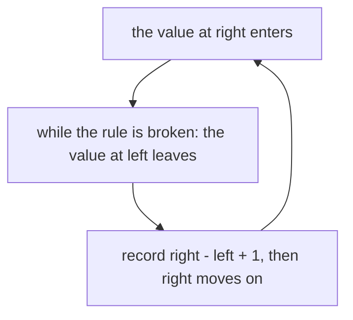
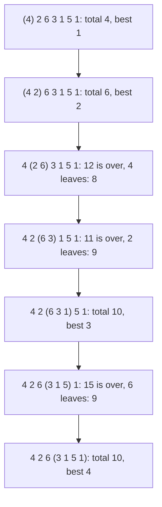

# Variable-size sliding windows

## The idea

Some questions ask for the **longest** stretch that obeys a rule: the most songs in a row that fit in an hour, the longest run of a log with no repeated user. Others ask for the **shortest** stretch that reaches something: the fewest days in a row that contain three rainy days. An array of `n` values has `n(n + 1) / 2` stretches; trying every start and extending it one value at a time is O(n²).

A **variable-size window** finds the answer in one pass. Keep a window from `left` to `right`, and a summary of it, such as its sum. For each `right` from the first position to the last:

1. The value at `right` **enters** the window.
2. **While** the window breaks the rule, the value at `left` **leaves**, and `left` moves one place right.
3. Now the window is the longest one that ends at `right` and obeys the rule: record its length, `right - left + 1`.



<!-- text-of-mermaid sha256:168b07e2e6328e1070f59819682dfbe0a703caecec7048e1f99d6ff86ffc713f -->
```text
┌──────────────────────────────────────────────────┐
│            the value at right enters             │◄┐
└─────────────────────────┬────────────────────────┘ │
                          ▼                          │
┌──────────────────────────────────────────────────┐ │
│while the rule is broken: the value at left leaves│ │
└─────────────────────────┬────────────────────────┘ │
                          ▼                          │
┌──────────────────────────────────────────────────┐ │
│   record right - left + 1, then right moves on   ├─┘
└──────────────────────────────────────────────────┘
```

Both edges only ever move right. `right` moves `n` times, and `left` can move at most `n` times in all, however those moves are spread out. So the whole pass is O(n) moves, even though one step of `right` can trigger many steps of `left`.

This only works for some rules. Moving `left` forward throws stretches away for good, which is safe only if the rule is **closed under shrinking**: whenever a stretch obeys it, every shorter stretch inside it obeys it too.

| Rule | Closed under shrinking? |
|------|-------------------------|
| The sum is at most a budget, and no value is negative | Yes: removing a value that is 0 or more cannot raise the sum |
| No value occurs twice | Yes: removing values cannot create a repeat |
| At most `k` different values | Yes: removing values cannot add a new one |
| The sum is at most a budget, and values may be negative | No: `[5, -4, 1]` has sum 2, within a budget of 3, but `[5]` inside it does not |
| The sum is exactly `k` | No: a stretch inside it usually has another sum |
| Contains every letter of a word | No, it is the other way round: it is **closed under growing**, and asks for the shortest stretch |

## A worked example

Seven songs last `[4, 2, 6, 3, 1, 5, 1]` minutes. What is the most songs in a row that fit in 10 minutes? Durations are never negative, so "total at most 10" is closed under shrinking.



<!-- text-of-mermaid sha256:5ddc32828ea95ebffdc32973f0834aecbe183ba3cb58f89bf0baed43dd0fb6cb -->
```text
┌────────────────────────────────────────┐
│    (4) 2 6 3 1 5 1: total 4, best 1    │
└────────────────────┬───────────────────┘
                     ▼
┌────────────────────────────────────────┐
│    (4 2) 6 3 1 5 1: total 6, best 2    │
└────────────────────┬───────────────────┘
                     ▼
┌────────────────────────────────────────┐
│4 (2 6) 3 1 5 1: 12 is over, 4 leaves: 8│
└────────────────────┬───────────────────┘
                     ▼
┌────────────────────────────────────────┐
│4 2 (6 3) 1 5 1: 11 is over, 2 leaves: 9│
└────────────────────┬───────────────────┘
                     ▼
┌────────────────────────────────────────┐
│   4 2 (6 3 1) 5 1: total 10, best 3    │
└────────────────────┬───────────────────┘
                     ▼
┌────────────────────────────────────────┐
│4 2 6 (3 1 5) 1: 15 is over, 6 leaves: 9│
└────────────────────┬───────────────────┘
                     ▼
┌────────────────────────────────────────┐
│   4 2 6 (3 1 5 1): total 10, best 4    │
└────────────────────────────────────────┘
```

The values in parentheses are the window after shrinking. The best is 4 songs, `3 1 5 1`. The left edge never went back, and no song it dropped could start a valid window ending there or further right: any such window would contain the window that had just broken the rule.

**Why it is right.** For each right edge `r`, let `L(r)` be the smallest left edge such that the window from `L(r)` to `r` obeys the rule. Count the empty window, from `r + 1` to `r`, as obeying it, so `L(r)` always exists; for a budget of 0 or more, an empty window's total of 0 is within it.

- **Every window from `L(r)` to `r` or shorter obeys the rule**, because it lies inside the window from `L(r)` to `r`, and the rule is closed under shrinking. **Every longer one breaks it**, because `L(r)` is the smallest left edge that works. So the longest valid window that ends at `r` is the one from `L(r)` to `r`.
- **`L(r)` never decreases as `r` grows.** If `L(r + 1)` is `r + 2`, the empty window, then `L(r) <= r + 1 < L(r + 1)`. Otherwise the window from `L(r + 1)` to `r + 1` obeys the rule, so the window from `L(r + 1)` to `r`, which lies inside it, obeys it too. Since `L(r)` is the smallest left edge that works for `r`, `L(r) <= L(r + 1)`.
- **The loop stops exactly at `L(r)`.** Suppose `left <= L(r)` when `r` enters. The loop removes values while the window breaks the rule, which is exactly while `left < L(r)`, so it stops with `left = L(r)`. Then, for `r + 1`, `left = L(r) <= L(r + 1)`, so the assumption holds again. It holds for the first `r` too, where `left` is 0.

The loop therefore records the longest valid window ending at every `r`, and the best of those is the answer.

**The shortest form** mirrors it. When the rule is closed under growing, as "contains at least 3 rainy days" is, grow the window, and **while it obeys the rule**, record its length and remove the value at `left`. Let `R(r)` be the largest left edge for which the window ending at `r` obeys the rule, when there is one. The window from `R(r)` to `r` is the shortest valid window that ends at `r`, and every window ending at `r` that starts at or before `R(r)` contains it, so it obeys the rule too.

- **`R(r)` never decreases.** If the window from `l` to `r` obeys the rule, so does the window from `l` to `r + 1`, which contains it.
- **The loop leaves `left` at `R(r) + 1`.** When `r` enters, `left` is `R(r - 1) + 1`, or 0 if no window obeyed the rule yet, and either way at most `R(r) + 1`. The loop records and removes exactly while `left <= R(r)`, so it records every valid window ending at `r` from where `left` was, and stops at `R(r) + 1`.
- **It records the shortest window of all.** Take a shortest valid stretch of all, and say it ends at `r`. If `R(r)` were equal to `R(r - 1)`, the window from `R(r - 1)` to `r - 1` would be valid and one value shorter, which is impossible. So `R(r)` is new or larger than `R(r - 1)`, `left` started at or before it, and the loop recorded the window from `R(r)` to `r`.

The program runs both forms and checks them against every stretch of every list of up to six values from 0 to 3, for every budget from 0 to 8 and every target from 1 to 3 rainy days. Then it shows the window giving a wrong answer once a negative value breaks the rule's closure:

```python examples/variable_windows.py
"""Grow on the right, shrink on the left: the longest and the shortest stretch that obey a rule."""

from itertools import product


def longest_within(durations: list[int], budget: int, trace: bool = False) -> int:
    """The most consecutive songs whose total length is at most `budget`."""
    left = total = best = 0
    for right, duration in enumerate(durations):
        total += duration  # grow: song `right` enters
        while total > budget:  # shrink until the rule holds again
            total -= durations[left]
            left += 1
        best = max(best, right - left + 1)  # the longest window that ends at `right`
        if trace:
            print(f"  right={right} left={left} {durations[left:right + 1]} total={total} best={best}")
    return best


def shortest_with_at_least(rainy: list[int], wanted: int) -> int:
    """The fewest consecutive days holding at least `wanted` rainy days (1 = rainy), or 0."""
    left = count = 0
    best = len(rainy) + 1
    for right, day in enumerate(rainy):
        count += day  # grow
        while count >= wanted:  # the rule holds: record, then try a shorter window
            best = min(best, right - left + 1)
            count -= rainy[left]
            left += 1
    return best if best <= len(rainy) else 0


def every_stretch(values):
    return [values[start:end] for start in range(len(values)) for end in range(start + 1, len(values) + 1)]


songs = [4, 2, 6, 3, 1, 5, 1]
print("longest run of", songs, "within 10 minutes")
print("window:", longest_within(songs, 10, trace=True))
print("every stretch:", max(len(s) for s in every_stretch(songs) if sum(s) <= 10))

days = [0, 1, 0, 0, 1, 1, 0, 1, 0, 1, 1]
print("shortest stretch with 3 rainy days:", shortest_with_at_least(days, 3))

cases = disagreements = 0
for size in range(7):
    for values in product(range(4), repeat=size):  # every list of 0 to 6 values from 0 to 3
        stretches = every_stretch(list(values))
        for budget in range(9):
            cases += 1
            brute = max((len(s) for s in stretches if sum(s) <= budget), default=0)
            disagreements += longest_within(list(values), budget) != brute
        for wanted in range(1, 4):
            cases += 1
            flags = [value % 2 for value in values]
            lengths = [len(s) for s in every_stretch(flags) if sum(s) >= wanted]
            disagreements += shortest_with_at_least(flags, wanted) != min(lengths, default=0)
print(f"against every stretch: {cases} cases, {disagreements} disagreements")

mixed = [5, -4, 1]  # a negative value: the rule is no longer kept by shrinking
print("with a negative value, window:", longest_within(mixed, 3),
      "| every stretch:", max(len(s) for s in every_stretch(mixed) if sum(s) <= 3))
```

It prints:

```output examples/variable_windows.py
longest run of [4, 2, 6, 3, 1, 5, 1] within 10 minutes
  right=0 left=0 [4] total=4 best=1
  right=1 left=0 [4, 2] total=6 best=2
  right=2 left=1 [2, 6] total=8 best=2
  right=3 left=2 [6, 3] total=9 best=2
  right=4 left=2 [6, 3, 1] total=10 best=3
  right=5 left=3 [3, 1, 5] total=9 best=3
  right=6 left=3 [3, 1, 5, 1] total=10 best=4
window: 4
every stretch: 4
shortest stretch with 3 rainy days: 4
against every stretch: 65532 cases, 0 disagreements
with a negative value, window: 2 | every stretch: 3
```

The trace is the diagram, line for line. In `[0, 1, 0, 0, 1, 1, 0, 1, 0, 1, 1]`, the shortest stretches with 3 rainy days take 4 days, such as positions 4 to 7. Both forms agree with checking every stretch in all 65,532 cases.

## When the window fails

The last line of the program is the window giving a wrong answer. With `[5, -4, 1]` and a budget of 3, the whole list obeys the rule, with a total of 2. But when `5` enters alone, its total of 5 is over the budget, so the loop removes it, and `left` never comes back. The window reports 2, and the true answer is 3.

The proof above says exactly what went wrong. With negative values, "total at most the budget" is not closed under shrinking: `[5, -4, 1]` obeys it and `[5]` inside it does not. Then `L(r)` can decrease: `L(0)` is 1, the empty window, while `L(2)` is 0. A loop whose left edge only moves forward cannot follow it back.

So before reaching for a window, check the rule: **if a stretch obeys it, does every stretch inside it?** For the shortest form: **if a stretch obeys it, does every stretch around it?** When the answer is no, the window is the wrong tool, however natural it looks. [Prefix sums](../prefix-sums-with-hash-maps/guide.md) give the sum of any stretch without that requirement, and together with a hash map they find the stretches with an exact sum in one pass, negative values included.

## When to use it

- The question is about **contiguous** stretches, not subsequences, and asks for the longest or the shortest.
- For the longest, the rule is **closed under shrinking**; for the shortest, it is **closed under growing**.
- The window's summary can **take in and give up** one value cheaply, as in a [fixed-size window](../fixed-size-windows/guide.md): a sum, a count, or a [count per value](../counting-and-frequency/guide.md).

The same window also **counts** stretches. When the rule is closed under shrinking, the valid windows that end at `r` are exactly those that start from `L(r)` to `r`, which makes `r - L(r) + 1` of them. Adding that up as `right` moves counts every valid stretch in O(n).

When the length is fixed, a fixed-size window is simpler. When the rule is closed neither way, as an exact sum is, the window is the wrong tool: for exact sums, prefix sums with a hash map find or count the stretches in one pass, negative values included.

## Common traps

- **`if` instead of `while`.** One removal may not be enough to restore the rule: a long song that enters can push the total over the budget by more than the leftmost song is worth. Shrink until the rule holds.
- **Recording at the wrong moment.** For the longest form, record after shrinking, when the window obeys the rule. For the shortest form, record inside the loop, before removing the left value, while the window still obeys it.
- **The length is `right - left + 1`.** Both edges are inside the window. With a half-open window, from `left` up to but not including `right`, the length is `right - left`; mixing the two conventions is the most common off-by-one.
- **Counts of zero left in a map.** When the summary is a count per value, delete an entry whose count reaches 0, or the number of entries no longer says how many different values the window holds. Python's `Counter` keeps an entry set to 0 until it is deleted.
- **A rule that the empty window breaks.** With a budget below 0, the empty window is over budget too, so `while total > budget` moves `left` past `right` and subtracts songs that never entered, or reads past the end of the list. Guard the loop with `left <= right`, or reject such inputs first.
- **A rule that is not closed.** Negative values and exact targets break the window, as shown above. The code runs, and the answers are wrong only sometimes, which makes it worse.

## Complexity

| Approach | Time | Extra space |
|----------|------|-------------|
| Every start, extending its summary one value at a time | O(n²) | O(1) for a sum |
| Prefix sums and a binary search per start, positive values only | O(n log n) | O(n) |
| Grow and shrink | O(n) | O(1) for a sum, O(d) for a count per value |

`right` moves `n` times and `left` at most `n` times, since it only moves forward and never passes `right + 1`. Each move is one update of the summary: O(1) for a sum or a count, and O(1) on average for a hash map, under the usual assumption of a well-spread hash. Here `d` is the number of different values in the window, at most its length. With positive values the prefix sums strictly increase, which is what lets a binary search find, for each start, the first end that reaches a target.

## Expert notes

- **The left edge is a monotone function.** The whole technique rests on `L(r)`, or `R(r)`, never decreasing. That is the same kind of fact that lets [two pointers on a sorted array](../pairs-in-sorted-arrays/guide.md) skip pairs: the best partner of one pointer only ever moves one way as the other pointer moves. Look for that monotone function, and the window, or a pair scan, follows.
- **"Exactly" from two "at most"s.** "Exactly `k` different values" is not closed under shrinking, but "at most `k` different values" is, and every window with at most `k - 1` different values also has at most `k`. So the windows with exactly `k` are the windows with at most `k`, minus the windows with at most `k - 1`: two counting passes, O(n).
- **The summary decides the cost.** The loop is O(n) moves, but a summary that needs O(size) to test the rule, such as recounting the window, makes it O(n²) again. A test over a fixed alphabet, such as comparing 26 letter counts, costs 26 comparisons per move: still linear, with a constant worth knowing.
- **Shortest and longest are different loops.** The longest form shrinks while the rule is broken and records afterwards; the shortest form shrinks while the rule holds and records inside. A question for the longest stretch needs a rule closed under shrinking, and a question for the shortest needs one closed under growing; the other pairings have trivial answers. The longest stretch of positive values with a sum of at least a target is the whole array, if any stretch qualifies, since it contains that stretch.

## Practice

- `cstudy start best-time-to-buy-sell-stock`: a stretch from a buying day to a selling day; work out when the buying day should move.
- `cstudy start min-size-subarray-sum`: the shortest form, with positive values.
- `cstudy start longest-substring-without-repeats`: the longest form, with a rule about repeated characters.
- `cstudy start max-ones-with-flips`: the longest form, with a budget.
- `cstudy start fruit-into-baskets`: the longest form, with a limit on how many kinds the window may hold.
- `cstudy start longest-repeating-replacement`: the longest form, with a rule that depends on the most frequent letter in the window.
- `cstudy start minimum-window-substring`: the shortest form, where the window must cover every required letter, repeats included.

## Further reading

- [Python `collections.Counter`](https://docs.python.org/3/library/collections.html#collections.Counter): counts per value, a zero count for missing items, and `del` to remove an entry whose count is 0.
