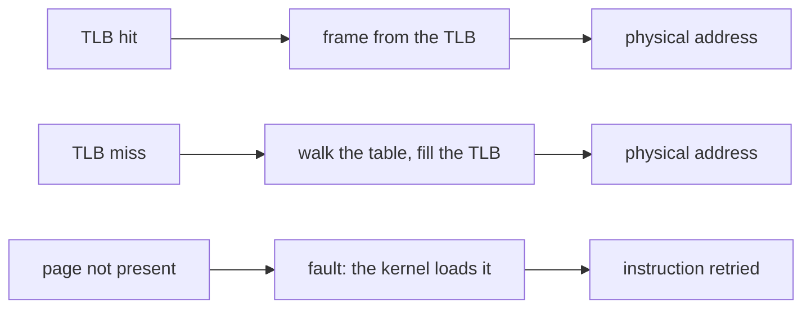
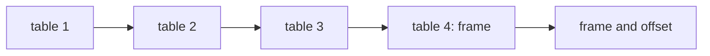

# Virtual memory, paging and page replacement

## The idea

Every process sees memory as one long row of bytes, numbered from 0, as if it had the machine to itself. That row is its **address space**, and the numbers it uses are **virtual addresses**. The memory chips, the **physical memory**, are shared by every process and have **physical addresses** of their own. On every memory access, the hardware **translates** a virtual address into a physical one, with tables the kernel keeps. This one indirection buys three things:

- **isolation**: a process cannot even name another's memory;
- **convenience**: every program can be written as if it starts at the same addresses and has a large, contiguous space;
- **overcommitment**: parts of a process may live on disk, or nowhere yet, and be brought into physical memory only when used.

Translating byte by byte would need a table as large as memory, so memory is cut into blocks of one size. A block of the address space is a **page**; a block of physical memory is a **frame**; both are the same size, the **page size**, a power of two. A virtual address splits into a **page number** and an **offset** inside the page, and only the page number is translated: byte 100 of a page is byte 100 of its frame. Linux's manual says a program should not hard-code the page size, since some processors support several; the kernel's documentation uses 4 KiB (4096 bytes) as the basic size in its examples.

The **page table** of a process maps its page numbers to frame numbers, along with a few bits per page: whether it may be written, whether it is present in memory, whether it has been written since it was loaded (the **dirty bit**). The **memory management unit** (MMU), the part of the processor that translates, reads it. Reading a table in memory on every access would double the cost of every access, so the MMU keeps a small cache of recent translations, the **translation lookaside buffer** (TLB).



<!-- text-of-mermaid sha256:4b55b100579ee79ca96b65ad8016d4fc5623301f01b05a8d74560679c12b9f3f -->
```text
┌────────────────┐    ┌────────────────────────────┐    ┌───────────────────┐
│    TLB hit     ├───►│     frame from the TLB     ├───►│  physical address │
└────────────────┘    └────────────────────────────┘    └───────────────────┘

┌────────────────┐    ┌────────────────────────────┐    ┌───────────────────┐
│    TLB miss    ├───►│walk the table, fill the TLB├───►│  physical address │
└────────────────┘    └────────────────────────────┘    └───────────────────┘

┌────────────────┐    ┌────────────────────────────┐    ┌───────────────────┐
│page not present├───►│ fault: the kernel loads it ├───►│instruction retried│
└────────────────┘    └────────────────────────────┘    └───────────────────┘
```

The drawing shows the three outcomes, after the address is split into page number and offset and the TLB is checked. A **hit** costs almost nothing. A **miss** costs a walk through the page table in memory. A **page fault** happens when the page is not usable: the MMU raises an exception, and the kernel's documentation lists the expected causes, such as memory allocated lazily that is touched for the first time, a page shared copy-on-write after a `fork` that one side writes, or a page that was moved out to disk, **swapped out**. The kernel fixes the cause, and the textbook *Operating Systems: Three Easy Pieces* describes what follows: the page table is updated and the instruction that faulted is retried. Loading pages only when they are first touched is **demand paging**.

## A worked example

Take 4096-byte pages. 4096 is 2^12, so the offset is the lowest 12 bits of an address and the page number is the bits above them. In hexadecimal, where each digit is 4 bits, the offset is simply the last three digits.

| Step | Value |
|------|-------|
| Virtual address | `0x4E20` (20000) |
| Page number, offset | `0x4`, `0xE20` (4 and 3616): 20000 = 4 × 4096 + 3616 |
| The page table says page 4 is in frame 9 | frame `0x9` |
| Physical address | `0x9E20` (40480): 9 × 4096 + 3616 |

A second address, `0x7010`, is on page 7. If page 7 has no frame, the access is a page fault: the kernel allocates a frame, or reads the page from disk, records it in the page table, and the access is retried.

Nothing in the translation looks at the offset, which is why programs care about **locality**: the textbook distinguishes **temporal locality**, using recently used data again soon, and **spatial locality**, using data near recently used data. The program below reads a table of 512 rows of 512 eight-byte numbers stored row after row, so each row fills one page, once row by row and once column by column.

```python examples/locality.py
"""Reading a table row by row stays on one page for a long time; column by column, it never does.

The table has 512 rows of 512 numbers of 8 bytes each, stored row after row from address 0, so one
row fills exactly one page of 4096 bytes. The program counts how often a read lands on a different
page than the read before it, and how many distinct pages the first 1000 reads touch.
"""

PAGE_SIZE = 4096  # 2 ** 12, so the page number is the address shifted right by 12 bits
ROWS = COLS = 512
ITEM = 8  # bytes per number


def page_of(row: int, col: int) -> int:
    address = (row * COLS + col) * ITEM
    return address >> 12


def walk(addresses: list[int]) -> tuple[int, int]:
    changes, previous = 0, None
    for page in addresses:
        if page != previous:
            changes += 1
            previous = page
    return changes, len(set(addresses[:1000]))


by_rows = [page_of(r, c) for r in range(ROWS) for c in range(COLS)]
by_columns = [page_of(r, c) for c in range(COLS) for r in range(ROWS)]
for name, pages in (("row by row", by_rows), ("column by column", by_columns)):
    changes, early = walk(pages)
    print(
        f"{name:<17} {changes:>6} page changes in {len(pages)} reads; "
        f"the first 1000 reads touch {early} pages"
    )
```

It prints:

```output examples/locality.py
row by row           512 page changes in 262144 reads; the first 1000 reads touch 2 pages
column by column  262144 page changes in 262144 reads; the first 1000 reads touch 512 pages
```

Row by row, 511 of every 512 reads stay on the page of the read before, so a TLB of any size hits almost every time. Column by column, every read lands on another page, and the first thousand reads already touch every page of the table: a TLB with fewer than 512 entries misses on every read, and if memory could not hold the whole table, every read could be a page fault. Same data, same result, very different cost.

## Page tables in levels

A single flat table needs an entry for every page of the address space, used or not. Most address spaces are sparse: some code at the bottom, a heap, a stack at the top, and a vast gap. So page tables are built as a tree. The page number is split into several groups of bits; the first group indexes a top-level table, whose entry points to a second-level table, and so on, until the last level gives the frame. A region where nothing is mapped needs no lower tables at all: the kernel's documentation notes that a large unmapped area is marked once, at a higher level.



<!-- text-of-mermaid sha256:2f05a2dca7ce99533d54938f6d13f03952fbfe43e7ae775cad941ffc40300b6d -->
```text
┌───────┐    ┌───────┐    ┌───────┐    ┌──────────────┐    ┌────────────────┐
│table 1├───►│table 2├───►│table 3├───►│table 4: frame├───►│frame and offset│
└───────┘    └───────┘    └───────┘    └──────────────┘    └────────────────┘
```

Each table fills one page. With 4096-byte pages and 8-byte entries, a table holds 512 entries, so each level translates 9 bits; four levels translate 36 bits, and with the 12 bits of the offset they cover 48-bit addresses: 2^48 bytes, 256 TiB. That is the limit the Linux documentation gives for four-level paging on one 64-bit processor family, where a fifth level raises it to 128 PiB, 57 bits. Linux describes its page tables as a hierarchy of currently five levels, and an architecture that uses fewer **folds** the extra ones away.

The cost of the tree is on a TLB miss: one memory access per level. The kernel's documentation notes that processors keep page walk caches for the upper levels as well as the TLB, and huge pages (below) shorten the walk.

## Page replacement

With demand paging, memory eventually fills up. The next page fault then needs a **victim**: a page to evict so its frame can be reused. If the victim is dirty, it must first be written back to disk; the textbook notes that some systems therefore prefer to evict clean pages. The rule that picks the victim is the **replacement policy**, and every extra fault costs a disk read.

- **FIFO** (first in, first out) evicts the page that was loaded earliest. It needs only a queue, but a page loaded long ago may be the most used one.
- **LRU** (least recently used) evicts the page whose last use is the oldest, betting that the recent past predicts the near future. Exact LRU must record every single access, which hardware does not do for page replacement.
- **The clock** approximates LRU cheaply. The hardware sets a **use bit** in the page table entry whenever a page is accessed; only the kernel clears it. The frames form a circle with a **hand**; to find a victim, the hand moves around the circle, clearing set bits and stopping at the first page whose bit is already clear. The textbook credits it to Corbató.
- **The optimal policy** evicts the page whose next use is the farthest in the future. Mattson and colleagues cite Belady's 1966 paper for an optimum replacement algorithm called MIN, and define their own optimal algorithm, OPT, by this rule. It needs the future, so no running system can use it, but run on a recorded string of references it shows the fewest faults any policy could have had: a yardstick for the others.

The program below counts the faults of FIFO, LRU and the optimal policy on one string of page references, with 1 to 5 frames. It computes LRU by the method Mattson, Gecsei, Slutz and Traiger described in 1970: keep the pages in a list from the most to the least recently used; a reference to the page at position d in that list, its **stack distance**, hits in a memory of m frames exactly when d ≤ m.

```python examples/replacement.py
"""Page faults of FIFO, LRU and the optimal policy on one string of page references.

FIFO evicts the page that was loaded the earliest. The optimal policy evicts the page whose next
use is the farthest away, which needs the future, so it can only be run on a recorded string.
LRU is computed the way stack algorithms allow: one pass gives each reference its stack distance,
the position of its page in a list of pages from the most to the least recently used, and a memory
of m frames faults exactly on the references whose distance is larger than m, or which are first
uses.
"""

from collections import deque

REFS = [1, 2, 3, 4, 1, 2, 5, 1, 2, 3, 4, 5]


def fifo_faults(frames: int) -> int:
    loaded: deque[int] = deque()  # pages in the order they were loaded
    faults = 0
    for page in REFS:
        if page not in loaded:
            faults += 1
            if len(loaded) == frames:
                loaded.popleft()
            loaded.append(page)
    return faults


def next_use(page: int, future: list[int]) -> int:
    """How many references from now the page is used again; never counts as the farthest."""
    return future.index(page) if page in future else len(future)


def optimal_faults(frames: int) -> int:
    resident: set[int] = set()
    faults = 0
    for i, page in enumerate(REFS):
        if page in resident:
            continue
        faults += 1
        if len(resident) == frames:
            future = REFS[i + 1 :]
            distance = {p: next_use(p, future) for p in resident}
            resident.remove(max(sorted(resident), key=distance.__getitem__))
        resident.add(page)
    return faults


def stack_distances() -> list[int | None]:
    stack: list[int] = []  # stack[0] is the most recently used page
    distances: list[int | None] = []
    for page in REFS:
        if page in stack:
            distances.append(stack.index(page) + 1)
            stack.remove(page)
        else:
            distances.append(None)  # a first use faults whatever the memory size
        stack.insert(0, page)
    return distances


distances = stack_distances()
print("references:     ", " ".join(map(str, REFS)))
print("stack distances:", " ".join("-" if d is None else str(d) for d in distances))
print("frames  FIFO  LRU  optimal")
for frames in range(1, 6):
    lru = sum(1 for d in distances if d is None or d > frames)
    print(f"{frames:>6}  {fifo_faults(frames):>4}  {lru:>3}  {optimal_faults(frames):>7}")
```

It prints:

```output examples/replacement.py
references:      1 2 3 4 1 2 5 1 2 3 4 5
stack distances: - - - - 4 4 - 3 3 5 5 5
frames  FIFO  LRU  optimal
     1    12   12       12
     2    12   12        9
     3     9   10        7
     4    10    8        6
     5     5    5        5
```

Look at the FIFO column between 3 and 4 frames: **more memory, more faults**. This is **Belady's anomaly**. Belady, Nelson and Shedler reported in 1969 that experiments had shown programs that ran faster in a smaller memory, and gave a formal treatment for FIFO; this string, written `abcdabeabcde`, is the one Mattson and colleagues use to show that FIFO's faults are not monotonic. LRU and the optimal policy never do this. Mattson and colleagues call them **stack algorithms**: for every string and every moment, the pages they keep in m frames are a subset of those they would keep in m + 1, their **inclusion property**, so adding a frame can only turn misses into hits. That property is also why one pass of stack distances gives LRU's faults for every memory size at once.

## The working set and thrashing

How much memory does a process need? Denning's 1968 answer is its **working set**, W(t, τ): the pages it referenced during the last τ units of its own execution time, up to time t. The working set changes slowly as a program moves from one phase to the next, and it is a good guess of the pages the process will use soon.

When the processes running together have working sets larger than memory, they evict each other's pages, fault, wait for the disk, and evict more. Denning's paper on the subject defines **thrashing** as excessive overhead and severe performance degradation or collapse caused by too much paging. Its cure: there must be room in memory for every active process's working set, so a process is kept active only when its working set fits, and the others wait.

## When to use it

- **Traversal order.** Walk large arrays in the order they are stored. A table stored row after row is read row by row, as the example shows.
- **Mapping files and memory.** `mmap` maps a file, or anonymous zero-filled memory, into the address space; Linux's manual describes a private mapping as copy-on-write, so changes are never written back to the file. Pages are then loaded on first touch, by page faults.
- **Huge pages.** The kernel's documentation explains that a huge page, 2 MiB in its examples, lets one TLB entry cover much more memory, so a program with a large working set has fewer TLB misses, and each miss is faster.
- **Sizing memory.** A server whose working set does not fit in memory does not slow down gently: it thrashes. Measure the working set, not the total size.
- **Caches of your own.** Any fixed-size cache faces the replacement question: FIFO, LRU, the clock and their kin are the same ideas in software, and the stack-distance method sizes an LRU cache from one recorded trace.

## Common traps

- **Hard-coding the page size.** Linux's manual warns against it: ask the system with `sysconf(_SC_PAGESIZE)` or `getpagesize()`.
- **Assuming more frames always help.** For LRU and the other stack algorithms it is true; for FIFO it is not, as the anomaly shows.
- **Forgetting stale translations.** The TLB caches what the page table said. The kernel's documentation on TLB flushing says that after the kernel changes page tables it must flush the affected translations, or stale ones may remain; a simulator that changes a mapping must do the same.
- **Confusing the two kinds of faults.** Linux counts **minor** faults, served without any input or output, for example by reclaiming a frame from the pages awaiting reuse, apart from **major** faults, which required input or output. Only major faults wait for a disk.
- **Exact LRU on every access.** Moving an entry on every access is the price of exact LRU; hardware gives the kernel a use bit instead, which is why the clock exists.
- **A loop slightly larger than memory.** LRU evicts the page that a loop will need next, so a loop over one page more than the memory holds faults on every reference.

## Complexity

For a TLB of t entries, a page table of L levels, f frames and a reference string of n references with p distinct pages:

| Operation | Cost | Conditions |
|-----------|------|------------|
| Translation, TLB hit | No memory access beyond the one asked for | The textbook's TLB is searched by the hardware, all entries in parallel |
| Translation, TLB miss | L extra memory accesses | Fewer with page walk caches or huge pages |
| Page fault served from disk | A disk read | Denning traces thrashing to the very large speed difference between main memory and the disk |
| Page table memory, flat | One entry per page of the whole address space | Whether used or not |
| Page table memory, multi-level | One table per region in use, plus the upper levels | Small for a sparse address space |
| FIFO, per fault | O(1) | A queue of loaded pages |
| Clock, per access and per fault | O(1) per access, to set a bit; at most one full turn of f frames per fault | A turn clears the bits it passes, so the next search stops sooner |
| Optimal, offline | O(n · f) next-use searches as in the example, or O(n log f) with precomputed next uses and a heap | Needs the whole string in advance |
| LRU stack distances, all memory sizes at once | O(n · p) with a list, as in the example | Faster with a balanced tree |

## Expert notes

- **Optimal is a stack algorithm too.** Mattson and colleagues list OPT among the stack algorithms, prove that it is optimal, and show how to compute its success function for every memory size in two passes of a trace. Denning's 1968 paper sums up Belady's study as finding that a good algorithm needs much of the simplicity of random or FIFO selection and some, though not much, record of past references.
- **Denning's LRU used use bits.** In the 1968 paper, LRU is implemented with a use bit in each page table entry, set on every reference, with all entries searched at intervals to update usage records: an approximation, as the clock is.
- **Address space identifiers.** The textbook describes TLBs that tag each entry with an address space identifier, a few bits that name the process, so that a context switch does not have to throw away every translation.
- **Copy-on-write and lazy allocation are page faults by design.** The kernel's documentation calls them common and expected causes of faults, distinct from swapping, which happens only under memory pressure and is undesirable.
- **The page frame number.** Linux calls a frame's number its pfn: the physical address divided by the page size, so with 4 KiB pages pfn 1 is at physical address 0x1000.

## Practice

- `cstudy start lru-cache`: a fixed-size cache that evicts the least recently used entry, with every operation in constant time. It is the replacement question as a data structure.
- `cstudy start virtual-memory-sim`: a simulator that grows from splitting addresses and a page table to a TLB, demand paging with FIFO, LRU and clock replacement, two-level tables and the working set. Its levels define exactly when a translation counts as a use and what each policy does, so follow its rules rather than the variations of this guide.

## Further reading

- [Linux kernel documentation, *Page Tables*](https://docs.kernel.org/mm/page_tables.html): the five-level hierarchy, page frame numbers, the MMU, TLBs, page walk caches and the causes of page faults; [*5-level paging*](https://docs.kernel.org/arch/x86/x86_64/5level-paging.html): the limits of four and five levels; [*Cache and TLB Flushing Under Linux*](https://docs.kernel.org/core-api/cachetlb.html): flushing after page table changes; [*Transparent Hugepage Support*](https://docs.kernel.org/admin-guide/mm/transhuge.html): huge pages and the TLB.
- Linux manual pages: [`getpagesize(2)`](https://man7.org/linux/man-pages/man2/getpagesize.2.html), [`mmap(2)`](https://man7.org/linux/man-pages/man2/mmap.2.html) and [`getrusage(2)`](https://man7.org/linux/man-pages/man2/getrusage.2.html) (minor and major faults).
- [Belady, *A study of replacement algorithms for a virtual-storage computer* (IBM Systems Journal, 1966)](https://doi.org/10.1147/sj.52.0078): the optimal algorithm, MIN.
- [Belady, Nelson and Shedler, *An anomaly in space-time characteristics of certain programs running in a paging machine* (Communications of the ACM, 1969)](https://doi.org/10.1145/363011.363155): more memory, more faults, under FIFO.
- [Mattson, Gecsei, Slutz and Traiger, *Evaluation techniques for storage hierarchies* (IBM Systems Journal, 1970)](https://doi.org/10.1147/sj.92.0078): stack algorithms, the inclusion property, OPT, and evaluating every memory size in one pass.
- [Denning, *The working set model for program behavior* (Communications of the ACM, 1968)](https://doi.org/10.1145/363095.363141) and [*Thrashing: its causes and prevention* (Fall Joint Computer Conference, 1968)](https://doi.org/10.1145/1476589.1476705).
- [*Operating Systems: Three Easy Pieces*](https://pages.cs.wisc.edu/~remzi/OSTEP/), a free textbook: the chapters on paging, TLBs, smaller tables and replacement policies cover locality, address space identifiers, the use bit, the clock and dirty pages.
