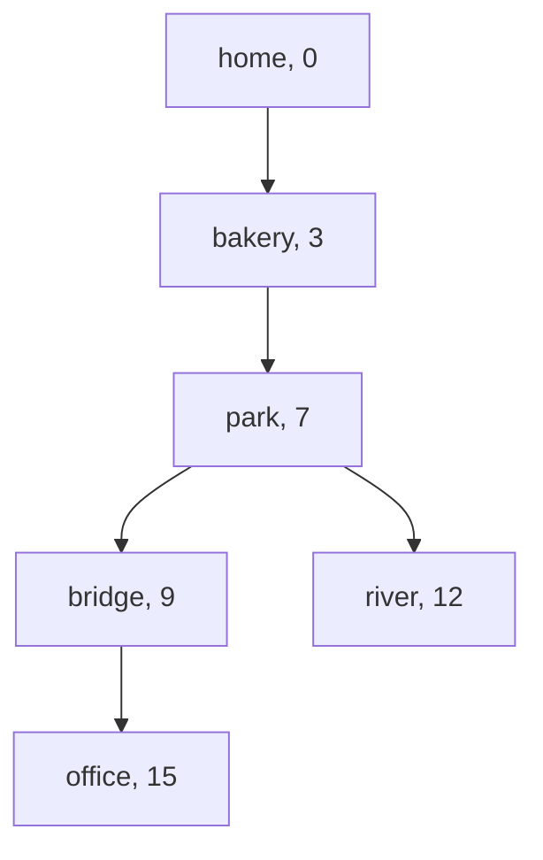

# Weighted shortest paths

## The idea

[Breadth-first search](../breadth-first-search/guide.md) finds the route with the fewest edges. When edges have different costs, minutes, prices or distances, the route with the fewest edges is often not the cheapest: one long road can take longer than three short ones. This guide is a short pointer to the algorithm for that case, with its one hard requirement.

**Dijkstra's algorithm** finds the cheapest route from a start to every node when no edge costs less than zero. It keeps a **tentative distance** for each node, the cheapest route found so far, and grows a set of **settled** nodes whose distance is final:

1. The start has distance 0; every other node has none yet.
2. Settle the unsettled node with the smallest tentative distance. Its distance is now final.
3. **Relax** its edges: for each neighbor, if going through the node just settled is cheaper than the neighbor's tentative distance, lower it, and remember the settled node as the neighbor's parent.
4. Repeat until every reachable node is settled, or until the node you want is.

Nodes are settled in order of increasing distance, the way BFS takes nodes in order of level. Finding the smallest tentative distance fast is the job of a **priority queue**, a min-heap in practice: Python's `heapq` keeps the smallest item at `heap[0]`. When a distance goes down, the simplest approach pushes a new entry rather than changing the old one, and skips an entry when it comes out of the heap for a node that is already settled: that entry is outdated.

## A worked example

### Cycling across town

Cycling times in minutes; every road can be ridden both ways.

| Road | Minutes |
|------|---------|
| home – bridge | 12 |
| home – bakery | 3 |
| bakery – park | 4 |
| park – bridge | 2 |
| park – river | 5 |
| bridge – office | 6 |
| river – office | 5 |

```python examples/cycling_times.py
"""Fewest roads is not fastest: BFS against Dijkstra's algorithm on cycling times in minutes."""

import heapq
from collections import deque
from itertools import pairwise

roads = [
    ("home", "bridge", 12),
    ("home", "bakery", 3),
    ("bakery", "park", 4),
    ("park", "bridge", 2),
    ("park", "river", 5),
    ("bridge", "office", 6),
    ("river", "office", 5),
]
near: dict[str, list[tuple[str, int]]] = {}
time_of: dict[tuple[str, str], int] = {}
for a, b, minutes in roads:
    near.setdefault(a, []).append((b, minutes))
    near.setdefault(b, []).append((a, minutes))
    time_of[a, b] = time_of[b, a] = minutes


def route(came_from: dict[str, str | None], place: str) -> list[str]:
    steps = []
    current: str | None = place
    while current is not None:
        steps.append(current)
        current = came_from[current]
    return steps[::-1]


def fewest_roads(start: str, goal: str) -> list[str]:
    came_from: dict[str, str | None] = {start: None}
    queue = deque([start])
    while queue:
        place = queue.popleft()
        for nxt, _ in near[place]:
            if nxt not in came_from:
                came_from[nxt] = place
                queue.append(nxt)
    return route(came_from, goal)


def dijkstra(start: str, goal: str) -> tuple[int, list[str]]:
    best = {start: 0}
    came_from: dict[str, str | None] = {start: None}
    settled: set[str] = set()
    heap = [(0, start)]
    while heap:
        minutes, place = heapq.heappop(heap)
        if place in settled:
            print(f"  skip  {place:<7} at {minutes:>2}: an outdated entry")
            continue
        settled.add(place)  # no route found later can be shorter than this one
        print(f"  settle {place:<6} at {minutes:>2}")
        if place == goal:
            return minutes, route(came_from, goal)
        for nxt, cost in near[place]:
            if nxt not in settled and minutes + cost < best.get(nxt, float("inf")):
                best[nxt] = minutes + cost
                came_from[nxt] = place
                heapq.heappush(heap, (minutes + cost, nxt))
    raise ValueError(f"{goal} cannot be reached")


hops = fewest_roads("home", "office")
total = sum(time_of[step] for step in pairwise(hops))
print("fewest roads:", " -> ".join(hops), "=", total, "minutes")
minutes, fastest = dijkstra("home", "office")
print("fastest:", " -> ".join(fastest), "=", minutes, "minutes")
```

It prints:

```output examples/cycling_times.py
fewest roads: home -> bridge -> office = 18 minutes
  settle home   at  0
  settle bakery at  3
  settle park   at  7
  settle bridge at  9
  skip  bridge  at 12: an outdated entry
  settle river  at 12
  settle office at 15
fastest: home -> bakery -> park -> bridge -> office = 15 minutes
```

BFS takes the direct road to the bridge: two roads, 18 minutes. Dijkstra's algorithm settles the nodes in order of distance:

- `home` at 0. Relaxing its roads gives `bakery` 3 and `bridge` 12.
- `bakery` at 3, the smallest. Relaxing gives `park` 7.
- `park` at 7. Through it, `bridge` costs 7 + 2 = 9, less than 12, so `bridge` drops to 9 and a new entry is pushed; `river` gets 12.
- `bridge` at 9, and `office` gets 15. The old entry for `bridge` at 12 then comes out of the heap and is skipped: `bridge` is already settled.
- `river` at 12: through it, `office` would cost 17, which is worse than 15.
- `office` at 15, the goal, and the search stops.

The parents of the settled nodes form a **shortest-path tree**:



<!-- text-of-mermaid sha256:ce201572031af7bad7a704fdde1e87bff9859d7ddf4c5a37758f1ab4f7917f1b -->
```text
┌──────────┐
│ home, 0  │
└─────┬────┘
      ▼
┌──────────┐
│bakery, 3 │
└─────┬────┘
      ▼
┌──────────┐
│ park, 7  │
└──────────┘
      ▼──────────────▼
┌──────────┐    ┌─────────┐
│bridge, 9 │    │river, 12│
└─────┬────┘    └─────────┘
      ▼
┌──────────┐
│office, 15│
└──────────┘
```

Each node in the drawing shows its final distance, and its parent is the node above it. The fastest route reads down the tree: home, bakery, park, bridge, office, four roads and 15 minutes. The roads home–bridge and river–office are not in the tree: neither gave any node its best route.

### One negative edge

Settling assumes that no route found later can be cheaper than one settled now. A negative cost breaks that.

```python examples/negative_edge.py
"""One negative edge is enough to make Dijkstra's algorithm settle a node too early.

The edges are one-way. Relaxing every edge again and again, V - 1 times, still finds the truth."""

import heapq

nodes = ["a", "b", "c", "d"]
edges = [("a", "b", 2), ("a", "c", 5), ("c", "b", -4), ("b", "d", 1)]
out: dict[str, list[tuple[str, int]]] = {node: [] for node in nodes}
for start, end, weight in edges:
    out[start].append((end, weight))


def dijkstra(source: str) -> dict[str, int]:
    best = {source: 0}
    settled: set[str] = set()
    heap = [(0, source)]
    while heap:
        distance, node = heapq.heappop(heap)
        if node in settled:
            continue
        settled.add(node)
        for nxt, weight in out[node]:
            if nxt not in settled and distance + weight < best.get(nxt, float("inf")):
                best[nxt] = distance + weight
                heapq.heappush(heap, (best[nxt], nxt))
    return best


def relax_every_edge(source: str) -> dict[str, float]:
    best: dict[str, float] = {node: float("inf") for node in nodes}
    best[source] = 0
    for _ in range(len(nodes) - 1):
        for start, end, weight in edges:
            if best[start] + weight < best[end]:
                best[end] = best[start] + weight
    return best


print("Dijkstra:        ", dijkstra("a"))
print("relax every edge:", {node: int(d) for node, d in relax_every_edge("a").items()})
```

It prints:

```output examples/negative_edge.py
Dijkstra:         {'a': 0, 'b': 2, 'c': 5, 'd': 3}
relax every edge: {'a': 0, 'b': 1, 'c': 5, 'd': 2}
```

Dijkstra's algorithm settles `b` at 2 before it settles `c` at 5. Only then does it see the edge from `c` to `b` costing −4, which makes `b` reachable at 1, but `b` is final and `d` was already computed from it. The other method makes no such assumption: it relaxes every edge, V − 1 times over. After round k, every node whose cheapest route uses at most k edges has its exact distance, and a cheapest route never needs more than V − 1 edges, because without a cycle of negative total it visits no node twice. It costs O(V · E) instead of about O(E log V). If a V-th round still lowers a distance, some cycle has a negative total, and "cheapest" has no answer: going round it once more is always cheaper.

## Why settling is safe

Suppose every edge costs 0 or more, and `x` is the unsettled node with the smallest tentative distance, D. Take any route from the start to `x`. It starts in the settled set and ends outside it, so it has a first node outside, `y`, reached directly from a settled node. When that settled node was settled, it relaxed its edge to `y`, so `y`'s tentative distance is at most the cost of the route up to `y`. And since `x` was chosen as the smallest, D is at most `y`'s tentative distance. The rest of the route, from `y` to `x`, costs 0 or more. So the route costs at least D, and no route to `x` is cheaper than the one already found. The step that fails with a negative edge is the last one: the rest of the route could lower the total.

## When to use it

- **Non-negative costs from one start**: travel times, prices, delays, any cost that adds up along a route and is never below 0. Costs of 0 are fine.
- **All costs equal**: use BFS instead. It gives the same answer with a plain queue, in O(V + E).
- **Negative costs**: relax every edge V − 1 times, as above, and check a last round for a negative cycle.
- **Not a shortest path at all**: connecting every node at the least total cost is a different problem, a minimum spanning tree, whose answer is usually not a shortest-path tree. Dijkstra's 1959 note treats both, as its two problems.

## Common traps

- **Settling when you push.** In BFS a node is final when it is discovered; here it is final only when it leaves the heap. A node discovered first through an expensive road, like `bridge` at 12, can still get cheaper.
- **Not skipping outdated entries.** Without the check, a node is processed again for each outdated entry: wasted work at best, and wrong answers when the code relaxes from it again.
- **Negative costs.** The algorithm returns numbers, not an error. Check the input, or use the slower method.
- **Ties in the heap.** Python compares tuples item by item, so two entries with equal distances compare their nodes next. The `heapq` documentation warns that this breaks when the items cannot be compared, and suggests a running counter as the second item.
- **Unreachable nodes.** They never get a distance. Decide what to report for them, and do not read them as distance 0.
- **Storing an undirected road once.** As in any graph, an edge that works both ways is stored in both lists.

## Complexity

With V nodes and E edges:

| Method | Time | Memory |
|--------|------|--------|
| Dijkstra with a binary heap and outdated entries skipped | O((V + E) log V): each edge pushes at most one entry, and the heap holds at most E + 1 entries, whose logarithm is at most about 2 log V | O(V + E) |
| Dijkstra scanning all unsettled nodes for the smallest | O(V²): V steps of O(V) each, better than a heap for very dense graphs | O(V) beyond the graph |
| Relaxing every edge V − 1 times | O(V · E) | O(V) beyond the graph |
| BFS, when every edge costs the same | O(V + E) | O(V) |

## Expert notes

- **Dijkstra, 1959.** Edsger Dijkstra's three-page note "A Note on Two Problems in Connexion with Graphs" considers n nodes joined by branches of given lengths. Its second problem is the path of minimum total length between two given nodes P and Q, and it solves it by constructing the minimal paths from P to the other nodes in order of increasing length until Q is reached. It divides the nodes into three sets, those whose minimal path is known, those connected to one of them, from which the next is selected, and the rest; and a remark adds that the process also applies when the length of a branch depends on the direction in which it is traversed. Its first problem is the tree of minimum total length between the n nodes, a minimum spanning tree in today's words, and the note prefers its own method to Kruskal's and to Loberman and Weinberger's, because theirs first sort all of the possibly n(n − 1)/2 branches by length, while its own stores the data of at most n branches at a time.
- **No decrease-key in Python.** `heapq` has no operation to lower an entry's priority. Its documentation suggests marking the old entry as removed and adding a new one with the revised priority; skipping settled nodes, as here, is the same idea without the mark.
- **Stopping early.** For one goal, stop when it is settled, as the note does with Q. For every node, run until the heap is empty.
- **Routes, not just distances.** Keep the parent of each node when its distance drops; the route to any settled node is its chain of parents, reversed.

## Practice

- `cstudy start network-delay-time`: how long a signal takes to reach every node of a network.
- `cstudy start min-obstacle-removal`: the fewest obstacles to clear for a route across a grid.
- `cstudy start swim-rising-water`: the earliest time a route across a flooding pool opens.

## Further reading

- E. W. Dijkstra, [A Note on Two Problems in Connexion with Graphs](https://doi.org/10.1007/BF01386390), Numerische Mathematik 1, 1959, pages 269 to 271.
- [Python `heapq`](https://docs.python.org/3/library/heapq.html): the min-heap, and the notes on implementing a priority queue.
