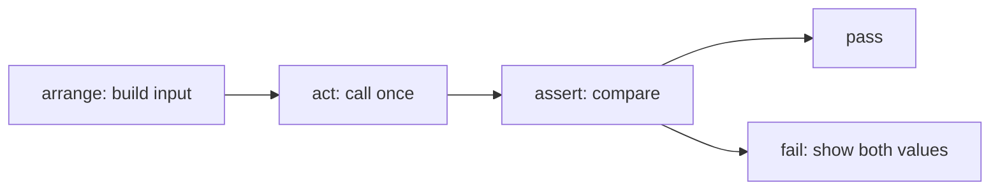

# What a test checks

## The idea

A **test** is a small program that runs a piece of your code on an input you chose and checks the result against what should happen. The code being tested is the **system under test**, often shortened to SUT: a function, a class, or a whole service. The check is an **assertion**, a statement that must be true, such as "the result equals `[[1, 2], [3]]`". A test **passes** when every assertion holds and **fails** when one does not. Where the expected answer comes from matters: something that can tell a right answer from a wrong one is called an **oracle**, and for an ordinary test the oracle is you, writing the expected value down before you look at what the code returns.

Most tests have the same three steps, often called **arrange, act, assert**:

1. **Arrange**: build the input and anything the code needs around it.
2. **Act**: call the code, once.
3. **Assert**: compare what came back, or what changed, with what you expected.



<!-- text-of-mermaid sha256:9d66bf01764d818e00f9d70b0a9ce792a61ec0337ee1044a567bd636a32a88d8 -->
```text
┌────────────────────┐    ┌──────────────┐    ┌───────────────┐    ┌──────────────────────┐
│arrange: build input├───►│act: call once├───►│assert: compare├───►│         pass         │
└────────────────────┘    └──────────────┘    └───────┬───────┘    └──────────────────────┘
                                                      │
                                                      │            ┌──────────────────────┐
                                                      └───────────►│fail: show both values│
                                                                   └──────────────────────┘
```

The drawing reads left to right: one input, one action, one comparison, and one of two outcomes. A failure that shows the expected and the actual value side by side is half of the debugging done.

A collection of tests is a **test suite**, and a **test runner** is the program that finds the tests, runs them and reports the outcome. A test that keeps an old bug from coming back is a **regression test**: once a bug is fixed, its test stays in the suite, and if anyone reintroduces the bug, that test fails.

One limit applies to every test. Edsger Dijkstra put it in his 1972 Turing lecture: "program testing can be a very effective way to show the presence of bugs, but is hopelessly inadequate for showing their absence." A passing suite says that the cases you wrote behave as you expected. It says nothing about the cases you did not write, which is why the choice of cases matters so much.

## A worked example

### Three steps, four tests

`chunk(items, size)` splits a list into lists of `size` items, the last one shorter if the items do not divide evenly. The program below writes four tests with Python's `unittest` module and runs them against two versions of `chunk`: one with a bug, one fixed. Each test is a method whose name starts with `test`, and each follows the three steps; the first marks them with comments.

```python examples/arrange_act_assert.py
"""Four tests in the arrange-act-assert shape, run against a buggy and a fixed function.

`chunk(items, size)` splits a list into lists of `size` items, the last one possibly shorter.
The same tests run against both versions. Only the buggy one fails, and each failure says what
was expected and what came back.
"""

import io
import unittest


def chunk_buggy(items: list, size: int) -> list[list]:
    return [items[i:i + size] for i in range(0, len(items) - size + 1, size)]


def chunk_fixed(items: list, size: int) -> list[list]:
    if size < 1:
        raise ValueError("size must be at least 1")
    return [items[i:i + size] for i in range(0, len(items), size)]


chunk = chunk_fixed  # the tests call whatever function this name points to


class ChunkTests(unittest.TestCase):
    def test_even_split(self):
        items = [1, 2, 3, 4]  # arrange
        result = chunk(items, 2)  # act
        self.assertEqual(result, [[1, 2], [3, 4]])  # assert

    def test_last_chunk_is_shorter(self):
        items = [1, 2, 3, 4, 5]
        result = chunk(items, 2)
        self.assertEqual(result, [[1, 2], [3, 4], [5]])

    def test_empty_list(self):
        result = chunk([], 3)
        self.assertEqual(result, [])

    def test_size_zero_is_refused(self):
        with self.assertRaisesRegex(ValueError, "at least 1"):
            chunk([1, 2], 0)


def run_tests_against(version) -> None:
    global chunk
    chunk = version
    suite = unittest.defaultTestLoader.loadTestsFromTestCase(ChunkTests)
    result = unittest.TextTestRunner(stream=io.StringIO()).run(suite)
    print(f"{version.__name__}: {result.testsRun} run, {len(result.failures)} failed, "
          f"{len(result.errors)} errors")
    for test, traceback in result.failures:
        message = next(line for line in traceback.splitlines() if line.startswith("Assertion"))
        print(f"  {test.id().split('.')[-1]}: {message}")


run_tests_against(chunk_buggy)
run_tests_against(chunk_fixed)
```

It prints:

```output examples/arrange_act_assert.py
chunk_buggy: 4 run, 2 failed, 0 errors
  test_last_chunk_is_shorter: AssertionError: Lists differ: [[1, 2], [3, 4]] != [[1, 2], [3, 4], [5]]
  test_size_zero_is_refused: AssertionError: "at least 1" does not match "range() arg 3 must not be zero"
chunk_fixed: 4 run, 0 failed, 0 errors
```

Read the two failures. The buggy version stops its range at `len(items) - size + 1`, so a last, shorter chunk is never started: the message shows the list it returned and the list the test expected. The second failure is subtler. Asked for chunks of size 0, the buggy version does raise a `ValueError`, but by accident, from inside `range`, with a message nobody chose. A test that only checked the type of the exception would have passed. Checking the message as well shows that the refusal was not designed.

Two passing tests matter too. `test_even_split` and `test_empty_list` pass on both versions: they are not wrong, they just do not exercise the bug. A suite of only those two would call the buggy version correct.

`unittest` counts **failures**, where an assertion was false, apart from **errors**, where the test raised an exception nobody expected. A failure usually means the code gave a wrong answer; an error often means the test could not even run its check.

### From a bug report to a test

A user reports: a 90-minute meeting shows as "1 h 30 min", but a meeting of exactly one hour shows as "60 min". The first step is to reproduce the report as a test, before touching the code. The second is to probe the neighbourhood, because a bug at one boundary often has company. The program writes down the expected answers first, for the values on each side of every boundary in the rule, then compares both versions with them:

```python examples/from_bug_report.py
"""From a bug report to a regression test: reproduce, probe the boundaries, fix.

The report: "a 90-minute meeting shows as 1 h 30 min, but a meeting of exactly one hour shows as
60 min". The cases below are the values on each side of every boundary in the rule, with the
answer a person expects for each, written down before looking at what the code returns.
"""


def format_minutes_buggy(minutes: int) -> str:
    if minutes > 60:
        hours, rest = divmod(minutes, 60)
        return f"{hours} h" if rest == 0 else f"{hours} h {rest} min"
    return f"{minutes} min"


def format_minutes_fixed(minutes: int) -> str:
    if minutes >= 60:
        hours, rest = divmod(minutes, 60)
        return f"{hours} h" if rest == 0 else f"{hours} h {rest} min"
    return f"{minutes} min"


EXPECTED = {
    0: "0 min",
    1: "1 min",
    59: "59 min",
    60: "1 h",  # the case from the report
    61: "1 h 1 min",
    90: "1 h 30 min",  # the case the report says works
    119: "1 h 59 min",
    120: "2 h",
    121: "2 h 1 min",
}

print(f"{'minutes':>7}  {'expected':<11} {'buggy':<16} fixed")
for minutes, expected in EXPECTED.items():
    buggy = format_minutes_buggy(minutes)
    fixed = format_minutes_fixed(minutes)
    mark = "  FAIL" if buggy != expected else ""
    print(f"{minutes:>7}  {expected:<11} {buggy + mark:<16} {fixed}")
    assert fixed == expected, minutes
print("the fixed version passes every case")
```

It prints:

```output examples/from_bug_report.py
minutes  expected    buggy            fixed
      0  0 min       0 min            0 min
      1  1 min       1 min            1 min
     59  59 min      59 min           59 min
     60  1 h         60 min  FAIL     1 h
     61  1 h 1 min   1 h 1 min        1 h 1 min
     90  1 h 30 min  1 h 30 min       1 h 30 min
    119  1 h 59 min  1 h 59 min       1 h 59 min
    120  2 h         2 h              2 h
    121  2 h 1 min   2 h 1 min        2 h 1 min
the fixed version passes every case
```

Only 60 fails, and it fails on the buggy version, which proves that the test can see the bug: a regression test you have never seen fail may not test anything. The fix changes `>` to `>=`, and the whole table passes. The cases stay in the suite, so the bug cannot quietly return.

## Choosing the cases

No suite can try every input, so each test should earn its place. Three ideas cover most of the choice:

- **Groups of inputs.** Split the inputs into groups that the rule treats the same way: for `format_minutes`, "under an hour", "whole hours" and "hours and minutes". One representative per group is usually enough, because the code takes the same path for all of them.
- **Boundaries.** Bugs gather where one group meets the next: the last value of one group and the first of the next, such as 59 and 60, or 119, 120 and 121. Comparisons written with `>` instead of `>=` live exactly there.
- **Special values.** The empty list, one element, zero, a negative number, duplicates, the largest allowed value, text with accents, and the inputs the rule says to refuse.

| For an input that is | Try |
|----------------------|-----|
| A collection | Empty, one element, two, many; with duplicates; already sorted and reversed |
| A number | Zero, one, a negative, each side of every threshold, the largest and smallest allowed |
| Text | Empty, one character, spaces at the ends, characters outside ASCII |
| Something the rule refuses | One case per kind of refusal, checking the error and its message |

A useful habit, taken from the advice to write the assertion first: before writing a test, ask "Suppose it worked; how would I be able to tell?" The answer is the assertion, and the arrange step follows from it.

## When to use it

- **Example tests** like these, for the behaviour you can state as specific inputs and outputs, for every bug you fix, and as documentation: a reader learns what `chunk([], 3)` returns faster from a test than from prose.
- **A failing test first** whenever you start from a bug report: reproduce, then fix, then keep the test.
- **Property-based tests** when the input space is large and you can state a rule that every input must satisfy; the guide on [property-based testing](../property-based-testing/guide.md) shows how.
- **Test doubles** when the code depends on something slow, random or outside your control, such as a clock, a network service or a payment provider; see [test doubles](../stubs-spies-mocks-and-fakes/guide.md).

## Common traps

- **Copying the expected value from the code's own output.** Run the code, paste what it printed into the assertion, and the test now agrees with the bug. Work the expected value out by hand, or from the specification.
- **A test that has never failed.** If you never saw it fail, you do not know that it can. Break the code on purpose once, or write the test before the fix.
- **Asserting too little.** `assertTrue(result)` passes for any non-empty result, and a test with no assertion passes whenever the code does not crash. Assert the exact value, or the exact error and its message.
- **Several behaviours in one test.** When a test with ten assertions fails, the report may not make clear which one did. The xUnit patterns vocabulary calls this *assertion roulette*. One behaviour per test, named for that behaviour, makes the failure explain itself.
- **Logic in the test.** Loops and `if` statements in a test mean that some of its checks may not run at all. A test should be simple enough to need no test of its own; when many cases share one shape, use a table of cases, or `subTest`, which reports each case on its own.
- **Testing how instead of what.** A test that checks which private helper was called breaks when the code is refactored, even if every answer stays right. Check the result the caller sees.
- **Comparing floating-point results with `==`.** `0.1 + 0.2 == 0.3` is false in Python. Compare with a tolerance, such as `math.isclose`, and remember that its default tolerance is relative, so comparing with `0.0` needs an `abs_tol`.
- **Tests that depend on each other.** A test that relies on another one having run first passes or fails depending on the order and on which tests are selected. Each test arranges everything it needs.

## Complexity

A test costs what the code it calls costs, plus the arrange step. A suite of `n` tests that each run in time `t` takes about `n · t`, so tests that run in milliseconds can number in the thousands and still finish while you wait.

Trying every input is out of reach for almost any real function. A function of two 32-bit integers has 2^64, about 1.8 · 10^19, possible inputs; at a billion checks a second, trying them all would take about 585 years. Inputs of a bounded size are different: all lists of up to 4 elements drawn from 3 values number 1 + 3 + 9 + 27 + 81 = 121, which a test can try in an instant. Small inputs tried exhaustively, plus chosen boundaries, catch a large share of mistakes cheaply.

## Expert notes

- **The four phases.** The xUnit patterns vocabulary describes a test as four phases in sequence: fixture setup, exercise the system under test, result verification and fixture teardown. The **fixture** is everything the test sets up beforehand. Arrange, act and assert are the first three; the fourth, teardown, puts the world back the way it was, which matters as soon as a test touches files, databases or shared state.
- **`unittest`'s building blocks.** Python's `unittest` names four concepts: a test fixture (the preparation for tests and the cleanup after), a test case (the individual unit of testing, a check of a specific response to a particular set of inputs), a test suite (a collection of cases or suites) and a test runner (what runs them and reports the outcome). It runs the tests of a class in the order of their method names sorted as strings, not the order they were written.
- **Better failure messages for free.** `assertEqual` on two lists, tuples, dicts, sets or strings of the same type calls a type-specific comparison that explains the difference, which is where "Lists differ" comes from. It has done so since Python 3.1.
- **Subtests.** Since Python 3.4, `with self.subTest(i=i):` inside a loop reports each failing iteration separately, with its parameters, instead of stopping at the first.
- **Simple tests on purpose.** The patterns vocabulary calls `if` statements and loops in a test *conditional test logic*, and argues that test methods must be simple enough to not need tests, since otherwise there is no end to testing the tests.
- **The oracle problem.** Every assertion needs an expected answer, and for some code there is no easy way to get one: a numerical simulation, a compiler optimization, a ranking. Then tests check relations instead of exact values, compare with a slower but obviously correct version, or check properties that every answer must have; the later guides of this path cover those techniques.

## Practice

- `cstudy start debug-binary-search-bounds`: a search that passes most of its tests and fails some. Turn the bug report into the smallest input that fails, then fix the code without giving up its logarithmic running time.
- `cstudy start debug-sort-comparator`: a leaderboard whose order goes wrong for some players. Reproduce each complaint of the bug report as a failing case before you change any code.

## Further reading

- [Python, `unittest`](https://docs.python.org/3/library/unittest.html): test fixtures, cases, suites and runners; the order tests run in; `subTest`; failures against errors; the type-specific equality checks of `assertEqual`.
- [Python, `math.isclose`](https://docs.python.org/3/library/math.html#math.isclose): relative and absolute tolerances, and why comparing with zero needs `abs_tol`.
- [xUnit Patterns, *Four-Phase Test*](http://xunitpatterns.com/Four%20Phase%20Test.html), [*Assertion Roulette*](http://xunitpatterns.com/Assertion%20Roulette.html) and [*Conditional Test Logic*](http://xunitpatterns.com/Conditional%20Test%20Logic.html): the online draft of the patterns of the book *xUnit Test Patterns*.
- [*3A: Arrange, Act, Assert* (26 April 2011)](https://xp123.com/3a-arrange-act-assert/): the three steps, and writing the assertion first.
- [E. W. Dijkstra, *The Humble Programmer* (EWD 340), ACM Turing Lecture 1972](https://www.cs.utexas.edu/~EWD/transcriptions/EWD03xx/EWD340.html): testing shows the presence of bugs, not their absence.
