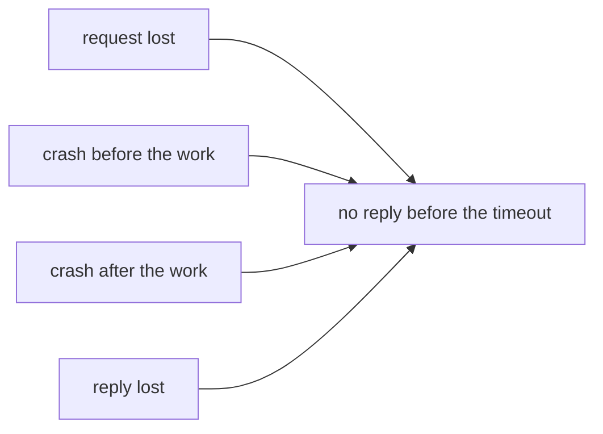
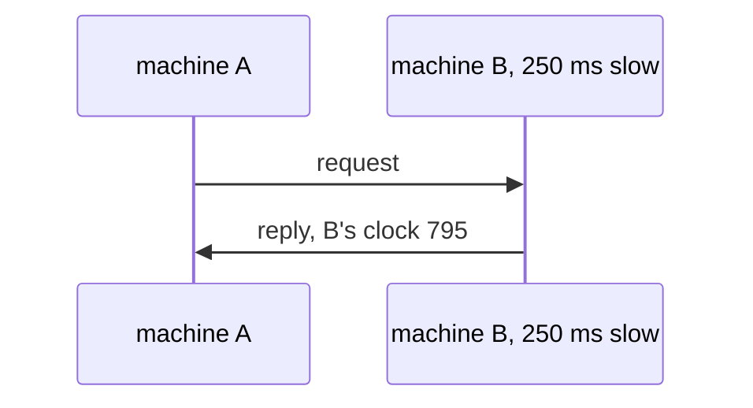

# Why distributed systems are hard

## The idea

A **distributed system**, in the words of Leslie Lamport's 1978 paper on time and clocks, is a collection of distinct processes that are spatially separated and communicate with one another by exchanging messages. A **process** here is a running program, usually on its own machine; a **message** is anything one process sends another over the network: a request, a reply, a copy of some data. A web shop with a database, three copies of that database and a payment service is a distributed system, and so are a phone and a laptop that keep the same shopping list.

On one machine, a program can take three things for granted. Distribution takes all three away.

1. **Failure is partial.** On one machine, a failure is either total, stopping everything at once, or detected by the operating system, which knows what failed. In a distributed system one machine or one network link can fail while the others keep running. Jim Waldo and his co-authors, in *A Note on Distributed Computing* (1994), put it plainly: no common agent can tell the other components what failed, and the failure of a network link is indistinguishable from the failure of the processor on the other side of it.
2. **The network is not reliable.** A message can be lost, delayed for an unknown time, delivered twice, or overtaken by a message sent after it. The Raft paper (Ongaro and Ousterhout, 2014) lists exactly these, network delays, partitions, and packet loss, duplication and reordering, as the conditions a consensus algorithm must stay correct under. A **partition** is a network failure that splits the machines into groups that cannot reach each other.
3. **There is no shared clock.** Each machine has its own clock, and clocks are not perfectly accurate, as Lamport's paper notes: they drift apart, and setting one from another over the network takes a message whose travel time is unknown. Friedemann Mattern's 1989 paper on virtual time calls this the cause of most typical problems of distributed systems: no process has a consistent view of the global state, and a common time base does not exist.

The consequence that surprises people most is what a **timeout** means. A timeout is a limit on how long to wait for a reply. When it runs out, the caller knows only that no reply came in time. The request may have been lost; the server may have crashed before doing the work, or after; the reply may have been lost; or everything may simply be slow.



<!-- text-of-mermaid sha256:d525b242816a7c41d8d5b3ec79e0cd4bf8f75ece0fa56de4bfc575efc19675b9 -->
```text
┌─────────────────────┐    ┌───────────────────────────┐
│     request lost    ├───►│no reply before the timeout│
└─────────────────────┘    └───────────────────────────┘
                                         ▲
┌─────────────────────┐                  │
│crash before the work├──────────────────┤
└─────────────────────┘                  │
                                         │
┌─────────────────────┐                  │
│ crash after the work├──────────────────┤
└─────────────────────┘                  │
                                         │
┌─────────────────────┐                  │
│      reply lost     ├──────────────────┘
└─────────────────────┘
```

The drawing shows four different situations ending in the same observation. The caller cannot tell them apart, and two of them changed the server's data while two did not. Every technique in this path exists because of that one fact, or because of the missing clock.

## A worked example

### What a timeout tells you

A client asks a server to add 10 to a balance of 100. This program plays out each of the five things that can happen to the request, once with a client that gives up at the timeout and once with a client that retries once:

```python examples/silent_failures.py
"""A client asks a server, across a network, to add 10 to a balance of 100.

Five things can happen to one request: it is delivered and answered, the request is lost, the
server crashes before or after doing the work, or the reply is lost. The client waits for a
reply; when none comes before its timeout, it may retry once. The table shows what the client
saw and what the balance became, with and without that retry.
"""

FATES = ["delivered", "request lost", "crash before work", "crash after work", "reply lost"]


def send(fate: str, retry: bool) -> tuple[str, int]:
    balance = 100

    def attempt(fate: str) -> bool:  # True when a reply reaches the client
        nonlocal balance
        if fate in ("request lost", "crash before work"):
            return False
        balance += 10  # the server did the work
        return fate == "delivered"

    if attempt(fate):
        return "ok", balance
    if not retry:
        return "timeout", balance
    attempt("delivered")  # the retry gets through
    return "timeout, then ok", balance


print(f"{'what happened':<18} {'client saw':<17} {'no retry':>8} {'one retry':>9}")
for fate in FATES:
    seen, once = send(fate, retry=False)
    _, twice = send(fate, retry=True)
    print(f"{fate:<18} {seen:<17} {once:>8} {twice:>9}")
```

It prints:

```output examples/silent_failures.py
what happened      client saw        no retry one retry
delivered          ok                     110       110
request lost       timeout                100       110
crash before work  timeout                100       110
crash after work   timeout                110       120
reply lost         timeout                110       120
```

Four rows show the client the same word, `timeout`. A client that never retries leaves the balance at 100 in two of them: the deposit is lost. A client that retries adds 10 twice in the other two: the deposit is doubled. Neither policy is right on its own, and no cleverness in the client can fix it, because the client does not have the information. The fix has to come from the server: a request it can recognize when it sees it again, which is the subject of the guide on idempotency.

### Clocks that disagree

Two machines each write a log, stamping every line with their own clock, and someone merges the two logs by time to find out what happened. Machine B's clock is 250 ms slow:

```python examples/two_clocks.py
"""Two machines log what they do, each stamping lines with its own clock, and the logs are merged.

Machine B's clock runs 250 ms behind machine A's. A request takes 40 ms to reach B, B answers
5 ms later, and the reply takes 30 ms to come back. Sorted by the clocks' readings, B receives
the request before A has sent it.
"""

CLOCK_ERROR = {"A": 0, "B": -250}  # what each clock reads minus the true time, in ms

history = [  # (true time in ms, machine, what it did), in the order it happened
    (1000, "A", "sends request #7"),
    (1040, "B", "receives request #7"),
    (1045, "B", "sends reply to #7"),
    (1075, "A", "receives reply to #7"),
]


def reading(true_time: int, machine: str) -> int:
    return true_time + CLOCK_ERROR[machine]


print("merged log, sorted by each line's clock reading:")
for true_time, machine, what in sorted(history, key=lambda line: reading(line[0], line[1])):
    print(f"  {reading(true_time, machine):>4} ms  {machine}  {what}")
print("what happened, in order:")
for true_time, machine, what in history:
    print(f"  {true_time:>4} ms  {machine}  {what}")
```

It prints:

```output examples/two_clocks.py
merged log, sorted by each line's clock reading:
   790 ms  B  receives request #7
   795 ms  B  sends reply to #7
  1000 ms  A  sends request #7
  1075 ms  A  receives reply to #7
what happened, in order:
  1000 ms  A  sends request #7
  1040 ms  B  receives request #7
  1045 ms  B  sends reply to #7
  1075 ms  A  receives reply to #7
```



<!-- text-of-mermaid sha256:f64ec8e7a8c9f5bac0c022fbebdf7d6fd379c2e4544d0a809e18a8b6abf3bb2f -->
```text
 ┌───────────┐            ┌────────────────────────┐
 │ machine A │            │ machine B, 250 ms slow │
 └─────┬─────┘            └────────────┬───────────┘
       │                               │
       │  request #7, A's clock 1000   │
       │───────────────────────────────▶
       │                               │
       │     reply, B's clock 795      │
       ◀───────────────────────────────│
       │                               │
 ┌─────┴─────┐            ┌────────────┴───────────┐
 │ machine A │            │ machine B, 250 ms slow │
 └───────────┘            └────────────────────────┘
```

The merged log says that B received the request before A sent it: an effect before its cause. The real order is certain, because a message cannot arrive before it is sent, but the clocks cannot show it. The guide on time and order replaces clock readings with **logical clocks**, counters that follow the messages and so always put a send before its receive.

## When to use it

This guide is about recognizing the situation rather than choosing a technique. You are building a distributed system whenever:

- **One request crosses the network**, to a database, another service or a cache. Each call can time out with the outcome unknown.
- **Data is copied to several machines**, to survive the loss of one or to be close to its users. The copies can disagree, which the guides on replication, consistency models and CRDTs take up.
- **Data is split across machines** because it is too big for one, which the guide on partitioning takes up.
- **Machines must agree** on a leader, an order or a decision, which the guide on Raft takes up.

What to use instead: one machine, when it is enough. A single process with a local database has none of these problems, and the cost of distribution, in code and in ways to fail, only pays off when one machine cannot hold the data, carry the load or survive the failures you must survive.

## Common traps

- **Treating a remote call like a local one.** A function call returns or raises; a remote call can also do neither, or do the work and lose the answer. Waldo and his co-authors argue that hiding this difference behind an interface that looks local is the root mistake, because the programmer then never handles partial failure.
- **Reading a timeout as "it failed".** A timeout means "no reply yet". Code that undoes or repeats work on a timeout must also be right when the work happened.
- **Retrying something that is not safe to repeat.** Adding 10 twice is wrong; setting the balance to 110 twice is fine. Retries are only safe for operations that give the same result when repeated, or when the server can recognize a repeat.
- **Ordering events by wall-clock time across machines.** Clocks drift and are set back. A timestamp from another machine says roughly when, never reliably which came first.
- **Assuming failures are rare enough to ignore.** With many machines and many messages, some message is lost and some machine is restarting most of the time. Rare per machine is frequent per system.
- **Assuming the network is either up or down.** It can also be up for some machines and down for others, which is a partition, or slow enough to look down.

## Complexity

The costs in distributed systems are counted in messages and in waiting, more than in steps of a computation:

| Action | Cost | Condition |
|--------|------|-----------|
| One request and its reply | One **round trip**: the time for a message to go and an answer to come back | Network delay is unknown and varies, so it is measured, not assumed |
| Detecting that a machine is gone | At least one timeout | A short timeout suspects machines that are only slow; a long one leaves a dead machine unnoticed for longer |
| Retrying until a reply comes | Up to `k + 1` attempts for `k` retries | Each attempt that reached the server may have done the work once |
| Asking every one of `n` machines | `n` requests, and waiting for the slowest reply you need | Waiting for all `n` is as slow as the slowest machine; waiting for any majority is as slow as the slowest machine of the fastest majority |

A timeout is a guess about the network and the server, and no value is right for every moment: it trades false alarms against slow detection.

## Expert notes

- **Consensus is impossible without some timing assumption.** Fischer, Lynch and Paterson proved in 1985 that no completely asynchronous consensus protocol can tolerate even a single unannounced process death. *Asynchronous* there means no assumptions about the relative speeds of processes or the delay of messages, and no synchronized clocks, so timeouts cannot be used: it is impossible for one process to tell whether another has died or is just running very slowly. The proof holds even though their model's network delivers every message correctly and exactly once, and the paper concludes that the problem has no robust solution without further assumptions about the computing environment. Raft, in the last guide of this path, keeps its safety free of timing and needs timeouts only to make progress.
- **Safety must not depend on timing.** The Raft paper makes this a design rule: the system must not produce incorrect results because some event happens faster or slower than expected, while availability, answering in a timely way, inevitably depends on timing. That split between "never wrong" and "usually answers" runs through every guide of this path.
- **Lost or only late is undecidable without clocks.** Gilbert and Lynch, in their 2002 proof of the CAP theorem, note that in the asynchronous model an algorithm cannot tell a lost message from one arbitrarily delayed in the network. In their partially synchronous model, where every node has a timer and a message arrives within a known time or not at all, a timeout can decide it. The guide on consistency models states the theorem.
- **External causality.** Lamport's paper shows that even a perfect ordering of the messages inside a system can disagree with what users see: one person issues a request on computer A, then phones a friend who issues a request on computer B, and B's request can be ordered first, because the phone call is outside the system. His remedies are to carry that order into the system explicitly, or to use physical clocks synchronized closely enough.
- **Retries turn into duplicates.** Waldo and his co-authors tell the story of an application that, crashing on timeouts from a queue, retried every operation until it succeeded, after which some requests were processed two, three, four or more times. The problem was the use of the queue, not the queue.

## Practice

- `cstudy start logical-clocks`: order the events of processes that talk only by messages, without trusting any machine's clock. Read the guide on time and order first; the path puts the problem after it.
- `cstudy start idempotent-document-consumer-typescript`: a queue that delivers at least once, messages that arrive twice or late, and a process that can die just before it acknowledges. Read the guide on idempotency first; the path puts the problem after it.

## Further reading

- [Lamport, *Time, Clocks, and the Ordering of Events in a Distributed System*, Communications of the ACM 21(7), 1978](https://lamport.azurewebsites.net/pubs/time-clocks.pdf): the definition of a distributed system, imperfect physical clocks, and the anomalous behavior caused by events outside the system.
- [Waldo, Wyant, Wollrath and Kendall, *A Note on Distributed Computing*, 1994](https://web.archive.org/web/2010/http://www.cc.gatech.edu/classes/AY2010/cs4210_fall/papers/smli_tr-94-29.pdf): partial failure, and why a remote call cannot be made to look local.
- [Mattern, *Virtual Time and Global States of Distributed Systems*, 1989](https://www.vs.inf.ethz.ch/publ/papers/VirtTimeGlobStates.pdf): the missing global state and common time base.
- [Fischer, Lynch and Paterson, *Impossibility of Distributed Consensus with One Faulty Process*, Journal of the ACM 32(2), 1985](https://groups.csail.mit.edu/tds/papers/Lynch/jacm85.pdf): consensus in a completely asynchronous system.
- [Ongaro and Ousterhout, *In Search of an Understandable Consensus Algorithm (Extended Version)*, 2014](https://raft.github.io/raft.pdf): section 2 on the conditions a consensus algorithm must survive, and section 5.6 on safety that does not depend on timing.
- [Gilbert and Lynch, *Brewer's Conjecture and the Feasibility of Consistent, Available, Partition-Tolerant Web Services*, SIGACT News 33(2), 2002](https://www.comp.nus.edu.sg/~gilbert/pubs/BrewersConjecture-SigAct.pdf): lost and delayed messages in the asynchronous and partially synchronous models.
