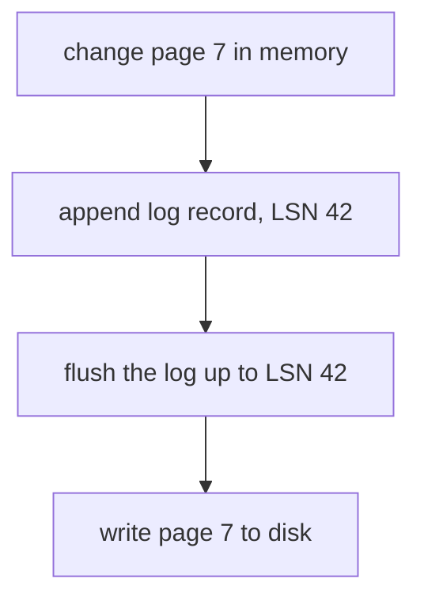
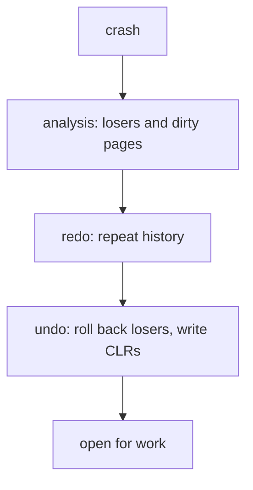

# Write-ahead logging and crash recovery

## The idea

A database changes pages in its buffer pool, in memory, and writes them back to disk later. If the power fails in between, memory is gone. Two promises must still hold. Theo Härder and Andreas Reuter's 1983 paper on database recovery lists them among the four properties of a transaction, which it abbreviates **ACID**:

- **Atomicity**: a transaction is all or nothing. A transfer that took money from one account and crashed before adding it to the other must leave no trace.
- **Durability**: once the database has said a transaction committed, its results survive any later failure.

(The other two letters, consistency and isolation, are the subject of the next guide.)

Both promises depend on when changed pages reach the disk, and Härder and Reuter name the two decisions a buffer pool makes:

| Policy | Means | What recovery must then do |
|--------|-------|----------------------------|
| **Steal** | a changed page may be written to disk at any time, even before its transaction commits | **undo**: remove changes of transactions that never committed |
| No-steal | changed pages stay in memory at least until their transaction ends | no undo from disk |
| **Force** | every page a transaction changed is written to disk when it commits | no redo for committed transactions |
| No-force | nothing is written to disk at commit | **redo**: reapply committed changes that never reached the disk |

No-steal and force sound safe, and both are expensive. Force writes every changed page at every commit, at random places on the disk. The ARIES paper explains why no-steal is a problem even with plenty of memory: with record-level locking, a page can always contain some uncommitted change, so it could never be written, and a long-running transaction makes this worse. So the ARIES recovery method is built to allow **steal and no-force**, and pays for them with a **log** that allows both undo and redo.

The log is a file that only grows at the end. Before a change is made, a **log record** describing it is appended: which transaction, which page, the value before (for undo) and the value after (for redo). Each record gets a **log sequence number** (LSN), a number that grows with every record; in PostgreSQL it is the byte offset of the record in the log. Two rules make the log sufficient:

1. **The write-ahead rule.** A changed page may replace its old version on disk only after the log records describing the change are on stable storage. The ARIES paper states it as: the system may not write an updated page to disk until at least the undo portions of the log records that describe its updates have been written to stable storage. To check this cheaply, ARIES stores in every page the LSN of the log record of the page's most recent change; PostgreSQL's page header has such a field, `pd_lsn`, which holds the log position just past that record. Before writing a dirty page, the buffer pool may have to flush the log up to the page's LSN.
2. **Commit means the log is on disk.** A transaction commits when its commit record is on stable storage. Its changed pages can stay in memory; if the system crashes, the log can redo them.



<!-- text-of-mermaid sha256:19f7739cb4e1cc5dd36135259077f30bc2d76677dc7cd15356bdb1ba9e511410 -->
```text
┌──────────────────────────┐
│ change page 7 in memory  │
└─────────────┬────────────┘
              ▼
┌──────────────────────────┐
│append log record, LSN 42 │
└─────────────┬────────────┘
              ▼
┌──────────────────────────┐
│flush the log up to LSN 42│
└─────────────┬────────────┘
              ▼
┌──────────────────────────┐
│   write page 7 to disk   │
└──────────────────────────┘
```

The order in the drawing is the whole rule: the log record for a change reaches the disk before the changed page does, never after.

Why is this cheaper than writing pages? PostgreSQL's documentation gives the reasons: at commit only the log needs to be flushed, not every data file the transaction touched; the log is written sequentially, so syncing it costs far less than flushing scattered pages; and when many small transactions commit at once, one flush of the log can commit them all.

After a crash, the database **recovers** from the log. The ARIES method, published by C. Mohan and colleagues in 1992, does it in three passes:

1. **Analysis** reads the log from the last checkpoint to the end. It works out which transactions were still running at the crash (the **losers**) and which pages may have been dirty, and so where redo must start.
2. **Redo** repeats history. It reapplies every logged change whose effect may be missing from the disk, those of the losers included, so that the database is exactly as it was at the moment of the crash. A change is redone only when the page's LSN is older than the record's: a newer page already has it.
3. **Undo** rolls the losers back, newest change first, in one backward sweep of the log. Each undone change writes a **compensation log record** (CLR) that describes the undo. CLRs are redo-only: they are never undone themselves, and each points to the next record its transaction still has to undo, so a crash during recovery never undoes the same change twice and the amount of logging stays bounded.



<!-- text-of-mermaid sha256:c1b105380d1be87b7acb3763e133e1bf522f583bffdf504a72c3ed1295175f63 -->
```text
┌──────────────────────────────────┐
│              crash               │
└─────────────────┬────────────────┘
                  ▼
┌──────────────────────────────────┐
│ analysis: losers and dirty pages │
└─────────────────┬────────────────┘
                  ▼
┌──────────────────────────────────┐
│       redo: repeat history       │
└─────────────────┬────────────────┘
                  ▼
┌──────────────────────────────────┐
│undo: roll back losers, write CLRs│
└─────────────────┬────────────────┘
                  ▼
┌──────────────────────────────────┐
│          open for work           │
└──────────────────────────────────┘
```

The passes run top to bottom once per restart. Redo makes the disk match the moment of the crash, uncommitted changes and all, and only then does undo remove what never committed.

Replaying the whole log at every restart would take ever longer, so the database takes **checkpoints**. In PostgreSQL, a checkpoint flushes all dirty data pages to disk and writes a checkpoint record; recovery starts from the point that record names, and older log segments can be recycled. By default a checkpoint starts every 5 minutes, or sooner when the log is about to exceed `max_wal_size`, 1 GB by default. ARIES takes **fuzzy checkpoints** while transactions keep running: a checkpoint records the table of active transactions and the table of dirty pages in the buffer pool, each page with its **RecLSN**, the point in the log from which its disk copy may lack updates, and analysis starts from there.

## A worked example

### A crash, with and without the rule

The program below runs the same story twice. T1 changes A from 100 to 70 and C from 10 to 40, and commits. T2 changes B from 50 to 80 and then A from 70 to 60, and never commits. Meanwhile the buffer pool steals: it writes B, and later A, while T2 is still running. Then the power fails.

```python examples/crash_recovery.py
"""Write-ahead logging with steal and no-force, a crash, and recovery by redo then undo.

Pages live on disk with the LSN of the last change applied to them. Changes happen in a buffer in
memory. Every change first appends a log record (its LSN, transaction, page, value before and
value after) to the log tail in memory. A commit flushes the log up to its commit record; dirty
pages are not written at commit (no-force), and a dirty page may be written before its
transaction commits (steal). The write-ahead rule: before a page goes to disk, the log is flushed
up to that page's LSN. A crash loses the buffer and the unflushed log tail.
"""


class Engine:
    def __init__(self, *, wal_rule: bool) -> None:
        self.wal_rule = wal_rule
        self.disk = {"A": (100, 0), "B": (50, 0), "C": (10, 0)}  # page -> (value, LSN)
        self.buffer: dict[str, list] = {}  # page -> [value, LSN]
        self.log: list[tuple] = []  # flushed to stable storage
        self.tail: list[tuple] = []  # still in memory
        self.next_lsn = 1

    def _append(self, *record) -> int:
        lsn = self.next_lsn
        self.next_lsn += 1
        self.tail.append((lsn, *record))
        return lsn

    def flush_log(self, upto: int) -> None:
        while self.tail and self.tail[0][0] <= upto:
            self.log.append(self.tail.pop(0))

    def update(self, txn: str, page: str, value: int) -> None:
        if page not in self.buffer:
            self.buffer[page] = list(self.disk[page])
        before = self.buffer[page][0]
        lsn = self._append(txn, "update", page, before, value)
        self.buffer[page] = [value, lsn]

    def commit(self, txn: str) -> None:
        self.flush_log(self._append(txn, "commit", None, None, None))

    def write_page(self, page: str) -> None:
        value, lsn = self.buffer[page]
        if self.wal_rule:
            self.flush_log(lsn)
        self.disk[page] = (value, lsn)

    def crash(self) -> None:
        self.buffer, self.tail = {}, []

    def recover(self) -> None:
        committed = {r[1] for r in self.log if r[2] == "commit"}
        for lsn, txn, kind, page, _before, after in self.log:  # redo: repeat history
            if kind == "update" and self.disk[page][1] < lsn:
                self.disk[page] = (after, lsn)
                print(f"  redo LSN {lsn}: {page} = {after} ({txn})")
        for lsn, txn, kind, page, before, _after in reversed(self.log):  # undo the losers
            if kind == "update" and txn not in committed:
                clr = self.next_lsn
                self.next_lsn += 1
                self.log.append((clr, txn, "compensation", page, None, before))
                self.disk[page] = (before, clr)
                print(f"  undo LSN {lsn}: {page} = {before} ({txn}), compensation LSN {clr}")

    def state(self) -> str:
        return ", ".join(f"{p}={v}" for p, (v, _) in self.disk.items())


for wal_rule in (True, False):
    print("with the write-ahead rule" if wal_rule else "without the write-ahead rule")
    db = Engine(wal_rule=wal_rule)
    db.update("T1", "A", 70)
    db.update("T2", "B", 80)
    db.update("T1", "C", 40)
    db.commit("T1")
    db.write_page("B")  # steal: T2 has not committed
    db.update("T2", "A", 60)
    db.write_page("A")  # steal again, before the log holds T2's change to A
    db.crash()
    print(f"  on disk after the crash: {db.state()}; log holds LSNs {[r[0] for r in db.log]}")
    db.recover()
    print(f"  after recovery: {db.state()}  (T1 committed A=70 and C=40; T2 never committed)")
```

It prints:

```output examples/crash_recovery.py
with the write-ahead rule
  on disk after the crash: A=60, B=80, C=10; log holds LSNs [1, 2, 3, 4, 5]
  redo LSN 3: C = 40 (T1)
  undo LSN 5: A = 70 (T2), compensation LSN 6
  undo LSN 2: B = 50 (T2), compensation LSN 7
  after recovery: A=70, B=50, C=40  (T1 committed A=70 and C=40; T2 never committed)
without the write-ahead rule
  on disk after the crash: A=60, B=80, C=10; log holds LSNs [1, 2, 3, 4]
  redo LSN 3: C = 40 (T1)
  undo LSN 2: B = 50 (T2), compensation LSN 6
  after recovery: A=60, B=50, C=40  (T1 committed A=70 and C=40; T2 never committed)
```

**With the rule**, writing A forced the log out up to LSN 5, T2's change to A, so the log on disk holds all five records. The disk holds B = 80 and A = 60, both uncommitted, and C = 10, because T1's change to C never left memory (no-force). Recovery:

- **Redo** compares page LSNs with record LSNs. A carries LSN 5 and B carries LSN 2, so their records are already applied and are skipped. C carries LSN 0, older than record 3, so T1's committed change to C is redone: C = 40.
- **Undo** finds T2 without a commit record and walks its changes backwards: LSN 5 puts A back to 70, LSN 2 puts B back to 50, each writing a compensation record.

The result is T1's work and none of T2's: A = 70, B = 50, C = 40.

**Without the rule**, page A reached the disk carrying T2's value, 60, before the record of that change reached the log. After the crash nothing in the log knows that A was changed by T2, so undo cannot restore it, and redo skips T1's record for A because the page's LSN, 5, looks newer than record 1. A uncommitted value survives: A = 60, a state no correct execution produces.

### A torn page

A page is larger than what a disk writes in one step. PostgreSQL's documentation explains: disks write whole sectors, commonly 512 bytes, PostgreSQL typically writes 8,192 bytes, 16 sectors, at a time, and a power failure can stop the write after some of them. This program tears a 16-byte page made of four sectors, LSN first:

```python examples/torn_page.py
"""A torn page: power fails during a page write, and a full page image in the log repairs it.

A page here is 16 bytes, written as four 4-byte sectors, one sector at a time: the page's LSN,
eight bytes of data, and a checksum of the first twelve bytes. Redo applies a log record only
when the page's LSN is older than the record's, so a page whose first sector already carries the
new LSN is skipped, although the rest of it never reached the disk. A copy of the whole page,
logged with the first change after a checkpoint, replaces the torn page.
"""

import zlib

SECTOR = 4


def make_page(lsn: int, data: bytes) -> bytes:
    head = lsn.to_bytes(4, "big") + data
    return head + zlib.crc32(head).to_bytes(4, "big")


def describe(page: bytes) -> str:
    ok = zlib.crc32(page[:12]).to_bytes(4, "big") == page[12:]
    return f"LSN {int.from_bytes(page[:4], 'big')}, data {page[4:12].decode()}, checksum ok: {ok}"


def redo(page: bytes, lsn: int, offset: int, data: bytes) -> bytes:
    if int.from_bytes(page[:4], "big") >= lsn:
        return page  # the page looks as new as the record: skip it
    body = bytearray(page[4:12])
    body[offset : offset + len(data)] = data
    return make_page(lsn, bytes(body))


old = make_page(7, b"qty=0010")
new = make_page(9, b"qty=0042")  # LSN 9 changed the 4 bytes at offset 4 of the data
torn = new[: 2 * SECTOR] + old[2 * SECTOR :]  # power failed after two of the four sectors
print("before the write:  ", describe(old))
print("after a whole write:", describe(new))
print("torn write:        ", describe(torn))
print("redo of LSN 9:     ", describe(redo(torn, 9, 4, b"0042")))
image = new  # the whole page, logged with LSN 9, the first change after the last checkpoint
print("logged image:      ", describe(image))
```

It prints:

```output examples/torn_page.py
before the write:   LSN 7, data qty=0010, checksum ok: True
after a whole write: LSN 9, data qty=0042, checksum ok: True
torn write:         LSN 9, data qty=0010, checksum ok: False
redo of LSN 9:      LSN 9, data qty=0010, checksum ok: False
logged image:       LSN 9, data qty=0042, checksum ok: True
```

The torn page carries the new LSN in its first sector and the old data in the third, and its checksum fails. Redo of the change is no help: the page's LSN says the change is already there, so the record is skipped. What repairs it is a copy of the whole page in the log. With `full_page_writes` on, as it is by default, PostgreSQL writes the entire content of a page to the log at its first modification after each checkpoint; since replay always starts from a checkpoint, that one image per page and checkpoint is enough to rebuild any page a crash tore.

## When to use it

- **Any data that must survive a crash.** The database already logs; what you choose is when a commit returns. PostgreSQL's **asynchronous commit** returns before the commit record is flushed: faster, at the cost that the most recent transactions may be lost in a crash, though the database stays consistent. Its documentation puts the window at up to three times `wal_writer_delay`, and warns against it when a client takes actions outside the database that assume the transaction will be remembered: a bank, it says, would not use it to record the cash an ATM has dispensed.
- **Many small transactions** benefit from sharing a log flush. Grouping changes into fewer, larger transactions does the same from the application's side.
- **Your own append-only files.** The same order works for a program that keeps state in a file: append a record describing the change, flush it, and only then change the main file or acknowledge the request.
- **SQLite's WAL mode** when readers and a writer run at once. In its default rollback mode, a writer must lock readers out while it writes the database file; in WAL mode, readers keep reading the original file while the writer appends to the log.

## Common traps

- **Acknowledging before the flush.** A commit that returns before its log record is on stable storage is a promise the database cannot keep after a power failure.
- **Turning off `fsync` instead of using asynchronous commit.** PostgreSQL's documentation distinguishes them: asynchronous commit risks losing the last few transactions, while `fsync = off` disables the synchronization that keeps the data consistent and can leave arbitrarily bad corruption after a crash of the operating system or the hardware.
- **Trusting that a write reached the disk.** The operating system keeps writes in its cache; SQLite's documentation notes that a newly created file may exist only in that cache until later. Only a flush (`fsync`) that has returned means the data is stored, and SQLite warns that on some systems even that primitive is broken.
- **Undoing with before-images when another transaction overwrote the value.** Berenson and others point out that if T2 writes x after T1 did and before T1 ends, restoring T1's before-image of x on abort wipes out T2's write. This is why even the weakest isolation levels hold write locks until the end of the transaction, as the next guide explains.
- **Redoing blindly.** Redo must be idempotent, safe to apply twice, because a crash can interrupt recovery. Comparing the page's LSN with the record's gives that for free: a page that already has the change is skipped.
- **Moving files around after a crash.** In rollback mode, SQLite recovers from a **hot journal**, the journal left by an interrupted commit, found by its name next to the database. Renaming or moving either file hides it, and the database is not rolled back.

## Complexity

| Operation | Cost |
|-----------|------|
| A change | one log record appended in memory, plus the page change in the buffer pool |
| A commit | one sequential flush of the log up to the commit record, shared by every transaction committing at the same moment |
| Writing a dirty page | first the log up to the page's LSN, then the page |
| Recovery | analysis and redo read the log from the checkpoint to the end; undo reads the losers' records backwards |
| Log space | everything since the redo point of the last checkpoint, plus anything kept for archiving or replication |

Checkpoints trade normal work against recovery time. PostgreSQL's documentation says more frequent checkpoints make recovery faster, since less must be redone, but cost more flushing of dirty pages and, with full page writes, more log volume, because the first change of every page after each checkpoint logs the whole page.

## Expert notes

- **Shadow paging.** Before write-ahead logging was general, some systems wrote an updated page to a different place on disk and kept the previous version for recovery until the next checkpoint; the ARIES paper describes this **shadow page** technique and explains why it does not fit write-ahead logging, which updates pages in place.
- **What a record holds.** Härder and Reuter classify log data on two axes: physical logging records the bit pattern of a page or record, logical logging records the operation and its arguments; and a record may hold the state before or after a change, or the transition between them. ARIES redoes by page (physical) and can undo logically, for example by deleting a key from whatever index page now holds it.
- **More than crash recovery.** The ARIES paper covers partial rollbacks to a savepoint within a transaction, record-level locking, fuzzy checkpoints, media recovery from an archive copy, and recovery that runs in parallel. The log also feeds replication: the guide on [change data capture](../change-data-capture/guide.md) reads a database's log to copy its changes elsewhere.
- **PostgreSQL's log.** The log, which PostgreSQL calls the WAL, is a series of segment files, normally 16 MB each, divided into 8 kB pages. LSNs can be compared to measure how much log separates two points, which is how replication and recovery progress is tracked.
- **SQLite's two journals.** In rollback mode, before changing the database file SQLite copies the original content of the pages it will change into a rollback journal, an undo log; the transaction commits at the instant the journal is deleted. In WAL mode, the database file keeps the original content and changes are appended to a separate log; a commit is a commit record appended to it, and a **checkpoint** later copies the changes back into the database file, automatically when the log reaches 1,000 pages by default. Each reader remembers the last commit record present when it started, its **end mark**, and reads pages as of that point, so it sees one consistent moment while the writer goes on appending.

## Practice

- `cstudy start transactional-kv-store`: a key-value store with transactions that roll back, nest, commit into their parent and take snapshots on commit; it practises keeping what is needed to undo a transaction's changes in memory.

## Further reading

- [T. Haerder and A. Reuter, *Principles of Transaction-Oriented Database Recovery*, ACM Computing Surveys 15(4), 1983, pages 287 to 317](https://doi.org/10.1145/289.291): the ACID properties, steal and force, and the kinds of log data.
- [C. Mohan, D. Haderle, B. Lindsay, H. Pirahesh and P. Schwarz, *ARIES: A Transaction Recovery Method Supporting Fine-Granularity Locking and Partial Rollbacks Using Write-Ahead Logging*, ACM Transactions on Database Systems 17(1), 1992, pages 94 to 162](https://doi.org/10.1145/128765.128770): the write-ahead rule, page LSNs, repeating history, compensation log records and the three passes.
- [PostgreSQL documentation, *Write-Ahead Logging*](https://www.postgresql.org/docs/current/wal-intro.html), [*WAL Configuration*](https://www.postgresql.org/docs/current/wal-configuration.html), [*WAL Internals*](https://www.postgresql.org/docs/current/wal-internals.html) and [*Reliability*](https://www.postgresql.org/docs/current/wal-reliability.html): the rule, checkpoints, LSNs and segments, sectors and full page writes.
- [PostgreSQL documentation, *Asynchronous Commit*](https://www.postgresql.org/docs/current/wal-async-commit.html) and [*Write Ahead Log* settings](https://www.postgresql.org/docs/current/runtime-config-wal.html): the risk window, `fsync` and `full_page_writes`.
- [SQLite, *Atomic Commit In SQLite*](https://www.sqlite.org/atomiccommit.html) and [*Write-Ahead Logging*](https://www.sqlite.org/wal.html): the rollback journal, hot journals, flushes, WAL mode and checkpoints.
- [SQLite, *Isolation In SQLite*](https://www.sqlite.org/isolation.html): readers and writers in rollback mode and in WAL mode.
- [Python, `zlib.crc32`](https://docs.python.org/3/library/zlib.html#zlib.crc32): the checksum of the torn page example.
