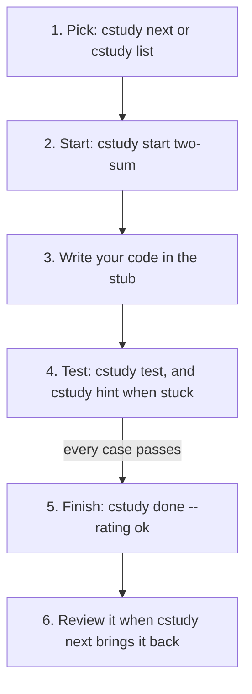

# Your first problem

## The idea

Every cstudy problem goes through the same loop. Learn it once on an easy problem, and every later problem is the same few commands.



<!-- text-of-mermaid sha256:74a2525d05d05cd9bf169d2a584ec8e6928f624b332f025c62048a94163f4e9e -->
```text
┌────────────────────────────────────────────────┐
│      1. Pick: cstudy next or cstudy list       │
└────────────────────────┬───────────────────────┘
                         ▼
┌────────────────────────────────────────────────┐
│         2. Start: cstudy start two-sum         │
└────────────────────────┬───────────────────────┘
                         ▼
┌────────────────────────────────────────────────┐
│         3. Write your code in the stub         │
└────────────────────────┬───────────────────────┘
                         ▼
┌────────────────────────────────────────────────┐
│4. Test: cstudy test, and cstudy hint when stuck│
└────────────────every─case─passes───────────────┘
                         ▼
┌────────────────────────────────────────────────┐
│       5. Finish: cstudy done --rating ok       │
└────────────────────────┬───────────────────────┘
                         ▼
┌────────────────────────────────────────────────┐
│  6. Review it when cstudy next brings it back  │
└────────────────────────────────────────────────┘
```

The diagram shows the six steps. Steps 3 and 4 repeat: you change your code and test again until every case passes.

- **Pick** a problem. `cstudy next` suggests one; `cstudy list` shows them all, with filters.
- **Start** it. `cstudy start` writes a file for your code, the **stub**, and the problem's **statement**, then opens both in your editor.
- **Write** your solution in the stub, in your own editor.
- **Test** it. `cstudy test` runs your code against the problem's cases, including hidden ones, and shows what passed and what failed. `cstudy hint` shows the next hint when you are stuck.
- **Finish** with `cstudy done`, saying how it went. cstudy uses that to schedule a **review**: a later day when `cstudy next` brings the problem back, so you practise it again before you forget it.

Every problem assumes you can write a small function in the language you practise. If that still needs looking up, read the guide for your language first. Each says what to learn, where to learn it for free, and what your first stub looks like:

- [Learn Python first](../learn-python-first/guide.md)
- [Learn TypeScript first](../learn-typescript-first/guide.md)
- [Learn Java first](../learn-java-first/guide.md)
- [Learn Kotlin first](../learn-kotlin-first/guide.md)
- [Learn Go first](../learn-go-first/guide.md)
- [Learn Rust first](../learn-rust-first/guide.md)

You also need a **workspace**, a folder of your own where your solutions, notes and progress live. Create it once, then run the rest from inside it:

```console
$ cstudy init ~/cstudy-workspace
$ cd ~/cstudy-workspace
$ cstudy doctor --fix
```

`cstudy doctor --fix` checks your toolchains and sets up the workspace's projects: `uv sync` for Python, `pnpm install` for TypeScript and a first Gradle build for Java and Kotlin. A `FAIL` for a language you do not use does not stop you; the guide for your language says which rows matter.

## A worked example

Here is the loop on `two-sum`, the problem that `cstudy next` suggests in a new workspace, in Python. The outputs are real; long ones are shortened, and your dates and times will differ.

**1. Pick.**

```console
$ cstudy next
new     two-sum  (easy · arrays-hashing)  weakest pattern: arrays-hashing (0.75)
start   cstudy start two-sum --lang python
```

`new` means you have never tried it. The second line is the command to start it.

**2. Start.**

```console
$ cstudy start two-sum
two-sum · easy · arrays-hashing · python
stub       python/practice/two_sum.py
statement  .statements/two-sum.md
next       cstudy test --watch
```

cstudy wrote the stub and the statement and opened them in the editor that your `VISUAL` or `EDITOR` variable names; `--no-open` skips that. Read the statement first: it says what the function gets, what it must return, the examples and the limits on the input. `cstudy show two-sum` prints it in the terminal too. To practise in another language, add `--lang`, such as `--lang rust`.

**3 and 4. Write and test.** Before writing anything, run the tests on the untouched stub. It shows what a test report looks like:

```console
$ cstudy test
two-sum · python · 16 cases (2 visible, 13 hidden, 1 generated)

ERROR    ex1
         input     nums=[4, 9, 2, 8]  target=11
         error     NotImplementedError
                   two_sum.py:13 in two_sum
...
0/16 passed · 16 errors · total 0.8s
```

The header counts the cases: 2 **visible** ones, which are the examples in the statement, 13 **hidden** ones, and 1 **generated** one, a large input made by a program. `ERROR` means the code raised an error: here the stub's `NotImplementedError`, at line 13 of `two_sum.py`. The command ends with exit status 1, as every run with a failing case does.

Now a wrong answer, on purpose: a function that always returns `[0, 1]`.

```console
$ cstudy test
two-sum · python · 16 cases (2 visible, 13 hidden, 1 generated)

FAIL     ex1
         input     nums=[4, 9, 2, 8]  target=11
         expected  [1, 2]  (unordered)
         actual    [0, 1]
PASS     ex2   0.00ms
FAIL     h1    hidden
         input     nums=[-3, 8, 0, 3]  target=0
         expected  [0, 3]  (unordered)
         actual    [0, 1]
         note      negatives and zero
...
PASS     4 hidden cases

5/16 passed · 11 failed · total 0.4s
```

Read each failing case from the top: the **input** it got, what was **expected**, and what your function returned, the **actual** value. `(unordered)` means the order of the two positions does not matter. A **note** says what a hidden case is testing. The second example passes by luck, since its answer happens to be `[0, 1]`: passing the visible examples is not enough.

Two options save time while you work. `cstudy test --case ex1` runs only that case, and `cstudy test --watch` runs the tests again every time you save the file, until you press Ctrl-C.

A correct but slow answer, one that tries every pair of positions, passed every case but one on the machine these outputs come from:

```console
TIMEOUT  g1    hidden
         input     nums=[-288974850, 472686664, 368723364, ...]  target=841227559
         limit     30000 ms hang guard
         note      large input: an O(n^2) scan does about 9 * 10^8 checks here

15/16 passed · 1 timeout · total 30.3s
```

`TIMEOUT` means the code was stopped after 30 seconds, and the note says why: on this large input, a scan of every pair is about 900 million checks. On a faster machine it might just finish, but it is the slow approach the note warns about, and a faster idea exists. That is what hints are for.

**Hints.**

```console
$ cstudy hint
two-sum · hint 1 of 3
```

The hint's text follows the header (it is left out here, so as not to give it away). Each `cstudy hint` shows the next one, until `no more hints`. `cstudy status` shows where the attempt stands:

```console
$ cstudy status
two-sum · python · function · attempt 1 · new
file       python/practice/two_sum.py
hints      1 of 3
tested     5/16 passed, just now
next       cstudy test --watch
```

**5. Finish.** Once a run passes every case, `cstudy test` ends with `all passed. Next: cstudy done --rating easy|ok|hard`. Rate how it went:

```console
$ cstudy done --rating ok
two-sum · python · passed · 3s · rating ok · hints 0
next review  2026-11-15 (in 3 days) · ease 2.50
```

The time is the attempt's, from `cstudy start` to `cstudy done`. If you stop without a full pass, finish with `--gave-up` instead; a rating then is refused, with `error: the latest test run did not pass every case; run cstudy test, or finish with --gave-up`:

```console
$ cstudy done --gave-up
two-sum · python · failed · 2m 16s · gave up · hints 1
next review  2026-11-13 (in 1 day) · ease 2.30
```

Giving up is a normal outcome: it schedules the problem again for the next day. **6. Review.** When the day comes, `cstudy next` suggests it again. After an attempt, `cstudy solution two-sum` shows a reference solution with its explanation, and `--all` shows every approach.

## Picking a beginner problem

`cstudy next` suggests one problem at a time. To choose yourself, list the easy ones:

```console
$ cstudy list --difficulty easy --track dsa
ID    SLUG              DIFF    PATTERN          STATUS        DUE         REFS
0001  two-sum           easy    arrays-hashing   new           -           py ts java kt go rs
0003  invert-binar...   easy    trees            new           -           py ts java kt go rs
0004  contains-dup...   easy    arrays-hashing   new           -           py ts java kt go rs
...
```

`REFS` lists the languages the problem has a reference solution in. `cstudy show <slug>` prints a statement without starting anything, and `cstudy next --difficulty easy` keeps suggestions easy.

For a first win, start with problems that a straightforward loop solves:

- `valid-palindrome` and `move-zeroes` need only loops, comparisons and the basics of strings and arrays. Even the simplest approach their solutions list takes a few passes over the input, never a loop inside a loop.
- `contains-duplicate` and `two-sum` are next. Checking every pair is correct for both, but on their largest inputs it is hundreds of millions of steps: slow on one, and stopped by the 30-second guard on the other in the worked example. [Hash maps and sets](../hash-maps-and-sets/guide.md) teaches the faster idea.

Problems about trees, linked lists and the other topics in the list come after; each topic has its own guides and problems.

## When to use it

- **Every problem** uses this loop: pick, start, write, test, finish. Project problems add `cstudy submit`, and system-design and code-review items are answered in a notes file; the `next` line of `cstudy start` says which.
- **This learning path**: `cstudy learn --path getting-started` shows its steps and which ones are done. `cstudy learn your-first-problem --done` marks this guide read; reading a guide never marks it by itself.
- **The browser**: `cstudy serve --open` runs the same loop in a page on your own computer, with an editor, test runs and hints, on the same workspace and progress.

## Common traps

- **Running cstudy outside the workspace.** Most commands need one, and outside it they stop and point at `cstudy init`. `cd` into the workspace first.
- **Renaming the function or changing its parameters.** The tests call the function by the name and signature in the stub; change them, and the tests cannot load your code.
- **Printing instead of returning.** The tests compare what the function returns.
- **Stopping at the examples.** The hidden cases test edge cases, such as negative numbers, duplicates and large inputs. Read each failing case's note.
- **Opening the solution too early.** `cstudy solution` before a full pass asks first, and if you go ahead, the attempt is graded `again`, the same as giving up.
- **Forgetting `cstudy done`.** The attempt stays open, and `cstudy next` offers to resume it before anything else. `cstudy abort` closes an attempt without a grade, keeping your files.

## Complexity

Two things in the loop are worth knowing as numbers.

**What the large hidden inputs test.** A generated case is big on purpose. On `two-sum`'s, the note puts a scan of every pair at about 9 × 10⁸ checks, and in the worked example the run was stopped at its 30-second guard. A solution that does about n steps for n numbers finishes it easily. The `cstudy solution` explanation gives each approach's time and space in Big-O notation.

**How a grade is computed.** `cstudy done` turns your attempt into a grade, and the grade decides when the review comes back:

| Attempt | Grade | First review, by default |
|---------|-------|--------------------------|
| `--gave-up`, or the solution opened before a pass | `again` | 1 day later |
| `--rating hard`, finished over a `--timer`, or measured as slower than expected by `cstudy bench` | `hard` | 2 days later |
| `--rating ok`, or `easy` after using a hint | `ok` | 3 days later |
| `--rating easy`, without hints | `easy` | 5 days later |

Later reviews move further apart while you keep passing, up to 180 days, and a problem counts as mastered once its interval reaches 21 days. The intervals are settings in your `config.toml`.

## Expert notes

- **A time box.** `cstudy start two-sum --timer 25m` makes `cstudy test` show the time used against the limit; finishing over time caps the grade at `hard`.
- **Starting again.** `cstudy start two-sum --fresh` moves your file to the workspace's `.archive/` folder and writes a new stub. Nothing is deleted.
- **Your editor runs the commands too.** Every command that takes a problem also takes the path of your solution file, such as `cstudy test python/practice/two_sum.py`, which is how the workspace's VS Code and IntelliJ files run them on the file you have open.
- **The default language** is Python. `cstudy config edit` opens your `config.toml`, where `default_lang` changes it.
- **History.** `cstudy history two-sum` lists your attempts, their grades and the review schedule.

## Practice

Try these in order. Each comes in every language cstudy supports.

- `valid-palindrome`: decide whether a line of text reads the same both ways, skipping everything but letters and digits and ignoring case. Strings and characters.
- `move-zeroes`: move every zero to the end of an array, in place, keeping the order of the other values. Changing the array you were given.
- `contains-duplicate`: the plainest "have I seen this before?". On its largest input, checking every pair is about 450 million comparisons.
- `two-sum`: the problem of the worked example. Find two positions whose values add up to a target, faster than by checking every pair.

After `contains-duplicate` and `two-sum`, the hashing path continues with the guide [hash maps and sets](../hash-maps-and-sets/guide.md).

## Further reading

- [cstudy's command reference](https://github.com/bkuberek/coding-study/blob/main/docs/specs/cli.md): every command and option used here, with its output.
- [Scheduling and grades](https://github.com/bkuberek/coding-study/blob/main/docs/specs/progress-and-scheduling.md): how a grade and the review intervals are computed.
- [Practise in your browser](https://github.com/bkuberek/coding-study/blob/main/docs/guides/web-ui.md): the same loop in `cstudy serve`.
- [Install the language toolchains](https://github.com/bkuberek/coding-study/blob/main/docs/guides/toolchains.md): what `cstudy doctor` checks, and how to fix each row.
